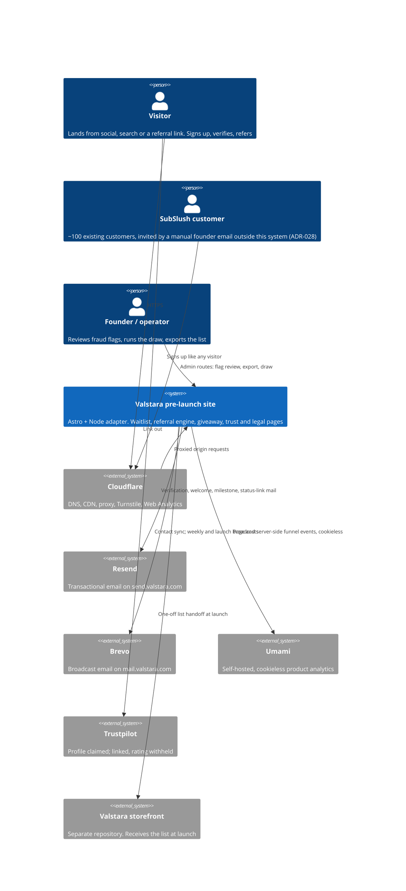
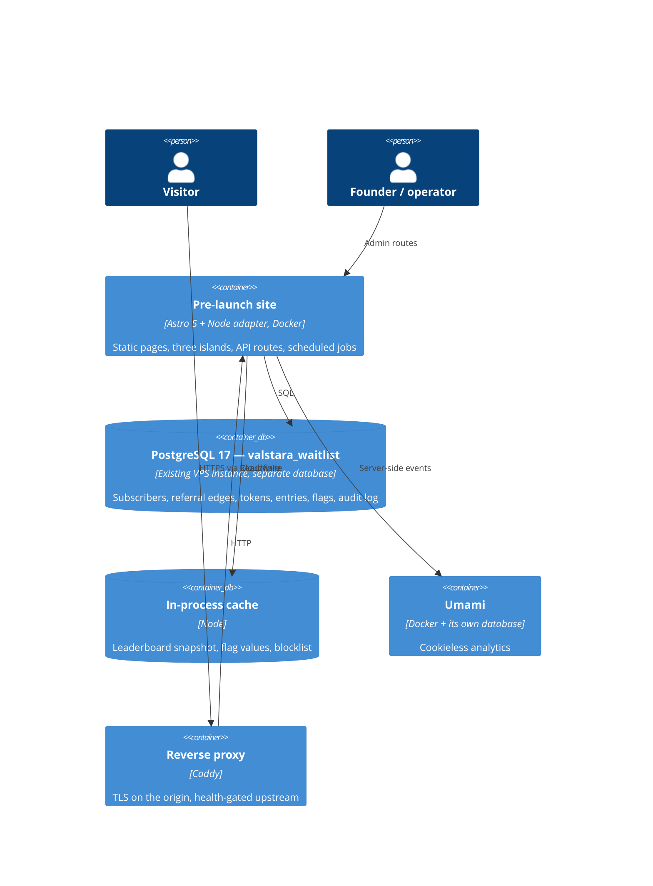
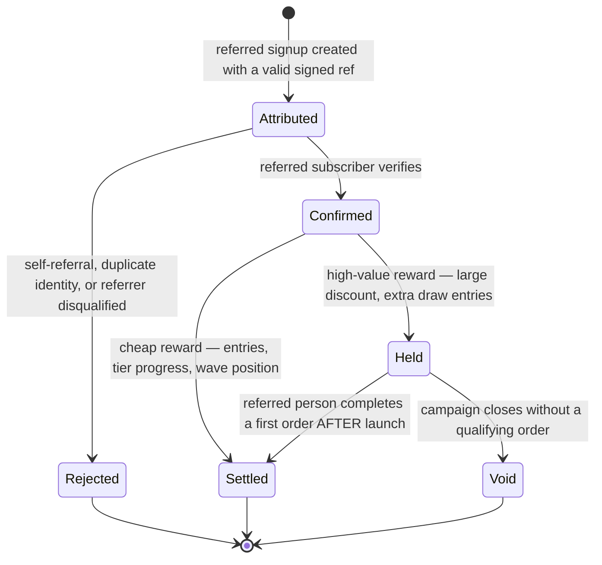
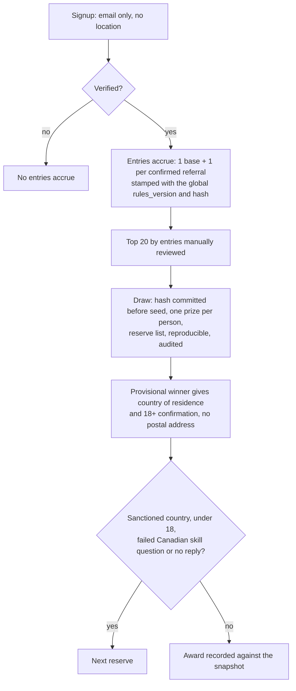
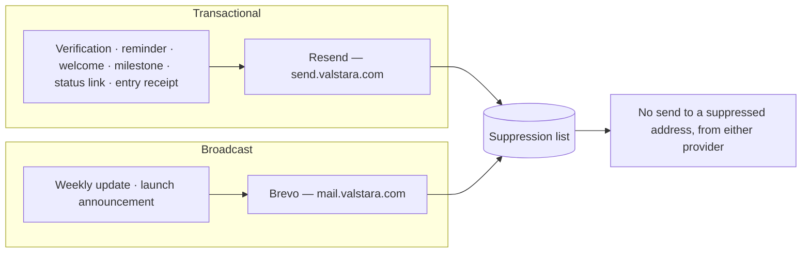
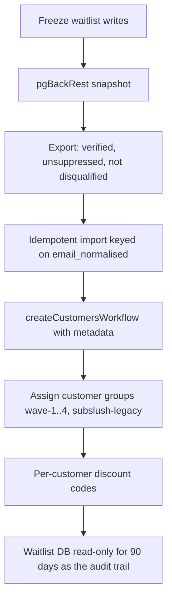

# Pre-Launch Architecture Overview

Status: authoritative. Derived from the 24 accepted ADRs in `docs/architecture/adr/`, which in turn record `prelaunch-stack-decisions.md` v2. **Any change to this document requires an ADR update in the same ticket.**

The pre-launch site is a mostly-static content site with **three interactive islands** and a small set of API routes, backed by its own PostgreSQL database. It collects waitlist signups, verifies them, attributes referrals, runs a geo-scoped giveaway, and hands a clean, deduplicated list to the storefront at launch.

Its job is to be **credible**. The audience is a suspicious buyer in a category full of scams, and every mechanic on this site is therefore constrained by what a legitimate company would do — which is why there are no countdown timers, no inflated positions and no fake scarcity, and why those are engineering rules rather than taste (ADR-024, `docs/brand/copy-rules.md`).

---

## Principles

Each is re-derived from this campaign and traces to an ADR.

1. **Static by default; interactive only where a person has to act.** Three islands exist — signup form, theme toggle, leaderboard — and adding a fourth is an ADR-level event. Everything else is server-rendered or fully static, which is what lets Cloudflare absorb a viral spike without the VPS noticing. → ADR-001

2. **A signup is not a subscriber until it is verified.** Double opt-in is unconditional. Nothing is counted, ranked, rewarded or broadcast to before verification, because the entire funnel's honesty rests on that one boundary. → ADR-011

3. **No non-essential cookie, ever — so there is no consent banner.** This is not a shortcut. Referral attribution is captured **server-side on the rendering request** and carried as a signed hidden field, analytics is cookieless, and the site runs no device-fingerprinting API. Because nothing is stored on or read from the visitor's device for a non-essential purpose, the site is outside ePrivacy Article 5(3); Cloudflare Turnstile's separate server-side processing of IP, TLS and user-agent security signals is disclosed as processor activity (`docs/legal/compliance.md`). That is the reason the measurement is trustworthy rather than a self-selected subset. → ADR-007, ADR-008

4. **Fraud is answered by economics, not detection.** Cheap rewards confirm on verification; **high-value rewards are held until the referred person completes a first order after launch.** Detection layers exist, they *flag*, and a human decides. Nothing auto-bans. → ADR-012, ADR-013

5. **The waitlist database is its own database, and it is designed against the import.** Never tables inside Medusa's. Every column that the launch-day handoff needs — referral tier, code, confirmed referrals, category preference, access window, source, SubSlush provenance, marketing-consent state — exists from the first migration, so the handoff is a script rather than a modelling exercise. → ADR-004, `docs/data/model.md`

6. **Transactional and broadcast email never share a reputation.** Verification goes out on `send.valstara.com` through Resend; campaign mail on `mail.valstara.com` through Brevo. The isolation is the point: a spam complaint on the marketing list must not stop new signups from being able to verify. → ADR-009

7. **The pages that survive are written as content, not as markup.** `/legit`, `/guarantee`, `/about`, `/terms` and `/privacy` are built here at their permanent URLs, as Markdown content files, so porting them into the storefront at launch is a copy operation rather than a rewrite. → ADR-017

8. **Tokens are the one artifact that must not drift.** Colour, type scale, spacing, radii and motion live in a single framework-free CSS custom-property file that transfers to the storefront verbatim. A literal colour value in a component is a review blocker, because token drift during the campaign means the storefront inherits a subtly different brand. → ADR-015

9. **Launch is a cutover, not a deploy.** Because the repositories are separate, opening the store swaps the host behind `valstara.com` at the DNS/proxy layer. It is a rehearsed checklist with the trust-page port completed and verified beforehand — not a release. → ADR-021

---

## System context



**The unusual edge is `store`.** There is no live integration between the two systems, ever. The relationship is exactly one export, once, at launch (`docs/ops/launch-cutover.md`). Everything else about the boundary is a copy-and-port operation performed by humans.

---

## Containers



**Everything runs on the existing €15 VPS beside the storefront's future services**, under Docker Compose with hard memory limits and no swap. Three rules follow and bind every ticket: **cap the batch size on every sweep and export**, **cache anything that a spike can read repeatedly**, and **never hold a whole result set in memory**. → ADR-003

The leaderboard is served from a cached snapshot rather than a live query (ADR-024). The landing response is also CDN-cacheable when it has no `?ref=` and all flags are at their registered defaults. Its cache identity is `X-Valstara-Flag-Generation` alone — no country, since none is collected (ADR-026); referral-bearing requests and any non-default flag state return `Cache-Control: private, no-store`. Verification and other bearer/query-dependent pages are never shared-cacheable. Cloudflare therefore absorbs anonymous read spikes while personalised state reaches the origin.

---

## Runtime flow 1 — Signup to verified subscriber

The critical path. Every number the campaign reports depends on it, and its failure mode is silent.

```mermaid
sequenceDiagram
  actor V as Visitor
  participant CF as Cloudflare
  participant A as Astro (SSR + API)
  participant DB as PostgreSQL
  participant R as Resend

  V->>CF: GET / (or /?ref=CODE)
  CF->>A: Proxied request
  A->>A: Read ?ref= SERVER-SIDE; sign it into a hidden field
  A-->>V: Page + signup island
  V->>A: POST /api/signup (email, optional marketing opt-in, signed ref, Turnstile token)
  A->>A: Verify Turnstile server-side
  A->>A: Normalise email (lowercase, strip +tag, Gmail dots)
  A->>A: Blocklist + MX check; velocity and self-referral flags
  A->>DB: Upsert subscriber (status = pending) + referral edge (state = attributed)
  A->>R: Verification mail, idempotent on a business key
  A-->>V: "Check your inbox" — never a position, never a count

  V->>A: GET /verify?token=...
  A-->>V: Render inert confirmation page
  V->>A: POST /verify (token)
  A->>DB: Consume single-use token, set status = verified
  A->>DB: Referral edge -> confirmed; cheap reward settles
  A->>DB: High-value reward -> HELD (waits on a post-launch first order)
  A-->>V: Success page + two survey questions + referral link
  A->>R: Welcome mail with referral link and signed status link
```

**Nothing counts an unverified signup.** Not the leaderboard, not a referral tier, not a giveaway entry, not a broadcast list. The only things an unverified row may receive are its verification mail and the reminder ladder, and if it never verifies it expires (`docs/architecture/fallbacks.md`). → ADR-011

**The silent failure to design against:** if verification mail stops being delivered, the site looks exactly like a page with poor conversion. That is why verification *rate* is alerted on rather than verification *count*, and why seed tests run weekly into Gmail, Outlook, GMX and Web.de. → `docs/modules/email.md`

---

## Runtime flow 2 — Referral attribution and reward state



Two properties make this defensible:

- **Attribution never depends on the browser.** The `?ref=` value is read on the server during the rendering request and returned as a signed, expiring hidden field. It cannot be forged client-side, it survives a browser that blocks storage, and it never touches ePrivacy. → ADR-008
- **`confirmed_referrals` is derived, never incremented blindly.** The referral edge table is the record; the counter is a cache of it, recomputable idempotently by a repair job. A counter that can drift from its edges is a leaderboard that cannot be defended. → `docs/modules/referral.md`

---

## Runtime flow 3 — The global giveaway

One draw under Hong Kong law, with no location read at entry (ADR-026). Entry never depends on marketing consent (ADR-027). Location is collected only from provisional winners, at award time.



The rules are in `docs/legal/compliance.md#4`; the one rules page lives at `/giveaway/rules`, with immutable revisions at `/giveaway/rules/<rules_version>`. → ADR-026

---

## Runtime flow 4 — Email, split by reputation



**The SubSlush announcement is not sent by this system.** The founder sends it manually, and `subslush.com` is kept separate from Valstara's domain, DNS and email providers. `send.valstara.com` warms on verification traffic — low volume, high engagement, near-zero complaints. → ADR-028

---

## Runtime flow 5 — Launch-day handoff

Not part of the campaign, but the campaign's schema is designed for it from the first migration.



**Groups, not metadata, are what promotions and price lists target** — the metadata carries provenance, the group carries the access it grants. The import is rehearsed twice against a scratch database before launch day (E11-06). → ADR-022, `docs/ops/launch-cutover.md`

---

## Cross-cutting concerns

| Concern | Approach | ADR |
|---|---|---|
| **Bot defence** | Cloudflare Turnstile, verified **server-side** on every public write route. Article 5(3): no device storage/access; the site runs no device-fingerprinting API; Cloudflare processes IP/TLS/UA server-side as security processor | 006 |
| **Feature flags** | A small `campaign_flag` table with **code-registered fail-safe defaults**. Exists so the leaderboard or the giveaway can be switched off during an incident without a deploy | 023 |
| **Audit** | Append-only `audit_log`, enforced by database permissions. Records disqualifications, flag decisions, exports, draw execution, admin actions and consent-relevant events | — |
| **Analytics** | Umami self-hosted plus Cloudflare Web Analytics. Cookieless by construction; **a test asserts no non-essential cookie and no browser-storage identifier is ever set** | 007 |
| **Geo** | **None.** No country is collected and `CF-IPCountry` is not read. Location is collected only from provisional giveaway winners at award time | 026 |
| **Rate limiting** | Per-IP-prefix and per-normalised-email limits on every write route, ahead of the database, with honest error copy | — |
| **Retention** | Truncated hashed IP prefixes purge at 90 days; unverified rows expire; the whole database goes read-only 90 days after handoff | 011, 022 |
| **i18n** | None. English at the **root**, not `/en/`, so adding `/de/` later is additive rather than a site-wide redirect | 014 |

---

## What is deliberately absent

**Nothing on this list is deferred.** Each is a permanent decision not to build during pre-launch:

A consent banner (ADR-007) · device fingerprinting (ADR-013) · cookies of any non-essential kind (ADR-008) · GA4 or Meta pixels · passwords or sessions — the member area is a signed expiring link (ADR-011) · an i18n framework (ADR-014) · a hosted waitlist or referral SaaS (ADR-020) · position inflation, countdown timers, fake scarcity or exit-intent popups (ADR-024) · SMS · any write into Medusa's database (ADR-004) · a public API.
