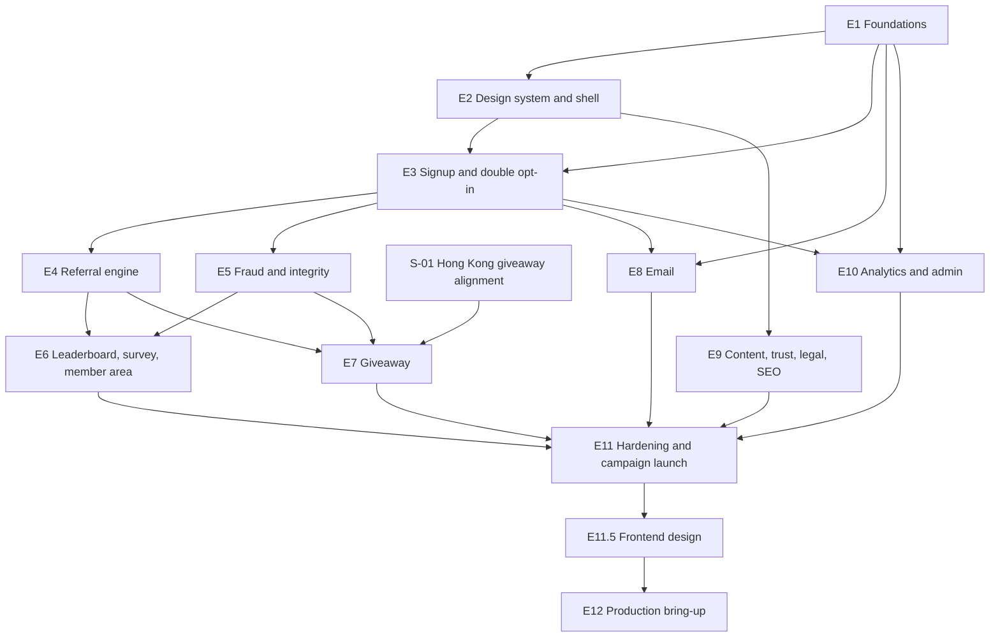

# Valstara Pre-Launch — Development Plan v1

Date: 2026-08-25 · Source: `prelaunch-stack-decisions.md` v2, the 24 accepted ADRs, 14 feature specs and 10 module docs.

**Scope is the 8–12 week pre-launch waitlist site on `valstara.com`, and nothing else.** Store scope lives in the storefront repository. Where this plan touches the store, it touches only the handoff.

---

## 0. How this plan is governed

**This file is the single source of truth for what gets built.** Not the ADRs, not the feature specs, not the stack decisions document, not any conversation — those are *inputs* the tickets reference. When they disagree, the plan is what an agent builds, and the disagreement is a defect to be fixed here.

Four rules follow, and they are binding:

1. **No ticket is added, removed, resized or reordered without founder authorisation.** An agent that believes a ticket is wrong **stops and asks** — it never edits the plan and never builds around it.
2. **An agent reads the whole plan before implementing any ticket.** It is then the check on the plan: if a ticket contradicts its epic's goal, the standing rules, what earlier tickets built, or what later tickets assume, that is a `BLOCKED:` output, not a judgement call. **A contradiction caught now costs one question; caught six tickets later it costs a rewrite.**
3. **Ticket scope is exact.** No scope creep, no unrequested refactors, no scaffolding for future tickets, no drive-by improvements.
4. **Changes are made here first, then implemented.** Never the reverse.

### Ticket anatomy
Every ticket carries: **Model** and reasoning level (§3) · **Priority** · **Flag** · **Area** · why that model where it is not obvious · **Build** · **Acceptance criteria** (the contract) · **Tests** · **Docs** it must read. Each is sized for **one focused agent run producing one PR.**

### The campaign clock
This plan is written against a **12-week campaign**, and three of its constraints are calendar constraints rather than engineering ones: the Article 27 appointments, the DNS and email authentication warm-up, and the ESP tier upgrades. They are in §2 as founder prerequisites, not as tickets, because no agent can complete them.

---

## 1. Environment and workflow

**Local → production. No staging** (`docs/engineering/ci-cd.md`). There is no live traffic before the campaign opens, so the risk staging normally guards against does not exist yet.

**One consequence applies from early on:** production carries **real sending credentials and a real domain reputation** the moment email is configured. From the first live Resend key onward, a mistake in production is a deliverability event. Sandbox keys never reach production; live keys never reach local.

**Per-ticket cycle:** implement (fresh session, the ticket's model) → **pre-PR review in a fresh session that has not seen the implementation** → fix blockers → push, PR, squash-merge to `main`. Prompts are in `docs/engineering/prompts/`.

**`main` is the only long-lived branch.** **Merged is not deployed:** before the campaign opens, deploying is a deliberate command; from campaign open, a **release tag** deploys.

**Definition of Done** is `docs/testing/strategy.md#definition-of-done`.

---

## 2. Founder prerequisites — not agent tickets

Items no agent can complete. Each gates something, and the gate is stated so it is not discovered late.

| # | Item | Nature | Gates | Start by |
|---|---|---|---|---|
| **P1** | ~~DNS records and email authentication~~ — **SATISFIED 2026-09-27.** SPF, DKIM and DMARC `p=none` are published for `send.valstara.com` and `mail.valstara.com`; Resend and Brevo report their respective domains as verified. `subslush.com` is out of scope (ADR-028). Sender-reputation warming continues | Configuration | Nothing. E8 is unblocked; warming is evidenced at E11-08/E12-07 | Done |
| **P2** | **EU and UK Article 27 representatives waived by founder decision, 2026-10-01** (ADR-029) | Founder decision | No representative gate | Done |
| **P3a** | ~~Brand token values~~ — **SATISFIED.** In the repository at `docs/brand/identity-guidelines.md` §5 (colour) and §6 (typography), LOCKED | — | Nothing. E2-01 is unblocked | Done |
| **P3b** | **Trust-page prose** — `/legit`, `/guarantee`, `/about` | Founder input from the brand and store documentation | E9-02. **A page shell with placeholder text is not a deliverable** | Before E9 |
| **P4** | **Giveaway prize and the final text of the single global rules page (Hong Kong law)** — **supplied 2026-09-25:** 5 bundles at €300 (€1,500), entries 1 Oct 2026 – 1 Mar 2027, draw 1 Apr 2027, the promoter **3NITY DIGITAL LIMITED** (Business Registration No. 79886556) with its registered address and contacts, and the layered substitution rule. The approved text is in `docs/prerequisites/p4-rules-page-draft.md`. **P4 is complete.** Bundle contents (due before the draw) and the sanctions list (due before the first award) are deliberately **not** blockers (ADR-026) | Founder input. One global page under Hong Kong law — no per-country rules or local review (founder decision, 2026-09-25, ADR-026) | Nothing now — satisfied | Done |
| **P6** | **Provision the production VPS** | Purchase and provisioning | **E12 entirely.** Nothing before E12 requires it — founder decision, 2026-08-27: the site is built and verified locally first, then the host is provisioned once | Before E12 |
| **P5** | **Upgrade Resend and Brevo past the free tiers** | Purchase — Resend free is 100/day, Brevo 300/day | **Turning `giveaway.open` on.** Upgrade *before* the giveaway opens, not when the limits hit | Before E7 exit |
| **P7** | **Create the four seed mailboxes** — one each at Gmail, Outlook.com, GMX and Web.de, IMAP access enabled, used for seed tests and nothing else. Outlook.com allows IMAP only through OAuth, not a password. Credentials go to the production secret manager; none is committed (founder-authorised 2026-09-29) | Account setup, free | **E12-07:** the first live seed run and the rendering check | Before E12 |
| **P8** | **Launch provider list and logo files** — for each provider shown on the landing page: display name, category (E11.5-02's v2 taxonomy), confirmation that its goods are on the launch catalogue, the official SVG logo (plus a dark-theme variant where the provider supplies one) from the provider's published brand resources with its source URL, and its brand colour (founder-authorised 2026-10-19) | Founder input | **E11.5-04** only. A showcase with placeholder logos is not a deliverable | Before E11.5-04 |

**A ticket blocked on one of these reports `BLOCKED:` and stops.** It does not invent a placeholder and it does not build around it.

---

## 3. Model assignment policy

**Rebound by benchmark evidence — founder-authorised 2026-09-28.** Every ticket not merged by that date (E8-02 to E12-07, 34 tickets) names a concrete Codex model and reasoning level on its **Model** line. Tickets merged before it keep the tier they were built under, as history; the tier policy is kept below because §6 and the prompt guide still use it.

### Models for E8–E12

The Codex roster on 2026-09-28 was GPT-5.6 Luna, Terra and Sol, and GPT-6 Luna, Sol and Astra. The roster was first written down with a "GPT-6 Terra", but no such model is published: the small GPT-6 model is Luna. If GPT-6 Luna is unavailable, use GPT-5.6 Luna at High for the two Luna tickets. Reasoning levels are Light, Medium, High and Extra High; in the CLI, Light is `low` and Extra High is `xhigh`.

| Model | Use for | Evidence |
|---|---|---|
| **GPT-6 Sol** | Code written into this repository: routes, modules, templates, their tests and docs | Same score as Astra on real-repository coding (DeepSWE 69 vs 68), at about 40% of Astra's cost and a quarter less time per task |
| **GPT-6 Astra** | Terminal and operations work (the stack, the host, drills, load, backups, Cloudflare) and audits of the whole system | Leads every Sol level on terminal tasks (Terminal-Bench 4.0 at Light/Medium/High/Extra High: 42/49/54/60% vs Sol 9/19/26/30%) and on factual reliability (AA-Omniscience 41–44 vs 27) |
| **GPT-6 Luna** | Small, low-stakes tickets with no terminal work, no audit and no new factual claim, where an existing gate catches the dangerous failure | 14–16 points below Sol on the Coding Agent Index (41 vs 57). It is cheaper, not faster: it writes more tokens per task |
| GPT-5.6 Sol, Terra, Luna | Not used | GPT-6 Sol matches or beats GPT-5.6 Sol and Terra at every level for less; GPT-6 Luna matches or beats GPT-5.6 Luna from Light to High |

**E11.5 (founder-authorised 2026-10-19) follows the same binding:** its eleven code tickets go to GPT-6 Sol and its design-QA and re-audit ticket, E11.5-12, to GPT-6 Astra.

**Two tickets are exceptions to "code goes to Sol":** E9-05, because its erasure design spans every table and conflicts with the append-only audit log and six-year award retention, and E11-06, because it is the campaign's unrecoverable output and includes the scratch-database rehearsals. Both go to Astra.

**Reasoning level:**
- **GPT-6 Sol — Medium** for contained, fully specified work; **High** when the ticket spans several modules or owns a privacy, security or sending-reputation property. Never Light: Light to Medium is Sol's largest step (+6 on the Intelligence Index, +10 on Terminal-Bench). Never Extra High: Astra at Light scores higher (46 vs 44; 42% vs 30%) and finishes sooner, so escalate to Astra instead.
- **GPT-6 Astra — Light** for routine operations against a clear spec; **Medium** for audits and procedures led by reasoning, where its general score levels off (50, 51, 52 at Medium, High, Extra High); **High** for terminal-heavy, high-stakes work; **Extra High** only for E11-05, whose failure is retroactive and whose work is inspection of running systems.
- **GPT-6 Luna — High**, where its agentic score levels off (AutomationBench 40, 48, 48 at Medium, High, Extra High).

**Escalation rule:** on a second failed attempt at the same ticket, move one step up this ladder: GPT-6 Luna High → GPT-6 Sol Medium → GPT-6 Sol High → GPT-6 Astra Light → Astra Medium → Astra High → Astra Extra High. Each step is stronger on both the Intelligence Index (32, 40, 43, 46, 50, 51, 52) and Terminal-Bench 4.0 (5, 19, 26, 42, 49, 54, 60%). **A third failure is a signal that the ticket is wrong, not the agent** — stop and revisit the plan entry.

**Evidence and its limits.** Artificial Analysis Coding Agent Index v1.5 on the Codex harness, Intelligence Index v4.3 per reasoning level, Terminal-Bench 4.0 and AA-Omniscience, with the arena.ai Agent and Code leaderboards as a cross-check; all retrieved 2026-09-28. The Coding Agent Index is published only at max effort, which is not selectable here, so the per-level figures come from the Intelligence Index and Terminal-Bench. Benchmarks measure general ability, not this repository: revise from real runs, starting with review blockers per ticket.

**Not changed by this binding:** pre-PR reviews, fix runs, CI triage and the QA gates (§6, `docs/engineering/prompts/00-USAGE.md`) still name tiers under the binding below. Where the review rule asks whether "the ticket was Tier B", an E8–E12 ticket counts as Tier B when it is assigned GPT-6 Astra, or GPT-6 Sol at High.

### The tier policy (tickets merged before 2026-09-28, reviews and QA gates)

| Tier | Bound to | Use for |
|---|---|---|
| **Tier A** | The founder's fast implementation model | Scaffolding, config, wiring, well-specified CRUD, content and markup, admin screens |
| **Tier B** | The founder's strongest implementation model | Money-adjacent logic, personal data, privacy properties, concurrency, security, and anything architecture-bearing that later tickets inherit |
| **Second-model QA** | A model from a **different family** | The dual QA gates only |

> **Binding.** The tier → model binding is carried over from the founder's existing setup. Before 2026-09-28 it was the only line to change if the roster changed; since then it governs only the merged tickets and the review, fix, triage and QA-gate roles.

This policy was reasoned from task characteristics, not from a benchmark: **route to Tier B where a mistake is expensive, subtle, or hard to detect after the fact.** Reasoning levels: **Medium** for well-specified work · **High** for multi-file integration or novel design · **Extra High** for the four deepest tickets. Where a ticket sat between Tier A at maximum effort and Tier B at moderate effort, Tier B at moderate was chosen. Escalation stepped Tier A Medium → Tier A High → Tier B Medium → Tier B High.

---

## 4. Standing rules for every ticket

These are not restated per ticket. **Violating one fails review.** They are the same rules as `AGENTS.md`, listed here because the plan is what an agent reads first.

1. **No non-essential cookie, no browser-storage identifier, no fingerprinting API, no third-party request from a rendered page.** Three CI gates enforce it (ADR-007, ADR-013).
2. **Nothing counts an unverified subscriber** — not the leaderboard, a tier, an entry, the broadcast list or the export (ADR-011).
3. **A high-value referral reward can never settle from a verification alone** (ADR-012).
4. **Referral attribution is server-side and signed** — no cookie, no client-side path (ADR-008).
5. **Email is normalised before any uniqueness check.**
6. **Every public, unauthenticated write route verifies Turnstile server-side first. A write authenticated by a single-use signed token consumes that token first, in place of Turnstile. Rate limiting applies to both kinds** (ADR-006; founder-authorised amendment 2026-09-28).
7. **No code path sets `disqualified` without a recorded human actor.**
8. **One email per business key; suppression re-checked at dispatch.**
9. **A full IP address is never stored, logged or returned** — truncate, then hash.
10. **No analytics event property, and no public response, carries personal data.**
11. **The audit log is append-only, enforced by database permissions.**
12. **Every sweep, export and bulk operation caps its batch size.**
13. **Every state that waits on a person has a defined expiry and a defined fallback.**
14. **Business logic in server modules, not routes. Only `server/db` issues SQL.**
15. **Every feature behind its registered flag** with a code-level fail-safe default; the flag-off path is tested (ADR-023).
16. **No literal colour, font, radius, spacing or duration in a component; no prose inline in markup** (ADR-015, ADR-017).
17. **No forbidden copy string ships** (`docs/brand/copy-rules.md`) — CI-scanned.
18. **Docs and ADRs update in the same PR.** Doc drift is a review blocker.
19. **Constraints ship with the structure they constrain.** A ticket that creates a table also creates its permissions, triggers, indexes, defaults and checks. Never in a later ticket — a structure that violates a standing rule between the ticket that creates it and the ticket that constrains it is a defect in this plan.
20. **Every ticket is self-contained.** Its acceptance criteria are reachable using only what it builds and what earlier tickets already delivered. If they are not, the plan is wrong: **stop and report**, never build ahead and never work around.

---

## 5. Epic dependency graph

**E11.5 runs after E11 and before E12 (founder-authorised 2026-10-19).** It redesigns every surface a visitor sees without changing behaviour, then re-runs E11's accessibility, claims and privacy audits on the new surfaces, so E12 deploys and measures the final build.

**Everything through E11 is built and verified locally.** The VPS is provisioned once, at the end, and **E12 collects every piece of evidence that needs real infrastructure** — the rollback RTO, a restore from R2, capacity on the actual box (founder decision, 2026-08-27).

**S-01 is a standalone ticket outside every epic (founder-authorised 2026-09-25).** It brings everything already built into line with ADR-026 and ADR-027 and **must be merged before any E7 ticket starts.**

**E1 proves the whole path end to end before any feature work.** E3 is the spine: E4, E5, E8 and E10 all depend on a verified subscriber existing. **E9 is independent of the mechanics and has the longest founder-input lead time — start its content tickets early, in parallel.** E11 is the campaign gate.

---

## 6. QA gates

A gate runs after the listed epics, in a fresh session on `main`, using the integrated-QA prompt. **No next epic opens on a NO-GO.**

| Gate | After | Runs | Models |
|---|---|---|---|
| 1 | E1 | 1 | Tier B |
| 2 | E2 + E3 | 2 | Tier B + second model |
| 3 | E4 + E5 | 2 | Tier B + second model |
| 4 | S-01 + E6 + E7 | 2 | Tier B + second model |
| 5 | E8 | 2 | Tier B + second model |
| 6 | E9 + E10 | 1 | Tier B |
| 7 | E11 + E11.5 | 2 | Tier B + second model |

**Dual-gate rules, no exceptions:** the two runs are fully independent — fresh sessions, neither model sees the other's report · the deduplicated **union** of blockers is cleared · disagreements are settled **by evidence from the code and docs, never by which model raised it.** The value is a decorrelated blind spot from a different model family, not extra capability.

**Gates 2, 3, 4 and 5 are dual because each covers something unrecoverable**: the privacy properties, the fraud invariants, the prize draw, and the sending reputation.

---

# Epics and tickets

## Epic E1 — Foundations

**Goal:** the repository, the stack, the pipeline, the database, and one thin end-to-end slice — a signup that writes a row, sends a verification mail in sandbox, and verifies — proving the architecture and toolchain before any feature work. *12 tickets.*

**Exit criteria:** a signup made against production-shaped infrastructure produces a verified subscriber, with every CI gate green, backups proven by restore, and a rollback drilled.

### E1-01 — Repository scaffold: Astro, Node adapter, strict TypeScript
**Model:** Tier B — Medium · **Priority:** Highest · **Flag:** — · **Area:** infra
**Why this tier:** the layout and the island discipline are inherited by all 87 later tickets; a wrong answer here is expensive to unwind.

**Build:** Scaffold the root of the layout in `docs/architecture/modules.md#repository-layout` — which is the **target-state** tree, the shape this repository has after all 88 tickets, not the shape it has now. **This ticket creates the top-level structure only**: Astro with the **Node adapter in standalone mode**, TypeScript strict, ESLint flat config, Prettier, and the empty directories `src/server/`, `src/copy/`, `src/content/` and `src/styles/`. Add `AGENTS.md` and `docs/` as-is. Pin the Astro major and commit the lockfile.

**Create no file that a later ticket owns.** The standing rule against scaffolding for future tickets applies here exactly as it does everywhere else — an empty `src/pages/index.astro` or `src/server/referral/` is a scope violation, not a head start.

**Verify, do not assume:** the production build runs and serves from the Node adapter, and a page with no island **ships zero client JavaScript** — measured from the build output, not asserted.

**Acceptance criteria:**
- `npm install && npm run build` succeeds from a clean clone; the built server starts and serves
- **A page with no island emits no client JavaScript bundle** — evidenced in the PR from the build output
- TypeScript strict with **no `any`**; lint and format clean
- The top-level tree (`src/`, `infra/`, `scripts/`, `.github/workflows/`, `AGENTS.md`, `docs/`) and **every directory this ticket creates** appear in the layout doc — tree diff in the PR. **Files belonging to later tickets are absent, and their absence is correct**
- **`origin/main` exists and is pushed** — the precondition every later ticket assumes. If it does not, **STOP and report**; never seed the trunk

**Tests:** None (scaffold). The zero-JS evidence is the deliverable.
**Docs:** `docs/architecture/modules.md#repository-layout` · `docs/architecture/adr/001-astro-node-adapter.md` · `docs/engineering/standards.md`

### E1-02 — Local Compose stack: PostgreSQL, the app, Umami
**Model:** Tier A — High · **Priority:** Highest · **Flag:** — · **Area:** infra

**Build:** `infra/compose/docker-compose.yml` bringing up **PostgreSQL 17 with the `valstara_waitlist` database**, the app, and Umami with its own database. **Hard `mem_limit` per service with `memswap_limit` equal to it** — the box has no swap deliberately. No host ports on data services beyond local development.

**Acceptance criteria:**
- `docker compose up -d` yields a working local stack, and **the app's configured `DATABASE_URL` authenticates against `valstara_waitlist`** — proven by an authenticated query using the app container's **actual runtime value**, asserting `current_database()`, with a **red-path test showing invalid credentials fail**. *The application connection pool is E1-03; a container liveness probe does not satisfy this criterion*
- **Memory limits present on every service with swap disabled** — asserted by inspecting the running config, not by reading the file
- Umami reachable locally with its own separate database
- `infra/ENV.md` started, listing every variable with its purpose

**Tests:** A script asserting the memory limits and the database separation, **plus an authenticated query with the app's own connection string and a red-path case proving wrong credentials fail the assertion.**
**Docs:** `docs/architecture/adr/003-self-hosted-vps.md` · `docs/architecture/adr/004-separate-waitlist-database.md`

### E1-03 — Data layer, migration runner and the initial schema
**Model:** Tier B — High · **Priority:** Highest · **Flag:** — · **Area:** backend
**Why this tier:** the schema is designed against the launch-day import, and every later epic writes to it. Getting the constraints wrong here is discovered in E11.

**Build:** `src/server/db` — the connection pool, transaction helper, and a **forward-only migration runner with a `migration_ledger` recording filename, checksum and applied timestamp.** Then the initial schema per `docs/data/model.md`: `subscriber`, `verification_token`, `referral_edge`, `milestone_award`, `survey_response`, `giveaway_entry`, `giveaway_draw`, `fraud_flag`, `email_send`, `suppression`, `campaign_flag`, `audit_log`, `rate_limit_bucket`.

**The constraints are the deliverable, not the columns.** `subscriber.email_normalised` unique · `referral_edge.referred_id` unique · `email_send.business_key` unique · `giveaway_entry (subscriber_id, method, source_edge_id)` unique · `milestone_award (subscriber_id, tier, reward_kind)` unique · `subscriber.referred_by_id` **write-once, enforced by trigger**.

**Including `audit_log`'s permissions.** This ticket creates `audit_log`, and standing rule 11 says that table is append-only **enforced by database permissions**. So this ticket grants the application role `INSERT` and `SELECT` only — no `UPDATE`, no `DELETE` — and provisions that role with a login and password **in the migration path**, not in a first-boot init hook, so an existing volume upgrades correctly. **E1-09 owns the `audit` service on top of this; it does not own the table or its permissions** (standing rule 19).

**`subscriber.referral_code` is nullable.** E4-01 generates a code only at verification, so a `pending` row has no code. Founder-authorised 2026-08-26.

**Acceptance criteria:**
- Migrations run once each and are recorded with a checksum; **a checksum mismatch on an already-applied migration aborts**
- Every constraint named above exists **in the database** — asserted by querying the catalogue, not by reading the migration
- **`referred_by_id` cannot be updated once set** — asserted by an attempted update that fails
- The schema is reproducible from the migration files alone, into an empty database
- **No query helper permits an unbounded result set** — every list method takes an explicit limit
- **`subscriber.referral_code` is nullable**, and a `pending` subscriber is inserted with a null code
- **`UPDATE` and `DELETE` against `audit_log` are rejected at the database level** for the application role — asserted by test, not by convention
- **The application role authenticates with a password provisioned by the migration path** — asserted against a database created before this ticket ran, so an existing volume is proven to upgrade

**Tests:** *(this list is the contract — implement exactly these, plus unit tests for new logic)*
1. Ledger records filename, checksum and timestamp; a second run applies nothing.
2. An edited already-applied migration aborts on checksum mismatch.
3. Each of the five named unique constraints exists **in the PostgreSQL catalogue**, and each rejects a duplicate. **The `email_normalised` case uses two different raw addresses that normalise to the same value** (`user+a@gmail.com` and `u.s.e.r@gmail.com`), so the test fails if the constraint is moved to `email`.
4. `referred_by_id` accepts its first value and rejects reassignment.
5. The schema reproduces from the migration files alone into an empty database.
6. `list()` requires a positive explicit limit; `execute()` rejects result-returning statements.
7. **A `pending` subscriber inserts with a null `referral_code`, and two null codes coexist** under the unique index.
8. **`UPDATE` and `DELETE` on `audit_log` are rejected for the application role.**
9. **The app's real credentials authenticate against a database created before this ticket's migrations ran** (upgrade path).
10. **`runMigrations()` called concurrently** — genuine parallel calls against one disposable database — applies each migration exactly once.
**Docs:** `docs/data/model.md` · `docs/modules/platform.md#db` · `docs/engineering/standards.md#data-and-queries`

### E1-04 — CI PR pipeline: lint, typecheck, test, build, coverage
**Model:** Tier A — High · **Priority:** Highest · **Flag:** — · **Area:** infra

**Build:** GitHub Actions PR workflow: frozen-lockfile install, lint, typecheck, tests against a disposable PostgreSQL service container, the Astro production build, and a **coverage gate at 80% changed code with the 90% list configured but not yet enforced** (those modules do not exist). Path-filtered so `docs/**`-only changes run nothing.

**Acceptance criteria:**
- The pipeline is green on `main`; a fixture PR dropping coverage below the bar fails
- A docs-only change runs **nothing**
- All jobs are mandatory review gates, named per `docs/engineering/git-workflow.md#review-gate-check-names`

**Tests:** A red-path fixture branch per gate proving each fails.
**Docs:** `docs/engineering/ci-cd.md#pr-pipeline` · `docs/engineering/git-workflow.md`

### E1-05 — CI security and privacy gates
**Model:** Tier B — High · **Priority:** Highest · **Flag:** — · **Area:** security
**Why this tier:** these gates are what make "no consent banner" a verified property rather than an intention. A gate that silently stops working is worse than no gate.

**Build:** The mandatory security stage, seven scans, **each with a planted red-path fixture committed in-repo**:

1. **Secret scan** — no committed credential; a `.env` path added anywhere in the PR range fails, while `.env.example` is scanned as ordinary content
2. **Dependency scan** — an allowlist entry requires a written justification **and a future expiry date**
3. **Cookie and storage rule** — `document.cookie`, `Set-Cookie`, `localStorage`, `sessionStorage` outside the single permitted theme-preference write
4. **Fingerprinting rule** — canvas, font-enumeration, WebGL and timing-entropy APIs anywhere
5. **Third-party request rule** — any off-origin request from a rendered page; Cloudflare Turnstile on protected forms is the sole allowlisted exception
6. **Vendor-boundary rule** — an email SDK imported outside its provider module. **Runtime `import()` targets must resolve statically; an unresolved target fails closed**
7. **Forbidden-copy scan** — over `src/copy/`, `src/content/` and every `.astro` file. **This ticket creates `scripts/forbidden-copy.json` and seeds it from the never-use table in `docs/brand/copy-rules.md`**, so the gate is live the moment it exists. E2-08 later moves copy into the layer the scan already covers; it does not create the list (standing rule 20)

**Acceptance criteria:**
- **Each scan fails on its planted fixture and passes on `main`**
- **An allowlist entry without an expiry date fails CI**
- The cookie, fingerprinting and third-party rules each fire on a deliberate violation
- The vendor-boundary rule fails closed on an unresolvable dynamic import
- Every fixture is committed in-repo, so a scan that stops working is caught

**Tests:** Planted-violation fixtures per gate in a dedicated job.
**Docs:** `docs/security/threat-model.md#ci-security-gates` · `docs/architecture/adr/007-cookieless-analytics.md` · `docs/architecture/adr/013-no-fingerprinting.md`

### E1-06 — Image build, GHCR push, production Compose behind Cloudflare
**Model:** Tier A — High · **Priority:** Highest · **Flag:** — · **Area:** infra

**Build:** Multi-stage Dockerfile. Main-branch workflow building and pushing to GHCR tagged with the commit SHA, retention last three, path-filtered to `src/**`, `infra/**`, `scripts/**`. Production Compose mirroring local with the same hard memory limits, plus **Caddy terminating TLS on the origin and health-gating the upstream**. Cloudflare proxied in front.

**Acceptance criteria:**
- A merge to `main` touching application code produces a SHA-tagged GHCR image; a docs-only change builds nothing
- Production Compose starts the SHA-tagged image and passes health checks
- **Caddy removes an unhealthy backend and returns it only after recovery** — demonstrated
- Production Compose runs **locally**; it is the same file E12 deploys to the VPS unchanged. **Cloudflare proxying and origin lock-down are E12-05** — there is no origin to lock down yet

**Tests:** The pipeline is the test; a docs-only commit demonstrably builds nothing.
**Docs:** `docs/engineering/ci-cd.md#main-pipeline` · `docs/architecture/adr/003-self-hosted-vps.md`

### E1-07 — Deploy with a migration audit, and a drilled rollback
**Model:** Tier B — Medium · **Priority:** Highest · **Flag:** — · **Area:** infra
**Why this tier:** a deploy that silently mis-records a migration is exactly the failure this exists to prevent, and it is discovered at the worst moment.

**Build:** `infra/deploy/deploy.sh`: pull the SHA image → run migrations → health-gated restart. **Record for every deploy: the image SHA or tag, the migrations applied, the timestamp and the outcome** — persisted, not just logged. `rollback.sh` redeploys the previous identifier, one command.

**Acceptance criteria:**
- A deploy writes a **durable record answering *which migration ran, when, on which release***
- **A checksum mismatch on an already-applied migration aborts before anything restarts**
- A failed health check aborts the rollout, leaving the previous version serving
- **Rollback logic is drilled and recorded in the PR** — against the production Compose definition running locally, proving the script pulls, migrates, health-gates and restores. **The timed five-minute RTO is E12-03**: the number is dominated by a real registry pull to a real host, so it cannot be measured here and a local figure must not be recorded as the RTO
- Failed attempts are records too, including migrations committed before a later one failed

**Tests:** A staged bad-image deploy proving the health gate and the rollback; an induced checksum mismatch.
**Docs:** `docs/engineering/ci-cd.md#deploy-and-the-migration-audit`

### E1-08 — Backups: the waitlist database into pgBackRest, and a proven restore
**Model:** Tier B — Medium · **Priority:** Highest · **Flag:** — · **Area:** infra
**Why this tier:** a backup that has never been restored is a hypothesis, and this list is the campaign's only durable asset.

**Build:** The pgBackRest configuration for `valstara_waitlist` — weekly full, daily differential, continuous WAL, **repository encryption on** — and the restore-to-scratch-container drill script. Prove the whole cycle **against the local stack**, backing up to a local repository. Document the passphrase procedure in `infra/ENV.md` without containing the production value.

**Nothing this ticket adds may make an existing command fail.** The local stack is started by earlier tickets' tests and drills; a new required variable breaks all of them.

**The R2 remote, the schedule and the off-host passphrase are E12-04.** What this ticket owns is that the configuration is correct and the restore genuinely works; where the repository lives is a deployment detail.

**Acceptance criteria:**
- A full backup, a differential and WAL archiving all succeed against the local stack
- **A restore into a scratch container succeeds and is verified against known rows — evidenced in the PR**
- Repository encryption is on, and the passphrase comes from `PGBACKREST_REPO1_CIPHER_PASS` **with a local-only default**, exactly as every other credential in the local stack. **It must not be a required variable** — making it mandatory breaks every command that starts the local stack, including earlier tickets' drills
- **The real passphrase, held off-host, is E12-04's.** "Absent from the repository" is a production property; a local-only default documented as local-only satisfies this ticket
- The drill is a script, runnable unattended, not a sequence of documented commands
- **Local restore timing recorded as a floor, explicitly not the production RTO** — E12-04 measures that

**Tests:** The restore drill is the test.
**Docs:** `docs/engineering/ci-cd.md#backups`

### E1-09 — Append-only audit log
**Model:** Tier B — High · **Priority:** Highest · **Flag:** — · **Area:** security
**Why this tier:** append-only enforced at the permission layer is a security property that later tickets assume without re-checking.

**Build:** `src/server/audit` per `docs/modules/audit.md` — `record()`, an admin-only batch-capped `query()`, and the required action registry.

**The table and its append-only permissions already exist**, created by E1-03 under standing rule 19. This ticket builds the service on top and **must not alter the schema or the grants.**

**Acceptance criteria:**
- **The append-only grants from E1-03 are still in force** — re-asserted here by test, because this is the ticket that starts writing through them
- **`record()` failure on a disqualification, export, draw or DSR fulfilment raises an error**, never a warning
- **No code path can write a token, secret, raw IP or full email into `detail`** — a redaction test runs over every call site
- `query()` honours its limit

**Tests:** Permission-level rejection · redaction over every call site · the raise-on-failure cases.
**Docs:** `docs/modules/audit.md` · `docs/data/model.md#audit_log`

### E1-10 — Campaign flags with code-level fail-safe defaults
**Model:** Tier A — High · **Priority:** Highest · **Flag:** — · **Area:** backend

**Build:** `src/server/flags` per `docs/modules/flags.md`. All seven current flags registered in code with declared defaults, **matching `docs/features/README.md#flag-registry` exactly**. The former `trustpilot.widget` flag was retired by the founder's E11-05 decision on 2026-10-10.

**Includes a forward-only migration changing `audit_log.subject_id` from `uuid` to `text`.** E1-03 typed it `uuid` because `docs/data/model.md` listed `audit_log`'s columns without types — the one table where it did. The column is **polymorphic by design**: `subject_type` discriminates, a subscriber subject is a UUID, a flag subject is a key like `leaderboard.public`, and an export has no natural subject. Auditing a flag change is impossible until this is corrected, so it is this ticket's. Founder-authorised 2026-08-27.

The change is additive-safe — `USING subject_id::text` preserves every existing value, and text accepts what a previous image would write. **Two default off: `giveaway.open` and `email.broadcast`**; the other five default on. In-process cache with a short TTL, invalidated immediately on `set()`. Every change audited with an actor.

**Acceptance criteria:**
- **An unregistered key throws** — never a silent `false`
- **Database unavailable returns the code default** — fail-safe, never fail-open
- **Every registered flag has a declared default** — asserted by a test over the registry
- **The registry matches `docs/features/README.md#flag-registry` exactly** — same seven current keys, same defaults — asserted by a test, so the table and the code cannot drift
- **`audit_log.subject_id` is `text`**, existing UUID values preserved as strings — asserted against the PostgreSQL catalogue
- **A flag change writes an audit record whose `subject_id` is the flag key** — the case that was previously impossible
- `set()` takes effect within the documented TTL, and **the worst-case propagation delay is documented**
- Every change is audited with an actor

**Tests:** Unregistered key · database-down fallback · registry completeness · propagation within the TTL.
**Docs:** `docs/modules/flags.md` · `docs/features/README.md#flag-registry` · `docs/architecture/adr/023-campaign-flags.md`

### E1-11 — Thin end-to-end slice: signup → row → verification mail → verified
**Model:** Tier B — High · **Priority:** Highest · **Flag:** — · **Area:** backend
**Why this tier:** the first pass through the whole architecture; it shapes the conventions every later epic follows.

**Build:** A deliberately minimal vertical slice: a bare form posting to `/api/signup`, **server-side Turnstile verification**, a `subscriber` row, a verification token, a mail through Resend **in test mode**, and `/verify` consuming the token to set `verified`. **No abstraction beyond what this slice needs** — the real modules are E3.

**`docs/api/README.md` describes the finished `/api/signup`. This ticket implements the subset below and nothing else** — the list is closed, and a step absent from it is correct rather than missing. Implement what is here **in the documented order**; a step may be absent, it may not be out of sequence.

| Step | E1-11 implements | Completed by |
|---|---|---|
| Verify Turnstile server-side, **fail closed** on an invalid or missing token | **Yes** — inline, no module | E3-03: module extraction, provider-timeout accept-and-flag, other routes |
| Rate-limit per hashed IP prefix | **Yes** — one window, one limit, honest `rate_limited` response | E3-02/E5-03: per-identity limits, tuning, the shared module |
| Validate the email's shape | **Yes** | E3-02: full schema validation and the closed code set |
| Lowercase into `email_normalised` | **Yes** — the column is `NOT NULL UNIQUE`, so something must be written | **E3-01: the real rule** — `+tag` stripping, Gmail dots |
| Insert the subscriber as `pending` | **Yes** | E3-02 |
| Issue a verification token, queue the mail | **Yes** — Resend in test mode | E3-06/E8-01 |
| `/verify` consumes the token, sets `verified` | **Yes** | E3-07 |
| Blocklist and MX · referral attribution · fraud signals · giveaway eligibility · country selector · survey | **No** | E5-01 · E4-02/03 · E5-02 · E7-01 · E3-04 · E6-03 |

**Turnstile and the rate limit are in the subset because they are abuse defence on a public write route**, and standing rule 19 puts a route's protections in the ticket that creates the route. **Normalisation is deliberately not** — lowercasing satisfies the column, and getting the uniqueness rule right is E3-01's whole purpose, worth doing once and properly.

A walking skeleton that skips the site's own standing rules proves nothing about the architecture.

**Acceptance criteria:**
- A signup produces exactly **one** subscriber, **one** token and **one** queued email
- **A double submission produces no second row and no second email**
- `/verify` sets `verified`; **a replayed token returns success, not an error**
- The slice runs locally against Compose. **Running it on the real host is E12-02**
- **Turnstile is verified server-side before any other work**, and an invalid or missing token is rejected — asserted by test
- **The route is rate-limited per hashed IP prefix**, returning `rate_limited` with an honest wait — **never a silent no-op that looks like success**
- **The implemented steps run in the order `docs/api/README.md` documents** — asserted by test, because a route that does work before its challenge cannot be reordered later without re-auditing what was built on it
- **No step outside the subset table is implemented** — later tickets own them
- **No cookie is set anywhere in the flow** — asserted by a rendered-page check

**Tests:** Integration test through the full path, including double submission and token replay.
**Docs:** `docs/architecture/overview.md#runtime-flow-1--signup-to-verified-subscriber` · `docs/api/README.md`

### E1-12 — Validated configuration and the environment inventory
**Model:** Tier A — Medium · **Priority:** High · **Flag:** — · **Area:** infra

**Build:** `src/server/config.ts` validating every environment variable **at boot, failing fast** on missing or malformed values. Complete `infra/ENV.md` — name, purpose, where used, whether the value is live or sandbox. **No value in the repository.**

**Acceptance criteria:**
- **A missing or malformed variable fails at boot with a named error**, never at first use
- **A missing Turnstile secret cannot start the application** — the failure this prevents is a site that silently accepts every bot
- Every variable is documented in `infra/ENV.md`; **no secret value is in the repository** — verified by the secret scan
- The passphrase and pepper procedures are documented without containing the secrets

**Tests:** Boot failure per missing required variable; a shape test over the documented inventory versus the validated schema.
**Docs:** `docs/engineering/ci-cd.md#secrets` · `docs/engineering/standards.md`

---

## Epic E2 — Design system and site shell

**Goal:** the portable token file, the type stack, the three-island discipline, the page shell, and the accessibility and copy baselines every later page inherits. *8 tickets.*

**Exit criteria:** the landing page renders in both themes at every breakpoint with a passing accessibility gate, and the token file is copyable into the storefront verbatim.

### E2-01 — The portable token file
**Model:** Tier B — Medium · **Priority:** Highest · **Flag:** — · **Area:** frontend
**Why this tier:** this is the single artifact the storefront inherits verbatim (ADR-015), and getting its structure wrong costs 15–25 hours later rather than an hour now.

**Build:** `src/styles/tokens.css` — every token as a CSS custom property, with **no framework coupling of any kind.** Structure and names per `docs/brand/tokens.md`.

**Transcribe the values from `docs/brand/identity-guidelines.md` §5 and §6 — they are in this repository and LOCKED.** Do not invent, tint, blend or "improve" a value. Light palette on bare `:root`; dark values redefining the same names in **both** a `@media (prefers-color-scheme: dark) { :root:not([data-theme]) }` block and a `:root[data-theme="dark"]` block, per `docs/brand/tokens.md`. Both are required — the media block is what renders the system theme with JavaScript disabled, the attribute block is what lets an explicit choice win. Start the port checklist.

**Use the brand document's own token names** — `--coral`, `--midnight`, `--ink-600` — not invented role names. They are LOCKED vocabulary shared with the storefront, and the file must transfer verbatim (ADR-015).

**Acceptance criteria:**
- Every token in `docs/brand/tokens.md` is present with **the exact value from `identity-guidelines.md` §5/§6** — asserted against the source, not eyeballed
- **The file has no framework coupling and no import** — it is copyable into a Next.js project unchanged
- **No token's only definition lives inside a media query or a theme block** — the light palette is the base
- **The two dark blocks declare the identical set of token names** — asserted by test, so one cannot gain a token the other lacks
- **Every text/background pairing clears WCAG AA in both themes** — asserted by an automated contrast test over the token matrix, not read off the guidelines
- **`--error` is visibly distinct from `--coral`**
- The port checklist exists and names the storefront target

**Tests:** Contrast assertion over every declared pairing; a parse test proving no framework syntax.
**Docs:** `docs/brand/tokens.md` · `docs/architecture/adr/015-portable-design-tokens.md`

### E2-02 — Self-hosted fonts with metric-matched fallbacks
**Model:** Tier A — Medium · **Priority:** High · **Flag:** — · **Area:** frontend

**Build:** Instrument Sans and JetBrains Mono self-hosted as WOFF2, subset to the Latin ranges used, preloaded for above-the-fold faces only. **Metric-matched fallbacks with `size-adjust` and `ascent-override`** so the eventual Söhne swap is one `@font-face` change plus a QA pass.

**Acceptance criteria:**
- **No request to `fonts.googleapis.com` or `fonts.gstatic.com`** — asserted by the third-party request gate
- Fallbacks are metric-matched; **measured cumulative layout shift from the font swap is zero** — evidenced
- Only above-the-fold faces are preloaded
- Mono is used for every figure that changes, **with tabular figures on**

**Tests:** Third-party request assertion; a layout-shift measurement in the rendered-page checks.
**Docs:** `docs/brand/tokens.md#type` · `docs/architecture/adr/016-self-hosted-fonts.md`

### E2-03 — Theme toggle island
**Model:** Tier A — High · **Priority:** High · **Flag:** — · **Area:** frontend
**Why this tier:** the no-flash requirement and the single permitted storage write are both easy to get subtly wrong, and the second one is a privacy-gate violation if it is.

**Build:** The theme toggle — one of the three islands. **Light-first; dark is a user toggle, never the default.** Respects `prefers-color-scheme` when no preference is set. **No flash of the wrong theme on load.** The preference is **the single permitted storage write in the codebase** and is documented in the cookie and storage inventory.

**Acceptance criteria:**
- **No flash on load in either theme** — evidenced, not asserted
- With no stored preference, `prefers-color-scheme` decides; **with one, the toggle wins in both directions**
- **The storage write is the only one in the repository** — the cookie/storage gate passes with it explicitly allowlisted and nothing else
- Keyboard-operable, correctly labelled, and announced on change
- Works with JavaScript disabled to the extent of rendering the system-preferred theme

**Tests:** No-flash check in the rendered-page suite; the three preference states; the storage-gate allowlist has exactly one entry.
**Docs:** `docs/brand/tokens.md` · `docs/architecture/adr/007-cookieless-analytics.md`

### E2-04 — Interface primitives
**Model:** Tier A — Medium · **Priority:** High · **Flag:** — · **Area:** frontend

**Build:** Button, input, select, field with error, card, pill, accordion — as **zero-JS Astro components** except where interaction genuinely requires it. Every one references tokens; **no literal values anywhere.**

**Acceptance criteria:**
- **No literal colour, font, radius, spacing or duration value in any component** — CI-scanned
- Every interactive primitive is keyboard-operable with a visible focus state that clears contrast requirements
- Error states are announced to assistive technology, not only coloured
- **The accordion works without JavaScript** (native disclosure), because the FAQ must be readable and indexable
- All primitives render correctly in both themes

**Tests:** The literal-value scan; keyboard and focus tests; a no-JS render test for the accordion.
**Docs:** `docs/brand/tokens.md` · `docs/engineering/standards.md`

### E2-05 — Layout, navigation and footer
**Model:** Tier A — Medium · **Priority:** High · **Flag:** — · **Area:** frontend

**Build:** The base layout: skip link, landmark structure, header with the theme toggle, footer carrying the legal and trust links. **Each page sets its own title and description through the layout's props** — a working mechanism used by the pages that exist now, not an empty slot for later (standing rule 20). E9-06 adds canonical, structured data and the sitemap on top.

**Acceptance criteria:**
- One `<main>`, correct landmark structure, a working skip link as the first focusable element
- The footer links to `/legit`, `/guarantee`, `/about`, `/terms`, `/privacy` — **the permanent URLs**
- Zero client JavaScript beyond the theme toggle island
- Responsive from 320px up with **no horizontal scroll at any breakpoint**

**Tests:** Landmark and skip-link assertions in the accessibility suite; a horizontal-overflow check across breakpoints.
**Docs:** `docs/architecture/modules.md` · `docs/features/seo.md`

### E2-06 — The landing page
**Model:** Tier A — High · **Priority:** Highest · **Flag:** `signup.enabled` · **Area:** frontend

**Build:** The landing page sections: hero with the signup form slot, what Valstara is, the trust signals, the FAQ accordion, and the footer. **Fully static except the form island.** All prose from the copy layer.

**Acceptance criteria:**
- **The page ships one island** — the form — plus the toggle. Measured from the build output
- **No countdown timer, no scarcity claim, no position display, no exit-intent behaviour** — asserted by the copy scan and by review
- Every string comes from the copy layer; **none is inline**
- Renders correctly at every breakpoint in both themes
- With `signup.enabled` off, **an honest paused message replaces the form** — never a form that fails on submit

**Tests:** Island-count assertion from the build output; the flag-off path; the copy scan.
**Docs:** `docs/features/signup.md` · `docs/brand/copy-rules.md`

### E2-07 — Accessibility baseline and the CI gate
**Model:** Tier B — Medium · **Priority:** High · **Flag:** — · **Area:** frontend
**Why this tier:** retrofitting accessibility is far more expensive than building it, and these components are being ported into the storefront where the standard is a legal one.

**Build:** Wire an automated axe pass over the built pages **in both themes** as a mandatory CI gate. Fix what it finds. Ensure `prefers-reduced-motion` is respected everywhere, focus is never trapped, and no information is conveyed by colour alone.

**Acceptance criteria:**
- **The axe gate runs over every built page in both themes and is mandatory**
- Zero violations at WCAG 2.2 AA on the pages that exist
- **`prefers-reduced-motion` is respected by every animation** — asserted, and not only on decorative elements
- No focus trap anywhere; tab order matches visual order
- **A planted violation fails the gate** — a fixture proves it works

**Tests:** The gate itself, plus its planted fixture.
**Docs:** `docs/testing/strategy.md` · `docs/legal/compliance.md#6-accessibility`

### E2-08 — The copy layer and the forbidden-copy scan
**Model:** Tier A — Medium · **Priority:** High · **Flag:** — · **Area:** frontend

**Build:** `src/copy/` as the single home for interface strings, and move every existing inline string into it. **`scripts/forbidden-copy.json` already exists and is live from E1-05** — this ticket reviews it against `docs/brand/copy-rules.md`, adds any term the brand guidelines list that is missing, and ensures every entry names its replacement. Add the inline-prose scan over `.astro` files.

**Acceptance criteria:**
- Every customer-visible string in the codebase lives in the copy layer — **a scan finds no inline prose in `.astro` files**
- The forbidden list is populated from the brand guidelines, **not invented**, and **every entry names a replacement**
- **The scan fails on a planted forbidden string** and passes on `main`
- Failure output tells a developer what to write instead, not only what not to

**Tests:** The planted-string fixture; the inline-prose scan with its own fixture.
**Docs:** `docs/brand/copy-rules.md` · `docs/architecture/adr/024-no-dark-patterns.md`

---

## Epic E3 — Signup and double opt-in

**Goal:** the spine of the campaign — a real person's address, normalised, challenged, verified, and monitored for the silent failure that would otherwise look like poor conversion. *10 tickets.*

**Exit criteria:** a signup through the production-shaped route queues verification mail in test mode, its token produces a verified subscriber through `/verify`, an unverified one expires on schedule, and a collapse in verification rate raises a P1 alert.

**Scope note (founder-authorised 2026-09-10):** E3 proves the token, queue and verify path with mail queued and sent only in test mode. Operational transactional dispatch belongs to E8-01, and E8-02 owns the authenticated Resend sending domain; the real-browser signup → delivered email → verified-subscriber end-to-end criterion therefore moves to E8. No E8 delivery implementation is part of E3.

### E3-01 — Email normalisation and the uniqueness rule
**Model:** Tier B — Medium · **Priority:** Highest · **Flag:** — · **Area:** backend
**Why this tier:** this single function is the cheapest and highest-value anti-fraud control in the campaign, and every uniqueness guarantee downstream depends on it being right.

**Build:** `normaliseEmail()` in `src/server/subscriber`: lowercase, strip `+tag`, **remove dots for Gmail-family domains only**, validate shape. Store the raw address for display and sending, the normalised address as the unique key, and the domain denormalised.

**Acceptance criteria:**
- `user+tag@gmail.com`, `u.s.e.r@gmail.com` and `user@gmail.com` **collide on one row**
- **A non-Gmail domain keeps its dots** — dot-stripping is Gmail-family behaviour, not general
- `+tag` stripping applies generally; the raw address is preserved unchanged
- **Normalisation runs before any uniqueness check** — asserted at the call site, not just in the function
- Unicode and internationalised domains are handled without throwing

**Tests:** Table test over the normalisation cases including the non-Gmail counterexample · a call-site assertion that no uniqueness check precedes normalisation.
**Docs:** `docs/modules/subscriber.md` · `docs/features/fraud-review.md`

### E3-02 — The signup route
**Model:** Tier B — High · **Priority:** Highest · **Flag:** `signup.enabled` · **Area:** backend
**Why this tier:** the campaign's only write path, publicly exposed, with a documented and load-bearing order of operations.

**Build:** The E3-owned subset of `POST /api/signup` per `docs/api/README.md#post-apisignup`, in this exact order: verify Turnstile → rate-limit → validate → normalise → upsert subscriber → issue a verification token → queue the verification mail → respond. Typed errors from the closed code set. The current implementation remains the integration point; blocklist/MX and fraud signals belong to E5, referral attribution to E4, and giveaway eligibility/rules stamping to E7.

**Acceptance criteria:**
- **The order of operations matches the documented order** — asserted by test, because doing work before the challenge is the failure mode
- **The response contains no position, count or rank**
- Idempotent on `email_normalised`: a repeat for `pending` re-queues subject to its own limit; a repeat for `verified` sends nothing. **Unknown, pending and verified addresses return the identical accepted response** — the route exposes no membership oracle
- **A double submission produces one subscriber, one edge and one email** — asserted **under genuine concurrency against a real database**
- Every error maps to a code in the closed set; **an unmapped error fails a test**
- With the flag off, the route returns an honest paused response
- **A send failure never rolls back the subscriber row**

**Tests:** Order-of-operations assertion · concurrent double-submit against a real database · unknown/pending/verified response equivalence · the closed-code-set completeness test · flag-off path.
**Docs:** `docs/api/README.md` · `docs/features/signup.md` · `docs/modules/subscriber.md`

### E3-03 — Turnstile verification
**Model:** Tier B — Medium · **Priority:** Highest · **Flag:** — · **Area:** security
**Why this tier:** the distinction between "token invalid" and "provider unreachable" is the entire design, and getting it backwards either opens the door or rejects real people.

**Build:** `src/server/turnstile` — server-side verification, the only consumer of the secret. **E1-11 already verifies tokens inline on the signup route and fails closed**; this ticket extracts that into the module, adds the behaviour E1-11 did not need, and applies it to every write route. **Fail closed on an invalid or replayed token. On a provider timeout, accept, apply strict rate limits, and flag the row.**

**Flagging mechanism — founder-authorised 2026-09-07.** "Flag the row" on a provider timeout means a `fraud_flag` for review, but E1-03's `fraud_flag.kind` set carried no value for it and the fraud module (E5) that owns `fraud_flag` writes does not exist yet. Rather than reject real people or leave the criterion unmet, this ticket owns the Turnstile-timeout flag end to end: a forward-only additive migration (`0005`) adds a `challenge_timeout` kind, and the signup route writes it through a minimal `server/db` path. This mirrors the E1-10 precedent (a migration into an E1-03 table assigned to the ticket that needs it). The E5 fraud module owns every other kind and the review workflow; it does not raise `challenge_timeout`.

**Acceptance criteria:**
- Verification happens **server-side, before any other work**, on every write route
- **An invalid or replayed token is rejected**
- **A provider timeout accepts-and-flags under strict limits** — asserted, because rejecting real people because Cloudflare is slow is the worse error
- **The secret appears in no log line** and no response
- No client code contains the secret

**Tests:** Invalid, replayed and timeout paths · a log-scan assertion for the secret.
**Docs:** `docs/modules/platform.md#turnstile` · `docs/architecture/adr/006-turnstile.md`

### E3-04 — Country selector with geo prefill
**Model:** Tier A — Medium · **Priority:** High · **Flag:** — · **Area:** frontend

> **Superseded by ADR-026 (founder decision, 2026-09-25).** No country or region is collected at signup. The selector, the region field, the geo module and the stored columns this ticket built are removed by **S-01**. The text below is kept as history.

**Build:** `src/server/geo` returning a **suggestion** from `CF-IPCountry`, and the country dropdown prefilled from it. **Always overridable.** The Canada-only region field appears when Canada is selected, because Quebec changes eligibility.

**Acceptance criteria:**
- **The `geo` module has no method that can decide eligibility** — the interface shape is the guardrail
- A missing or `XX` header renders the selector **unfilled**, never guessed
- **Changing the selection submits the changed value** — asserted, because silent detection overriding a person's answer is the failure
- The region field appears **only for Canada** and is required there
- The confirmed value, not the detected one, is what is stored as `country`

**Tests:** Header cases including absent and `XX` · an override test · the Canada region path · a scan proving no consumer reads the header directly.
**Docs:** `docs/modules/platform.md#geo` · `docs/architecture/adr/018-giveaway-jurisdictions.md`

### E3-05 — The signup form island
**Model:** Tier A — High · **Priority:** Highest · **Flag:** `signup.enabled` · **Area:** frontend

**Build:** The form island: inline validation, submission states, error rendering from the closed code set, the signed ref carried as a hidden field, and Turnstile mounted invisibly. Submission requires JavaScript because Turnstile has no no-JS token path; the server-rendered form remains visible and its `<noscript>` notice tells visitors to enable JavaScript.

**Turnstile client mount and the no-third-party-request property — founder-authorised 2026-09-08 (Option A), reconciled 2026-10-10.** Mounting Turnstile client-side loads `challenges.cloudflare.com/turnstile/v0/api.js`, an off-origin request that the standing "no third-party request from a rendered page" rule and `docs/legal/compliance.md#3` otherwise forbid. Cloudflare's widget reads and writes `cf.turnstile.u` only when a protected form runs; the Article 5(3) no-banner basis is the strictly-necessary exemption for security of the form the visitor submits (founder-authorised 2026-10-10, subject to legal sign-off). The site runs no device-fingerprinting API; Cloudflare processes IP, TLS and user-agent signals server-side as a security processor. This ticket — the first to put Turnstile in the browser — owns the reconciliation under standing rule 19: the third-party-request gate permits the **always-on** (no flag) `challenges.cloudflare.com` entry scoped to protected forms, adds the public `TURNSTILE_SITE_KEY` config (a temporary placeholder until the real Cloudflare key is provisioned; E12-05 swaps it in with the production secret), and updates ADR-006, ADR-007, `docs/legal/compliance.md#3` and the threat model. The signed ref field itself remains E4-02's to render; the island only carries it through unchanged.

**Acceptance criteria:**
- With JavaScript disabled the form still renders, explains that JavaScript is required, and a native submission is rejected for its missing/empty Turnstile token
- Inline validation never blocks a submission the server would accept
- Errors render from the copy layer with the field association assistive technology needs
- The signed ref is carried through unchanged; **the island never reads or writes the ref itself**
- **No cookie and no Valstara source-code storage write occurs** in the flow; Cloudflare's protected-form widget may read and write the published `cf.turnstile.u` entry under the E11-05 amendment
- Submission is disabled during flight; a double-click cannot double-submit

**Tests:** Real-route no-JS missing/empty-token rejection · delayed Turnstile resolution in the submitted body · error rendering per code · expiry/error retry · double-click prevention · the storage-gate check over the rendered page.
**Docs:** `docs/features/signup.md` · `docs/api/README.md`

### E3-06 — Verification tokens
**Model:** Tier B — Medium · **Priority:** Highest · **Flag:** — · **Area:** security
**Why this tier:** a token system that leaks, replays incorrectly, or crosses purposes is an account-takeover primitive, even on a waitlist.

**Build:** `src/server/verification` per `docs/modules/verification.md`. Single-use, **stored only as SHA-256**, expiring, with a **purpose discriminator** (`verify` · `status` · `unsubscribe`) and per-purpose expiry.

**Acceptance criteria:**
- **The plaintext is never persisted** — asserted across every table, log line and audit detail
- **A replayed token returns `already`**, which the caller renders as success
- **A token issued for one purpose is invalid for another** — asserted, because a status link that could verify an address would be a takeover primitive
- **`expired` and `invalid` produce the identical customer-facing response**
- Expiry is honoured under an injected clock; the purge sweep is batch-capped

**Tests:** Replay · cross-purpose rejection · plaintext-absence scan · clock-injected expiry · purge limit.
**Docs:** `docs/modules/verification.md` · `docs/architecture/adr/011-double-opt-in.md`

### E3-07 — The verify endpoint and the success page
**Model:** Tier B — High · **Priority:** Highest · **Flag:** — · **Area:** backend
**Why this tier:** this route performs five state transitions in one request, and a partial application of them is a corrupt subscriber.

**Build:** Non-mutating `GET /verify?token=` renders a confirmation page so scanners and prefetchers are inert. Its token-authenticated `POST /verify` consumes the token and, **in one transaction**: sets `verified`, **generates the referral code** (E4-01's `generateCode`, invoked here because it happens at verification and the success page must render the link), confirms existing referral edges regardless of the new-attribution flag, settles cheap rewards, holds high-value ones, and assigns/promotes access windows. Then the success page carries the referral link, survey questions and status link. Invalid and expired posts render the identical generic response and request-new-link control.

**Scope note (2026-09-08):** two dependencies are resolved into this ticket. (1) **Referral code generation** — E4-01 owns the algorithm and its entropy/collision/case-insensitive/no-pending-row tests; those travel with the implementation brought forward here, and E3-07's transaction calls `generateCode` inside the same transaction so the link can be rendered. (2) **Survey** — E3-07 renders the two questions as a **static, progressively-enhanced `<form>`** (no client hydration, no fourth island). **Submission stays in E6-03**: `POST /api/survey` is token-authenticated (the signed `status` token), so it is **exempt from Turnstile-first** (`docs/api/README.md`, rule 2), and its "answerable without a page load" enhancement is a **minimal inline handler, not a fourth island** (the E6-05 precedent). ADR-001's three-island rule is unchanged.

**Acceptance criteria:**
- **All five transitions commit together or none do** — asserted by an induced mid-transaction failure
- **A high-value reward enters `held`, never `settled`** — the anti-fraud invariant
- A replayed token renders the **same success page**
- The referral link, the survey questions and the status link are all present
- The page is static apart from the survey interaction; **no cookie is set**

**Tests:** Scanner/prefetch GET inertness · transactional atomicity under induced failure · full cheap/held reward matrix · referral flag-off existing-edge regression and bounded stranded-row reconciliation · invalid/expired equivalence with recovery control · replay rendering.
**Docs:** `docs/features/double-opt-in.md` · `docs/modules/referral.md` · `docs/architecture/adr/012-reward-gating.md`

### E3-08 — The reminder ladder and unverified expiry
**Model:** Tier A — High · **Priority:** High · **Flag:** — · **Area:** backend

**Build:** The reminder job at **+1h, +24h, +72h** — **three reminders**, stopping immediately on verification, deduplicated by business key. Then the expiry sweep moving `pending` rows past the horizon to `expired`. Both batch-capped, both clock-injected.

**Scope note (2026-09-09):** two clarifications resolved. (1) **Reminder count is three** (+1h, +24h, +72h) — authoritative per ADR-011, `docs/features/double-opt-in.md` and the offsets here; `docs/architecture/fallbacks.md` said "Two reminders" in error and is corrected to "Three." (2) **Expired-exclusion is asserted only against surfaces that exist at this ticket** (standing rule 20). Ranking (E6-01) and the exports (E10-04, E11-06) are later tickets; each owns its own exclusion assertion. See the AC below.

**Acceptance criteria:**
- Reminders fire at the documented offsets and **stop on verification** — table-tested with an injected clock
- **Exactly one reminder per offset per subscriber**, enforced by business key
- **An `expired` row is excluded from every count and query this ticket can reach** — asserted at the shared status-filter layer every consumer uses (standing rule 2), not just at the table. **Ranking (E6-01) and export (E10-04, E11-06) are later surfaces and cannot be tested here (standing rule 20)**; each asserts the same exclusion in its own suite. The exports already scope their set to *verified* rows, which an expired row is not.
- Both jobs honour their batch caps
- **If the job stops, no subscriber is lost** — the row still verifies from the original mail

**Tests:** Clock-injected ladder table (three offsets) · deduplication · an expired-exclusion assertion at the shared status-filter/query layer · batch-cap tests.
**Docs:** `docs/features/double-opt-in.md` · `docs/architecture/fallbacks.md`

### E3-09 — Resend-verification, without an enumeration oracle
**Model:** Tier B — Medium · **Priority:** High · **Flag:** — · **Area:** security
**Why this tier:** the obvious implementation leaks list membership, and it leaks it to anyone.

**Build:** `POST /api/resend-verification` — Turnstile, hard rate limits per address **and** per IP prefix, and **an identical response whether or not the address exists.**

**Acceptance criteria:**
- **The response, status code and timing are indistinguishable for a known and an unknown address** — asserted including timing
- Rate-limited per address **and** per IP prefix
- A verified address receives no new verification mail; the response is unchanged
- Turnstile is verified first

**Tests:** Known/unknown equivalence including a timing assertion · both rate-limit dimensions.
**Docs:** `docs/api/README.md` · `docs/security/threat-model.md#t1--the-email-list-leaks`

### E3-10 — Verification-rate monitoring
**Model:** Tier B — High · **Priority:** Highest · **Flag:** — · **Area:** backend
**Why this ticket exists:** without it, the campaign's most dangerous failure is indistinguishable from a page that simply is not converting — and it is discovered weeks later, with the list already lost.

**Build:** An hourly job computing the verification rate over a rolling window against a baseline, alerting **P1 on a collapse.** Export the current rate, baseline and per-mailbox-provider breakdown from `src/server/verification-rate` so the authenticated admin health view can surface it. Include the provider breakdown so the alert points at a cause.

**Scope note (updated 2026-09-16):** `GET /api/admin/health` remains E10-05's route, behind the MFA boundary built by E5-03a. This ticket supplies its verification-rate health result; E10-05 renders that result in the route. Creating the route here would require building E10-05's health-view work ahead of its ticket, contrary to standing rule 20. Founder-authorised 2026-09-09; authentication split founder-authorised 2026-09-16.

**Monitoring configuration (2026-09-09):** compare the current rolling 24-hour signup cohort with the preceding seven days; the cohort is eligible once it contains 50 signups; raise P1 at a relative rate drop of 50% or greater. Report mailbox-provider groups Gmail, Microsoft, GMX, Web.de and other. These values are validated configuration, so operations can change them without code; they are the founder-authorised defaults for this ticket.

**Acceptance criteria:**
- **The alert is on the *rate*, not the count** — a drop in traffic must not fire it, and a drop in conversion must
- The baseline is rolling and configurable; **the first hours of the campaign do not produce a false alarm**
- The breakdown is per mailbox provider, because "Gmail only" and "everywhere" are different incidents
- **The alert fires in a simulated collapse** — drilled, not assumed
- The metric is available through the verification-rate health result consumed by `GET /api/admin/health` in E10-05

**Tests:** Simulated collapse · a traffic-drop scenario that must **not** alert · cold-start behaviour.
**Docs:** `docs/architecture/fallbacks.md#the-two-silent-failures` · `docs/ops/runbook.md`

---

## Epic E4 — Referral engine

**Goal:** the mechanic the campaign's growth depends on, built so its numbers can be defended afterwards. *9 tickets.*

**Exit criteria:** a referral link produces an attributed edge, confirms on verification, settles the cheap reward, holds the valuable one, and the counters recompute idempotently from the edges.

### E4-01 — Referral code generation
**Model:** Tier A — Medium · **Priority:** Highest · **Flag:** `referral.enabled` · **Area:** backend

**Build:** Unguessable, non-sequential codes from an unambiguous alphabet (no `0`/`O`, `1`/`l`), case-insensitive on lookup, collision-checked on write. Generated at verification.

**Acceptance criteria:**
- **Codes are unguessable and non-sequential** — asserted by an entropy and distribution test over a large generated sample
- Collisions are handled by regeneration, and the unique constraint is the backstop
- Lookup is case-insensitive; the ambiguous characters are absent
- Generated at verification, **never for a pending row**

**Tests:** Entropy and collision over a large sample; case-insensitive lookup; the pending-row assertion.
**Docs:** `docs/modules/referral.md`

### E4-02 — Server-side ref capture and the signed field
**Model:** Tier B — High · **Priority:** Highest · **Flag:** `referral.enabled` · **Area:** backend
**Why this tier:** this is the decision that keeps the whole site outside ePrivacy (ADR-008). A client-side shortcut here costs the no-banner property.

**Build:** Read `?ref=` **on the server during the rendering request**; sign it with an expiry; render it as a hidden field. `verifyRef()` on submit, **returning `null` rather than throwing** on tamper or expiry.

**Acceptance criteria:**
- **The ref is read server-side and never touches a cookie or browser storage** — asserted by the storage gate and by a scan for any client-side ref path
- The field is signed and expiring; **a tampered value returns `null`** and the signup proceeds unattributed
- **A bad or expired ref never costs a signup** — asserted
- The signature cannot be forged from public information
- Also capture UTM parameters server-side on the same request, consistently

**Tests:** Tamper, expiry and absent cases · a repository scan proving no client-side attribution path exists · signature forgery attempt.
**Docs:** `docs/modules/referral.md` · `docs/architecture/adr/008-server-side-referral-attribution.md`

### E4-03 — Attribution and the edge
**Model:** Tier B — Medium · **Priority:** Highest · **Flag:** `referral.enabled` · **Area:** backend

**Build:** On signup with a valid ref, write a `referral_edge` in `attributed`. **Self-referral is rejected and flagged, and the signup still completes.** An existing subscriber keeps their original `referred_by_id`, which is never reassigned.

**Acceptance criteria:**
- **One edge per referred person, enforced by the database** — asserted under genuine concurrency
- **Self-referral is rejected with `self_referral`, flagged, and the signup still succeeds**
- `referred_by_id` is write-once — asserted at the schema level
- An unknown code produces no edge and no error
- **Only one referral level exists** — a repository scan finds no code walking a referral chain

**Tests:** Concurrent duplicate-edge attempt · self-referral path · write-once assertion · the single-level scan.
**Docs:** `docs/modules/referral.md` · `docs/features/referral.md`

### E4-04 — Confirmation on verification
**Model:** Tier B — Medium · **Priority:** Highest · **Flag:** `referral.enabled` · **Area:** backend

**Build:** On the referred person's verification, move the edge to `confirmed`, recompute `confirmed_referrals` from the edges, and evaluate milestones. Part of the E3-07 transaction.

**Acceptance criteria:**
- **An edge confirms only on the referred person's verification** — never on signup, never on the referrer's action
- `confirmed_referrals` is **recomputed from edges**, never blindly incremented
- Milestone evaluation is idempotent — re-running produces no second award
- The whole path is inside the verification transaction

**Tests:** Confirmation timing · counter derivation · idempotent milestone evaluation.
**Docs:** `docs/modules/referral.md`

### E4-05 — Milestone ladder and tiers
**Model:** Tier A — Medium · **Priority:** High · **Flag:** `referral.enabled` · **Area:** backend

**Build:** The tier ladder as configuration, evaluated on each confirmation. `milestone_award` unique on `(subscriber_id, tier, reward_kind)` so the tier's settled wave upgrade and held discount coexist. No milestone bonus draw entries are configured (founder-authorised 2026-10-11). Tier 1 ships; **the five-referral tier is cut-list item 7 and can be added mid-campaign** without a migration.

**Acceptance criteria:**
- A tier is awarded **exactly once**, enforced by the unique constraint
- **The ladder is configuration** — adding a tier mid-campaign requires no migration and no schema change
- Adding a tier mid-campaign **does not retroactively award it to people who already passed it** unless deliberately backfilled, and the backfill is a separate audited action
- `referral_tier` is derived from settled awards

**Tests:** Duplicate-award rejection · a mid-campaign tier addition scenario · derivation from awards.
**Docs:** `docs/modules/referral.md` · `docs/features/README.md#cut-list-in-order`

### E4-06 — Reward gating
**Model:** Tier B — **Extra High** · **Priority:** Highest · **Flag:** `referral.enabled` · **Area:** backend
**Why this tier:** this is the campaign's central anti-fraud invariant (ADR-012). Every other fraud control is secondary to it, and a subtle path that settles a high-value reward from a verification undoes all of them at once.

**Build:** The pre-launch reward state machine: `none` → `settled` for cheap rewards on confirmation and `none` → `held` for milestone discounts on confirmation. The classification is configuration. Tier 1 has settled tier progress/`wave_upgrade` and a held 15% discount; Tier 2, if enabled, has settled tier progress/`wave_upgrade` and a held 25% discount. No milestone draw-entry reward is configured. The storefront (Medusa) owns both `held` → `settled` when any one of the owner's confirmed referred people places a first order before the qualification deadline, and `held` → `void` after the deadline, which is store launch plus 90 days. This repository never reads or writes Medusa. Founder-authorised 2026-10-11: legacy bonus-entry awards, if any, are voided with a recorded audited reason; eligible held discounts are carried at handoff.

**Acceptance criteria:**
- **No code path settles a high-value reward from a verification** — asserted by enumerating every transition into `settled` and proving each one's precondition
- Cheap rewards settle on confirmation
- No configured milestone reward is a draw entry; any legacy bonus-entry award is voided with an audited reason, never deleted
- The classification is configuration, changeable without a migration

**Tests:** **A generated test over every transition into `settled`, asserting its precondition** · a seeded property test over generated referral graphs asserting no held reward settles without a qualifying order · no milestone draw-entry reward is configured · the audited legacy bonus-entry void path.
**Docs:** `docs/architecture/adr/012-reward-gating.md` · `docs/modules/referral.md` · `docs/security/threat-model.md#t2--referral-fraud-discredits-the-leaderboard`

### E4-07 — Access-window assignment
**Model:** Tier A — Medium · **Priority:** High · **Flag:** — · **Area:** backend

**Build:** Assign `access_window` (`wave-1`…`wave-4`) at verification from tier and verification order. **The wave is a handoff field** — it becomes a Medusa customer group, so its values are fixed and documented.

**Acceptance criteria:**
- Assignment is deterministic and recorded at verification
- **The wave values match exactly what the handoff expects** — asserted against `docs/data/model.md#the-launch-day-handoff-contract`
- A later tier increase can promote a wave, and the promotion is audited
- Wave distribution is configuration

**Tests:** Deterministic assignment table · the handoff-value assertion · promotion path.
**Docs:** `docs/data/model.md` · `docs/ops/launch-cutover.md`

### E4-08 — Referral status in email and on `/me`
**Model:** Tier A — Medium · **Priority:** High · **Flag:** `referral.enabled` · **Area:** backend

**Scope correction (founder-authorised 2026-09-14):** This ticket is reduced to the shared computation and remains in sequence. E6-05 owns the `/me` rendering; E8-03 owns the welcome and milestone email renderings and the final cross-surface parity assertion.

**Build:** The single shared referral-status computation in the referral module: `ReferralService.status(subscriberId)`. It returns the referral link from the subscriber's code, the **exact** stored confirmed count with no rounding or inflation, the tier derived only from settled awards, and the per-reward **settled-versus-held** breakdown. **Do not build an email template or `/me` markup in this ticket.**

**Acceptance criteria:**
- The computation returns the **exact count in the database** — no rounding, no inflation
- The tier derives only from settled awards; held awards do not raise it
- Every active reward is labelled `settled` or `held` correctly

**Tests:** Computation-level tests for the exact count, settled-only tier derivation and per-reward state.
**Docs:** `docs/features/member-status.md` · `docs/brand/copy-rules.md`

### E4-09 — The counter repair job
**Model:** Tier B — Medium · **Priority:** High · **Flag:** — · **Area:** backend
**Why this ticket exists:** a leaderboard whose counters can drift from their edges is a leaderboard that cannot be defended when someone disputes it — and the drift is invisible until then.

**Build:** A daily job recomputing `confirmed_referrals` and `referral_tier` from the edge and award tables, batch-capped, idempotent. **Alerts on any non-zero correction.**

**Acceptance criteria:**
- **Idempotent — asserted by a seeded property test over generated referral graphs**
- **Any non-zero correction raises an alert** — a silently repaired counter hides the bug that caused it
- Batch-capped, and safe to run while the site is taking signups
- The correction count is recorded, not just alerted

**Tests:** Seeded property test over generated graphs · a deliberately corrupted counter, restored and alerted · a concurrent-signup run proving safety.
**Docs:** `docs/modules/referral.md` · `docs/architecture/fallbacks.md`

---

## Epic E5 — Fraud and integrity

**Goal:** make fraud visible and cheap to review, without punishing real people and without collecting anything that would cost the no-banner property. *8 tickets.*

**Exit criteria:** the signals fire on seeded fraud patterns, an operator can clear a false positive in one action, and no code path can disqualify without a human.

### E5-01 — Disposable-domain blocklist and MX check
**Model:** Tier A — Medium · **Priority:** High · **Flag:** — · **Area:** backend

**Build:** A configurable disposable-domain blocklist and an MX lookup at signup, both in `src/server/fraud`. **An MX timeout accepts and flags** rather than rejecting.

**Founder-authorised resolution (2026-09-14):** E5-01 owns the complete operator override path. The blocklist is the `disposable-email-domains` CC0 1.0 dataset, pinned to commit `28bb67b2b6398e87d6f0ee5bf4f6096420d456ee`, stored as a versioned file and loaded into an in-memory set at boot; source, version, licence and checksum travel with it. A forward-only migration creates `domain_allow` (`domain` normalised primary key, `allowed_by`, `created_at`). `FraudService.allowDomain(domain, actor)` writes the override and append-only audit record atomically, and `scripts/allow-domain.ts` is the operator surface; no admin route is added. Screening order is normalise domain → allow override → blocklist → bounded, per-domain-cached MX lookup.

**Acceptance criteria:**
- A blocklisted domain is rejected with `blocked_domain` and plain copy
- An address with **no MX record** is rejected with `invalid_email`
- **An MX lookup timeout accepts the signup and flags it** — asserted, because a slow resolver must never cost a real person
- The blocklist is **configuration, not code**, and an operator can allow a domain, audited
- The MX lookup has a bounded timeout and is cached per domain

**Tests:** Blocklist hit · no-MX rejection · **the timeout accept-and-flag path** · the domain-allow action.
**Docs:** `docs/modules/fraud.md` · `docs/features/fraud-review.md`

### E5-02 — Self-referral and duplicate-identity flags
**Model:** Tier A — Medium · **Priority:** High · **Flag:** — · **Area:** backend

**Build:** Flag kinds `self_referral` and `duplicate_identity`, raised at signup. **Flags only — nothing changes the subscriber's status.**

**Acceptance criteria:**
- Self-referral raises a flag **and rejects the edge**, while the signup completes
- Duplicate-identity heuristics raise a flag and **nothing else**
- **No flag path writes to `subscriber.status`** — asserted over every write site
- Flag detail is structured enough for an operator to decide without opening the database

**Tests:** Both flag kinds · the no-status-write assertion · detail completeness.
**Docs:** `docs/modules/fraud.md`

### E5-03 — IP velocity flags with truncated, hashed prefixes
**Model:** Tier B — Medium · **Priority:** High · **Flag:** — · **Area:** security
**Why this tier:** this is the one place the campaign touches an identifier that is unambiguously personal data, and the retention obligation attaches immediately.

**Build:** `hashIpPrefix()` — **truncate first** (IPv4 /24, IPv6 /64), then hash with a **server-side pepper held outside the database.** A velocity flag over a rolling window. The daily purge job at 90 days. **Founder-authorised 2026-09-15:** `IP_VELOCITY_WINDOW_MINUTES` and `IP_VELOCITY_THRESHOLD` are optional positive-integer environment variables with defaults of `60` and `10` respectively.

**Acceptance criteria:**
- **A full IP address is never stored, logged, returned or passed to another module** — asserted by a scan and by a test over the module's outputs
- Truncation happens **before** hashing
- The pepper is not in the database and not in the repository
- The velocity window and threshold are configuration
- **The purge runs daily, is batch-capped, and its failure is a compliance alert** — not a hygiene one
- A velocity flag on a shared network is expected behaviour, not a bug

**Tests:** Truncate-then-hash ordering · full-address absence across outputs and logs · purge honouring retention and its limit · the alert on purge failure.
**Docs:** `docs/data/model.md#ip-handling` · `docs/legal/compliance.md#2-lawful-basis-and-the-record-of-processing`

### E5-03a — Admin authentication (the single-operator MFA boundary)
**Model:** Tier B — Medium · **Priority:** Highest · **Flag:** — · **Area:** security
**Why this tier:** one credential guards disqualification, export and the draw, and every later admin route inherits this boundary.

**Founder-authorised split (2026-09-16):** Admin authentication moves here from E10-05 so E5-04 never creates an unauthenticated admin route. E10-05 is reduced to the health view and consumes this boundary.

**Build:** A single operator credential with TOTP MFA, enforced by fail-closed middleware over `/api/admin/*`. The credential is a bearer secret and the six-digit TOTP travels separately; neither creates a password system or session. Add the central admin-route registry and the generated assertion that every admin route source is registered and protected. Because no functional admin route exists yet, register and exercise a protected probe fixture so the assertion is non-vacuous. Authenticated requests carry the fixed single-operator actor for downstream audit records. Admin routes are excluded in `robots.txt` and unlinked from the public site. No user system or permission matrix.

**Acceptance criteria:**
- **Both factors are required and verified** — a missing or wrong credential or TOTP fails closed; a valid pair reaches the route
- **Every admin route requires authentication** — a generated test reconciles the registered route set with `src/pages/api/admin` and exercises every registration through the middleware, so a new route cannot be added unprotected
- The generated assertion is non-vacuous before E5-04: a registered protected probe fixture rejects an unauthenticated request and accepts an authenticated one
- Every authenticated admin request carries the single operator actor, so every later admin action can audit a human actor
- Admin routes are excluded in `robots.txt` and unlinked from the public site
- **No authentication response contains a raw IP address, credential, TOTP or token**
- `ADMIN_CREDENTIAL` and `ADMIN_TOTP_SECRET` are validated at boot, documented, test-only locally and live only in the production secret manager; no value is committed
- No user system, permission matrix, password or session is built

**Tests:** RFC 6238 vector and clock-window cases · both-factor rejection matrix · fail-closed middleware · non-vacuous protected probe · generated registry/filesystem/auth reconciliation · actor propagation · response-content assertion · robots/unlinked assertion · configuration validation.
**Docs:** `docs/features/admin.md` · `docs/api/README.md` · `docs/security/threat-model.md#t7--admin-compromise` · `docs/architecture/modules.md` · `infra/ENV.md`

### E5-04 — The flag review queue
**Model:** Tier A — High · **Priority:** High · **Flag:** — · **Area:** admin

**Build:** Behind E5-03a's authentication boundary, `GET /api/admin/fraud` and `POST /api/admin/fraud/:id` — open flags with their evidence, dismiss or uphold. Batch-capped, audited. Dependency ordering founder-authorised 2026-09-16.

**Acceptance criteria:**
- Open flags list with enough detail to decide **without opening the database**
- Dismiss and uphold are both audited with an actor
- The list is batch-capped and ordered by a useful priority, not by insertion
- **No response contains a raw IP address or a token**

**Tests:** Both outcomes audited · batch cap · the response-content assertion.
**Docs:** `docs/features/admin.md` · `docs/modules/fraud.md`

### E5-05 — Disqualification, audited, with the published rule
**Model:** Tier B — Medium · **Priority:** Highest · **Flag:** — · **Area:** security
**Why this tier:** it is irreversible-feeling from the outside, it affects a prize, and it must be defensible afterwards.

**Build:** Upholding a flag sets `disqualified`, rejects the referrer's edges, and voids their referral-derived entries — **all audited.** Reversal is possible and equally audited, and **restores the edges the disqualification rejected.** Founder-authorised 2026-09-16: defer publication of the disqualification rule to E7-02; no standalone rule copy is published in this ticket because P4 is outstanding and `giveaway.open` remains off until P4/P5. Since 2026-09-25 (ADR-026) E7-02 is the single global rules page.

**Acceptance criteria:**
- **`disqualified` is reachable only through `review(_, 'upheld')` with an actor** — asserted over every write site
- Rejecting a referrer's edges **changes no referred subscriber's status** — nobody is punished for their referrer
- Their referral-derived entries are voided; **the entries of the people they referred are not**
- Reversal restores the rejected edges and is audited
- **Deferred to E7-02:** the rule is published on the global rules page before `giveaway.open` can be enabled

**Tests:** The single-path assertion · the referred-subscriber isolation · the entry-voiding scope · reversal restoring edges.
**Docs:** `docs/features/fraud-review.md` · `docs/modules/fraud.md`

### E5-06 — Leaderboard integrity
**Model:** Tier A — Medium · **Priority:** High · **Flag:** — · **Area:** backend

**Build:** Exclude flagged and disqualified subscribers from the leaderboard snapshot and from prize ranking. **Excluded, not greyed out** — a visibly penalised account invites an argument the campaign does not need.

**Acceptance criteria:**
- Flagged and disqualified subscribers **do not appear in the snapshot at all**
- Their exclusion does not leave a gap in the rank sequence
- The exclusion applies to prize ranking as well as display
- **No response reveals that a specific account was excluded**

**Tests:** Exclusion from snapshot and ranking; rank contiguity; the no-disclosure assertion.
**Docs:** `docs/features/leaderboard.md`

### E5-07 — The top-20 review gate
**Model:** Tier B — Medium · **Priority:** Highest · **Flag:** — · **Area:** backend
**Why this tier:** this is the last human checkpoint before real money is given away, and a procedural version of it will be skipped under time pressure.

**Build:** Rank the raw, non-voided `giveaway_entry` ledger directly (including flagged accounts; this is not E6's anonymised snapshot) and record a human actor and outcome for every account in the top 20. Expose a **server-side** `top-20 reviewed and current` precondition. Not a checklist — E7-05's draw/publish path must call this precondition before recording or publishing an award. A changed top-20 membership invalidates the review and requires a re-check.

**Scoping/deferred seam (founder-authorised 2026-09-17):** E5-07 provides the ranking, review workflow and precondition now, using seeded `giveaway_entry` rows. E7-05 owns wiring that precondition into draw/publish; E5-07 does not build E7-03's `accrue()` or E7-06's award record. This follows E3-08's deferred-surface pattern under standing rule 20.

**Acceptance criteria:**
- **An award cannot be recorded until the top 20 are reviewed** — enforced server-side, not by UI order
- The review records an actor and an outcome per account
- A change in the top 20 after review **invalidates the review** and requires a re-check
- The gate is audited

**Tests:** The cannot-award-without-review assertion · review invalidation on a changed top 20.
**Docs:** `docs/features/giveaway.md` · `docs/security/threat-model.md#t2--referral-fraud-discredits-the-leaderboard`

---

## Epic E6 — Leaderboard, survey and member area

**Goal:** the three surfaces that keep a verified subscriber engaged, each built so it can be switched off without breaking a page. *5 tickets.*

**Exit criteria:** the leaderboard serves from a cached snapshot under load, the survey writes back, `/me` shows only the bearer's data, and every one of them degrades gracefully with its flag off.

### E6-01 — Leaderboard snapshot
**Model:** Tier B — Medium · **Priority:** High · **Flag:** `leaderboard.public` · **Area:** backend
**Why this tier:** this is the one route a viral spike can hammer, on a box with hard memory limits and no swap.

**Build:** A job recomputing the ranked, **anonymised** snapshot every five minutes into an in-process cache with an `as_of` timestamp. Deterministic tie-breaking by earliest verification. Flagged and disqualified excluded.

**Acceptance criteria:**
- **The public route reads only the snapshot** — asserted by a test that fails if the route touches `subscriber`
- **No email address, country, referral code or exact signup time is in the snapshot**
- **Pending and `expired` rows never appear in the snapshot** — asserted; this is E3-08's deferred ranking-exclusion assertion, owned here (standing rule 20)
- Ties break deterministically; **the board does not shuffle between refreshes**
- **A stopped job leaves the last good snapshot serving**, with its age visible
- The snapshot computation is batch-safe and does not hold the full table in memory

**Tests:** The route-isolation assertion · anonymisation over the response shape · the pending/expired-exclusion assertion · tie determinism across repeated computations · stale-snapshot serving.
**Docs:** `docs/features/leaderboard.md` · `docs/architecture/adr/024-no-dark-patterns.md`

**Shared-snapshot amendment (founder-authorised 2026-09-30):** E8-07 persists the E6-01 computation as the single source shared by the site and weekly email. Maintenance refreshes it every five minutes regardless of `leaderboard.public`; the web process loads the latest persisted row into its in-process cache. The public route remains cache-only. The previous in-process computation is superseded by this amendment, not a second ranking source.

### E6-02 — The leaderboard island and the kill switch
**Model:** Tier A — Medium · **Priority:** High · **Flag:** `leaderboard.public` · **Area:** frontend

**Build:** The third and final island. Renders the anonymised public snapshot with its `as_of` timestamp. **With the flag off, the section is absent from the page** — not broken, not empty-stated. It does not identify a visitor, read or validate a `status` token, or derive personal content from the public snapshot.

**Scope move (founder-authorised 2026-09-21):** the earlier own-rank clause moved to the authenticated `/me` surface. E6-04 authenticates the bearer with the `status` token; E6-05 computes and renders that subscriber's own rank server-side against the referral ordering through the shared `ReferralService.status` result. It is gated by `member.dashboard`, independently of `leaderboard.public`. E6-02 remains anonymous and reads only E6-01's snapshot.

**Acceptance criteria:**
- **Flipping the flag off removes the section within the flag TTL, with no deploy** — drilled, not assumed
- The snapshot age is visible
- **The count shown is the count in the snapshot** — no inflation, no offset, no "approximately"
- A short board renders short; **it is never padded**
- This is the **third** island; the build output confirms no fourth

**Tests:** The flag-off drill · the island-count assertion · the short-board case.
**Docs:** `docs/features/leaderboard.md` · `docs/modules/flags.md`

### E6-03 — Survey capture and write-back
**Model:** Tier A — Medium · **Priority:** High · **Flag:** `survey.enabled` · **Area:** backend

**Build:** The two questions on the verification success page, validated against a **versioned** question set, stored as `survey_response`, with `category_preference` denormalised onto the subscriber because that is the handoff field.

**Acceptance criteria:**
- Answers validate against the versioned set, and **the version is stored**
- **A version change never rewrites earlier responses**
- `category_preference` is written to the subscriber
- **Skipping is a first-class outcome with no follow-up prompt**
- An unverified subscriber cannot submit
- A resubmission replaces and is audited

**Tests:** Version handling across a change · the skip path · the unverified rejection · resubmission audit.
**Docs:** `docs/features/survey.md`

### E6-04 — The signed status link
**Model:** Tier B — Medium · **Priority:** High · **Flag:** `member.dashboard` · **Area:** security
**Why this tier:** it is the only route that renders one person's data, with no session behind it.

**Build:** `/me?t=` using the `status` token purpose. **No password, no session, no cookie.** An expired link offers a one-click re-send, rate-limited. The authenticated subscriber identity is the only identity E6-05 may use to request the bearer's own rank; the public leaderboard and `leaderboard.public` flag are not involved.

**Acceptance criteria:**
- **A tampered token and an expired token produce the identical response**
- **The page renders only the bearer's own data** — asserted
- **No cookie and no session is created**
- Re-request is one click and rate-limited
- **The forwarded-link exposure is documented as accepted** in the feature spec, not discovered in review

**Tests:** Tamper/expiry equivalence · a cross-subject access attempt · the no-cookie assertion.
**Docs:** `docs/features/member-status.md` · `docs/modules/verification.md`

### E6-05 — The member dashboard
**Model:** Tier A — Medium · **Priority:** Medium · **Flag:** `member.dashboard` · **Area:** frontend

**Build:** The `/me` content: status, confirmed referrals, **the authenticated subscriber's own rank**, tier, wave, entries and eligibility, the referral link with a copy control, the survey re-answer path, and unsubscribe. The referral section renders from `ReferralService.status`; if that shared result does not yet expose own rank, this ticket adds it there as the single source, computed server-side against the referral ordering for E6-04's authenticated subscriber. Own rank is gated by `member.dashboard`, not `leaderboard.public`. **With the flag off, the equivalent information is in email** — this is cut-list item 3. Referral-status rendering ownership assigned here by founder authorisation on 2026-09-14; own-rank ownership moved here by founder authorisation on 2026-09-21.

**Acceptance criteria:**
- Every field comes from the **one shared status computation** used by the emails
- The `/me` referral section renders directly from `ReferralService.status`
- The visitor's own rank is computed server-side for E6-04's authenticated subscriber and is independent of `leaderboard.public`
- **The held-versus-settled reward distinction is stated plainly**
- The copy control works without a permanent island — a minimal inline handler, not a fourth island
- **With the flag off, the welcome and weekly emails carry the same information** — tested
- Renders in both themes and passes the accessibility gate

**Tests:** Parity with the email surfaces; the flag-off fallback; accessibility.
**Docs:** `docs/features/member-status.md`

> **Amended by S-01 (2026-09-25).** The country-based `giveaway_eligible` value this ticket rendered is removed, and `/me` gains the marketing on/off control required by ADR-027. S-01 owns both changes.

---

## Standalone ticket — outside every epic

### S-01 — Align the built campaign with the Hong Kong giveaway strategy
**Model:** Tier B — High · **Priority:** Highest · **Flag:** — · **Area:** backend
**Why this tier:** it removes a collected field and adds a consent record across the only public write path, the schema, verification and `/me`. Those are privacy properties that are expensive to get subtly wrong.

**Founder-authorised 2026-09-25.** Implements the built-code consequences of **ADR-026** (one global giveaway under Hong Kong law, with no country collected, no per-country rules, 18+ and one person per registration, prize limits, and location checks only at award time) and **ADR-027** (joining and entering are separate from marketing consent). **Merge it before any E7 ticket starts.** Branch: `feat/S-01-hong-kong-giveaway-alignment`. The docs were updated with the plan change on 2026-09-25. This ticket keeps them true and fixes any doc it finds still stale (standing rule 18).

**Build — remove what ADR-026 retires:**
1. **Signup form and landing page** (built in E2-06, E3-04 and E3-05): remove the country dropdown, the Canada region field and its CSS `:has()` reveal, the `CF-IPCountry` prefill in `src/pages/index.astro`, `src/copy/country.ts`, and the country and region wording in `src/copy/signup.ts` (`invalidInput`, `countryRequired`, `regionRequired`).
2. **Signup route and subscriber module** (E3-02, E3-04): stop reading, validating and storing `country` and `region` in `src/pages/api/signup.ts` (including the `CANADA_COUNTRY_CODE` check), `src/server/subscriber/signup.ts` and `src/server/db/subscriber.ts`. A request that still sends either field is handled exactly like one that does not, and neither value is stored.
3. **Geo module and landing cache:** delete `src/server/geo`. Remove the country header from `landingCacheVary` in `src/server/cache/landing.ts`, so the landing cache varies by flag generation alone. Keep the header scan, rewritten to assert that **nothing** reads `CF-IPCountry`.
4. **Fraud review** (E5-04): remove `country` from the review-queue item in `src/server/db/fraud-review.ts` and `src/server/fraud/review.ts`.
5. **`/me` and the shared status** (E6-05): remove `giveawayEligible` from `ReferralService.status` (`src/server/referral/service.ts`, `src/server/referral/status.ts`, `src/server/db/referral.ts`), and remove the eligibility row and its copy from `src/pages/me.astro`. The entries count stays.
6. **Database:** one forward-only migration (the next number, `0023`). It drops `subscriber.country`, `subscriber.country_detected`, `subscriber.region` and `subscriber.giveaway_eligible`, and drops `giveaway_entry.jurisdiction`. It narrows the `giveaway_entry.method` check to `base` and `referral`, and **refuses to run if `giveaway_entry` has any row** (E7 has not been built, so it must be empty). It adjusts every grant that referenced a dropped column. `subscriber.giveaway_rules_version` stays, with the meaning given in `docs/data/model.md`.
7. **Tests:** delete the tests that exist only for retired behaviour (`test/country-selector-rendered-page.test.mjs`, `test/signup-region.test.ts`, `test/geo-suggest-country.test.ts`). Update every test and fixture that sends or asserts `country` or `region` (signup form, route and subscriber tests, fraud, referral, leaderboard and rendered-page tests, and `test/fixtures/interface-primitives`). **Never weaken an unrelated assertion to get green.**

**Build — add what ADR-027 requires:**
8. **Signup form:** an optional, **unticked** marketing opt-in checkbox whose wording comes from the copy layer and carries a version, visually separate from the submit action. Next to the submit button, the statement "Open to people aged 18 and over." from the copy layer. No other new field.
9. **Signup route:** accept `marketing_opt_in`. On a new or `pending` row, a ticked box sets `marketing_opt_in_pending` and `marketing_opt_in_pending_version` to the wording version shown. A later ticked submission on a still-pending row overwrites the pending version with the newer one. It never touches an existing confirmed consent, and it never changes the response: the identical accepted response and the no-membership-oracle property are preserved.
10. **Subscriber schema** (same migration): add `marketing_consent_at`, `marketing_consent_version`, `marketing_consent_source` (`signup` or `member_status`), `marketing_opt_in_pending` and `marketing_opt_in_pending_version`. Check that the first three are all null or all set, and that `marketing_opt_in_pending` is true exactly when `marketing_opt_in_pending_version` is not null. Add the application grants. **Founder-authorised 2026-09-25:** the pending-version column preserves the wording actually shown at signup before consent takes effect.
11. **Verification** (E3-07): in the same transaction that sets `verified`, a pending opt-in becomes consent (source `signup`), copying `marketing_opt_in_pending_version` to `marketing_consent_version`, clearing both pending fields and auditing `consent.marketing_granted`. An unticked signup verifies exactly as before. Do not read the version from the audit log or use the current wording version at verification time.
12. **`/me`** (E6-05): show the current marketing preference and an on/off form posting to `POST /api/me/marketing`. The form is authenticated by the E6-04 status token, Turnstile-protected (extend the third-party gate's allowlist scope to this form) and rate-limited. A grant sets the consent fields with source `member_status`. A withdrawal clears them. Each is audited as `consent.marketing_granted` or `consent.marketing_withdrawn`. **Neither touches status, referral edges, wave or entries.**
13. **Audit:** add both consent actions to the required set. A failure to record either raises an error, so consent never changes without its evidence.

**Acceptance criteria:**
- **No country, region or location field exists** on the signup form, in the signup route's accepted fields, in `subscriber`, in `giveaway_entry` or in any response. A request carrying `country` or `region` succeeds and stores neither
- **Nothing reads `CF-IPCountry`** — the scan asserts zero readers, and the landing cache key varies only by flag generation
- The migration is forward-only, refuses to run when `giveaway_entry` has rows, and passes the migration audit
- **Signup and verification behave identically whether the marketing box is ticked or not** — waitlist status, referral code, wave and future entries never depend on it (GDPR Art. 7(4))
- The marketing box renders **unticked**, with versioned wording from the copy layer
- A ticked signup has **no marketing consent until verification**; verification records and audits it in the same transaction
- `/me` shows the current preference. Grant and withdrawal each write the consent fields and an audit event, and **withdrawal leaves status, referral edges, wave and entries untouched**
- The `/me` marketing route is Turnstile-protected and rate-limited, and gives the identical response for a tampered or an expired token
- The 18+ statement renders next to the submit button, from the copy layer
- `/me` no longer shows an eligibility row; the entries count still shows
- The fraud-review queue item no longer carries `country`
- Every retired test is removed or rewritten, no unrelated assertion is weakened, and lint, typecheck, test and build are green

**Tests:** The no-location assertion over form, route, schema and responses · the zero-reader `CF-IPCountry` scan · the migration (drops, consent check constraints, refusal with rows present) · ticked-versus-unticked signup-and-verify equivalence · consent recorded only at verification · the pending version is written at signup and copied into consent at verification even if the current wording version changes between them · `/me` grant and withdrawal with the untouched-entries assertion · tampered/expired token equivalence on the marketing route · 18+ copy presence · the rendered-page privacy gates still clean.
**Docs:** `docs/architecture/adr/026-global-giveaway-hong-kong-law.md` · `docs/architecture/adr/027-entry-separate-from-marketing-consent.md` · `docs/legal/compliance.md` · `docs/data/model.md` · `docs/api/README.md` · `docs/features/signup.md` · `docs/features/member-status.md` · `docs/modules/platform.md`

---

## Epic E7 — Giveaway

**Goal:** one global prize draw under Hong Kong law (ADR-026) that is honest in its mechanics and can be reproduced when someone asks. *6 tickets.*

**Exit criteria:** the single rules page is published and immutable per version; entries accrue idempotently for verified people with the rules version and hash they entered under; the free entry route is disclosed; and a draw reproduces from its recorded seed with a reserve list, followed by award-time checks.

**Requires S-01 merged first.** **Not blocked on P4:** the founder supplied it in full on 2026-09-25. Bundle contents and the sanctions list are deliberately not blockers (ADR-026). **P5 gates turning `giveaway.open` on.** **Implementation order: E7-02 → E7-01 → E7-03 → E7-04 → E7-05 → E7-06**, because E7-02 is the source of `rules_version`.

### E7-01 — Entry eligibility: verified, 18+, one person
**Model:** Tier A — Medium · **Priority:** Highest · **Flag:** `giveaway.open` · **Area:** backend

**Build:** The single eligibility rule for the global giveaway (ADR-026), in `src/server/giveaway`. `isEligible(subscriberId)` returns true only when the subscriber is `verified` and the giveaway is open. **There is no location input:** the function takes no country, region or header. The 18+ requirement is a rules condition confirmed with provisional winners at award time (E7-06), not collected at entry. One registration per natural person is enforced by the existing normalisation and fraud controls (E3-01, E5).

**Acceptance criteria:**
- **The eligibility function has no location parameter, and a scan finds no location read in eligibility or entry accrual paths**
- `pending`, `expired`, `unsubscribed`, `bounced` and `disqualified` subscribers are not eligible — a table test covers every status
- **Entry never depends on marketing consent** — asserted with consent absent and with it present (ADR-027)
- With `giveaway.open` off, `isEligible` returns false for every subscriber and the waitlist is unaffected

**Tests:** The status table · the no-location scan · consent independence · the flag-off path.
**Docs:** `docs/architecture/adr/026-global-giveaway-hong-kong-law.md` · `docs/modules/giveaway.md` · `docs/legal/compliance.md#4-giveaway--one-global-draw-under-hong-kong-law`

**Scope amendment (founder-authorised 2026-09-25):** stamping `subscriber.giveaway_rules_version` on first entry, and the 'nothing accrues with the flag off' assertion, moved to E7-03, which owns `accrue()`. E7-01 is limited to the eligibility decision.

**Location-scan clarification (founder-authorised 2026-09-27):** The no-location scan covers eligibility and entry accrual paths, not the whole `src/server/giveaway` directory. E7-06 must collect country of residence from provisional winners in that module after the draw. Its separate winner-only test asserts that boundary; eligibility and entry still never read location.

### E7-02 — The global rules page (Hong Kong law)
**Model:** Tier A — Medium · **Priority:** Highest · **Flag:** — · **Area:** frontend

**Build:** `/giveaway/rules`, built from one content file carrying every section listed in `docs/legal/compliance.md#4`: eligibility (18+, one registration per person, excluded persons), entry methods including the free route and how referral entries work, the entry period in UTC, the draw date and method, the odds basis, the prize description with approximate retail value and substitution clause, taxes and delivery, award-time verification (age, sanctions, country of residence with no postal address, the Canadian skill-testing question and the response deadline), the disqualification rule, winner publicity, governing law (Hong Kong) and the promoter's identity. **Each published revision gets an immutable `rules_version`** in the form `VAL-GW-<campaign>-<YYYYMMDD>-r<N>`, a SHA-256 of its rendered content, and a permanent URL at `/giveaway/rules/<rules_version>`. `/giveaway/rules` always serves the current version. Any text change creates a new revision; no revision is ever overwritten.

**Deferred assertion from E5-05 (founder-authorised 2026-09-16):** this ticket publishes the disqualification rule, and it must be on the page before `giveaway.open` can be enabled.

**P4 inputs (2026-09-25):** transcribe the founder-approved text in `docs/prerequisites/p4-rules-page-draft.md`. Bundle contents may stay "to be announced".

**Acceptance criteria:**
- **Every required section is present** — schema-validated; a missing section or a placeholder marker **fails the build**
- **Each prize's stated approximate retail value is €449 or less, and the pool is below US$5,000 at the conservative euro-to-dollar rate recorded in the content file** — validated at build time, so a content file that breaks the ADR-026 limits fails the build
- **Bundle contents may be "to be announced"**: the page then states the prize by value and says the products will be listed before the draw. Dummy products are allowed only in test fixtures — a scan asserts the production content file lists none
- **Governing law is Hong Kong, and the promoter is the Hong Kong company, named with its legal identity**
- The page states "No purchase necessary", 18+, one registration per person, one prize per person, the ADR-026 odds wording, that winners pay any local taxes, and the award-time checks
- **Every revision is immutable at its versioned URL, and its recorded SHA-256 matches the bytes served** — asserted
- The current `rules_version` and hash are available to the server from the same source that renders the page
- Prose is in content files, never inline; structured data validates; pages are **retained, not redirected**, at store launch

**Structured-data ownership (founder-authorised 2026-10-03):** E9-06 fulfils this ticket's outstanding "structured data validates" criterion for the current rules page and every published revision. The published rules content and recorded article hashes remain unchanged.

**E11-04 revision (founder-authorised 2026-10-09):** `VAL-GW-LAUNCH-20261009-r1` removes only the now-false Article 27 representative sentence from the 2026-10-01 text. Both earlier revisions remain immutable and reachable. The current URL and entry stamping use the new revision.

**Tests:** Section completeness · the prize-limit build-failure fixture · the placeholder fixture · the "to be announced" rendering and the no-dummy-products scan · revision immutability and hash match · the required-statement checks.
**Docs:** `docs/legal/compliance.md` · `docs/architecture/adr/026-global-giveaway-hong-kong-law.md` · `docs/features/legal-and-dsr.md` · `docs/ops/launch-cutover.md`

**Wording correction (founder-authorised 2026-09-25):** 'address' in the award-time verification list here, in E9-03 and in `docs/legal/compliance.md#4` changed to 'country of residence, no postal address', to match ADR-026.

### E7-03 — The entry ledger
**Model:** Tier B — Medium · **Priority:** Highest · **Flag:** `giveaway.open` · **Area:** backend

**Build:** `accrue()` writes `giveaway_entry` with `rules_version`, `rules_sha256` and `source_edge_id`, and is idempotent through the unique constraint. In the same transaction as a subscriber's first accrual, it writes the current global `rules_version` to `subscriber.giveaway_rules_version` once and never overwrites it. One base entry on verification, plus one entry for each confirmed referral (a unique referred person who verifies). A forward-only migration adds `giveaway_entry.rules_sha256` as not-null, with its constraint, and grants the application permission to update `subscriber.giveaway_rules_version` (standing rule 19).

**Acceptance criteria:**
- **No entry accrues for a subscriber E7-01 finds ineligible**
- **A retry never double-credits** — asserted under genuine concurrency against a real database
- Every accrual stores the `rules_version` and `rules_sha256` in force
- The current global rules version is stamped on the subscriber's first accrual only, and never overwritten
- **Entries already accrued keep their rules version when the rules change** — asserted
- With `giveaway.open` off, nothing accrues
- Voiding a referrer's entries **leaves the entries of the people they referred intact**

**Tests:** Concurrent double accrual · the ineligible rejection · rules version stamped on first accrual only, never overwritten · the flag-off path · a mid-campaign rules-revision scenario · the voiding scope.
**Docs:** `docs/modules/giveaway.md` · `docs/data/model.md#giveaway_entry`

**Scope amendment (founder-authorised 2026-09-25):** receives from E7-01 the one-time stamping of `subscriber.giveaway_rules_version` on first accrual (never overwritten), its column grant, and the 'nothing accrues with `giveaway.open` off' assertion.

**Rules-based entitlement and reconciliation (founder-authorised 2026-09-26):** A `verified`, non-disqualified subscriber whose `verified_at` falls within the published entry period (from 00:00 UTC 1 October 2026, or the waitlist's later go-live, through 23:59:59 UTC 1 March 2027) is entitled to one base entry and to one referral entry per edge confirmed within that period. The flag controls when entries are written, not whether qualifying verification and confirmation events earn them. While `giveaway.open` is on, E7-03 accrues at verification and runs a batch-capped, idempotent reconciliation when the flag turns on and on a schedule while it remains on. Backfilled entries use the current rules version and hash when written; the subscriber's first rules version remains write-once. Every run audits its counts as `giveaway.entries_backfilled`. Verification or confirmation after the close never accrues, and nothing accrues while the flag is off. Tests cover the flag-off cohort after reopening, rerun idempotency, close cutoff, disqualification and the batch cap.

**Launch-time implementation decision (founder-authorised 2026-09-26):** Record the actual UTC waitlist go-live timestamp in validated `WAITLIST_LIVE_AT` configuration at launch. The effective entry start is the later of that timestamp and 00:00 UTC 1 October 2026. Production refuses to enable `giveaway.open` until this value is set; it does not require the flag to be enabled before the first signup.

### E7-04 — The free entry route and its disclosure
**Model:** Tier A — Medium · **Priority:** Highest · **Flag:** `giveaway.open` · **Area:** backend

**Build:** **There is no separate AMOE endpoint** (ADR-026, ADR-027). The ordinary verified signup is the free entry route, and this ticket proves and discloses it. A direct signup with no referral, no purchase and no marketing consent receives the same one base entry as anyone else. Every base and referral ledger row is exactly one unit, enforced by a validated database check constraint. A "No purchase necessary" line, with a link to `/giveaway/rules`, sits next to the primary signup call to action and beside every giveaway claim, from the copy layer.

**Acceptance criteria:**
- **Entry is reachable without a referral, without a purchase and without marketing consent** — asserted end to end
- **Every ledger row is one unit** — base and referral accrual each produce one row with `entries = 1`; the database rejects any other value, including during migration validation
- The disclosure renders next to the primary call to action and links to the current rules page
- No `POST /api/amoe` route exists, and the `amoe` method value is absent (S-01 removed it)

**Tests:** End-to-end entry with no referral and no consent · one-unit base and referral rows and constraint validation · disclosure presence · route absence.
**Docs:** `docs/features/giveaway.md` · `docs/legal/compliance.md`

**Founder-authorised 2026-09-26:** E7-04 proves the ledger side of equal weight. A forward-only migration adds and validates a check constraint requiring `giveaway_entry.entries = 1`; tests assert one unit for both base and referral accrual and database rejection of any other value. The assertion that draw selection treats base and referral rows indistinguishably moves to E7-05.

### E7-05 — The reproducible draw
**Model:** Tier B — **Extra High** · **Priority:** Highest · **Flag:** `giveaway.open` · **Area:** backend
**Why this tier:** a draw that cannot be reproduced cannot be defended, and this is the moment the campaign hands prizes to real people who will ask how it was decided.

**Build:** `POST /api/admin/draw`. Close entries and snapshot the non-voided entry ledger. **Record and commit the snapshot hash before the seed exists**, then derive the seed from an unpredictable source that is recorded with the draw and obtainable only after the commit. Select winners deterministically from the seed and snapshot, applying **one prize per person**: once a person is selected, their remaining entries leave the pool. In the same execution, produce an **ordered reserve list** for award-time replacements. **`reproduceDraw()` must return true before the result can be published.** A second execution is refused.

**Acceptance criteria:**
- **The draw reproduces exactly from its recorded seed and snapshot hash**, including the reserve list — asserted, and the publication path checks it
- **The snapshot hash is committed before the seed exists** — asserted from the recorded timestamps
- **A result that does not reproduce cannot be published** — enforced in code
- **A second execution is refused**; replacements come only from the reserve list
- **No person wins more than one prize** — asserted
- **The draw refuses to execute unless the current rules revision lists the bundle contents** — so a "to be announced" prize can never be awarded
- Selection is proportional to entries and **verifiably so** — tested statistically over a seeded run
- Base and referral ledger rows are indistinguishable to selection; every row has equal draw weight — asserted by the seeded proportionality test
- The top-20 review gate (E5-07) must have passed
- The whole execution is audited with an actor

**Tests:** Reproduction including reserves · commit-before-seed ordering · refusal while bundle contents are unannounced · refusal to publish on a mismatch · refusal of a second execution · one prize per person · a seeded statistical proportionality test · the review-gate precondition.
**Docs:** `docs/modules/giveaway.md` · `docs/features/giveaway.md`

**Founder-authorised 2026-09-26:** The seeded proportionality test also asserts that every ledger row has equal weight in the draw: selection is proportional to the number of rows a person holds, with base and referral rows indistinguishable. E7-04 enforces one unit per row in the database.

**Founder-authorised 2026-09-26 — randomness source:** E7-05 uses the public drand beacon, with no local seed fallback. The committed record includes the non-voided ledger snapshot hash, commit time, configured drand chain hash and the first round scheduled at least five minutes after that time. If the round already exists at commit, abort and recommit. Once published, fetch the target round from at least two configured relays and verify its signature against the configured chain public key with the official drand JS client. Derive `SHA-256(snapshot_hash || round_number || round_randomness)` and record the round, randomness, signature, chain hash and relay on `giveaway_draw`. A fetch or verification outage leaves the draw pending with bounded retries and an operator alert; there is no locally generated seed. `reproduceDraw()` verifies the recorded signature offline. Changing the source needs a founder decision and a rules revision. Tests cover future-round commitment, a recorded real-round seed fixture, signature rejection, outage and alert behavior, and offline reproduction. The drand client is server-only.

### E7-06 — Award-time checks, notification and the award record
**Model:** Tier B — Medium · **Priority:** High · **Flag:** `giveaway.open` · **Area:** backend
**Why this tier:** it is the only place the campaign collects any location, and it runs the sanctions check before a prize is delivered.

**Build:** Notify provisional winners, with notification idempotent on its business key. Then collect **from provisional winners only**, through a status-token-authenticated, Turnstile-protected form: their country of residence and confirmation that they are 18 or over. **No postal address:** prizes are Valstara digital goods, delivered electronically. **Screen the country against the sanctioned-jurisdiction list**, which is configuration rather than code. A winner resident in Canada must answer a skill-testing question correctly. A provisional winner who fails a check, or does not respond by the deadline stated in the rules, is replaced by the next reserve from E7-05, never by a new draw. Record the award against the entry snapshot that produced it, and apply the ADR-026 substitution path when a product is unavailable: the winner first chooses replacement products so the bundle keeps at least its stated retail value, and if they want none, the promoter pays the unavailable product's retail value in cash, as a last resort. A product that isn't available in the winner's region follows the same substitution path. Winner publicity follows the rules, and any photograph or testimonial needs separate, optional permission. This ticket creates `giveaway_award`, with its constraints, grants and retention (standing rule 19).

**Acceptance criteria:**
- **Only a provisional winner's country of residence is collected, and no postal address** — asserted; no other path stores location
- **A winner in a sanctioned jurisdiction is replaced from the reserve list**, and the list is configuration — asserted. **An empty list is valid** (the founder adds it later) and must not fail an award
- A winner resident in Canada cannot be confirmed without a correct skill-testing answer
- Missing the response deadline, or failing the age confirmation, moves the prize to the next reserve — tested with an injected clock
- **The award record references the entry snapshot that produced it**, not the current state
- The substitution path is implemented in its three steps — replacement products chosen by the winner keeping at least the stated retail value, then cash for the unavailable product only if the winner declines — because the rules page promises it
- Every award, replacement and check outcome is audited; publicity consent is separate and optional

**Tests:** Winner-only collection · sanctions replacement, including an empty list · the Canadian skill-testing question · deadline expiry with an injected clock · the snapshot reference · idempotent notification · the substitution path.
**Docs:** `docs/features/giveaway.md` · `docs/legal/compliance.md#4-giveaway--one-global-draw-under-hong-kong-law` · `docs/data/model.md`

**Notification scope (founder-authorised 2026-09-27):** "Notify provisional winners" means queueing only in E7-06, following the E3 verification and status-link precedent. Insert a `queued` `email_send` row through `src/server/db` with a deterministic business key per provisional winner per draw; `uq_email_send_business_key` makes concurrent repeats no-ops. Operational dispatch belongs to E8-01. The response deadline starts at the recorded notification time, using the injected clock. E7-06 does not build `src/server/email`, `queue()`, `dispatch()`, a provider or a template renderer.

**Substitution source (founder-authorised 2026-09-27):** A founder-approved award catalog in this repository is the authority for each bundle product's retail value and regional availability and for eligible replacement products. The award flow validates choices and cash amounts against that catalog. It may remain empty until the founder lists the bundle contents, but an award requiring product checks cannot proceed without approved entries.

**Substitution timing (founder-authorised 2026-09-27):** The 14-day response window applies only to the Section 9 checks: age, country of residence and, for Canada, the skill-testing answer. Passing confirms the award against its snapshot. An unavailable bundle product opens a separate substitution offer on the confirmed award, with a configurable 14-day deadline from the recorded offer time. A winner may choose catalog-validated replacement goods so the bundle retains at least its stated retail value, or explicitly decline for cash equal only to the unavailable product value. No choice by the offer deadline settles that same cash amount. None of these substitution outcomes forfeits the award or advances to a reserve. Audit the offer, choice, decline and expiry-to-cash. Test expiry with an injected clock.

---

## Epic E8 — Email

**Goal:** verification mail that arrives, and campaign mail that cannot damage it. *10 tickets.*

**Exit criteria:** both domains authenticate, a real-browser signup receives its delivered verification email and produces a verified subscriber, the weekly seed harness is scheduled with its spam alert drilled, and the quota projection alerts a week ahead.

**Seed and rendering evidence moved (founder-authorised 2026-09-29):** a seed test landing in the inbox at all four major providers is live sending from `send.valstara.com`, and live sending keys stay off local machines until E12-07 (`infra/ENV.md`). The first live inbox landing and the manual rendering check in real email clients are therefore both E12-07's, not E8 exit criteria.

**Scope change (founder-authorised 2026-09-27, ADR-028):** E8-08, the SubSlush migration send, is removed. `subslush.com` is kept fully separate from Valstara's domain, DNS and email providers, and the founder sends the one announcement to existing SubSlush customers manually, outside this system. Nothing in E8 builds, tests or authenticates anything for it. The remaining ticket numbers are unchanged.

**P1 satisfied 2026-09-27 (founder-authorised).** Sender-reputation warming continues and is evidenced at E11-08/E12-07.

### E8-01 — The email service
**Model:** Tier B — High · **Priority:** Highest · **Flag:** — · **Area:** backend
**Why this tier:** two of the campaign's three unrecoverable failures live in this module, and both of them are silent.

**Build:** `src/server/email` per `docs/modules/email.md`: `queue()` with a unique `business_key`, batch-capped `dispatch()` with backoff, suppression **re-checked at dispatch**, and the provider interface. **Broadcast (marketing) messages also re-check current marketing consent at dispatch** (ADR-027), so a withdrawal written after queueing still stops the send. **A send failure never rolls back or blocks the caller's transaction.** For each queued message, mint an `unsubscribe`-purpose token and bind it to its originating `email_send` row, which is the server-side source of its template. The required binding schema and constraints ship in this ticket with token minting.

**Acceptance criteria:**
- **One email per business key** — enforced by the database, asserted under genuine concurrency
- **A suppression written between queue and dispatch stops the send** — asserted by test
- **A marketing-consent withdrawal written between queue and dispatch stops a broadcast send**, and does not stop a transactional one — asserted by test
- Each unsubscribe token resolves its source template through its bound `email_send` row, never from caller input
- **A provider outage leaves the subscriber row committed** and the send queued — asserted
- Dispatch is batch-capped with bounded backoff, and a permanent failure raises an operator task
- The `Message` type requires a plain-text body. Dispatch refuses to send a message without a text alternative or a bound `unsubscribe` token. For a valid message, dispatch builds RFC 8058 `List-Unsubscribe` and `List-Unsubscribe-Post` headers from the bound token and a configured base URL, with no literal URL in code. **E6-06 proves the one-click route works; E8-03 supplies real plain-text alternatives for every template.**
- **No vendor SDK is imported outside `providers/`** — the boundary gate passes

**Tests:** Concurrent duplicate-key attempt · the queue-then-suppress race · the queue-then-withdraw race for broadcast versus transactional · unsubscribe-token binding to an `email_send` template · outage isolation · batch cap · backoff bounds · fixture messages proving dispatch refuses missing text or bound token and builds both RFC 8058 headers for a valid message.
**Docs:** `docs/modules/email.md` · `docs/architecture/adr/009-split-email-providers.md`

**Existing queue handoff (founder-authorised 2026-09-27):** E8-01 takes over every existing direct `email_send` insert for verification, status links and giveaway winner notifications, moving each onto `EmailService.queue()`. E7-06 only queues winner notification records; E8-01 owns their operational dispatch.

**Durable payload and staged dispatch (founder-authorised 2026-09-27):** Verify, status and unsubscribe tokens are base64url HMAC-SHA256 of their token ID under the required `EMAIL_TOKEN_SECRET`; only SHA-256 of the resulting token is stored. Rotation invalidates outstanding tokens. `email_send.payload` is not-null JSONB containing references only, with a database check forbidding email addresses, tokens and copy text. `email_send.unsubscribe_token_id` references an unsubscribe-purpose token minted at queue time. Legacy queued rows without reconstructible payload are marked `failed` with `last_error = 'legacy_unrecoverable'`. Dispatch reconstructs tokens and message content from references, reads the recipient, re-checks suppression and broadcast consent, and uses the business key as provider idempotency key. An unregistered provider or renderer leaves a row queued, consumes no attempt and appears in the health signal. E8-01 proves dispatch through injected fixture providers and renderers; the existing E1-11 direct test sender remains until E8-02 removes it. Tests additionally assert identical retry URLs, hash-only storage, payload rejection of personal data, and invalidation on secret rotation.

### E6-06 — Unsubscribe and preferences
**Model:** Tier B — Medium · **Priority:** Highest · **Flag:** — · **Area:** backend
**Why this tier:** a failed unsubscribe is a legal problem and a trust problem in the same moment.

**Build:** One-click unsubscribe (RFC 8058 `List-Unsubscribe-Post`) and a confirmable page. **Per ADR-027, unsubscribing from a marketing message withdraws marketing consent only** (an audited `consent.marketing_withdrawn` event); the person keeps their waitlist place and giveaway entries. Unsubscribing from a transactional message, or choosing "leave the waitlist" on the page, writes `suppression`. Consume the `unsubscribe`-purpose token and resolve its source template **server-side from the E8-01 token-to-`email_send` binding**, never from caller input. E8-01 owns the dispatch-time suppression re-check and its queue-then-suppress race assertion; E8-03 embeds this route's URL in every template. Founder-authorised reorder 2026-09-23: E8-01 → E6-06 → E8-03.

**Acceptance criteria:**
- **One click, no confirmation maze, no retention plea** — the copy rules forbid it and so does the law's spirit
- A marketing-message unsubscribe withdraws marketing consent, leaves waitlist status and giveaway entries untouched, and is audited
- A transactional-message unsubscribe or "leave the waitlist" writes one global suppression that applies to **both** providers
- The token is single-use per the verification module's rules
- Every unsubscribe is recorded with its source template resolved from the token binding
- A caller-supplied template value is rejected and cannot affect the recorded source

**Tests:** The one-click POST path · single-use consumption · marketing-only withdrawal leaving entries intact · cross-provider global suppression · source-template resolution from the bound `email_send` row, including rejection of a form-supplied template.
**Docs:** `docs/modules/email.md` · `docs/legal/compliance.md`

**Criterion ownership (founder-authorised 2026-09-27):** E6-06 proves the unsubscribe link actually works through its one-click POST tests. E8-01 builds and tests the bound-token headers; E8-03 embeds the route URL in each template.

**Recovery and member action (founder-authorised 2026-09-28):** A failed unsubscribe transaction emits a P1 `operator_task` alert containing `token_sha256` and request action, even if database lookup fails; bound IDs may then be null. The operator CLI applies by token ID or hash, requires `--action leave_waitlist` for an explicit leave task, and records its actor. `/me` offers its own Turnstile-first, rate-limited leave action authenticated by the reusable status token, using the same transactional suppression and audit service. An explicit leave also sets a verified subscriber's status to `unsubscribed` and stamps `unsubscribed_at` in that transaction, so leaving removes draw eligibility. The member page does not pass that status token to `/unsubscribe`.

### E8-02 — The Resend provider and domain authentication
**Model:** GPT-6 Sol — High · **Priority:** Highest · **Flag:** — · **Area:** backend

**Build:** `providers/resend.ts` on `send.valstara.com`, declaring its capabilities. Verify **SPF, DKIM and DMARC** for the domain as a startup or health check, not as a one-time manual step.

**Acceptance criteria:**
- **The sending domain is asserted in configuration and tested** — transactional mail cannot go out on the broadcast domain
- **SPF, DKIM and DMARC verification is a checked condition**, exported as a health result that E10-05 surfaces; a failure raises P1
- Capabilities are declared, not assumed
- The API key is validated at boot (E1-12) and appears in no log
- **Production configuration requires `RESEND_KEY_MODE=live`, no `RESEND_TEST_RECIPIENT`, and the From domain `send.valstara.com`; outside production, `RESEND_KEY_MODE=live` is rejected. The marker cannot prove the installed key's identity; E12-07 evidences a sending-only, domain-restricted key in the Resend dashboard.**

**Tests:** Domain assertion · exact configured DNS match · changed DKIM key · wrong return-path CNAME · missing DMARC · each production configuration rejection · valid production configuration boot.
**Docs:** `docs/modules/email.md` · `docs/engineering/ci-cd.md#campaign-open-sequencing`

**Provider registration (founder-authorised 2026-09-27):** Register the Resend provider with E8-01's dispatcher and remove the E1-11 direct test-mode sender at the same time, so no mail is sent twice.

**Health-result ownership (founder-authorised 2026-09-28):** E8-02 exports `domainAuthenticationHealth()` with per-domain SPF, DKIM and DMARC pass/fail, sanitized reason codes and `checkedAt` from an injected clock. Run it at startup; failure does not block boot, and instead logs a sanitized code and raises P1 through the existing alert path. E10-05 owns rendering this result in the admin health view.

**Production-key and DNS criteria (founder-authorised 2026-09-28):** Resend exposes no sandbox marker in an API key, so boot validates the explicit configuration marker and From-domain isolation described above; E12-07 verifies the actual key in the dashboard. Domain health uses public DNS without a domain-read credential and compares DKIM and both return-path CNAMEs exactly with non-secret configured expected values. It also requires the resolved send return-path TXT to start with `v=spf1`, and reports a present `v=DMARC1` policy, including valid `p=none`. Missing or mismatched records produce distinct sanitized codes and P1.

### E8-03 — The seven transactional templates
**Model:** GPT-6 Sol — High · **Priority:** Highest · **Flag:** — · **Area:** frontend

**Build:** Verification, verification reminder, welcome, milestone reached, status link, giveaway entry receipt (entries, and a link to the immutable global rules version that governs them — no jurisdiction), and provisional winner notification. One shared layout, tokens where email clients support them, **plain-text alternative for every one.** All copy from the copy layer. The welcome and milestone templates render referral status from `ReferralService.status`, including a plain settled-versus-held distinction. Those renderings and the cross-surface parity assertion were assigned here by founder authorisation on 2026-09-14.

**Acceptance criteria:**
- All seven exist with plain-text alternatives
- **The verification mail says what it is in the first line** — its only job is one click
- **The milestone mail plainly states which reward is settled and which is held**
- The welcome and milestone referral sections render directly from `ReferralService.status`
- The email and `/me` renderings derive from one `ReferralService.status` result shape, so field-level divergence is impossible by construction
- **Subject lines are descriptive, not curiosity-baiting** — the copy rules bind here as on the site
- Every mail to a verified subscriber carries the status link; every mail carries a working one-click unsubscribe
- No forbidden copy string — the scan covers templates

**Tests:** Template rendering with plain-text parity · the copy scan over templates · required-element presence per template · parity between the email and `/me` renderings from one `ReferralService.status` result.
**Docs:** `docs/features/email-campaign.md` · `docs/brand/copy-rules.md#email-copy`

**Criterion ownership (founder-authorised 2026-09-27):** E8-03 supplies and tests a real plain-text alternative for every template. E8-01 requires a text body at the `Message` boundary and refuses to dispatch without one.

**Provisional winner notification (founder-authorised 2026-09-27):** E8-03's seventh template has a plain-text alternative, copy from the copy layer, a status link, the response deadline and a link to the governing rules version. E7-06 queues this notification; E8-01 dispatches it.

**Renderer registration (founder-authorised 2026-09-27):** Register the seven real renderers with E8-01's dispatcher. Until a renderer is registered, its queued rows remain queued without an attempt and are counted in the health signal.

**Status-link exemption and renderer contract (founder-authorised 2026-09-28; unsubscribe URL correction also authorised 2026-09-28):** Verification and verification-reminder mail have only the verify-link call to action, no `/me` status link, and still carry an unsubscribe link. The required-element test asserts the status link on the other five templates and its absence on these two. Extend E8-01's `TemplateRenderer.render()` input with `unsubscribePageUrl: string`. Dispatch builds the body confirmation-page URL (`GET /unsubscribe?t=…`) and the header one-click URL (`POST /api/unsubscribe?token=…`) once from the same bound token and configured base URL. The template receives only `unsubscribePageUrl`; it neither mints tokens nor builds unsubscribe URLs. Test every template's HTML and plain-text body link, the matching token in the `List-Unsubscribe` header, and that opening the page with GET does not consume the token. Update E8-01's fixture-renderer tests.

**Template-only scope (founder-authorised 2026-09-28):** E8-03 owns the seven renderers and tests them with fixture payloads. E8-03a owns the missing welcome, milestone and giveaway entry-receipt queue producers and their live event wiring.

### E8-03a — Transactional queue producers
**Model:** Tier B — Medium · **Priority:** Highest · **Flag:** `giveaway.open` (receipt only) · **Area:** backend

**Build:** Queue the three messages without existing producers through `EmailService.queue()` inside each triggering event's transaction. Each producer mints a `status`-purpose token and stores its `status_token_id` in a reference-only payload. Welcome queues once on the first transition to `verified` in E3-07, with business key `welcome:{subscriber_id}` and no flag. Milestone reached queues once per tier in E4-05's tier transition, with business key `milestone:{subscriber_id}:{tier}` and payload `{ tier, status_token_id }`; render time reads `ReferralService.status`. Giveaway entry receipt queues once per subscriber per rules version when the first entry under that version accrues in E7-03, with business key `giveaway-receipt:{subscriber_id}:{rules_version}` and payload `{ rules_version, status_token_id }`. It is behind `giveaway.open`; later entries under the same version queue nothing and appear on `/me`. The required reference-payload schema change ships with these producers.

**Acceptance criteria:**
- Each producer queues exactly one row per business key under genuine concurrency
- A queue failure never rolls back its triggering event
- Payloads contain no personal data
- With `giveaway.open` off, no receipt is queued
- E6-05's dashboard-flag-off welcome parity is proven end to end from verification to rendered mail

**Tests:** Concurrent duplicate-event test for each producer · triggering event commits on queue failure · one receipt per rules version and none for later entries · receipt flag-off path · E6-05 welcome parity end to end.
**Docs:** `docs/modules/email.md` · `docs/features/email-campaign.md` · `docs/data/model.md` (the three business-key formats).

### E8-04 — Rendering QA and seed tests
**Model:** GPT-6 Sol — High · **Priority:** High · **Flag:** — · **Area:** frontend

**Build:** A **weekly automated seed test** into the four mailbox providers — Gmail, Outlook, GMX and Web.de — recording where each lands. The rendering pass across five clients (those four plus Apple Mail) is no longer part of this ticket: it is a manual check at E12-07 (see the note below).

**Acceptance criteria:**
- **The weekly seed test runs automatically and records inbox-versus-spam placement for each of the four providers** — proven against injected mailbox fakes; the first live run is E12-07's
- A seed test landing in spam **alerts** — this is one of the two silent-failure guards
- Results are exported as a health result that E10-05 surfaces

**Tests:** The seed harness itself; an induced spam-placement alert.
**Docs:** `docs/architecture/fallbacks.md#the-two-silent-failures` · `docs/ops/runbook.md`

**Health-result ownership (founder-authorised 2026-09-28):** E8-04 exports seed-test results as a health result; E10-05 owns displaying them.

**Evidence without live sending (founder-authorised 2026-09-29):** mail from `send.valstara.com` to a real inbox is live sending, and live sending keys stay off local machines until E12-07 (`infra/ENV.md`). E8-04 therefore proves the harness against injected mailbox fakes: the weekly schedule, placement recorded per provider, the spam-placement alert and the health result. Nothing is sent, no seed mailbox is used, and E8-04 does not depend on P7. The first live seed run, from the production host with the live key, is E12-07's. So is the manual rendering check: every transactional template, delivered to the seed mailboxes, viewed in all five clients. Apple Mail is a client, not a mailbox provider, so it is a rendering target only.

**Brevo broadcast seed extension (founder-authorised 2026-09-29):** E8-05 extends the weekly seed harness with an internal Brevo probe to the same four seed mailboxes. It runs independently of `email.broadcast`, which gates customer campaign sends, so the provider can be checked before enabling the flag. Inspect delivered raw MIME: a real `text/plain` part must be present, no tracking pixel may be injected, and the first-party probe link must not be rewritten. Failures alert P1. Local tests use injected mailbox messages; the first live Brevo seed and account-level tracking verification remain E12-07's. This does not add a broadcast campaign template before E8-07.

### E8-05 — The Brevo provider and contact sync
**Model:** GPT-6 Sol — High · **Priority:** High · **Flag:** `email.broadcast` · **Area:** backend

**Build:** `providers/brevo.ts` on `mail.valstara.com`. **Idempotent, resumable contact sync keyed on `email_normalised`**, syncing only verified, unsuppressed subscribers **with current marketing consent** (ADR-027). A withdrawal removes the contact from broadcast lists on the next sync, and dispatch re-checks consent regardless.

**Acceptance criteria:**
- **Only verified, unsuppressed, marketing-consented subscribers are synced** — asserted, including a withdrawn subscriber being removed
- The sync is **idempotent and resumable on partial failure** — a retry produces no duplicates
- **PostgreSQL remains the source of truth**; Brevo state is never read back as authoritative
- The flag gates all broadcast sending; **transactional mail is unaffected by it**
- Batch-capped

**Tests:** Idempotent resync · a partial-failure resume · the verified-and-consented-only assertion · withdrawal removal · flag isolation from transactional.
**Docs:** `docs/modules/email.md`

**Header contract and MIME evidence (founder-authorised 2026-09-29):** The founder's real `POST /v3/smtp/email` send delivered exactly one `List-Unsubscribe` — the E8-01 bound-token header, unchanged — and `List-Unsubscribe-Post: List-Unsubscribe=One-Click`. Both were covered by Brevo's DKIM signature for `mail.valstara.com`; SPF, DKIM and DMARC passed. E8-05 passes both headers in Brevo's `headers` payload and tests that payload. The same send showed Brevo converted `textContent`-only input to HTML-only output, so the provider must send both `htmlContent` and `textContent`. It also showed an injected open-tracking pixel. Account-level open and click tracking must be disabled on both providers. E8-04's broadcast seed extension checks delivered Brevo output; E12-07 confirms both account settings and obtains the first live seed evidence.

### E8-06 — Bounce and complaint handling
**Model:** GPT-6 Sol — High · **Priority:** Highest · **Flag:** — · **Area:** backend
**Why this model:** an unhandled complaint stream is how a sending reputation dies, and webhook handling is where signature and idempotency mistakes hide.

**Build:** `/api/webhooks/{provider}` — **provider authentication verified before the payload is parsed** (Resend raw-body Svix signature; Brevo bearer token checked before the body is read), idempotent on the recorded event key, writing hard bounces and complaints into `suppression`. Plus **hourly reconciliation**: Brevo provider reads and Resend webhook-gap detection.

**Acceptance criteria:**
- **Provider authentication is verified before parsing** — Resend signature and Brevo bearer token asserted
- **A replayed webhook is a no-op**
- A hard bounce and a complaint both write suppression; **a soft bounce does not**
- **The hourly reconciliation catches a deliberately dropped webhook** — by provider read for Brevo, and by gap detection plus an operator task for Resend. Resend gap detection covers messages with no recorded terminal event. A complaint or bounce after a recorded `delivered` is covered by the webhook-failure alert and weekly review, not gap detection
- **A suppressed address receives nothing from either provider** afterwards
- **Accepted and recorded lags:** Brevo up to about one hour (hourly provider read); Resend up to about three hours (the configured two-hour gap window plus the next hourly run). Resend's own suppression list prevents any Resend re-send to a bounced or complaining address during that time

**Tests:** Signature-before-parse and bearer-before-body-read · replay, including a Brevo replay with a changed `ts_event` · bounce-type handling · a dropped-webhook reconciliation scenario · verified-but-unstorable Resend event raises a sanitized P1 · delivered-then-complained with the complaint dropped is not flagged by gap detection.
**Docs:** `docs/modules/email.md` · `docs/architecture/fallbacks.md#email`

**Brevo one-click contract (founder-authorised 2026-09-29):** The real E8-05 send confirmed that Brevo preserves the application's bound RFC 8058 headers, so E8-06's one-click route and marketing-only withdrawal contract remain the paths for Brevo broadcasts. No Brevo-managed unsubscribe event is added to this ticket.

**Webhook and reconciliation contract (founder-authorised 2026-09-30):** Resend authenticates raw bodies with Svix before parsing and deduplicates on its Svix event ID. Brevo authenticates with `BREVO_WEBHOOK_TOKEN`, validated at boot and compared in constant time against `Authorization` before reading the body; a missing or wrong token returns 401. Its only ingested events are `hard_bounce` and `spam`; deduplicate on SHA-256 of `provider | message-id | event`, without recipient or timestamp, and store only the key. No Brevo-managed unsubscribe event is ingested. The hourly Brevo reconciliation reads transactional events and blocklist with the existing key in bounded batches. Resend has no read credential: after a configurable window (default two hours), a `sent` row with no recorded terminal event raises one aggregated sanitized P2 operator task with counts and `email_send` IDs, requesting dashboard replay. All non-2xx Resend webhook responses are counted by sanitized reason; a signature-verified request that cannot be ingested raises P1, and repeated authentication failures raise P2. The runbook requires weekly review of failed Resend webhook deliveries and replay. Resend's provider suppression and roughly one-day webhook retries protect its own sends while local suppression awaits recovery. A delivered event followed by a lost complaint or bounce has no detectable gap; webhook-failure alert and dashboard review are its fallbacks.

### E8-07 — The weekly campaign update
**Model:** GPT-6 Sol — Medium · **Priority:** Medium · **Flag:** `email.broadcast` · **Area:** frontend

**Build:** The weekly broadcast composed from a shared layout, **including the top-10 block that is the leaderboard's designed fallback surface** when `leaderboard.public` is off.

**Acceptance criteria:**
- Composed from the shared layout with a plain-text alternative
- **The top-10 block renders from the same snapshot the site uses** — one source, no divergence
- **The counts are real** — no rounding, no inflation
- Sent only to verified, unsuppressed subscribers **with current marketing consent** (ADR-027)
- With `leaderboard.public` off, **this block is the surface, and it still works**

**Tests:** Snapshot parity with the site · the flag-off scenario · the recipient-set assertion.
**Docs:** `docs/features/email-campaign.md` · `docs/features/leaderboard.md`

**Shared-snapshot decision (founder-authorised 2026-09-30):** Add a constrained, permissioned `leaderboard_snapshot` table holding an ID, `as_of` and only ranked anonymised entries (rank, display handle and exact confirmed count). Maintenance writes the existing E6-01 computation every five minutes even when `leaderboard.public` is off; the web process loads the latest persisted row into its cache, and the public route remains cache-only. The weekly payload stores `snapshot_id`, so retries render the same top 10. A daily, batch-capped sweep purges rows older than 14 days. Tests prove site/email snapshot-ID parity, email fallback with the public flag off, last-good serving on both surfaces when refresh stops, and absence of personal fields in stored rows. E6-01's tests remain green.

**Schedule and key decision (founder-authorised 2026-09-30):** Send Tuesday at 09:00 UTC, configurable rather than literal in code. The per-person business key is `weekly:{ISO-8601 UTC week}:{subscriber_id}`. An hourly maintenance run queues capped batches after the scheduled time and only within the following 24 hours. A missed window skips that week, records it and raises P2; no late send. Queueing runs only while `email.broadcast` is on and selects verified, unsuppressed, currently marketing-consented subscribers. Dispatch re-checks consent. Tests cover the boundary time with an injected clock, same-week rerun, partial-batch resume, missed-window P2 and flag-off.

### E8-08 — Removed
Removed by founder decision on 2026-09-27 (ADR-028, superseding ADR-010). The SubSlush announcement is sent manually by the founder, outside this system. Do not build it.

### E8-09 — Quota projection and the free-tier gate
**Model:** GPT-6 Sol — Medium · **Priority:** Highest · **Flag:** — · **Area:** backend

**Build:** A daily projection of send volume against each provider's cap, **alerting at a week's headroom.** Plus a hard precondition: **`giveaway.open` cannot be turned on while either provider is on its free tier.**

**Acceptance criteria:**
- **The projection alerts at a week of headroom**, per provider — pre-empted, not handled
- **`giveaway.open` refuses to turn on while a provider is on a free tier** — enforced in code, because "upgrade before the giveaway opens" is exactly the kind of instruction that gets skipped
- Resend's 100/day and Brevo's 300/day free caps are configuration, not hard-coded assumptions
- Current consumption and projection are exported as a health result that E10-05 surfaces

**Tests:** Projection triggering at the threshold · the flag precondition refusing · configuration override.
**Docs:** `docs/features/email-campaign.md` · `docs/architecture/adr/009-split-email-providers.md`

**Health-result ownership (founder-authorised 2026-09-28):** E8-09 exports quota consumption and projection as a health result; E10-05 owns displaying them.

**Quota calculation and gate (founder-authorised 2026-09-30):** Use the last seven complete UTC days per provider, counting zero-send days. Forecast the busiest day plus seven times the positive part of the least-squares daily slope across those days: `max(daily totals) + 7 × max(0, slope)`. Brevo's forecast is at least the current count of verified, unsuppressed, marketing-consented subscribers. Alert P2 when forecast reaches or exceeds the configured daily cap, at most once per provider per UTC day; alert P1 if an observed day has reached the cap. Count provider-accepted `email_send` rows by acceptance time and the Resend and Brevo seed rows by `sent_at`; exclude failed/unaccepted attempts and contact sync. Inject the clock. Export tier, cap, daily consumption, forecast and alert state per provider. `RESEND_TIER` and `BREVO_TIER` are explicit server settings (`free | paid`) defaulting to free. Daily caps are configurable, defaulting to 100 and 300 respectively; boot rejects `paid` when the configured cap is no higher than that provider's free cap. The founder sets paid only after verifying P5. Enabling `giveaway.open` refuses and audits the actor while either provider is free; disabling always remains possible.

---

## Epic E9 — Content, trust, legal and SEO

**Goal:** the pages that survive into the storefront, at their permanent URLs, plus the legal content and rights machinery. *8 tickets.*

**Exit criteria:** the trust and legal pages are live at permanent URLs with real prose, data-subject rights work, and the port checklist is complete.

**Start this epic's content tickets early, in parallel with E3–E5.** It has the longest founder-input lead time and the highest conversion value, and it is on the never-cut list.

### E9-01 — The content pipeline
**Model:** Tier A — Medium · **Priority:** Highest · **Flag:** — · **Area:** frontend

**Build:** Astro content collections for trust and legal prose, with **schema-validated frontmatter** including the **declared storefront port target** for each file.

**Acceptance criteria:**
- **A frontmatter validation failure fails the build**
- **Every content file declares its port target** — this mapping is the port checklist
- A scan finds **no prose block inline in any `.astro` file**
- Content renders with **zero client JavaScript**

**Tests:** The validation-failure fixture · the inline-prose scan · the port-target completeness assertion.
**Docs:** `docs/architecture/adr/017-content-files.md` · `docs/modules/platform.md#content`

### E9-02 — Trust pages at permanent URLs
**Model:** GPT-6 Sol — Medium · **Priority:** Highest · **Flag:** — · **Area:** frontend

**Build:** `/legit`, `/guarantee`, `/about` from content files. **BLOCKED if P3 prose is outstanding** — a page shell with placeholder text is not a deliverable.

**Acceptance criteria:**
- Pages exist at **the exact URLs the storefront will keep**
- All prose is from content files; **no placeholder text ships** — asserted by a scan for placeholder markers
- **Every claim is traceable to a source document** — this repository does not author guarantee terms
- Zero client JavaScript; both themes; accessibility gate passes
- The port checklist names each file's storefront target

**Tests:** Placeholder scan · the URL assertion · accessibility · zero-JS.
**Docs:** `docs/features/trust-pages.md` · `docs/brand/copy-rules.md#claims-that-must-stay-true`

### E9-03 — Legal pages and the representative gate
**Model:** GPT-6 Sol — High · **Priority:** Highest · **Flag:** — · **Area:** security
**Why this model:** these are public legal pages for a system holding personal data, and their contents must match the recorded founder decision.

**Build:** `/terms` and `/privacy` from content files. Founder decision 2026-10-01 (ADR-029): do not appoint EU or UK Article 27 representatives; remove the representative assertion and its signup gate.

**Acceptance criteria:**
- Neither page names or implies an appointed EU or UK representative
- The signup route has no representative-dependent gate
- Every collected field, its purpose, its lawful basis and its retention period appears in the policy — **reconciled against `docs/data/model.md` by a test**
- **The policy states the ADR-027 split plainly:** joining and entering run on contract, marketing runs on separate optional consent, and withdrawing marketing never affects the waitlist place or entries. It also names the winner-only collection of country of residence, with no postal address (ADR-026)
- The cookie and storage inventory is published and lists **exactly two** entries: the first-party theme preference and Cloudflare Turnstile's form-security value (founder-authorised 2026-10-10)
- Pages are at their permanent URLs

**Tests:** The no-representative-claim assertion · the signup route's independence from representative fields · the data-model reconciliation · the inventory count.
**Docs:** `docs/legal/compliance.md` · `docs/architecture/adr/019-article-27-representatives.md` · `docs/architecture/adr/029-no-article-27-representatives.md`

### E9-04 — The cookie and storage inventory
**Model:** GPT-6 Sol — Medium · **Priority:** High · **Flag:** — · **Area:** frontend

**Build:** A published inventory page listing every cookie and storage value — **exactly two: the first-party theme preference and Cloudflare Turnstile's `cf.turnstile.u` on protected forms** — with the reasoning for why no banner is required, and the CI gates that keep it true (founder-authorised 2026-10-10). Valstara's source code still makes exactly one permitted storage write, the theme preference; Cloudflare's script makes the second.

**Acceptance criteria:**
- **The inventory lists exactly two entries**, and a test reconciles the first-party entry against the unchanged source-code storage-gate allowlist and the Cloudflare entry against the rendered-page probe
- The no-banner reasoning is stated plainly and is checkable
- **Adding a second storage write fails both the gate and this reconciliation** — a fixture proves it
- Linked from the privacy policy

**Tests:** The two-entry reconciliation; the planted second source-write fixture.
**Docs:** `docs/legal/compliance.md#3-eprivacy--why-there-is-no-banner`

### E9-05 — Data-subject rights
**Model:** GPT-6 Astra — Medium · **Priority:** Highest · **Flag:** — · **Area:** security
**Why this model:** erasure that corrupts referral edges, or export that returns someone else's data, are both serious and both easy to get wrong.

**Build:** `POST /api/dsr/export` and `POST /api/dsr/delete`, each gated by a signed link sent to the address, each audited. **Erasure anonymises referral edges rather than dropping them.**

**Acceptance criteria:**
- Both require a signed link sent to the address; **an unknown address gets the same response as a known one**
- **Export returns the subject's complete data** — reconciled against `docs/data/model.md` by test, so a new column cannot be silently omitted
- **Erasure leaves no personal data outside the documented award-record retention.** Referral counts remain intact — asserted on both halves
- **Erasure mid-campaign voids the subject's entries.** Before snapshot commitment, the snapshot excludes them; after commitment, an immutable appended void record records the erasure without changing the draw, snapshot rows or selection
- Both are audited, request and fulfilment

**Tests:** Export completeness against the model · erasure leaving counts correct and data absent outside the documented award-record retention · an erased winner retains an intact award record with no email or other personal field outside that exception · erasure before snapshot commitment · erasure after commitment and before publication with exact draw reproduction and successful publication · erasure of the current provisional winner claims the next unclaimed reserve · erased reserves are skipped · confirmed and delivered awards are not reassigned · append-only void-record database permissions and constraints · the known/unknown equivalence.
**Docs:** `docs/legal/compliance.md#2-lawful-basis-and-the-record-of-processing` · `docs/features/legal-and-dsr.md`

**Erasure retention decision (founder-authorised 2026-10-01):** Erasure removes the email address and every other personal field for everyone, including winners, outside this sole exception: `giveaway_award` and `giveaway_award_candidate` records for anyone who reached the award stage are retained unchanged for six years, including country of residence, age confirmation, check outcomes, substitution, values and timestamps. They reference only the opaque subscriber ID, never an email. `giveaway_draw_snapshot_row` and `giveaway_draw_selection` likewise retain only the opaque subscriber ID as the subject reference; nothing may link that ID back to a person after erasure. The award-record exception relies on GDPR Art. 17(3)(b) for sanctions checks and Art. 17(3)(e) for legal claims and is disclosed in `/privacy` and `docs/legal/compliance.md` §2. The provisional-winner replacement below remains required; retained records are not scrubbed by erasure.

**Draw integrity decision (founder-authorised 2026-10-01):** Before snapshot commitment, erasure sets `giveaway_entry.voided_at`, excluding the subject's entries from the snapshot. After commitment, erasure never modifies `giveaway_draw`, snapshot rows or selection; it appends an immutable, append-only void record containing `draw_id`, opaque subscriber ID, reason `erasure`, `voided_at` and actor. The table's permissions and constraints ship in E9-05 under standing rule 19. Add `erasure` to the award-candidate reason check. Replace an erased current provisional winner with the next unclaimed reserve and skip erased reserves when reached. Confirmed or delivered awards are never reassigned; their retained award data remains intact and the email is erased. Exact reproduction and publication must still pass after erasure. No rules revision is required: Section 9 already advances to the next reserve when a winner cannot receive the prize.

**Backup and processor decisions (founder-authorised 2026-10-02):** Stop processing immediately and erase live data after Brevo confirmation, including the subject's suppression row; re-signup requires double opt-in again. Existing pgBackRest backups are not modified: they remain encrypted and beyond use (never read for ordinary processing) until normal rotation expires them, with weekly full backups and `retention-full=2`. Disclose the window as **up to 30 days**. E9-05 creates an append-only erasure ledger containing only opaque subscriber ID and `erased_at`, with its permissions and constraints, and an idempotent, batch-capped re-apply command for every ledger ID. A restored database must not serve traffic until erasures have been re-applied from the newest available ledger; test against a database where the subject still exists. E12-04 owns the off-host ledger copy and schedule; do not build them here.

Brevo erasure **DELETEs the contact by `ext_id`**, rather than unlinking list membership, as part of the erasure job. Erasure is complete only after Brevo confirms deletion; 404 counts as completion. Retries use bounded backoff for up to seven days, then raise a P1 operator task with only the opaque subscriber ID; the final pending-erasure decision below defines recovery and the deadline. No Resend deletion call or widening of the sending-only key is permitted (ADR-009). Resend and Brevo delivery logs expire under their processor retention. `/privacy` discloses the limited delivery-log retention and the 30-day backup window. These are the only additions to the 2026-10-01 retention exception. Tests additionally cover Brevo success, retry and 404, suppression removal, absence of personal data, the Brevo call and restore re-application idempotency. Update `docs/ops/runbook.md` with the restore gate in this ticket.

**Pending-erasure decision (founder-authorised 2026-10-02, superseding immediate local erasure and the earlier P2 fallback):** Local erasure waits for Brevo confirmation. The signed confirmation transaction audits the request and moves the subject to constrained `erasure_pending` with a `dsr_erasure` retry row; no second copy of the email or encrypted `ext_id` is stored. From that commit, queueing and dispatch stop, Brevo sync cannot upsert, leaderboard and entry/draw/award eligibility exclude the subject, and `/me` refuses access. The worker reads `subscriber.email_normalised`, DELETEs Brevo by `ext_id`, treats success/404 as done, then atomically erases personal fields, deletes suppression, appends `erasure_ledger` and audits fulfilment. Restart resumes the pending row. Retry with bounded backoff for seven days, then raise a P1 operator task containing only the opaque subscriber ID. A CLI taking `--subscriber-id` and `--actor` completes after manual dashboard deletion and audits the actor. The hard deadline is 30 days from confirmation; re-alert P1 before it, using an injected clock. `/privacy` says erasure normally completes immediately and always within one month, with processing stopped at once. Tests cover every pending exclusion, Brevo success/404/retry, restart, seven-day P1, CLI completion and absence of an extra email copy. All 2026-10-01 draw/award decisions and the 2026-10-02 backup/processor-log exceptions remain in force.

**E9-05 delivery contract:** `/dsr` hosts a Turnstile-protected email request form and an inert emailed-link confirmation form; `/me` links to it. The two POST routes distinguish requesting a link from consuming a purpose-bound link. DSR tokens last 24 hours; expiry requires a fresh request, GET never consumes, and replay never repeats fulfilment. Export streams subject-scoped NDJSON in 100-row pages, with other people's identities redacted. Recovery commands are `scripts/complete-erasure.ts` and `scripts/reapply-erasures.ts`. No feature flag gates rights. The leaderboard remains snapshot-only, but its public response uses `no-store` and pending confirmation redacts existing snapshots and the web cache; a database trigger also filters stale refreshes. The top-20 review uses committed snapshot evidence for erased subjects after commitment, so erasure cannot invalidate an otherwise reproducible publication.

### E9-06 — SEO foundations
**Model:** GPT-6 Sol — Medium · **Priority:** High · **Flag:** — · **Area:** frontend

**Build:** Per-page title, description and canonical, **enforced at build time.** Sitemap **generated from the route set.** `robots.txt` allowing the trust and legal pages and excluding `/me`, `/verify`, `/api` and the admin routes. Organisation structured data. The current `/giveaway/rules` page and every `/giveaway/rules/<rules_version>` revision also emit schema.org WebPage JSON-LD with `name`, their own permanent `url`, `publisher` pointing to the Organisation entity, `version` from `rules_version`, and `datePublished` from validated revision frontmatter. Generate this in the layout without editing published rules content files. Do not emit Event, Offer, Product, prize, odds or date claims in structured data. The current page and each versioned URL are self-canonical, as distinct permanent records (founder-authorised 2026-10-03).

**Acceptance criteria:**
- **A page without a unique title or description fails the build**
- **The sitemap is generated from the route set** — a new route cannot be omitted by forgetting
- `robots.txt` excludes exactly the routes named above
- Structured data validates
- Canonicals point at the permanent URLs

**Tests:** The missing-metadata build fixture · sitemap/route-set reconciliation · structured-data validation covering the Organisation, current rules page and every published revision · every revision's recorded SHA-256 still matches the served article.
**Docs:** `docs/features/seo.md`

**E11-04 archive treatment (founder-authorised 2026-10-09):** Superseded rules revisions remain self-canonical and reachable, but carry a visible archived notice outside the hashed article, `noindex`, and no sitemap entry. Only the current revision's permanent URL appears in the sitemap.

### E9-07 — OG images and social cards
**Model:** GPT-6 Luna — High · **Priority:** Medium · **Flag:** — · **Area:** frontend
**Why this model:** cosmetic, build-time output with a typed fallback. There is no terminal work, no audit and no new factual claim, so GPT-6 Luna's weaknesses are not exercised (§3).

**Build:** An OG image per page type, generated at build from tokens and the page's own title, with a typed fallback per page kind.

**Acceptance criteria:**
- Every page type has an image; **a missing image falls back rather than breaking the card**
- Images use tokens, so a brand change propagates
- Correct at the crops the major platforms use — evidenced
- Generated at build, not requested at runtime from a third party

**Tests:** Per-page-type presence; the fallback path.
**Docs:** `docs/features/seo.md`

### E9-08 — `llms.txt` and the Trustpilot link
**Model:** GPT-6 Luna — High · **Priority:** Low · **Flag:** — · **Area:** frontend
**Why this model:** `llms.txt` summarises existing content, and the Trustpilot profile link is ordinary static markup.

**Build:** Ship `llms.txt`. Link the claimed Trustpilot profile on `/legit`. Show the approved "not yet" Reviews paragraph on every response. No Trustpilot widget or rating is served during pre-launch.

**Founder-authorised 2026-10-10 (superseding the widget decision of 2026-10-05):** Remove the TrustBox markup, loader, widget-on copy, four Trustpilot settings, flag-on refusal and `trustpilot.widget` registry entry. Keep a plain link to `https://www.trustpilot.com/review/valstara.com` with `rel="noopener"`, without prefetch or preconnect; its sentence is "You can read and leave reviews on our Trustpilot page." with "our Trustpilot page" linked. The "not yet" Reviews paragraph and "We will never buy reviews" remain visible on every `/legit` response. The widget may return with the storefront's consent management platform, outside this repository.

**Acceptance criteria:**
- `llms.txt` ships. **Expect nothing from it** — the largest study found no correlation with citation frequency and Google says it does not use it. One hour of cheap insurance, not a channel
- **No Trustpilot host is requested on any rendered route** — asserted by the third-party request gate and browser crawl
- **No rating or review count renders pre-launch** — "3 reviews" is worse than none
- The plain profile link is present and the "not yet" Reviews paragraph always renders on `/legit`

**Tests:** No Trustpilot host request on any rendered route · the plain profile link on `/legit` · the "not yet" Reviews paragraph on every `/legit` response · the retired host fails the third-party request gate's planted fixture.
**Docs:** `docs/features/seo.md` · `docs/architecture/adr/007-cookieless-analytics.md`

---

## Epic E10 — Analytics and admin

**Goal:** the numbers the campaign is optimising, and the five screens an operator actually needs. *5 tickets.*

**Exit criteria:** submit → verify → refer is computable from server events alone; the view step uses the client `page_view` and any view-based rate is labelled an estimate (founder-authorised 2026-10-06). No event carries personal data, and the admin health view answers "is the campaign silently broken".

### E10-01 — Umami deployment and the cookieless proof
**Model:** GPT-6 Astra — Medium · **Priority:** High · **Flag:** — · **Area:** infra
**Why this model:** most of the work is compose and proxy configuration in the terminal, where GPT-6 Astra leads every Sol level, and the cookieless proof must inspect the actual rendered page and collector contract rather than trust a vendor claim (§3).

**Build:** Umami in Compose with its own database, behind the proxy, on a first-party path. Wire the first-party page-view emitter (founder-authorised 2026-10-05): one static same-origin script loaded with `defer`, sending one pageview per page load to Umami's `/api/send` through the first-party proxy. Its payload contains only website ID, hostname, URL path without query or fragment, referrer origin, page title and language. It never runs on `/me`, `/verify`, `/unsubscribe` or admin routes; it accesses no browser storage, cookie or IndexedDB, and failure is silent. Do not serve Umami's tracker, patched or stock, through the proxy. **Deploying it to the VPS is E12-07**; everything this ticket asserts — the cookieless proof — is verifiable locally and is the part that matters.

**Acceptance criteria:**
- Umami runs with **its own database**, never `valstara_waitlist`
- **No cookie or browser storage is accessed by the page-view emitter** — asserted by the rendered-page check
- **The script is served first-party**, so no third-party request occurs
- Its unavailability affects no response
- Its own database is included in the backup arrangement or explicitly excluded with a reason

**Tests:** The rendered-page cookie, storage and third-party assertions with the emitter live · payload fields and query/fragment exclusion including `?ref=` and token URLs · no emission on excluded routes · a collector-down scenario · a recorded-pageview contract test against the pinned Umami container.
**Docs:** `docs/features/analytics.md` · `docs/architecture/adr/007-cookieless-analytics.md` · `docs/legal/compliance.md#3-eprivacy--why-there-is-no-banner`

### E10-02 — The event schema and registry
**Model:** GPT-6 Sol — High · **Priority:** High · **Flag:** — · **Area:** backend
**Why this model:** the personal-data assertion over the registry is a privacy control, and it is the kind that decays silently as events are added.

**Founder-authorised clarification, 2026-10-06:** One registry covers every event and tags each `source: 'client' | 'server'`. `page_view` is client-sourced and has exactly the six E10-01 emitter fields. There is no server view event: edge caching (`s-maxage=300`) means it would undercount, and caching is retained. Server `track()` rejects a client-sourced event in the same way as an unregistered event. A test compares the E10-01 emitter's payload keys with the registered `page_view` fields.

**Build:** `src/server/analytics` with the registered event set from `docs/features/analytics.md#the-event-schema`. **An unregistered event throws in development and is dropped in production.**

**Acceptance criteria:**
- **No event property can carry an email address, referral code, IP address or any single-person identifier** — asserted **over the whole registry, including `page_view`**, so a newly added event is covered automatically
- Unregistered events and client-sourced calls to server `track()` throw in development, drop in production
- **`track()` never blocks a response and is never retried into a failing collector**
- UTM capture is server-side, consistent with referral capture

**Tests:** The registry-wide personal-data assertion (including `page_view`) · both unregistered-event behaviours · the client-event rejection behaviours · the non-blocking assertion · the E10-01 emitter payload-key match.
**Docs:** `docs/modules/analytics.md`

### E10-03 — Server-side funnel events
**Model:** GPT-6 Sol — High · **Priority:** High · **Flag:** — · **Area:** backend

**Founder-authorised clarification, 2026-10-06:** There is no server view event. The landing page remains edge-cached (`s-maxage=300`). A view-based rate uses the client `page_view` event and is labelled as an estimate because ad-blocker loss inflates it.

**Build:** Emit the server-side events at their state transitions: `signup_submitted`, `signup_rejected`, `verified`, `referral_confirmed`, `survey_completed`, `giveaway_entered`, `unsubscribed`.

**Acceptance criteria:**
- **Submit → verify → refer is computable from server events alone. The view step uses the client `page_view` event, and any view-based rate is documented and labelled as an estimate (ad-blocker loss inflates it).**
- Each event fires exactly once per transition
- Rejection events carry the reason code, so the rejection mix is analysable
- No event fires for an unverified row where the feature spec says nothing counts it

**Tests:** Funnel reconstruction (submit → verify → refer) from server events only.
**Docs:** `docs/features/analytics.md`

### E10-04 — The CSV export
**Model:** GPT-6 Sol — High · **Priority:** High · **Flag:** — · **Area:** admin
**Why this model:** it is the one route that emits the entire list, on a box with hard memory limits and no swap.

**Build:** `GET /api/admin/export.csv` — **streamed, batch-capped**, audited with a row count. The export set is exactly *verified, unsuppressed, not disqualified*, and every row carries its marketing-consent state (ADR-027).

**Acceptance criteria:**
- **Streamed and batch-capped** — asserted with a large seeded dataset, with memory observed
- **The export set matches the handoff contract exactly** — asserted against `docs/data/model.md#the-launch-day-handoff-contract`. The set is *verified, unsuppressed, not disqualified*, so a **pending or `expired` row is absent** — this is E3-08's deferred export-exclusion assertion, owned here (standing rule 20)
- Every run is audited with actor and row count
- **The export contains no raw IP address and no token**
- Admin authentication required

**Tests:** Large-dataset streaming with a memory assertion · the export-set reconciliation · the audit record · the forbidden-column assertion.
**Docs:** `docs/features/admin.md` · `docs/data/model.md`

### E10-05 — The health view
**Model:** GPT-6 Sol — Medium · **Priority:** Highest · **Flag:** — · **Area:** security

**Founder-authorised clarification, 2026-10-06:** Any view-based rate shown in the admin view is labelled "estimate".

**Build:** `GET /api/admin/health`, consuming E5-03a's authentication boundary: verification rate against baseline (from E3-10's verification-rate health result), referral-attribution health, snapshot age, email queue depth, domain authentication status (E8-02), seed-test results (E8-04), quota consumption and projection (E8-09), purge-job status, open flag count. E10-05 owns `ReferralService.attributionHealth()` in `src/server/referral`, with aggregate-only SQL in `server/db`: attributed share is new signups with a referral edge divided by all new signups. Compare the preceding 24 hours with the preceding seven days. Configurable defaults: evaluate only after at least 50 current-cohort signups and a baseline share above zero; a relative drop of at least 50% raises P1 through the existing alert path. Run hourly with an injected clock. While `referral.enabled` is off, do not evaluate or alert; report `disabled`. The health view shows attribution beside verification. Authentication split founder-authorised 2026-09-16; referral guard founder-authorised 2026-10-06.

**Purge-status decision (founder-authorised 2026-10-06):** Add `purge_job_run`, one row per existing purge job, with a constrained finite `job_key`, `last_started_at`, `last_finished_at`, `last_succeeded_at`, `last_outcome` (`succeeded` or `failed`), nonnegative `rows_purged`, and a sanitized nullable `last_error_code`; no personal data. The application role may SELECT, INSERT and UPDATE, but not DELETE. The existing purge jobs for IP prefix hashes (fraud retention), rate-limit buckets, verification/status tokens and leaderboard snapshots each upsert start and finish. Recording failure never fails the purge; existing failure alerts stay unchanged. Health shows each job's last success, outcome and rows purged. Never-run jobs are stale; a last success older than twice the job's schedule is stale (48 hours for daily jobs), using an injected clock. Do not count overdue rows.

**Acceptance criteria:**
- **The health view answers "is the campaign silently broken"** in one screen — it carries both silent-failure guards
- The route is registered with and protected by E5-03a's existing admin authentication boundary
- **No health response contains a raw IP address or a token**

**Tests:** Attribution drop at threshold alerts P1; just above threshold does not; below minimum sample and zero baseline do not; `referral.enabled` off does not alert and reports `disabled` · purge success and failure update the record; stale just under and over twice the schedule; never-run stale; record-write failure does not fail a purge · health-view completeness against the named metrics, including attribution, domain authentication status, seed-test results, quota consumption and projection, and purge status · response contains no IDs or referral codes. If no existing CI test proves that `?ref=` produces a signed field and an edge row, add one here. E5-03a's generated registry test automatically covers this route's authentication.
**Docs:** `docs/features/admin.md` · `docs/security/threat-model.md#t7--admin-compromise`

**Health-result integration (founder-authorised 2026-09-28):** Consume E8-02's domain-authentication health result, E8-04's seed-test health result, and E8-09's quota-consumption-and-projection health result; their owning tickets export the results, not this route.

---

## Epic E11 — Hardening and campaign launch

**Goal:** prove the system does what these documents claim, then open. *8 tickets.*

**Exit criteria:** every drill passed, every claim on the site true, the handoff rehearsed twice, and the launch gate verified line by line.

### E11-01 — Load test at 10× expected peak
**Model:** GPT-6 Astra — High · **Priority:** Highest · **Flag:** — · **Area:** infra

**Build:** Load-test the **signup endpoint at 10× expected peak** against the local production-Compose stack, plus the leaderboard route at spike volume. Confirm every sweep and export is batch-capped and that no query holds a result set in memory.

**This is the correctness run, not the capacity run.** It proves no duplicate rows, no dropped emails, no unbounded query and no cache bypass under load. **Capacity against the real box is E12-06** — a laptop's numbers say nothing about a €15 VPS.

**Load profile (founder-authorised 2026-10-07):** Expected peak is 20% of a 30,000-signup day in one hour (about 1.7 signups/s); the 10× target is rounded to 20 signups/s. Run 20 signups/s for 10 minutes (about 12,000 requests), followed by a one-minute burst at 50/s. About 90% use unique addresses spread across many simulated client IP prefixes through the local trusted-proxy header; about 10% repeat earlier addresses. Add one hostile prefix above its limit. Use Cloudflare's always-pass Turnstile test keys and a fake/sink email provider; no live sending. Require subscriber rows to equal unique normalised addresses with zero duplicates, exactly one `email_send` row per verification business key, and a fully drained queue after the run. The hostile prefix must receive 429 responses with honest wait times without affecting other traffic. Record any 5xx against a stated tolerance (target zero), p95 latency (informational), and container memory throughout. Run the leaderboard at 200 requests/s for two minutes; prove zero `subscriber` queries during that run using `pg_stat_statements` or the query log, and confirm every response comes from the snapshot cache. Enumerate every sweep, export and bulk query with its batch cap. Run a deliberately large export during signup load and show memory stays within limits. The script's rates are configurable inputs, not literals. Record the script, parameters and results in the PR.

**Acceptance criteria:**
- **The signup endpoint holds at 10× expected peak** with correct behaviour, not just non-zero throughput — no duplicate rows, no dropped emails
- **The leaderboard route serves from cache under spike load and never touches `subscriber`** — asserted under load, not just in unit tests
- **No unbounded query or sweep exists** — enumerated and verified
- Memory headroom is monitored; **a deliberate large export does not take down the box**
- Rate limits behave correctly under load rather than collapsing

**Tests:** The load exercise is the test; results recorded in the PR.
**Docs:** `docs/architecture/adr/003-self-hosted-vps.md` · `docs/security/threat-model.md#t8--the-box-goes-down-under-a-viral-spike`

### E11-02 — Chaos drills
**Model:** GPT-6 Astra — High · **Priority:** Highest · **Flag:** — · **Area:** infra

**Drill-3 clarification (founder-authorised 2026-10-08):** Invalid and replayed Turnstile tokens fail closed. A broken secret instead keeps the accepted `unavailable` contract: strict rate limits and a `challenge_timeout` flag on each accepted row, with a deduplicated P1 for the sanitized configuration fault. Timeout, network and internal errors remain P2. Restore the secret and verify normal operation.

**Build:** Execute and record drills 1–6 and 8 from `docs/architecture/fallbacks.md#chaos-drills` against the local production-Compose stack. Drills 7, 9 and 10 are E12-06's.

**Acceptance criteria:**
- **Drills 1–6 and 8 executed against the local production-Compose stack and recorded in the repository.** Drills 7, 9 and 10 need real infrastructure and are **E12-06**, named there rather than quietly skipped
- **Any drill that does not behave as the matrix claims is a blocking finding** — fix the system or fix the matrix, never neither
- **The `leaderboard.public` kill-switch drill is timed**, because its value is how fast it works

**Tests:** The drills are the tests.
**Docs:** `docs/architecture/fallbacks.md`

### E11-03 — Accessibility audit
**Model:** GPT-6 Sol — High · **Priority:** High · **Flag:** — · **Area:** frontend

**Build:** A manual audit beyond the automated gate: keyboard-only traversal of the full signup and verification journey, screen-reader passes on the form and its error states, contrast verified in both themes at real sizes, reduced-motion respected.

**Acceptance criteria:**
- **The whole signup-to-verified journey is completable by keyboard alone**
- Form errors are announced, associated and understandable without colour
- **Contrast verified at real rendered sizes**, not just from the token matrix
- Reduced motion is respected everywhere
- Findings are fixed, not filed

**Tests:** The audit is the test; evidence recorded.
**Docs:** `docs/testing/strategy.md` · `docs/legal/compliance.md#6-accessibility`

### E11-04 — Claims and copy audit
**Model:** GPT-6 Astra — Medium · **Priority:** Highest · **Flag:** — · **Area:** frontend
**Why this model:** an unverifiable claim on a trust brand is disproportionately expensive, and this is the last check before anyone sees it.

**Build:** Audit every customer-visible claim: **every giveaway claim matches the current global rules page** (ADR-026) · every number shown is the real number · no countdown, no scarcity, no inflated position, no pre-checked box · the guarantee and sourcing statements match the source documents exactly · the data claims describe what actually happens.

**Founder-authorised 2026-10-09:** Publish `VAL-GW-LAUNCH-20261009-r1` by copying the 2026-10-01 revision, deleting only its Article 27 representative sentence, updating `publishedOn` and `rulesVersion`, and recomputing the rendered-article SHA-256. Do not edit either earlier revision. Every superseded revision page shows the approved archived notice outside its hashed article, links to `/giveaway/rules`, is self-canonical, has `noindex`, and is excluded from the sitemap. The “every claim is true” acceptance criterion applies to current pages; a superseded revision passes with the notice and a valid unchanged hash.

**Acceptance criteria:**
- **Every claim on the site is true and checkable** — enumerated, with its source named
- **Every giveaway claim reconciles with the current global rules page** — prize and value within the ADR-026 limits, "no purchase necessary", 18+, one prize per person, the odds wording
- The forbidden-copy scan is clean across pages, copy layer and email templates
- **No dark pattern is present anywhere** — enumerated against `docs/brand/copy-rules.md#never-build`
- No placeholder text remains anywhere

**Tests:** A full-site copy scan; the claim-to-rules reconciliation; a placeholder scan.
**Additional founder-authorised tests (2026-10-09):** The new revision's hash matches its served article; both older revisions remain unchanged and hash-valid; the notice is present on every superseded revision and absent from the current one; only superseded revisions have `noindex` and sitemap exclusion; the current revision has no representative claim.
**Docs:** `docs/brand/copy-rules.md` · `docs/architecture/adr/024-no-dark-patterns.md`

### E11-05 — Privacy audit
**Model:** GPT-6 Astra — **Extra High** · **Priority:** Highest · **Flag:** — · **Area:** security
**Why this model:** the no-banner position rests on a property that must hold across every page and every dependency, and a single violation invalidates it retroactively — after data has already been collected.

**Founder-authorised clarification, 2026-10-09; amended 2026-10-10:** The off-origin criterion now recognises only Cloudflare Turnstile on protected forms. Executing the formerly approved Trustpilot loader revealed an unapproved follow-on host, so the founder removed the pre-launch widget and its exception. The audit asserts that the allowlist has exactly one host and checks every rendered route. The Umami page-view emitter is same-origin; `static.cloudflareinsights.com` is not an exception and its presence is a blocking finding.

**Build:** Exhaustively verify, across **every rendered page** including email-linked pages and error pages: **no non-essential cookie, no storage identifier beyond the two inventory entries, no off-origin request beyond the one approved host below, no fingerprinting API, no personal data in any analytics event, no full IP anywhere, and no public response carrying another person's data.** Enumerate every registered route and assert its response shape. On pages without a protected form, the rendered probe permits only the documented theme-preference access. On protected forms, it additionally permits only Cloudflare's `cf.turnstile.u` and requires a completed Turnstile token before submission; no page may set or access cookies (founder-authorised 2026-10-10).

**Acceptance criteria:**
- **Every rendered page checked** — the inventory is complete, not sampled
- **No rendered page makes an off-origin request except Cloudflare Turnstile (`challenges.cloudflare.com`) on Turnstile-protected forms (ADR-006).** No Trustpilot host is requested on any route
- **Every registered route's response shape enumerated and asserted free of another person's data**, with `/me`, the DSR export confirmation and the provisional-winner award form as own-bearer exceptions; each returns only its authenticated requester's data (founder-authorised wording correction, 2026-10-18)
- **The storage inventory holds exactly two entries** and reconciles with the unchanged first-party source-code gate and the protected-form rendered probe
- **No full IP address appears in any table, log line, alert or response** — verified by inspection, not by assertion
- Every dependency reaching the browser is enumerated with what it loads
- **The ADR-027 consent split holds end to end:** signup and entry succeed with the marketing box unticked, no broadcast reaches a subscriber without current consent, withdrawal leaves waitlist status and entries intact, and the launch-access notification's classification as a requested service message is confirmed and recorded
- **No country or location is collected anywhere except from a provisional winner at award time** (ADR-026)
- **Any violation found is a blocking finding**

**Tests:** A generated test over every registered route asserting response-shape safety; the full page inventory check.
**Docs:** `docs/security/threat-model.md#t4--a-privacy-failure-forces-a-consent-banner` · `docs/legal/compliance.md#3-eprivacy--why-there-is-no-banner`

### E11-06 — The handoff export and two rehearsed imports
**Model:** GPT-6 Astra — High · **Priority:** Highest · **Flag:** — · **Area:** backend
**Why this model:** this is the campaign's entire output. A non-idempotent import discovered on launch day means duplicate customers in the production commerce database.

**Build:** `scripts/export-handoff.ts` producing the export set and payload per `docs/data/model.md#the-launch-day-handoff-contract`, and `scripts/import-rehearsal.ts` performing the idempotent import keyed on `email_normalised` against a scratch database. **Rehearse twice.**

**Reward-gating boundary (founder-authorised 2026-09-13; amended 2026-10-11):** Campaign close for held discounts is the handoff. The pre-launch repository carries every held discount whose owner is in the export set to the storefront with owner `email_normalised`, state `held`, and `qualification_deadline = store launch + 90 days`; store launch is a handoff parameter. It exports confirmed referral links as `(referrer email_normalised, referred email_normalised)` pairs only when both people are in that set. Medusa settles a held discount when any one of the owner's confirmed referred people places a first order before the deadline and voids it after the deadline otherwise. Before export, a disqualified owner's held discount is voided with audited reason `owner_disqualified`; a suppressed or departed owner's is voided with audited reason `owner_not_in_handoff`. Marketing withdrawal alone does not remove an otherwise eligible owner. Erasure leaves no discount to export (E9-05). Each carried reward has an audited `carried_to_storefront` outcome with its deadline. The pre-launch repository never reads or writes Medusa and the waitlist database becomes read-only after handoff. Legacy bonus-entry milestone awards are unqualifiable under the published rules and are voided in bounded batches with an audited reason, never deleted.

**E11-07 cutover extension (founder-authorised 2026-10-12):** The handoff NDJSON also exports every unexpired, unconsumed unsubscribe token with its SHA-256 hash, owner `email_normalised`, origin kind (`marketing` or `transactional`) and expiry. The storefront imports these records idempotently and honours the existing one-click POST semantics until each token expires. The export command refuses unless the giveaway draw is published and every award is terminal (`confirmed`, `delivered` or `exhausted`). E11-07 extends the scratch import and tests; this is a founder-authorised addition to the E11-06 handoff contract.

**Acceptance criteria:**
- The export set is exactly *verified, unsuppressed, not disqualified* — asserted, so a **pending or `expired` row is absent** (E3-08's deferred handoff-exclusion assertion, owned here — standing rule 20)
- **Every field in the handoff contract is present and correctly typed**, including the marketing-consent state the storefront must honour (ADR-027); no `country` field exists (ADR-026)
- **Running the import twice produces zero additional customers** — the invariant, asserted, and a failure here is blocking
- **Customer groups `wave-1`…`wave-4` and `subslush-legacy` are assigned**, and their values match what the storefront expects
- **Both rehearsals are executed against a scratch database and recorded in the repository**
- Every eligible owner's held discount is exported with its owner key, 90-day-after-launch deadline and audited `carried_to_storefront` outcome; ineligible owner outcomes are voided and audited, and no discount for an owner outside the export set is exported
- Confirmed referral links include only pairs whose referrer and referred person are in the customer export set; the scratch import of those pairs is idempotent
- No bonus-entry reward exists in configuration or export; any legacy bonus-entry award is voided with an audited reason
- The export is streamed and batch-capped

**Tests:** Double-import idempotency including `qualification_deadline`, owner key and confirmed referral links · field completeness against the contract · group assignment · every eligible held discount and its deadline · one test per owner outcome (disqualified, suppressed, departed, erased, marketing-withdrawn) and no out-of-set discount export · no configured or exported bonus-entry reward · the audited legacy bonus-entry void pass.
**Docs:** `docs/data/model.md#the-launch-day-handoff-contract` · `docs/ops/launch-cutover.md`

### E11-07 — Cutover rehearsal and the port checklist
**Model:** GPT-6 Astra — Medium · **Priority:** High · **Flag:** — · **Area:** docs

**Founder-authorised cutover sequence, 2026-10-12:** Close signups with `signup.enabled` off and audit the change; send the final reminder to every unverified row; keep `/verify` live for a configurable 72-hour verification window (inside the seven-day verify-token expiry); then stop all remaining waitlist writes and audit the full freeze. Snapshot, export, import and DNS/proxy cutover follow in their existing order. The rehearsal times every step, including the verification window as an explicit parameter.

**Founder-authorised execution and route decisions, 2026-10-12:** E11-07 builds a batch-capped, idempotent final-reminder command for pending, unsuppressed subscribers, issuing fresh verification tokens. At full freeze, block public writes and pause maintenance; audited handoff operations remain permitted until the database is set read-only after cutover. `/unsubscribe` and `/api/unsubscribe` move to the storefront, preserving one-click POST from exported unexpired tokens; after token expiry they redirect to storefront email preferences. `/dsr` redirects to storefront privacy rights; named-operator erasure against the waitlist database is the documented exception during its 90-day read-only retention. `/giveaway/award` becomes `410` only after the draw is published and all awards are terminal. E11-07 verifies the source-to-target mapping in both directions, builds `scripts/cutover-check.ts`, and tests retained `200`, redirect-to-`200`, `410`, and one-click unsubscribe behaviour against a local fixture server. The live storefront run is a cutover-day go/no-go gate.

**Build:** Complete and verify the port checklist: the token file, every content file with its storefront target, and the font layer. Rehearse the cutover sequence in `docs/ops/launch-cutover.md` end to end, without executing the DNS change.

**Acceptance criteria:**
- **Every content file has a verified storefront target**, and the mapping is complete in both directions
- **`tokens.css` is confirmed copyable verbatim** — no framework syntax, no import
- The cutover sequence is rehearsed and timed
- **The retained-versus-redirected disposition of every route is recorded**, including the giveaway rules pages
- **The final-reminder-before-freeze step is in the sequence** — otherwise a live verification token stops working at cutover
- The port checklist asserts that the runbook's named current rules revision equals `currentRules()`; `VAL-GW-LAUNCH-20261009-r1` is current, and the 2026-09-25 and 2026-10-01 revisions remain directly served, archived and hash-preserved

**Tests:** The port-checklist reconciliation; the rehearsal is the test.
**Docs:** `docs/ops/launch-cutover.md` · `docs/brand/tokens.md#port-checklist`

### E11-08 — Campaign launch readiness gate
**Model:** GPT-6 Astra — High · **Priority:** Highest · **Flag:** — · **Area:** docs

**Build:** A single verified checklist, **every item evidenced rather than asserted**:

- All flags at their intended state — **`giveaway.open` off unless P4 and P5 are complete**
- **The founder's decision not to appoint Article 27 representatives is recorded** (ADR-029); no representative assertion remains
- **SPF, DKIM and DMARC verified on both sending domains** (`send.valstara.com`, `mail.valstara.com`), and the seed harness scheduled with its spam alert drilled. The first live inbox landing at all four providers is E12-07's, because live keys stay off local machines until then (founder-authorised 2026-09-29)
- **Both ESP tiers upgraded past the free caps**
- The global giveaway rules page published, its current `rules_version` and SHA-256 recorded, and the prize pool within the ADR-026 limits
- MFA active on the admin account
- Backups running and **a restore drilled with its timing recorded**
- **No live provider key is present anywhere in the repository or local environment** — verified. **Installing live keys on the host is E12-07**, and the campaign does not open until that ticket's gate passes
- The privacy audit (E11-05) with no open technical finding; the Turnstile `cf.turnstile.u` basis, Cloudflare processor wording and draft `/privacy` and `/terms` have either a recorded legal review outcome (reviewed wording, reviewer, date) or a founder risk acceptance in a new ADR. Record the latter as **waived**, never as a clean legal review (founder decision, 2026-10-18)
- The verification-rate alert **drilled**, not just configured
- The IP purge job running, with its retention verified
- **The plan itself reconciled** — every ticket done, or explicitly deferred with founder authorisation

**Acceptance criteria:**
- **Every item verified with evidence recorded per line**
- Any open blocker from any QA gate is closed
- **Any `Proposed` ADR is either resolved or its feature is flag-off**
- The founder prerequisites P1–P5 are complete or expressly waived, including P2 under ADR-029

**Tests:** The checklist is the gate.
**Docs:** This plan · `docs/architecture/adr/README.md` · `docs/engineering/ci-cd.md#campaign-open-sequencing`

---

## Epic E11.5 — Frontend design

**Founder-authorised 2026-10-19.** Added after E11 and before E12. Branches follow the usual pattern, e.g. `feat/E11.5-05-landing-page`; commits carry `[E11.5-05]`.

**Goal:** every page a visitor can reach looks finished, reads in seconds and works as well on a phone as on a desktop — without changing what the system does, what it collects or what it claims. *12 tickets.*

**Why this epic exists.** E2 built a correct, accessible and portable design system, and E3–E9 built every page on it, but no ticket owned the visual design. The site passes its gates and still reads as a wireframe, which `docs/brand/identity-guidelines.md` §7.3 names as an anti-pattern. A visitor sees the design, not the backend. For a brand whose whole proposition is trust, a page that looks unfinished is the conversion failure.

**Exit criteria:** every public page and state passes the layout checks at every test width in both themes; the landing page answers "is this legit, what is it, what do I get" within the scan budget; the mobile sticky signup bar works through the one signup island; the emails share the new layout; the accessibility, claims and privacy audits re-pass on the new surfaces; and the founder has signed off the visual contact sheet.

**Founder decisions recorded with this epic (2026-10-19):** brand rules in §4–§7 apply to the waitlist, which may deviate where the storefront elements do not exist yet · **text wordmark only** — no mark, no vector assets · the mobile sticky signup bar carries an email field and the submit button only, with no marketing checkbox · the landing page shows **real provider logos** in composed banners (P8) · the survey taxonomy changes to digital-goods categories · the emails are restyled in this epic.

**Requires P8 for E11.5-04 only.** Every other ticket proceeds without it.

### Design rules for every E11.5 ticket

Not restated per ticket. **Violating one fails review.**

1. **Behaviour is frozen.** E11.5 changes presentation, composition and customer-visible copy. It changes no route contract, response shape, flag default, collected field, token purpose or analytics event, except where a ticket's Build names the change (E11.5-02 survey taxonomy, E11.5-06 resend in the success state, E11.5-10 the 404 and 500 routes). Existing tests stay green unchanged unless the ticket names the test it rewrites and why. **Never weaken an assertion.**
2. **The scan budget.** Every page is designed for three reads: about **3 seconds** (is this legit: the wordmark, one plain statement of what Valstara is, the guarantee in view), about **20 seconds** (what is it and what do I get: understandable from headings, visuals and button labels alone), and **a minute or two** (details: FAQ, trust pages, rules).
3. **The copy budget.** On marketing surfaces (landing, signup states, verification success, `/me`, leaderboard, header and footer): a heading is at most 7 words, a supporting line at most 20, a card, step or badge text at most 15, an FAQ answer at most 45. A test over those copy-layer entries enforces it. Legal, rules and trust content files are exempt: their wording is founder-approved, hashed or ported, and **E11.5 does not edit it.**
4. **Visual over verbal.** Where a sentence would explain a mechanic — how referral works, what the guarantee covers, which wave you are in — use a step diagram, an icon row, a progress meter or a badge, with the exact figure from its source computation.
5. **The brand guidelines bind.** §4–§7 apply. The §5 palette and §6.1 type scale stay LOCKED: **no new colour and no new type size.** Recorded waitlist deviations from §7.1: no search, category navigation, currency, account, cart, prices, discount figures, reviews or Trustpilot rating, because none exists pre-launch and a placeholder of any of them is a false claim. **Every §7.3 anti-pattern binds without exception**, including centred hero text and centred section headings.
6. **Text wordmark only.** "Valstara" per §4.5: sentence case, primary face, semibold, near-black on light and near-white on dark, never coloured. No mark, no star logo and no favicon artwork until the §12 vector redraw exists.
7. **Breakpoints and test widths.** Mobile-first. Small is below 40rem, medium 40rem to below 64rem, large 64rem and up, wide 80rem and up. Layout checks run at 320, 360, 390, 768, 1024, 1280, 1440 and 1920 px, in both themes.
8. **The layout checks.** Playwright assertions in the rendered-page suite, run in CI, built by E11.5-01: no horizontal overflow; no clipped or overflowing text; interactive targets at least 44 × 44 CSS px at small widths; no focused element obscured by sticky content (WCAG 2.2 SC 2.4.11); every image with intrinsic dimensions, so layout shift stays zero; content aligned to the container grid. **A page joins the enforced set in the ticket that redesigns it**; E11.5-12 asserts the enforced set equals every rendered page.
9. **Evidence in every PR.** A PR that renders a page attaches the contact sheet (E11.5-01's script) for the pages it touched at small, medium and large widths in both themes.
10. **Tokens only, everywhere.** After E11.5-01 the literal-value scan covers every `.astro` file under `src/`, and the email layout's colours and fonts trace to `tokens.css`.
11. **No new island, no new third-party request, no new storage.** ADR-001's three islands stand. The sticky signup bar is part of the `SignupForm` island. Provider logos and illustrations are same-origin files. Every PR that reaches the browser states what it loads (AGENTS.md rule 1).
12. **Motion** is 150–200 ms ease-out on state changes only. No parallax, no auto-advancing carousel, no scroll-triggered entrance animation other than the sticky bar's own reveal. All motion stops under `prefers-reduced-motion`.

### E11.5-01 — Design foundations: tokens, breakpoints, icons, layout checks and the extended literal-value scan
**Model:** GPT-6 Sol — High · **Priority:** Highest · **Flag:** — · **Area:** frontend
**Why this model:** `tokens.css` is the file the storefront inherits verbatim (ADR-015), and every later E11.5 ticket builds on what this one adds.

**Build:** Add these tokens to `src/styles/tokens.css`. **The values are founder-authorised 2026-10-19**, because §7 is DIRECTIONAL and gives none:

- **Elevation** (shadow colour derived from `ink`): `--shadow-1: 0 1px 2px rgb(16 16 20 / 0.06), 0 2px 6px rgb(16 16 20 / 0.06)` for cards at rest · `--shadow-2: 0 2px 4px rgb(16 16 20 / 0.06), 0 8px 24px rgb(16 16 20 / 0.10)` for raised elements (hero visual, hovered interactive card, sticky bar) · `--shadow-3: 0 4px 8px rgb(16 16 20 / 0.08), 0 16px 40px rgb(16 16 20 / 0.14)` for overlays. In **both** dark blocks: `--shadow-1: 0 1px 2px rgb(0 0 0 / 0.30), 0 2px 6px rgb(0 0 0 / 0.30)` · `--shadow-2: 0 2px 4px rgb(0 0 0 / 0.30), 0 8px 24px rgb(0 0 0 / 0.40)` · `--shadow-3: 0 4px 8px rgb(0 0 0 / 0.40), 0 16px 40px rgb(0 0 0 / 0.50)`.
- **Layout:** `--container-max: 75rem` · `--gutter: var(--space-2)` · `--gutter-wide: var(--space-4)` · `--section-gap: var(--space-8)` · `--section-gap-wide: var(--space-10)` (§7: 64–80px) · `--measure: 68ch`.
- **Type:** `--weight-regular: 400` · `--weight-medium: 500` · `--weight-semibold: 600` · `--weight-bold: 700` · `--tracking-tight: -0.01em` (§6.1 "tight headline tracking") · `--tracking-normal: 0`.
- **Sizing and layering:** `--tap-min: 2.75rem` · `--icon-sm: 1rem` · `--icon-md: 1.5rem` · `--icon-lg: 2.5rem` · `--layer-dock: 20` · `--layer-skip: 30`.

Record the closed breakpoint set (`40rem`, `64rem`, `80rem`) in `docs/brand/tokens.md`. Custom properties cannot be used in media-query conditions, so these are the only literal lengths permitted inside an `@media` condition.

**Extend the literal-value scan** from components and the layout to every `.astro` file under `src/` — pages, layouts, islands and components. Widen it to `box-shadow`, `z-index`, `font-weight`, `letter-spacing`, width and height lengths (keywords, percentages and `0` remain allowed), and media-query conditions outside the closed set. Fix every existing violation it finds in this PR; that is what makes the gate true on `main`.

**Icons:** `src/components/icon.astro`, inline SVG from a closed registry, `currentColor`, sized by the icon tokens, hidden from assistive technology unless labelled from the copy layer. Hand-authored, or vendored from a permissively licensed set with its licence file committed beside it. No icon font, no runtime dependency, no request. Include a **four-point star glyph drawn to the §4.2 star geometry** (concave sides, sharp tips, vertical arms 1.4–1.6× the horizontal), used only as a decorative accent — never as a rating and never three in a level row (§4.10).

**Layout checks and contact sheet:** build the rule-8 Playwright harness and an enforced-pages list (empty at this ticket; later tickets add their pages), and `scripts/design/contact-sheet.mjs`, which screenshots a given set of routes and states at the test widths in both themes into a git-ignored directory. Run both over the current site and attach the result to the PR as the "before" baseline.

**Write `docs/brand/page-design.md`:** the E11.5 design rules as engineering reference — grid, section rhythm, elevation use, breakpoints, copy budget, the waitlist deviations from §7. Link it from `docs/brand/tokens.md` and `docs/README.md`. Update the port checklist for the new tokens.

**Acceptance criteria:**
- Every token above is present on bare `:root` with its stated value, and **both dark blocks declare the identical name set**, including the dark shadow values — the E2-01 tests extended
- **No new colour or type-size token exists** — asserted against identity-guidelines §5 and §6.1
- `tokens.css` still has no framework syntax and no import; the E11-07 port-checklist test passes
- **A planted literal in a page, in an island, and a media condition outside the closed set each fail the scan** — fixtures; `main` passes
- Every icon renders in `currentColor` at a token size; decorative icons are hidden from assistive technology; the star is four-pointed and symmetric about its vertical axis — asserted from its path geometry
- The contrast test covers the new surfaces: `--on-midnight` on `midnight` (light `paper` in the light theme, dark `ink` in the dark theme) for body text, and `coral` on `midnight` for large text and accents only, in both themes
- The layout-check harness passes on a fixture page and fails on a planted overflow, a planted 30px target and a planted obscured focus — fixtures

**Tests:** Token presence, values and dark-set identity · the no-new-colour-or-size assertion · the three planted-literal fixtures · icon rendering and assistive-technology hiding · star geometry · the extended contrast matrix · the layout-check harness and its planted fixtures · the port-checklist reconciliation.
**Docs:** `docs/brand/tokens.md` · `docs/brand/identity-guidelines.md` §4–§7 · `docs/architecture/adr/015-portable-design-tokens.md` · `docs/brand/page-design.md` (created here)

### E11.5-02 — Survey v2: the digital-goods taxonomy
**Model:** GPT-6 Sol — High · **Priority:** High · **Flag:** `survey.enabled` · **Area:** backend
**Why this model:** `category_preference` is a handoff field — the storefront creates its categories from these tokens (ADR-025) — so changing it is a contract change, not a copy edit.

**Build:** Founder decision 2026-10-19: the v1 taxonomy (`apparel`, `footwear`, `accessories`, `home`, `beauty`) does not describe a digital-goods store. Add survey version `"2026-10-19"` to `src/server/survey/questions.ts`:

- **Q1 `category_preference`** (multi-select, the handoff field): `ai`, `subscriptions`, `software`, `gift_cards`, `game_keys`, `game_top_ups`, `in_game_currency` — the storefront navigation categories of identity-guidelines §7.1. Copy-layer labels: AI tools · Streaming and subscriptions · Software · Gift cards · Game keys · Game top-ups · In-game currency.
- **Q2 `shopping_frequency`:** "How often do you buy digital goods?" with the four existing answers unchanged.

New renders on `/verify` and `/me` use v2. **v1 stays in the versioned set**: stored v1 responses are never rewritten, and a v1 submission from a page rendered before the deploy is accepted and stored as v1. No campaign data exists yet, so no backfill is needed. No migration: `subscriber.category_preference` is `text[]` with no value constraint (verified 2026-10-19). Write **ADR-031** (amends ADR-025's survey section; the index shows ADR-025 as "Accepted — survey amended by 031") and update `docs/features/survey.md`, `docs/data/model.md` and the handoff contract: exported `category_preference` values are the union of the v1 and v2 tokens, and each response carries its version. Update the analytics registry only if a registered event carries category values.

**Acceptance criteria:**
- `/verify` and `/me` render the v2 questions with labels from the copy layer; **no v1 label renders anywhere on the site**
- A v2 answer validates and stores version `"2026-10-19"`; a v1 submission stores v1; **no stored response is rewritten**
- `category_preference` denormalises v2 tokens onto the subscriber
- The handoff export carries v2 tokens with the response version, and **the E11-06 double-import rehearsal test passes with v1 and v2 fixtures**
- With `survey.enabled` off, the questions are still skipped

**Tests:** v2 validation · v1 acceptance from a pre-deploy page · no rewrite across the version change · denormalisation · handoff export and double import with v1 and v2 fixtures · flag-off.
**Docs:** `docs/architecture/adr/025-campaign-configuration.md` · `docs/features/survey.md` · `docs/data/model.md#the-launch-day-handoff-contract`

### E11.5-03 — The site shell and the primitives
**Model:** GPT-6 Sol — Medium · **Priority:** Highest · **Flag:** — · **Area:** frontend

**Build:** Restyle `BaseLayout` and the E2-04 primitives on the E11.5-01 foundations.

- **Header** (not sticky): the text wordmark on the left. From medium width up, anchor links to the landing sections — How it works · What you get · Guarantee · FAQ — and a primary "Join the waitlist" button; on other pages they point at `/#…`. **At small widths: wordmark, theme toggle and the Join button only** — no hamburger, no menu script.
- **Footer:** a full-width `midnight` band (§5.2) with the wordmark, two link columns — Company (About, Legit, Guarantee) and Legal (Terms, Privacy, Storage inventory, Giveaway rules) — `support@valstara.com`, and the §3.4 legal line "Valstara is a trading brand of 3NITY Digital Limited, registered in Hong Kong." Rewrite the E2-05 footer assertion to the new link set, keeping the five permanent URLs.
- **Layout primitives:** zero-JS `Container` (max `--container-max`, responsive gutters) and `Section` (section rhythm, optional `midnight` variant, left-aligned heading slot).
- **Primitives:** Button (primary coral, secondary, on-midnight; hover, active, focus-visible and disabled states; at least `--tap-min`) · Input, Select and Field (focus ring; error state using `--error` plus an icon, never colour alone) · Card (`--shadow-1` at rest, `--shadow-2` on hover only when interactive) · Pill and Badge (`coral-tint` and `coral`; mono tabular figures) · Accordion (native disclosure, chevron icon).
- **Theme toggle:** restyled as an icon button. Behaviour, storage key and no-flash are unchanged.

**Acceptance criteria:**
- Header and footer render as specified at every test width in both themes; one `<main>`, and the skip link is still the first focusable element
- **The small-width header adds no script and no menu**
- Every primitive state renders and passes the existing E2-04 keyboard and focus tests; error states are distinguishable without colour
- The theme toggle's existing E2-03 suite passes unchanged
- **Every existing page still passes the axe gate in both themes** after the restyle; the shell joins the enforced layout-check set

**Tests:** Header per breakpoint, including the no-script assertion · the rewritten footer link-set and legal-line assertion · primitive states · the E2-03, E2-04 and E2-05 suites · layout checks on the shell · axe · the rewritten E2-07 reading-order test with its planted column fixtures · the additive E2-04 icon and file-list extension.
**Docs:** `docs/brand/page-design.md` · `docs/brand/identity-guidelines.md` §4.5, §5.2, §7 · `docs/architecture/modules.md`

**Review decisions (founder-authorised 2026-10-20):** (1) The E2-07 “tab order follows the visual reading order” test reads the links in one list top to bottom as a single block. Planted reversed-column and swapped-column fixtures must still fail it. (2) The E2-04 primitives test expects seven icons and the extended file list, additively. (3) /legit, /guarantee and /about render the shell without the theme toggle, keeping E9-02’s zero-JavaScript criterion. They follow the system theme, and their small-width header is the wordmark and the Join button. (4) The header’s landing anchors resolve from E11.5-05, which owns that criterion. (5) “The shell joins the enforced layout-check set” means assertShellLayout checks the header and footer on every rendered page, at all 8 widths in both themes. enforcedPages gains pages only in the ticket that redesigns them.

### E11.5-04 — The provider showcase
**Model:** GPT-6 Sol — Medium · **Priority:** High · **Flag:** — · **Area:** frontend

**BLOCKED until P8 is supplied.** A showcase with placeholder logos or invented providers is not a deliverable.

**Build:** `src/content/provider-showcase.json`, schema-validated at build. Each entry has the provider's display name, its category (a v2 token from E11.5-02), a same-origin SVG logo path with an optional dark-theme variant, the provider's brand colour (as data, never a component literal), the founder's catalogue confirmation (name and date) and the logo's source URL. Logos live in `public/images/providers/`: SVG, optimised, at most 12 KB each, with intrinsic dimensions.

- **`ProviderBanner`** — a composed promotional banner per §7: a layered background in the provider's brand colour (the base colour plus a tonal layer derived from it in CSS), the logo on a raised surface, the category label and soft elevation. **Never a logo centred on a flat colour block (§7.3).** No price, discount figure, availability date or stock claim.
- **`ProviderRail`** — banners grouped by category in v2 order. At small widths a CSS scroll-snap rail with the next banner peeking, scrollable by touch and keyboard, with no script and no auto-advance; at large widths a grid of four to five across (§7).
- **Trademark line** in the footer on every page, from the copy layer: "Product names and logos are trademarks of their respective owners. Valstara is an independent seller, not affiliated with or endorsed by them."

Record the decision to show third-party marks, the asset source rule and the no-figures rule in **ADR-032**.

**Acceptance criteria:**
- **The build fails** on a missing field, a missing or oversized logo, a category outside v2, or an entry without a founder confirmation — fixtures
- **Every logo is same-origin** — the third-party request gate and the rendered probe pass, and no provider host is requested
- Banners are composed (layered background, raised logo) and legible in both themes
- **No price, discount, count or date appears in any banner** — asserted
- The rail scrolls by keyboard and touch with no script and never auto-advances
- Each logo's alt text is the provider name from the data file; decorative layers are hidden from assistive technology
- The trademark line renders on every page

**Tests:** Schema-failure fixtures · same-origin assertion · no-figure assertion · keyboard scroll and no-script · alt text · trademark line on every page · layout checks on a fixture page carrying the rail.
**Docs:** `docs/brand/identity-guidelines.md` §5.3, §7 · `docs/brand/copy-rules.md#claims-that-must-stay-true` · `docs/prerequisites/founder-prerequisites.md#p8`

### E11.5-05 — The landing page
**Model:** GPT-6 Sol — High · **Priority:** Highest · **Flag:** `signup.enabled` · `referral.enabled` · `giveaway.open` · `leaderboard.public` (read only) · **Area:** frontend
**Why this model:** the page that converts. It reads four flags, the referral ladder and the current rules, and every figure it shows is a claim.

**Build:** Rebuild `src/pages/index.astro` on the shell, in this order:

1. **Hero (`#join`).** Left: the §1.4 positioning as the eyebrow, the H1, one supporting line, the signup form (E11.5-06 owns its states) and, under the form, a row of three short icon facts drawn only from approved claims (for example free to join, one-click unsubscribe, your data is never sold). Right, from medium width: a composed hero visual — a layered stack of provider banners from E11.5-04 with elevation (§7: hero above background). Small widths: the visual becomes a compact logo strip below the form. Left-aligned, never centred.
2. **What you'll find (`#catalogue`).** The provider rail by category.
3. **How it works (`#how`).** Three numbered visual steps, one line each: join with your email → confirm the link we send → share your link (optional).
4. **What you get (`#rewards`).** Visual cards:
   - **Early access:** earlier sign-ups get earlier access, shown as a four-wave visual. No band thresholds are shown.
   - **Referral reward**, only with `referral.enabled`: for each configured tier, "N confirmed referrals → move up an access wave and X% off at launch", plus one plain line for the held condition (the discount unlocks when someone you referred places a first order within 90 days of launch). **N and X are read from the ladder configuration (ADR-025), never written into copy.**
   - **Giveaway**, only with `giveaway.open`: prize count and value from `currentRules()`, "No purchase necessary", 18+ and a link to `/giveaway/rules`.
   - **Leaderboard link**, only with `leaderboard.public`: to `/leaderboard`. No leaderboard island on this page.
   - One line that counts are real: only confirmed, verified referrals count.
5. **Guarantee band (`#guarantee`).** Full-width `midnight`, three columns, Roman numerals in coral (§2.4, §7.1 item 9), each promise title with one line from the approved guarantee source and a link to `/guarantee`. This is the page's principal contrast.
6. **Trust row.** Three link cards: is Valstara legit (`/legit`), who we are (`/about`), contact (`support@valstara.com`).
7. **FAQ (`#faq`).** The existing accordion, restyled, with answers within the copy budget.
8. **Final call to action.** A short heading and a button that links to `#join`. The island moves focus to the email field when present; without JavaScript the anchor scroll alone.

Rewrite `src/copy/landing.ts` within the copy budget. Keep the landing cache headers, the fail-safe flag defaults and the two-island rule.

**Acceptance criteria:**
- **At 390 × 844 and 1440 × 900 the positioning line, the H1, the email field and the submit button are visible without scrolling**
- Section order and anchors match the list above, and the header anchors resolve
- The copy-budget test passes for the landing copy
- **Every figure shown — tier threshold, discount, prize count and value — comes from its source**: a test changes the configuration or rules fixture and the page changes; no figure is literal in the copy layer
- **Flag matrix**: signup off → the paused panel replaces the form and no sticky bar renders; referral off → no referral card; giveaway off → no giveaway card and no disclosure; leaderboard off → no leaderboard link
- The page still ships exactly the theme toggle and signup form islands, and its cache headers are unchanged — existing tests
- **The E11-04 claim-to-rules reconciliation covers the new giveaway card**
- No countdown, scarcity claim, position display or exit-intent behaviour — copy scan and review
- The landing page joins the enforced layout-check set and passes axe in both themes

**Tests:** Above-the-fold at both viewports · copy budget · configuration-derived figures · the four-flag matrix · island count · cache headers · claims reconciliation · layout checks · axe.
**Docs:** `docs/features/signup.md` · `docs/features/referral.md` · `docs/features/giveaway.md` · `docs/architecture/adr/024-no-dark-patterns.md` · `docs/architecture/adr/025-campaign-configuration.md` · `docs/brand/copy-rules.md` · `docs/brand/page-design.md`

### E11.5-06 — Signup form states and the mobile sticky signup bar
**Model:** GPT-6 Sol — High · **Priority:** Highest · **Flag:** `signup.enabled` · **Area:** frontend
**Why this model:** this is the only public write path. The bar adds a second entry point without a second island, a second challenge or a membership oracle.

**Build:** In the `SignupForm` island:

- **States:** idle, focused, inline error, in flight (disabled button with its label changed), form error, rate limited (honest wait time) and paused — each designed on the primitives.
- **Success ("check your inbox"):** replaces the form with a mail icon, a heading, the address the visitor typed (their own input, echoed client-side, never returned by the server), and one plain next step: open the email from Valstara and click the link; nothing counts until you do. A "use a different address" control restores the form. After 60 seconds (an injected timer in tests) a "send the link again" control posts to the existing `POST /api/resend-verification` through the same Turnstile flow with a fresh token. **The copy is identical for unknown, pending and verified addresses and never says a mail was sent**; the resend result renders the route's identical acknowledgement (E3-09).
- **Mobile sticky signup bar**, small widths only. An email input and the submit button docked at the bottom of the viewport, plus one microline carrying the 18+ statement and, when `giveaway.open` is on, "No purchase necessary" with the rules link. Its markup lives inside `<valstara-signup-form>` and it submits through the island's single path: the same form submission, Turnstile widget and token, signed ref field and error mapping. **Only the hero input carries `name="email"`**; the bar's input mirrors it both ways. **No marketing checkbox in the bar** (founder decision 2026-10-19): a bar submission carries the hero checkbox's state, unticked unless the visitor ticked it there.
  - It appears once the hero form has scrolled out of view. It hides while the hero form or the footer is in view, after a successful signup, and when `signup.enabled` is off. It is server-rendered hidden, so without JavaScript it never appears.
  - The page reserves bottom space and sets `scroll-padding-bottom` to the bar's height, so it never covers content or a focused element (WCAG 2.2 SC 2.4.11). It respects `env(safe-area-inset-bottom)`.
  - Errors render in the bar with their field association. Success collapses the bar into a one-line confirmation with a close control. The reveal motion stops under reduced motion.

**Acceptance criteria:**
- **One island, one Turnstile widget, one submission path** — asserted from the build output and the DOM
- **A bar submission sends the identical body a hero submission sends**, including the signed ref and the checkbox state — asserted
- The bar follows its visibility rules at small widths, never renders at medium width and up, and is absent without JavaScript or with signup off
- **No focused element is obscured by the bar** at any small test width — asserted by tabbing through the whole page
- The success state is identical for unknown, pending and verified addresses, echoes only client input, and shows no position or count
- Resend appears only after the delay, uses a fresh Turnstile token, and renders the identical acknowledgement for any address
- **No cookie and no Valstara storage write; no host beyond the existing Turnstile entry** — the privacy gates pass
- The 18+ statement, and the disclosure when the giveaway is open, sit next to both submit buttons
- A double submission across both entry points produces one request
- The bar is a labelled region and its errors are announced

**Tests:** Island and widget count · hero-versus-bar body parity · the visibility matrix (scroll positions, success, flag off, no JavaScript) · the focus-not-obscured walk · success-state equivalence · resend delay with an injected timer and fresh-token use · privacy gates · statement presence · cross-entry double submit · axe with the bar visible.
**Docs:** `docs/features/signup.md` · `docs/architecture/adr/001-astro-node-adapter.md` · `docs/architecture/adr/006-turnstile.md` · `docs/architecture/adr/027-entry-separate-from-marketing-consent.md` · E3-05 · E3-09 · S-01

### E11.5-07 — Verification and the success page
**Model:** GPT-6 Sol — High · **Priority:** High · **Flag:** `survey.enabled` · `referral.enabled` · **Area:** frontend

**Build:** Redesign `/verify`. Behaviour is unchanged; a replay still renders the same success page.

- **Confirmation (GET):** one card, one primary button, and one line on what happens next. GET stays inert.
- **Success**, the funnel's highest-attention moment: a confirmed heading with a success icon; the access-wave badge; the referral card — the link in a mono field, the existing copy control, and a native share button only where `navigator.share` exists (an inline handler, no island, no third-party request); a progress meter such as "0 of 3 to Tier 1", with exact figures from `ReferralService.status` and the ladder; the rewards that tier unlocks, with the held condition in one line; survey v2 as selectable chips (multi-select) and segmented options (single-select), with skip as an equal-weight action; and the status link as a secondary button.
- **Invalid or expired:** one card, a plain message, and the restyled request-new-link control.

**Acceptance criteria:**
- Every state renders at every test width in both themes; `/verify` joins the enforced layout-check set and passes axe
- **Every figure comes from `ReferralService.status` or the ladder configuration** — exact, asserted
- The share button renders only where supported and requests nothing off-origin
- The survey is answerable without a page load and **skip is not visually demoted** — asserted from computed styles
- Referral off → no referral card or meter; survey off → no survey
- The existing E3-07, E6-03 and S-01 suites pass unchanged

**Tests:** State rendering · figure derivation · share feature detection · the flag-off matrix · skip parity · existing suites · layout checks · axe.
**Docs:** `docs/features/double-opt-in.md` · `docs/features/survey.md` · `docs/features/member-status.md` · `docs/architecture/adr/012-reward-gating.md`

### E11.5-08 — The member page and the leaderboard page
**Model:** GPT-6 Sol — High · **Priority:** High · **Flag:** `member.dashboard` · `leaderboard.public` · **Area:** frontend

**Build:**
- **`/me`** as a dashboard of cards, in this order: status, access-wave badge and own rank → the referral card (link, copy, share, progress to the next tier) → rewards, with settled and held as two clearly labelled states, each with an icon and the plain held explanation → giveaway entries when any exist, in mono tabular figures → preferences (survey v2 re-answer in a disclosure; the marketing on/off control styled as a switch but still the Turnstile form posting the existing route) → data rights (the `/dsr` links) → leave the waitlist, plain and visually separated, one action, no retention plea. The recovery, left and disabled states are restyled.
- **`/leaderboard`:** the top 10 as a clean ranked list — rank, display handle and exact count in mono tabular figures, the snapshot age, two lines on what counts (only referrals who verified), and a call to action to join or to open `/me`. A short board renders short. Flag-off behaviour is unchanged (E6-02).

**Acceptance criteria:**
- **`/me` renders only the bearer's data**, every field from the shared status computation — the existing suites unchanged
- The marketing control remains a Turnstile-protected form on the existing route; leaving remains one action
- **Held and settled are distinguishable without colour**
- The leaderboard is never padded, shows exact counts and its age, is still the third island, and its flag drill is unchanged
- No never-build pattern (`docs/brand/copy-rules.md#never-build`) on leave or marketing — asserted over the copy
- Both pages join the enforced layout-check set and pass axe in both themes

**Tests:** The existing E6, S-01 and E9-05 suites · state rendering · colour independence of reward states · the short board and age · layout checks · axe.
**Docs:** `docs/features/member-status.md` · `docs/features/leaderboard.md` · `docs/architecture/adr/024-no-dark-patterns.md` · `docs/architecture/adr/027-entry-separate-from-marketing-consent.md`

### E11.5-09 — Trust, legal and giveaway rules pages
**Model:** GPT-6 Sol — Medium · **Priority:** High · **Flag:** — · **Area:** frontend

**Build:** Restyle the trust-page and giveaway-rules layouts and `/terms`, `/privacy` and `/privacy/storage`.

- A page header band with the title and a one-line summary from the copy layer.
- From large width, two columns, so there is no narrow column with wide empty margins (§7.3): the prose at `--measure` and a sticky side card. On trust pages the card is a guarantee summary with a Join button to `/#join`; on legal and rules pages it is a contents list linking to heading anchors **already present** in the rendered content (none renders where there are none).
- Small widths: a single column. On `/legit`, `/guarantee` and `/about` only, a zero-JS sticky "Join the waitlist" link bar to `/#join` — a link, not a form. No sticky bar on legal or rules pages.
- Prose styles for headings, lists, links, blockquotes and tables, with tables in a horizontally scrollable wrapper at small widths.
- **Content files are not edited, and the hashed rules article markup stays byte-identical.** Every addition renders outside the hashed article and styling is CSS only. Superseded revisions keep their archived notice.

**Acceptance criteria:**
- **No content file changes, and every recorded rules SHA-256 still matches the served article** — the existing E7-02 and E11-04 suites
- These pages ship no client JavaScript beyond the existing page-view emitter and theme toggle; the sticky join bar is a link
- No table causes page-level horizontal overflow
- Every page joins the enforced layout-check set and passes axe in both themes; the E9-02, E9-03, E9-04 and E9-06 suites pass unchanged

**Tests:** Content-unchanged assertion · the rules hash suite · zero-JS · contents anchors · table overflow · layout checks · axe.
**Docs:** `docs/features/trust-pages.md` · `docs/features/legal-and-dsr.md` · `docs/architecture/adr/017-content-files.md` · E7-02 · E11-04

### E11.5-10 — Task pages, and branded 404 and 500 pages
**Model:** GPT-6 Sol — Medium · **Priority:** Medium · **Flag:** — · **Area:** frontend

**Build:** Move `/unsubscribe`, `/dsr` (request and confirmation) and `/giveaway/award` (every state) onto one task-card pattern: a left-aligned card in the container, one primary action, and plain outcome states with icons. Their behaviour is unchanged: token consumption, Turnstile and identical responses stay as built. Add `src/pages/404.astro` and `src/pages/500.astro` on the shell — a plain heading, one line, links home and to `/legit` — with `noindex`, excluded from the sitemap and served with the correct status.

**Acceptance criteria:**
- Every task-page state is restyled and the existing suites pass unchanged
- **An unknown route returns 404 with the branded page; an induced render error returns 500 with the branded page and leaks no stack trace or internal detail**
- Both are `noindex` and absent from the sitemap (the E9-06 reconciliation updated), and both are in the E11-05 page inventory and rendered privacy probe
- Every page joins the enforced layout-check set and passes axe in both themes

**Tests:** State rendering · 404 and 500 status and content · the no-leak assertion · sitemap and robots reconciliation · page inventory · layout checks · axe.
**Docs:** `docs/features/legal-and-dsr.md` · `docs/features/giveaway.md` · `docs/features/seo.md` · E6-06 · E11-05

### E11.5-11 — The email layout
**Model:** GPT-6 Sol — High · **Priority:** High · **Flag:** — · **Area:** frontend
**Why this model:** email clients are the least forgiving renderer in this project, and a broken message is a sending-reputation and trust event at once.

**Build:** Redesign the shared layout in `src/server/email/template-layout.ts` and `weekly-template.ts`, used by the seven transactional templates and the weekly update. A 600px table-based layout with inline styles: the text wordmark header; one bulletproof coral primary button per message for its main action; secondary links as text; facts as a compact list with mono figures; a footer with the §3.4 legal line, `support@valstara.com` and the unsubscribe link; and a hidden preheader per template from the copy layer. Light by default, with a `prefers-color-scheme: dark` block where supported. **Colours and fonts are resolved from `tokens.css` at render time and inlined**: Gmail and Outlook ignore CSS custom properties, so the output contains no `var(`, and the tokens remain the single source. No image, remote resource, tracking pixel or link rewriting. Copy is unchanged apart from the new preheaders, and the verification mail still says what it is in its first line.

**Acceptance criteria:**
- **Every template's HTML contains no `var(`, no `` and no remote URL beyond its own first-party links** — asserted
- **Every inlined colour and font traces to `tokens.css`** — a test changes a token fixture and the output changes
- Plain-text parity, required elements, unsubscribe binding and the first-line rule hold — the existing E8-03 and E8-07 suites pass unchanged
- The layout is at most 600px wide and buttons are at least 44px tall
- Rendered previews of every template in light and dark are attached to the PR; **the live five-client check stays E12-07's**

**Tests:** The no-`var(`, no-image and no-remote assertion · the token-trace test · preheader presence · the existing template suites.
**Docs:** `docs/features/email-campaign.md` · `docs/modules/email.md` · `docs/brand/copy-rules.md#email-copy` · `docs/architecture/adr/015-portable-design-tokens.md`

### E11.5-12 — Design QA, the re-audits and founder sign-off
**Model:** GPT-6 Astra — Medium · **Priority:** Highest · **Flag:** — · **Area:** frontend
**Why this model:** a reasoning-led audit across every page (§3), and E11's audits ran against the old surfaces.

**Build:**
1. **The full contact sheet:** every public page and state — the landing page per flag state, every signup state with and without the sticky bar, every `/verify` and `/me` state, the leaderboard, trust and legal pages, current and archived rules, the task pages, 404 and 500 — at every test width in both themes, plus every email preview. Generated by E11.5-01's script, not committed; its index is recorded in `docs/testing/e11-5-design-qa.md`.
2. **Re-run E11's audits on the new surfaces:** the E11-03 accessibility scope (keyboard-only journey including the sticky bar, a screen-reader pass, contrast at real sizes on `midnight` bands and banners); the E11-04 claims audit over all new copy, every showcase entry against its P8 confirmation, and every reward and prize figure; the E11-05 page inventory and rendered privacy probe, including 404, 500 and the logos; and the E11-07 port checklist for `tokens.css`.
3. **Performance** on the landing page at 390px with 4× CPU throttling in the local harness: layout shift 0, largest contentful paint at most 2.5 s, first-party JavaScript recorded before and after E11.5, and total logo bytes recorded.
4. **Founder visual review** of the contact sheet. Every finding is fixed in this ticket or recorded as a founder-accepted deviation; the sign-off is recorded with its date.
5. Update the rows of `docs/ops/e11-08-launch-readiness.md` that the re-audits touch.

**Acceptance criteria:**
- **The contact sheet is complete** — every page, state, width and theme, none sampled
- **The enforced layout-check set equals every rendered page** — asserted against the E11-05 page inventory
- Every re-audit passes, and findings are fixed, not filed
- The performance figures are recorded and within budget
- **The founder's sign-off is recorded**

**Tests:** The audits and the layout-check suite are the tests; evidence recorded.
**Docs:** `docs/testing/strategy.md` · `docs/brand/page-design.md` · E11-03 · E11-04 · E11-05 · E11-07

---

## Epic E12 — Production bring-up

**Goal:** provision the VPS, put the whole system on it, and collect every piece of evidence that could not be gathered locally. *7 tickets.*

**Why this epic exists.** E1-06, E1-07, E1-08, E1-11, E10-01, E11-01, E11-02 and E11-08 each carried an acceptance criterion that needed real infrastructure — a host, a registry pull over the network, R2, Cloudflare, live keys. The founder's decision (2026-08-27) is to build the entire site locally first and provision the VPS once. Rather than let those tickets merge with criteria that read as satisfied but were not, **the production half of each was moved here**, named, and gated.

**This epic is not optional and it is not a formality.** It holds the RTO measurement, the backup that has actually been restored from R2, and the load figure for the box the campaign actually runs on. Every one of those is a number the campaign depends on and none of them can be inferred from a laptop.

**Exit criteria:** the site serves from the VPS behind Cloudflare, a rollback has been timed under five minutes, a restore from R2 has been verified, the drills have run against real limits, and the launch gate passes on the real host.

**Prerequisite: the VPS is provisioned and reachable, and E11.5 is merged.** No ticket here starts before both hold, so E12 deploys, load-tests and gates the final build (founder-authorised 2026-10-19).

### E12-01 — Provision the host and run the production stack on it
**Model:** GPT-6 Astra — Light · **Priority:** Highest · **Flag:** — · **Area:** infra
**Why this model:** routine host work against an existing assertion script. Astra at Light beats every Sol level on terminal tasks and finishes faster than Sol at High (§3).

**Build:** Provision the VPS. Install Docker and Compose. Bring up `infra/compose/docker-compose.production.yml` **unchanged** — it has been running locally since E1-06, and any edit needed here is a defect in that file, to be fixed there and re-verified locally first. Create `infra/ENV.md` entries for the host and every production-only variable.

**Acceptance criteria:**
- The production Compose file runs on the host **with no modification** — a required change is reported, fixed in the file, and re-verified locally before proceeding
- Every service starts with its documented hard memory limit and equal swap limit — asserted from the running config on the host
- **No data service publishes a host port**
- Every production variable is documented in `infra/ENV.md`; **no value is in the repository**
- The box's total memory headroom with the full stack running is recorded

**Tests:** `assert-production-stack.mjs` passes against the host.
**Docs:** `docs/architecture/adr/003-self-hosted-vps.md` · `infra/ENV.md`

### E12-02 — Deploy from GHCR against the real host, with the migration audit
**Model:** GPT-6 Astra — Medium · **Priority:** Highest · **Flag:** — · **Area:** infra
**Why this model:** the first real pull-migrate-restart against live data paths; a mis-recorded migration here is the failure E1-07 exists to prevent, now with somewhere to actually happen.

**Build:** Run `infra/deploy/deploy.sh` on the host against a real GHCR image. Confirm the migration audit record is written to persistent storage. Then run the E1-11 thin slice end to end against the deployed site.

**Acceptance criteria:**
- A deploy pulls a SHA-tagged image from GHCR and records **which migrations ran, when, on which release** — durably, on the host
- A failed health check aborts the rollout, leaving the previous version serving — induced and evidenced
- **The E1-11 slice completes against the real host**: a signup writes a row and a verification email is queued
- The audit directory's permissions are as documented; it is not publicly reachable

**Tests:** An induced health-check failure; the recorded audit files.
**Docs:** `docs/engineering/ci-cd.md#deploy-and-the-migration-audit`

### E12-03 — The timed rollback drill
**Model:** GPT-6 Astra — Medium · **Priority:** Highest · **Flag:** — · **Area:** infra
**Why this ticket exists:** this is the RTO. E1-07 proved the rollback *logic* locally; the number is dominated by a real registry pull to a real host, and an unmeasured RTO is a guess written down.

**Build:** Deploy release A, deploy release B, then roll back to A with `rollback.sh`. Time it with a monotonic clock, from command to the previous release verifiably serving. Repeat from a cold local image cache, which is the honest worst case.

**Acceptance criteria:**
- **Rollback completes in under five minutes, measured on the host, recorded in the repository** — warm and cold-cache figures both recorded
- The previous release is confirmed serving **through the proxy by its release identity**, not by the script's own claim
- Because migrations are additive-first, the previous image runs against the migrated schema — asserted, not assumed
- **If the cold-cache figure exceeds five minutes, that is a blocking finding** — fix the deploy path or change the documented RTO, never neither

**Tests:** The drill is the test; both timings recorded.
**Docs:** `docs/engineering/ci-cd.md#rollback`

### E12-04 — Backups to R2, and a restore proven from the remote
**Model:** GPT-6 Astra — High · **Priority:** Highest · **Flag:** — · **Area:** infra
**Why this model:** the waitlist is the campaign's only durable asset, and a backup that has only ever been restored from a local repository has not been tested against the failure that matters — losing the box.

**Build:** Point the E1-08 pgBackRest configuration at Cloudflare R2. Enable the schedule. Move the repository passphrase off the host. Then restore **from R2** into a scratch container and verify against known rows.

**Founder-authorised 2026-10-02:** E12-04 owns the scheduled off-host copy of E9-05's append-only erasure ledger to R2, so restores can re-apply the newest available ledger before serving traffic.

**Acceptance criteria:**
- Backups run on schedule and land in R2 — full, differential and WAL all confirmed present
- **A restore from R2 into a scratch container succeeds and is verified against known rows — evidenced**
- **Restore timing recorded — this is the RTO, measured not estimated**
- **The passphrase is absent from the repository and from the VPS**, and its location is documented
- A deliberate loss of the local repository still permits a full restore — the case this ticket exists for

**Tests:** The restore drill is the test.
**Docs:** `docs/engineering/ci-cd.md#backups` · `docs/architecture/adr/003-self-hosted-vps.md`

### E12-05 — Cloudflare: proxy, origin lock-down, Turnstile and Web Analytics
**Model:** GPT-6 Astra — High · **Priority:** Highest · **Flag:** — · **Area:** security
**Why this model:** an origin reachable around the proxy defeats the caching the spike plan depends on and exposes the box directly.

**Build:** Put the zone in front of the host, proxied. Restrict the origin to Cloudflare. Move Turnstile and Web Analytics to production keys. Implement and verify the recorded landing-cache contract: a ref-less/default-flag response is cached with `X-Valstara-Flag-Generation` in the custom key (no country since ADR-026); `?ref=` and non-default flag states remain `private, no-store`. Verify static-asset cache behaviour as well.

**Acceptance criteria:**
- **The origin is not reachable except through Cloudflare** — verified by attempting a direct connection, from outside
- TLS terminates correctly; no mixed content; security headers as documented
- **Turnstile verifies server-side with production keys**, and a failure still fails closed
- **The anonymous/default landing page and static assets are served from Cloudflare's cache** — cache-status and cache-key assertions cover two flag generations and prove the key does not vary by country; `?ref=` and a non-default flag state are confirmed misses with `private, no-store`
- Cloudflare Web Analytics reports, and **still sets no cookie** — the privacy gate re-run against the live site

**Tests:** Direct-origin attempt; cache-status assertions; the rendered-page privacy check against production.
**Docs:** `docs/architecture/adr/003-self-hosted-vps.md` · `docs/architecture/adr/006-turnstile.md` · `docs/architecture/adr/007-cookieless-analytics.md`

### E12-06 — Chaos drills and the capacity run on the real box
**Model:** GPT-6 Astra — High · **Priority:** Highest · **Flag:** — · **Area:** infra

**Build:** Execute drills 7, 9 and 10 from `docs/architecture/fallbacks.md#chaos-drills` — restore from R2, a host OOM against real limits, and the Cloudflare-absent path — plus drills 1–6 and 8 re-run on the host. Then the capacity run: the signup endpoint at 10× expected peak against the VPS, and the leaderboard under spike load.

**Acceptance criteria:**
- **Drills 7, 9 and 10 executed on the host and recorded**, and drills 1–6 and 8 re-run there to confirm they behave the same on real infrastructure
- **Any drill that does not behave as the matrix claims is a blocking finding** — fix the system or fix the matrix, never neither
- **The signup endpoint holds at 10× expected peak on the real box** with correct behaviour, not just throughput — no duplicate rows, no dropped emails
- **The leaderboard serves from cache under spike load and never touches `subscriber`** — asserted under load on the host
- An OOM kill restarts the service and is visible in monitoring; **recurrence is recorded as a capacity signal**
- Memory headroom under full load is recorded against E12-01's baseline

**Tests:** The drills and the load run are the tests; all figures recorded.
**Docs:** `docs/architecture/fallbacks.md` · `docs/security/threat-model.md#t8--the-box-goes-down-under-a-viral-spike`

### E12-07 — Production readiness gate
**Model:** GPT-6 Astra — High · **Priority:** Highest · **Flag:** — · **Area:** docs

**Build:** Install live provider keys on the host. Deploy Umami to production behind the proxy. Then verify a single checklist, **every item evidenced rather than asserted**:

- **Live Resend and Brevo keys on the host; no sandbox key present** — and no live key in the repository or any developer environment
- **SPF, DKIM and DMARC verify on both sending domains from the production host**, and a seed test round-trips to the inbox at all four major providers. This is the first live seed run; E8-04 and E11-08 defer it here (founder-authorised 2026-09-29)
- **Every transactional template renders correctly in Gmail, Outlook, Apple Mail, GMX and Web.de** — checked manually on the messages delivered to the seed mailboxes from the production host, in both themes where the client supports them. Moved here from E8-04 (founder-authorised 2026-09-29)
- **The first live Brevo broadcast seed lands with a real plain-text MIME part, no tracking pixel and no rewritten first-party link**, and account-level open/click tracking is confirmed off for both providers (founder-authorised 2026-09-29)
- Umami serving first-party through the proxy, **setting no cookie** — the privacy gate re-run against production
- MFA active on the admin account; admin routes unreachable except as documented
- Backups running on schedule with the E12-04 restore evidence recorded
- The E12-03 rollback timing recorded and inside five minutes
- Every flag at its intended state — **`giveaway.open` and `email.broadcast` off** until P4 and P5 complete
- **The E11-08 campaign launch gate re-verified on the real host**, not on a laptop
- Every founder prerequisite P1, P2, P3b, P4, P5 complete or expressly waived, including P2 under ADR-029

**Acceptance criteria:**
- **Every item verified with evidence recorded per line**
- Any open blocker from any QA gate is closed
- **The plan itself is reconciled** — every ticket done, or explicitly deferred with founder authorisation

**Tests:** The checklist is the gate.
**Docs:** This plan · `docs/engineering/ci-cd.md#campaign-open-sequencing` · `docs/architecture/adr/README.md`

---

## Summary

| Epic | Tickets | Focus |
|---|---:|---|
| E1 Foundations | 12 | Scaffold, Compose, schema, CI, security gates, deploy, backups, audit, flags, thin slice |
| E2 Design system and shell | 8 | Tokens, fonts, theme toggle, primitives, layout, landing page, a11y, copy layer |
| E3 Signup and double opt-in | 10 | Normalisation, signup route, Turnstile, geo, form, tokens, verify, reminders, resend, rate monitoring |
| E4 Referral engine | 9 | Codes, signed capture, edges, confirmation, milestones, **reward gating**, waves, status, repair |
| E5 Fraud and integrity | 8 | Blocklist, flags, IP handling, admin authentication, review queue, disqualification, board integrity, top-20 gate |
| E6 Leaderboard, survey, member area | 5 | Snapshot, island, survey, status link, dashboard |
| S-01 Standalone | 1 | **Align built work with the Hong Kong giveaway strategy** (ADR-026, ADR-027) — runs before E7 |
| E7 Giveaway | 6 | Entry eligibility, **one global rules page**, entry ledger, free entry route, **reproducible draw**, awards |
| E8 Email | 10 | Service, unsubscribe, Resend, templates, transactional queue producers, seed tests, Brevo, bounces, weekly, quotas |
| E9 Content, trust, legal, SEO | 8 | Content pipeline, trust pages, legal pages, inventory, DSR, SEO, OG, llms.txt |
| E10 Analytics and admin | 5 | Umami, event registry, funnel events, export, health view |
| E11 Hardening and launch | 8 | Load, chaos, a11y, claims, **privacy audit**, **handoff rehearsal**, cutover, launch gate |
| E11.5 Frontend design | 12 | Foundations, survey v2, shell, **provider showcase**, landing, **mobile sticky signup bar**, verify, `/me` and leaderboard, content pages, task and error pages, email layout, design QA and re-audits |
| E12 Production bring-up | 7 | Provision, deploy, **timed rollback**, **restore from R2**, Cloudflare, drills, readiness gate |
| **Total** | **109** | |

**Model distribution (2026-09-28, the 34 tickets not yet merged):** GPT-6 Astra 16 (Extra High 1 · High 8 · Medium 6 · Light 1) · GPT-6 Sol 16 (High 10 · Medium 6) · GPT-6 Luna 2 (High 2). **Astra carries the operations and audit work of E11 and E12**, plus E9-05 and E10-01; **Sol carries the code of E8–E10**; Luna carries two small tickets whose dangerous failures an existing gate already catches (§3).

E8-03a was added after that model distribution was recorded, with an explicit founder assignment of Tier B — Medium (2026-09-28).

**E11.5 (founder-authorised 2026-10-19), 12 tickets:** GPT-6 Sol 11 (High 7 · Medium 4) · GPT-6 Astra 1 (Medium 1).

**Tier distribution before 2026-09-28** (all 96 tickets as first planned; the merged ones keep these tiers): Tier B Extra High 4 · Tier B High 15 · Tier B Medium 30 · Tier A High 16 · Tier A Medium 31. *(2026-09-25: S-01 added at Tier B High; E7-01 moved from Tier B High to Tier A Medium once jurisdiction gating was removed; E7-06 moved from Tier A Medium to Tier B Medium because it now collects provisional winners' countries of residence and runs the sanctions check. 2026-09-27: E8-08 removed from Tier B High by ADR-028.)*

Under the tier policy, **Tier B carried the personal data, the privacy properties, the fraud invariants, the prize draw, the sending reputation and the handoff** — the places where a mistake is expensive, subtle, or discovered too late to fix. Tier A carried the well-specified majority.

**The four deepest tickets** are the ones where a subtle error invalidates a whole class of work: reward gating (E4-06), the reproducible draw (E7-05), the privacy audit (E11-05), and the handoff rehearsal (E11-06). The first two were built at Tier B Extra High. Under the 2026-09-28 binding, E11-05 runs at GPT-6 Astra Extra High and E11-06 at GPT-6 Astra High, because Extra High adds one point on the Intelligence Index over High and E11-06 is not mainly terminal work (§3).

---

## Effort reconciliation

The stack decisions estimate is **~119–139 hours full, ~76 lean**. This plan is the full scope: 97 tickets at roughly 1.4 hours each, plus E11.5's 12 design tickets (founder-authorised 2026-10-19), which are heavier per ticket and are not in the stack-decisions estimate. E5-03a extracts security work previously held inside E10-05, so it does not add to the estimate. **The lean path is the cut list**, not a different plan — each cut removes named tickets:

| Cut | Removes | Saves |
|---|---|---|
| 2. Admin UI → SQL + export script | E5-04 reduced, E10-05 reduced; E5-03a retained as the mandatory boundary | ~5 h |
| 3. Member dashboard → status in email | E6-05, E6-04 reduced | ~8 h |
| 4. Public leaderboard → top-10 in email | E6-01, E6-02, E5-06 | ~6 h |
| 6. Advanced fraud checks | E5-03 velocity portion | ~4 h |
| 7. Milestone ladder beyond tier 1 | E4-05 reduced | ~3 h |

**A cut requires founder authorisation and is recorded here before it is implemented.** Cutting is a legitimate response to schedule pressure; cutting silently is not.

**Never cut:** the signup form · double opt-in deliverability · referral attribution · trust pages · legal and giveaway rules pages · funnel analytics. **If one of these is unfinished, delay the campaign rather than launch without it.**

---

## Reconciliation rule

**When this plan and any other document disagree, the plan is what gets built** — and the disagreement is a defect to be fixed here, with founder authorisation, before implementation continues.
