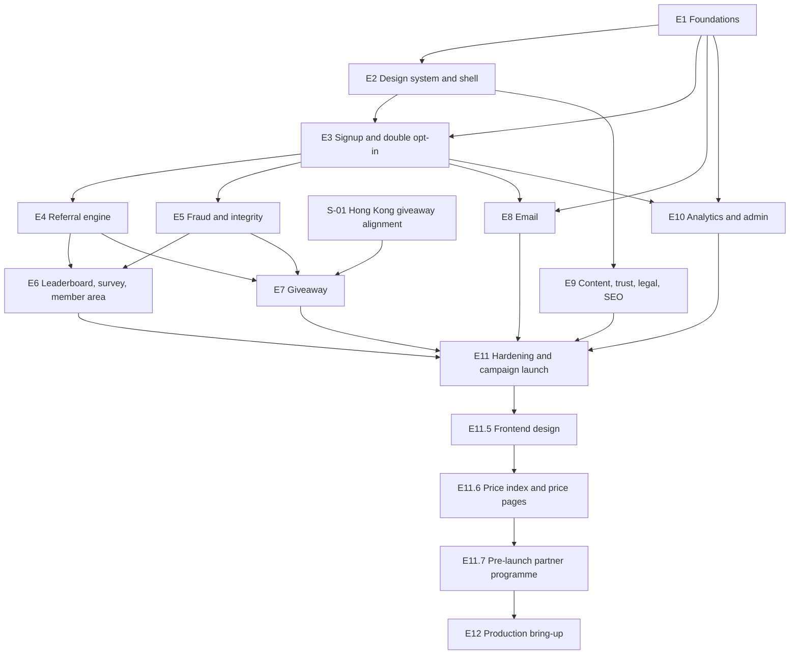

# Valstara Pre-Launch — Development Plan v1

Date: 2026-08-25 · Source: `prelaunch-stack-decisions.md` v2, the 24 accepted ADRs, 14 feature specs and 10 module docs.

**Scope is the 8–12 week pre-launch waitlist site on `valstara.com`, and nothing else.** Store scope lives in the storefront repository. Where this plan touches the store, it touches only the handoff.

---

## 0. How this plan is governed

**This file is the single source of truth for what gets built.** Not the ADRs, not the feature specs, not the stack decisions document, not any conversation — those are *inputs* the tickets reference. When they disagree, the plan is what an agent builds, and the disagreement is a defect to be fixed here.

Four rules follow, and they are binding:

1. **No ticket is added, removed, resized or reordered without founder authorisation.** An agent that believes a ticket is wrong **stops and asks** — it never edits the plan and never builds around it.
2. **An agent reads the whole plan before implementing any ticket.** It is then the check on the plan: if a ticket contradicts its epic's goal, the standing rules, what earlier tickets built, or what later tickets assume, that is a `BLOCKED:` output, not a judgement call. **A contradiction caught now costs one question; caught six tickets later it costs a rewrite.**
3. **Ticket scope is exact.** No scope creep, no unrequested refactors, no scaffolding for future tickets, no drive-by improvements.
4. **Changes are made here first, then implemented.** Never the reverse.

**The order and status of the work live in [`ticket-register.md`](ticket-register.md)** (founder-authorised 2026-11-11). This plan says what each ticket builds; the register says which ticket runs next and which are done. A ticket added to this plan gets its register row in the same change. **A founder decision is recorded on its ticket's entry here**, by the decision session, after the founder accepts and before anything is built on it (`docs/engineering/prompts/00-USAGE.md#decisions`). That is the only way a session edits this plan.

### Ticket anatomy
Every ticket carries: **Model** and reasoning level (§3) · **Priority** · **Flag** · **Area** · why that model where it is not obvious · **Build** · **Acceptance criteria** (the contract) · **Tests** · **Docs** it must read. Each is sized for **one focused agent run producing one PR.**

### The campaign clock
This plan is written against a **12-week campaign**, and three of its constraints are calendar constraints rather than engineering ones: the Article 27 appointments, the DNS and email authentication warm-up, and the ESP tier upgrades. They are in §2 as founder prerequisites, not as tickets, because no agent can complete them.

---

## 1. Environment and workflow

**Local → production. No staging** (`docs/engineering/ci-cd.md`). There is no live traffic before the campaign opens, so the risk staging normally guards against does not exist yet.

**One consequence applies from early on:** production carries **real sending credentials and a real domain reputation** the moment email is configured. From the first live Resend key onward, a mistake in production is a deliverability event. Sandbox keys never reach production; live keys never reach local.

**Per-ticket cycle:** implement (fresh session, the ticket's model) → **pre-PR review in a fresh session that has not seen the implementation** → fix the findings, at most four review rounds → pre-push checks → push, PR, CI, squash-merge to `main`. Prompts, the review cap and the decision procedure are in `docs/engineering/prompts/00-USAGE.md`.

**Local checks, full suite in CI (founder-authorised 2026-10-23, narrowed 2026-11-19).** Before committing, a session runs only the quick local checks: `npm run check`, and `npm run test:changed` naming the ticket's Tests-line files. From E11.6-11a, `test:changed` runs exactly the named files and the test files the branch adds or changes; tests reached only by import, file read, dependency or browser reach run in CI, not locally. The full suite runs once per pull request in CI, under coverage, split across parallel runners by recorded file timings (four, and eight from E11.6-11a), and every check must be green before merge (`docs/engineering/ci-cd.md#how-the-suite-runs`).

**`main` is the only long-lived branch.** **Merged is not deployed:** before the campaign opens, deploying is a deliberate command; from campaign open, a **release tag** deploys.

**Definition of Done** is `docs/testing/strategy.md#definition-of-done`.

---

## 2. Founder prerequisites — not agent tickets

Items no agent can complete. Each gates something, and the gate is stated so it is not discovered late.

| # | Item | Nature | Gates | Start by |
|---|---|---|---|---|
| **P1** | ~~DNS records and email authentication~~ — **SATISFIED 2026-09-27.** SPF, DKIM and DMARC `p=none` are published for `send.valstara.com` and `mail.valstara.com`; Resend and Brevo report their respective domains as verified. `subslush.com` is out of scope (ADR-028). Sender-reputation warming continues | Configuration | Nothing. E8 is unblocked; warming is evidenced at E11-08/E12-07 | Done |
| **P2** | **EU and UK Article 27 representatives waived by founder decision, 2026-10-01** (ADR-029) | Founder decision | No representative gate | Done |
| **P3a** | ~~Brand token values~~ — **SATISFIED.** In the repository at `docs/brand/identity-guidelines.md` §5 (colour) and §6 (typography), LOCKED | — | Nothing. E2-01 is unblocked | Done |
| **P3b** | **Trust-page prose** — `/legit`, `/guarantee`, `/about` | Founder input from the brand and store documentation | E9-02. **A page shell with placeholder text is not a deliverable** | Before E9 |
| **P4** | **Giveaway prize and the final text of the single global rules page (Hong Kong law)** — **supplied 2026-09-25:** 5 bundles at €300 (€1,500), entries 1 Oct 2026 – 1 Mar 2027, draw 1 Apr 2027, the promoter **3NITY DIGITAL LIMITED** (Business Registration No. 79886556) with its registered address and contacts, and the layered substitution rule. The approved text is in `docs/prerequisites/p4-rules-page-draft.md`. **P4 is complete.** Bundle contents (due before the draw) and the sanctions list (due before the first award) are deliberately **not** blockers (ADR-026) | Founder input. One global page under Hong Kong law — no per-country rules or local review (founder decision, 2026-09-25, ADR-026) | Nothing now — satisfied | Done |
| **P6** | **Provision the production VPS** | Purchase and provisioning | **E12 entirely.** Nothing before E12 requires it — founder decision, 2026-08-27: the site is built and verified locally first, then the host is provisioned once | Before E12 |
| **P5** | **Upgrade Resend and Brevo past the free tiers** | Purchase — Resend free is 100/day, Brevo 300/day | **Turning `giveaway.open` on.** Upgrade *before* the giveaway opens, not when the limits hit | Before E7 exit |
| **P7** | **Create the four seed mailboxes** — one each at Gmail, Outlook.com, GMX and Web.de, IMAP access enabled, used for seed tests and nothing else. Outlook.com allows IMAP only through OAuth, not a password. Credentials go to the production secret manager; none is committed (founder-authorised 2026-09-29) | Account setup, free | **E12-07:** the first live seed run and the rendering check | Before E12 |
| **P8** | **Launch provider list and logo files** — for each provider shown on the landing page: display name, category (E11.5-02's v2 taxonomy), confirmation that its goods are on the launch catalogue, the official SVG logo (plus a dark-theme variant where the provider supplies one) from the provider's published brand resources with its source URL, and its brand colour (founder-authorised 2026-10-19). **SUPPLIED 2026-10-25** for 34 providers across four categories (AI tools, Streaming and subscriptions, Software, In-game currency), recorded in `docs/prerequisites/p8-provider-list.md`. Founder-authorised amendments 2026-10-25: a logo without a source URL records its source as `founder-supplied` with the supply date, and a brand colour may be derived from the supplied logo by the rule in that record. AION2's logo is a WebP raster, the only non-SVG logo, by founder exception (no SVG exists) | Founder input | **E11.5-04** only. A showcase with placeholder logos is not a deliverable | Done |
| **P9** | **Price-index answers and source capture.** The brief's open questions and D1–D6 were **answered 2026-11-17** (the brief amendments are verbatim in `docs/features/price-index.md#founder-amendments-17-november-2026-verbatim`; D1–D6 are recorded on E11.6-04, E11.6-05, E11.6-10, E11.6-12 and E11.6-13). **Still to do: the founder captures the source pages for E11.6-01** by `docs/prerequisites/p9-source-capture.md` | A founder capture | E11.6-01 | Before E11.6-01 |
| **P10** | **Partner asset kit files** — the images and PDFs partners download (committed under `public/partners/kit/`), and the links to any videos, each with the right to share it (founder-authorised 2026-11-17) | Founder input | **E11.7-11** only. A kit with placeholder files is not a deliverable | Before E11.7-11 |

**A ticket blocked on one of these reports `BLOCKED:` and stops.** It does not invent a placeholder and it does not build around it.

---

## 3. Model assignment policy

**Every session runs on Claude Opus 5.5 — founder-authorised 2026-11-11.** A ticket's **Model** line names Opus 5.5 and a reasoning level; sessions other than implementation take the levels in `docs/engineering/prompts/00-USAGE.md`, and QA gates the levels in §6.

**Reasoning level:**
- **Medium** for contained, fully specified work;
- **High** when the ticket spans several modules, owns a privacy, security or sending-reputation property, or is terminal and operations work;
- **Extra High** for the deepest work, where a subtle error invalidates a whole class of work;
- **Low** only for routine operations against a clear spec.

**Escalation rule:** on a second failed attempt at the same ticket or finding, move one level up: Low → Medium → High → Extra High. **A third failure is a signal that the ticket is wrong, not the agent** — stop and revisit the plan entry.

**History.** Tickets merged before 2026-09-28 were planned under two tiers — **Tier A**, the founder's fast implementation model, and **Tier B**, the strongest, for money-adjacent logic, personal data, privacy, concurrency, security and anything architecture-bearing. From 2026-09-28 the Model lines named Codex models chosen by benchmark (GPT-6 Sol for code, GPT-6 Astra for operations and audits, GPT-6 Luna for small tickets); the founder ran each on Opus 5.5 at the same level. Model lines on merged tickets keep the names they were planned under, as history; they are not read again.

---

## 4. Standing rules for every ticket

These are not restated per ticket. **Violating one fails review.** They are the same rules as `AGENTS.md`, listed here because the plan is what an agent reads first.

1. **No non-essential cookie, no browser-storage identifier, no fingerprinting API, no third-party request from a rendered page.** Three CI gates enforce it (ADR-007, ADR-013).
2. **Nothing counts an unverified subscriber** — not the leaderboard, a tier, an entry, the broadcast list or the export (ADR-011).
3. **A high-value referral reward can never settle from a verification alone** (ADR-012).
4. **Referral attribution is server-side and signed** — no cookie, no client-side path (ADR-008).
5. **Email is normalised before any uniqueness check.**
6. **Every public, unauthenticated write route verifies Turnstile server-side first. A write authenticated by a single-use signed token consumes that token first, in place of Turnstile. Rate limiting applies to both kinds** (ADR-006; founder-authorised amendment 2026-09-28).
7. **No code path sets `disqualified` without a recorded human actor.**
8. **One email per business key; suppression re-checked at dispatch.**
9. **A full IP address is never stored, logged or returned** — truncate, then hash.
10. **No analytics event property, and no public response, carries personal data.**
11. **The audit log is append-only, enforced by database permissions.**
12. **Every sweep, export and bulk operation caps its batch size.**
13. **Every state that waits on a person has a defined expiry and a defined fallback.**
14. **Business logic in server modules, not routes. Only `server/db` issues SQL.**
15. **Every feature behind its registered flag** with a code-level fail-safe default; the flag-off path is tested (ADR-023).
16. **No literal colour, font, radius, spacing or duration in a component; no prose inline in markup** (ADR-015, ADR-017).
17. **No forbidden copy string ships** (`docs/brand/copy-rules.md`) — CI-scanned.
18. **Docs and ADRs update in the same PR.** Doc drift is a review blocker.
19. **Constraints ship with the structure they constrain.** A ticket that creates a table also creates its permissions, triggers, indexes, defaults and checks. Never in a later ticket — a structure that violates a standing rule between the ticket that creates it and the ticket that constrains it is a defect in this plan.
20. **Every ticket is self-contained.** Its acceptance criteria are reachable using only what it builds and what earlier tickets already delivered. If they are not, the plan is wrong: **stop and report**, never build ahead and never work around.

---

## 5. Epic dependency graph

**E11.5 runs after E11 and before E12 (founder-authorised 2026-10-19).** It redesigns every surface a visitor sees without changing behaviour, then re-runs E11's accessibility, claims and privacy audits on the new surfaces, so E12 deploys and measures the final build.

**E11.6 runs after E11.5 and before E12 (founder-authorised 2026-11-17).** It adds the price index — a separate tool the founder runs by hand once a month — and the price pages built from its data, in local currency only, so E12 deploys, load-tests and gates the site with them.

**E11.7 runs after E11.6 and before E12 (founder-authorised 2026-11-17).** It adds the temporary partner programme and replaces the campaign's reward rules with wave 1 and the coupon ladder, so E12 deploys and gates the site with them.

**Everything through E11 is built and verified locally.** The VPS is provisioned once, at the end, and **E12 collects every piece of evidence that needs real infrastructure** — the rollback RTO, a restore from R2, capacity on the actual box (founder decision, 2026-08-27).

**S-01 is a standalone ticket outside every epic (founder-authorised 2026-09-25).** It brings everything already built into line with ADR-026 and ADR-027 and **must be merged before any E7 ticket starts.**

**E1 proves the whole path end to end before any feature work.** E3 is the spine: E4, E5, E8 and E10 all depend on a verified subscriber existing. **E9 is independent of the mechanics and has the longest founder-input lead time — start its content tickets early, in parallel.** E11 is the campaign gate.

---

## 6. QA gates

A gate runs after the listed epics, in a fresh session on `main`, using the integrated-QA prompt. **No next epic opens on a NO-GO.** Each gate is a row in `ticket-register.md`, after the last ticket it audits.

**One run per gate, on one model — founder decision 2026-11-11.** The dual gates, with a second run on a model from a different family, are retired. The gates that cover something unrecoverable run at Extra High instead.

| Gate | After | Model |
|---|---|---|
| 1 | E1 | Opus 5.5 — High |
| 2 | E2 + E3 | Opus 5.5 — Extra High |
| 3 | E4 + E5 | Opus 5.5 — Extra High |
| 4 | S-01 + E6 + E7 | Opus 5.5 — Extra High |
| 5 | E8 | Opus 5.5 — Extra High |
| 6 | E9 + E10 | Opus 5.5 — High |
| 7 | E11 + E11.5 | Opus 5.5 — Extra High |
| 8 | E11.6 + E11.7 | Opus 5.5 — Extra High |

**Gates 2, 3, 4, 5, 7 and 8 run at Extra High because each covers something unrecoverable**: the privacy properties, the fraud invariants, the prize draw, the sending reputation, the launch surface with its privacy re-audit, and, in gate 8, hundreds of new public pages carrying the signup island and published price claims (E11.6) together with partners' personal data and the rewritten reward rules under the reward-gating invariant (E11.7) (founder-authorised 2026-11-17). **Gate 8 runs once, after E11.7, and audits E11.6 and E11.7 together** (founder-authorised 2026-11-17); it replaces the separate gates 8 and 9 first planned for them. A gate added with new epics names its model here, at Extra High when it covers personal data, privacy, security, money or email, and at High otherwise.

---

# Epics and tickets

## Epic E1 — Foundations

**Goal:** the repository, the stack, the pipeline, the database, and one thin end-to-end slice — a signup that writes a row, sends a verification mail in sandbox, and verifies — proving the architecture and toolchain before any feature work. *12 tickets.*

**Exit criteria:** a signup made against production-shaped infrastructure produces a verified subscriber, with every CI gate green, backups proven by restore, and a rollback drilled.

### E1-01 — Repository scaffold: Astro, Node adapter, strict TypeScript
**Model:** Tier B — Medium · **Priority:** Highest · **Flag:** — · **Area:** infra
**Why this tier:** the layout and the island discipline are inherited by all 87 later tickets; a wrong answer here is expensive to unwind.

**Build:** Scaffold the root of the layout in `docs/architecture/modules.md#repository-layout` — which is the **target-state** tree, the shape this repository has after all 88 tickets, not the shape it has now. **This ticket creates the top-level structure only**: Astro with the **Node adapter in standalone mode**, TypeScript strict, ESLint flat config, Prettier, and the empty directories `src/server/`, `src/copy/`, `src/content/` and `src/styles/`. Add `AGENTS.md` and `docs/` as-is. Pin the Astro major and commit the lockfile.

**Create no file that a later ticket owns.** The standing rule against scaffolding for future tickets applies here exactly as it does everywhere else — an empty `src/pages/index.astro` or `src/server/referral/` is a scope violation, not a head start.

**Verify, do not assume:** the production build runs and serves from the Node adapter, and a page with no island **ships zero client JavaScript** — measured from the build output, not asserted.

**Acceptance criteria:**
- `npm install && npm run build` succeeds from a clean clone; the built server starts and serves
- **A page with no island emits no client JavaScript bundle** — evidenced in the PR from the build output
- TypeScript strict with **no `any`**; lint and format clean
- The top-level tree (`src/`, `infra/`, `scripts/`, `.github/workflows/`, `AGENTS.md`, `docs/`) and **every directory this ticket creates** appear in the layout doc — tree diff in the PR. **Files belonging to later tickets are absent, and their absence is correct**
- **`origin/main` exists and is pushed** — the precondition every later ticket assumes. If it does not, **STOP and report**; never seed the trunk

**Tests:** None (scaffold). The zero-JS evidence is the deliverable.
**Docs:** `docs/architecture/modules.md#repository-layout` · `docs/architecture/adr/001-astro-node-adapter.md` · `docs/engineering/standards.md`

### E1-02 — Local Compose stack: PostgreSQL, the app, Umami
**Model:** Tier A — High · **Priority:** Highest · **Flag:** — · **Area:** infra

**Build:** `infra/compose/docker-compose.yml` bringing up **PostgreSQL 17 with the `valstara_waitlist` database**, the app, and Umami with its own database. **Hard `mem_limit` per service with `memswap_limit` equal to it** — the box has no swap deliberately. No host ports on data services beyond local development.

**Acceptance criteria:**
- `docker compose up -d` yields a working local stack, and **the app's configured `DATABASE_URL` authenticates against `valstara_waitlist`** — proven by an authenticated query using the app container's **actual runtime value**, asserting `current_database()`, with a **red-path test showing invalid credentials fail**. *The application connection pool is E1-03; a container liveness probe does not satisfy this criterion*
- **Memory limits present on every service with swap disabled** — asserted by inspecting the running config, not by reading the file
- Umami reachable locally with its own separate database
- `infra/ENV.md` started, listing every variable with its purpose

**Tests:** A script asserting the memory limits and the database separation, **plus an authenticated query with the app's own connection string and a red-path case proving wrong credentials fail the assertion.**
**Docs:** `docs/architecture/adr/003-self-hosted-vps.md` · `docs/architecture/adr/004-separate-waitlist-database.md`

### E1-03 — Data layer, migration runner and the initial schema
**Model:** Tier B — High · **Priority:** Highest · **Flag:** — · **Area:** backend
**Why this tier:** the schema is designed against the launch-day import, and every later epic writes to it. Getting the constraints wrong here is discovered in E11.

**Build:** `src/server/db` — the connection pool, transaction helper, and a **forward-only migration runner with a `migration_ledger` recording filename, checksum and applied timestamp.** Then the initial schema per `docs/data/model.md`: `subscriber`, `verification_token`, `referral_edge`, `milestone_award`, `survey_response`, `giveaway_entry`, `giveaway_draw`, `fraud_flag`, `email_send`, `suppression`, `campaign_flag`, `audit_log`, `rate_limit_bucket`.

**The constraints are the deliverable, not the columns.** `subscriber.email_normalised` unique · `referral_edge.referred_id` unique · `email_send.business_key` unique · `giveaway_entry (subscriber_id, method, source_edge_id)` unique · `milestone_award (subscriber_id, tier, reward_kind)` unique · `subscriber.referred_by_id` **write-once, enforced by trigger**.

**Including `audit_log`'s permissions.** This ticket creates `audit_log`, and standing rule 11 says that table is append-only **enforced by database permissions**. So this ticket grants the application role `INSERT` and `SELECT` only — no `UPDATE`, no `DELETE` — and provisions that role with a login and password **in the migration path**, not in a first-boot init hook, so an existing volume upgrades correctly. **E1-09 owns the `audit` service on top of this; it does not own the table or its permissions** (standing rule 19).

**`subscriber.referral_code` is nullable.** E4-01 generates a code only at verification, so a `pending` row has no code. Founder-authorised 2026-08-26.

**Acceptance criteria:**
- Migrations run once each and are recorded with a checksum; **a checksum mismatch on an already-applied migration aborts**
- Every constraint named above exists **in the database** — asserted by querying the catalogue, not by reading the migration
- **`referred_by_id` cannot be updated once set** — asserted by an attempted update that fails
- The schema is reproducible from the migration files alone, into an empty database
- **No query helper permits an unbounded result set** — every list method takes an explicit limit
- **`subscriber.referral_code` is nullable**, and a `pending` subscriber is inserted with a null code
- **`UPDATE` and `DELETE` against `audit_log` are rejected at the database level** for the application role — asserted by test, not by convention
- **The application role authenticates with a password provisioned by the migration path** — asserted against a database created before this ticket ran, so an existing volume is proven to upgrade

**Tests:** *(this list is the contract — implement exactly these, plus unit tests for new logic)*
1. Ledger records filename, checksum and timestamp; a second run applies nothing.
2. An edited already-applied migration aborts on checksum mismatch.
3. Each of the five named unique constraints exists **in the PostgreSQL catalogue**, and each rejects a duplicate. **The `email_normalised` case uses two different raw addresses that normalise to the same value** (`user+a@gmail.com` and `u.s.e.r@gmail.com`), so the test fails if the constraint is moved to `email`.
4. `referred_by_id` accepts its first value and rejects reassignment.
5. The schema reproduces from the migration files alone into an empty database.
6. `list()` requires a positive explicit limit; `execute()` rejects result-returning statements.
7. **A `pending` subscriber inserts with a null `referral_code`, and two null codes coexist** under the unique index.
8. **`UPDATE` and `DELETE` on `audit_log` are rejected for the application role.**
9. **The app's real credentials authenticate against a database created before this ticket's migrations ran** (upgrade path).
10. **`runMigrations()` called concurrently** — genuine parallel calls against one disposable database — applies each migration exactly once.
**Docs:** `docs/data/model.md` · `docs/modules/platform.md#db` · `docs/engineering/standards.md#data-and-queries`

### E1-04 — CI PR pipeline: lint, typecheck, test, build, coverage
**Model:** Tier A — High · **Priority:** Highest · **Flag:** — · **Area:** infra

**Build:** GitHub Actions PR workflow: frozen-lockfile install, lint, typecheck, tests against a disposable PostgreSQL service container, the Astro production build, and a **coverage gate at 80% changed code with the 90% list configured but not yet enforced** (those modules do not exist). Path-filtered so `docs/**`-only changes run nothing.

**Acceptance criteria:**
- The pipeline is green on `main`; a fixture PR dropping coverage below the bar fails
- A docs-only change runs **nothing**
- All jobs are mandatory review gates, named per `docs/engineering/git-workflow.md#review-gate-check-names`

**Tests:** A red-path fixture branch per gate proving each fails.
**Docs:** `docs/engineering/ci-cd.md#pr-pipeline` · `docs/engineering/git-workflow.md`

**Founder-authorised amendment (2026-10-23):** the `test` and `coverage` jobs no longer each run the whole suite. The suite runs once, under coverage, in four `test (n/4)` shards planned from recorded file timings. Each shard builds the app once and tests reuse that build while it is fresh. `coverage` merges the shard reports, fails unless every discovered test file ran exactly once, and applies the same 80% changed-line gate; it fails, not skips, when a shard fails. The E1-04 red-path harness, which the coverage run skips to avoid nesting coverage, runs in its own `red-paths` job. The workflow can also be dispatched by hand, so a QA gate runs the full suite on `main` in CI. Every gate and red-path fixture is unchanged (`docs/engineering/ci-cd.md#how-the-suite-runs`).

### E1-05 — CI security and privacy gates
**Model:** Tier B — High · **Priority:** Highest · **Flag:** — · **Area:** security
**Why this tier:** these gates are what make "no consent banner" a verified property rather than an intention. A gate that silently stops working is worse than no gate.

**Build:** The mandatory security stage, seven scans, **each with a planted red-path fixture committed in-repo**:

1. **Secret scan** — no committed credential; a `.env` path added anywhere in the PR range fails, while `.env.example` is scanned as ordinary content
2. **Dependency scan** — an allowlist entry requires a written justification **and a future expiry date**
3. **Cookie and storage rule** — `document.cookie`, `Set-Cookie`, `localStorage`, `sessionStorage` outside the single permitted theme-preference write
4. **Fingerprinting rule** — canvas, font-enumeration, WebGL and timing-entropy APIs anywhere
5. **Third-party request rule** — any off-origin request from a rendered page; Cloudflare Turnstile on protected forms is the sole allowlisted exception
6. **Vendor-boundary rule** — an email SDK imported outside its provider module. **Runtime `import()` targets must resolve statically; an unresolved target fails closed**
7. **Forbidden-copy scan** — over `src/copy/`, `src/content/` and every `.astro` file. **This ticket creates `scripts/forbidden-copy.json` and seeds it from the never-use table in `docs/brand/copy-rules.md`**, so the gate is live the moment it exists. E2-08 later moves copy into the layer the scan already covers; it does not create the list (standing rule 20)

**Acceptance criteria:**
- **Each scan fails on its planted fixture and passes on `main`**
- **An allowlist entry without an expiry date fails CI**
- The cookie, fingerprinting and third-party rules each fire on a deliberate violation
- The vendor-boundary rule fails closed on an unresolvable dynamic import
- Every fixture is committed in-repo, so a scan that stops working is caught

**Tests:** Planted-violation fixtures per gate in a dedicated job.

**Founder decisions (2026-11-17):**
1. **The 2026-11 Astro advisories are fixed by upgrade on a dedicated branch merged to `main` before GATE-7 merges, not by allowlist (D-009).** GHSA-mh32-jxcr-mh9f and GHSA-r3h5-4585-7x3w (npm 1246685–1246687) fail the dependency scan on `main` at astro 7.3.3 and @astrojs/node 11.1.4. The dedicated branch, cut from `main`, pins `astro` 7.4.12 and `@astrojs/node` 11.1.13. Every patched Astro release declares `node >=22.23.4`, so the same change moves the Node runtime from 22.22.3 to 22.23.5 everywhere it is pinned: `Dockerfile` (both stages), the three `infra/compose/docker-compose.yml` images, `.github/workflows/pr.yml` and `main-image.yml`, `.nvmrc`, `package.json` engines (`>=22.23.5 <23`), `infra/compose/assert-production-stack.mjs` and `infra/ENV.md`. The allowlist stays empty. Nothing new loads in the browser. The full suite runs in CI on that pull request; once merged, GATE-7 merges `main` and re-runs its pre-push checks. *(Accepted under the founder's standing rule for high-confidence recommendations.)*
2. **`pr.yml` moves all seven of its Node pins, and D-009's count is corrected (D-010).** `.github/workflows/pr.yml` pins Node in 7 places, not 4; all 7 move to 22.23.5. `.github/workflows/main-image.yml` pins no Node version (it builds the `Dockerfile`) and needs no change. *(Accepted under the founder's standing rule for high-confidence recommendations.)*
3. **The cross-site form guard in `src/middleware.ts` compares `Origin` with the request's scheme and its own `Host` header, not with `context.url.origin` (D-010).** From Astro 7.4.0, `context.url` uses the `Host` header only when it matches `security.allowedDomains`; any other host becomes `localhost:<port>`, so the guard rejected genuine same-origin form posts on every host but `valstara.com`. A form-like or body-typeless write now passes only when `Origin` equals `new URL(context.url.protocol + '//' + Host).origin`. That is what `context.url.origin` was under Astro 7.3.3. A missing or unparseable `Host` or `Origin`, or any other value, still gets the 403 with `securityCopy.crossSiteForm`. The `/api/unsubscribe` and `/api/webhooks/*` exemptions are unchanged. `security.allowedDomains` stays exactly `valstara.com`, and trust in `X-Forwarded-For` is unchanged. New tests, run through the built server, check five cases. A same-origin form post on `127.0.0.1:<port>` passes the guard. A foreign `Origin` gets 403, and so does a same-host `Origin` with a different scheme. With `Host: valstara.com` and `X-Forwarded-Proto: https`, `Origin: https://valstara.com` passes and a foreign `Origin` gets 403. No existing assertion changes. *(Accepted under the founder's standing rule for high-confidence recommendations.)*

**Named test rewrite (founder-authorised 2026-11-17):** `test/security-gates.test.mjs`, "Astro remote-image caching uses only the expected policy methods": the pinned version changes from `'7.3.3'` to `'7.4.12'`, after re-confirming that `http-cache-semantics` is consumed only by `assets/build/remote.js` through `storable()` and `timeToLive()`; every other assertion stays. *(Accepted under the founder's standing rule for high-confidence recommendations.)*

**Named test rewrite (founder-authorised 2026-11-17):** `test/ci-pipeline.test.mjs`, "developer, CI, and local Compose Node versions satisfy lint plugin engines": `.nvmrc` `22.22.3` → `22.23.5`, engines `>=22.22.3 <23` → `>=22.23.5 <23`, and the compose image pattern `node:22.22.3-bookworm-slim` → `node:22.23.5-bookworm-slim`, still exactly 3 matches; nothing else changes. *(Accepted under the founder's standing rule for high-confidence recommendations.)*

**Named test rewrite (founder-authorised 2026-11-17):** `test/ci-pipeline.test.mjs`, "the PR workflow exposes the mandatory E1-04 and E1-05 check names": `node-version: 22\.22\.3` → `node-version: 22\.23\.5`, still exactly 7 matches; nothing else changes. *(Accepted under the founder's standing rule for high-confidence recommendations.)*

**Founder decisions (2026-11-18):**
1. **picomatch advisory 1247710 (GHSA-fc5q-39xc-vjpf, ReDoS through repeated extglobs, `<=4.0.7`, no patched release) is allowlisted until 2026-12-18 on a dedicated branch merged to `main`, with a guard test, not held for a patch (D-022).** The branch `fix/deps-picomatch-advisory`, cut from `main`, adds one entry to `scripts/ci/dependency-allowlist.json`: `"package": "picomatch"`, `"advisory": 1247710`, `"expiresAt": "2026-12-18"`, and the justification "GHSA-fc5q-39xc-vjpf: ReDoS in picomatch <=4.0.7 (4.0.7 and the 2.3.2 copy under anymatch) through repeated extglobs; no patched npm release as of 2026-11-18. picomatch ships in the production image as a dependency of astro and @astrojs/node, but the built server never imports it; it runs only in build, lint and typecheck tooling, on glob patterns written in this repository, none of which uses extglobs. test/security-gates.test.mjs verifies the built server does not reach it. Remove this entry when patched releases cover both the 4.x and 2.x lines." A new test in `test/security-gates.test.mjs`, beside the `http-cache-semantics` check, walks the static and resolved dynamic imports from the built server entry (`dist/server/entry.mjs`) and fails if any module under `picomatch`, `anymatch`, `tinyglobby`, `fdir` or `@astrojs/internal-helpers/dist/create-filter.js` is reached; it carries a planted red path showing that a reached picomatch import fails it. `docs/security/threat-model.md` records the exception, its basis and its expiry in place of "The dependency allowlist is empty". Nothing changes in `package.json` or `package-lock.json`, and nothing new loads in the browser. When the entry expires, the gate fails on every branch: upgrade if a patch exists, otherwise bring a new decision to the founder; never extend the date without one. The full suite runs in CI on that pull request; once it is merged, branches waiting on it merge `main` and re-run their pre-push checks. *(Accepted under the founder's standing rule for high-confidence recommendations.)*

**Docs:** `docs/security/threat-model.md#ci-security-gates` · `docs/architecture/adr/007-cookieless-analytics.md` · `docs/architecture/adr/013-no-fingerprinting.md`

### E1-06 — Image build, GHCR push, production Compose behind Cloudflare
**Model:** Tier A — High · **Priority:** Highest · **Flag:** — · **Area:** infra

**Build:** Multi-stage Dockerfile. Main-branch workflow building and pushing to GHCR tagged with the commit SHA, retention last three, path-filtered to `src/**`, `infra/**`, `scripts/**`. Production Compose mirroring local with the same hard memory limits, plus **Caddy terminating TLS on the origin and health-gating the upstream**. Cloudflare proxied in front.

**Acceptance criteria:**
- A merge to `main` touching application code produces a SHA-tagged GHCR image; a docs-only change builds nothing
- Production Compose starts the SHA-tagged image and passes health checks
- **Caddy removes an unhealthy backend and returns it only after recovery** — demonstrated
- Production Compose runs **locally**; it is the same file E12 deploys to the VPS unchanged. **Cloudflare proxying and origin lock-down are E12-05** — there is no origin to lock down yet

**Tests:** The pipeline is the test; a docs-only commit demonstrably builds nothing.
**Docs:** `docs/engineering/ci-cd.md#main-pipeline` · `docs/architecture/adr/003-self-hosted-vps.md`

### E1-07 — Deploy with a migration audit, and a drilled rollback
**Model:** Tier B — Medium · **Priority:** Highest · **Flag:** — · **Area:** infra
**Why this tier:** a deploy that silently mis-records a migration is exactly the failure this exists to prevent, and it is discovered at the worst moment.

**Build:** `infra/deploy/deploy.sh`: pull the SHA image → run migrations → health-gated restart. **Record for every deploy: the image SHA or tag, the migrations applied, the timestamp and the outcome** — persisted, not just logged. `rollback.sh` redeploys the previous identifier, one command.

**Acceptance criteria:**
- A deploy writes a **durable record answering *which migration ran, when, on which release***
- **A checksum mismatch on an already-applied migration aborts before anything restarts**
- A failed health check aborts the rollout, leaving the previous version serving
- **Rollback logic is drilled and recorded in the PR** — against the production Compose definition running locally, proving the script pulls, migrates, health-gates and restores. **The timed five-minute RTO is E12-03**: the number is dominated by a real registry pull to a real host, so it cannot be measured here and a local figure must not be recorded as the RTO
- Failed attempts are records too, including migrations committed before a later one failed

**Tests:** A staged bad-image deploy proving the health gate and the rollback; an induced checksum mismatch.
**Docs:** `docs/engineering/ci-cd.md#deploy-and-the-migration-audit`

### E1-08 — Backups: the waitlist database into pgBackRest, and a proven restore
**Model:** Tier B — Medium · **Priority:** Highest · **Flag:** — · **Area:** infra
**Why this tier:** a backup that has never been restored is a hypothesis, and this list is the campaign's only durable asset.

**Build:** The pgBackRest configuration for `valstara_waitlist` — weekly full, daily differential, continuous WAL, **repository encryption on** — and the restore-to-scratch-container drill script. Prove the whole cycle **against the local stack**, backing up to a local repository. Document the passphrase procedure in `infra/ENV.md` without containing the production value.

**Nothing this ticket adds may make an existing command fail.** The local stack is started by earlier tickets' tests and drills; a new required variable breaks all of them.

**The R2 remote, the schedule and the off-host passphrase are E12-04.** What this ticket owns is that the configuration is correct and the restore genuinely works; where the repository lives is a deployment detail.

**Acceptance criteria:**
- A full backup, a differential and WAL archiving all succeed against the local stack
- **A restore into a scratch container succeeds and is verified against known rows — evidenced in the PR**
- Repository encryption is on, and the passphrase comes from `PGBACKREST_REPO1_CIPHER_PASS` **with a local-only default**, exactly as every other credential in the local stack. **It must not be a required variable** — making it mandatory breaks every command that starts the local stack, including earlier tickets' drills
- **The real passphrase, held off-host, is E12-04's.** "Absent from the repository" is a production property; a local-only default documented as local-only satisfies this ticket
- The drill is a script, runnable unattended, not a sequence of documented commands
- **Local restore timing recorded as a floor, explicitly not the production RTO** — E12-04 measures that

**Tests:** The restore drill is the test.
**Docs:** `docs/engineering/ci-cd.md#backups`

### E1-09 — Append-only audit log
**Model:** Tier B — High · **Priority:** Highest · **Flag:** — · **Area:** security
**Why this tier:** append-only enforced at the permission layer is a security property that later tickets assume without re-checking.

**Build:** `src/server/audit` per `docs/modules/audit.md` — `record()`, an admin-only batch-capped `query()`, and the required action registry.

**The table and its append-only permissions already exist**, created by E1-03 under standing rule 19. This ticket builds the service on top and **must not alter the schema or the grants.**

**Acceptance criteria:**
- **The append-only grants from E1-03 are still in force** — re-asserted here by test, because this is the ticket that starts writing through them
- **`record()` failure on a disqualification, export, draw or DSR fulfilment raises an error**, never a warning
- **No code path can write a token, secret, raw IP or full email into `detail`** — a redaction test runs over every call site
- `query()` honours its limit

**Tests:** Permission-level rejection · redaction over every call site · the raise-on-failure cases.
**Docs:** `docs/modules/audit.md` · `docs/data/model.md#audit_log`

### E1-10 — Campaign flags with code-level fail-safe defaults
**Model:** Tier A — High · **Priority:** Highest · **Flag:** — · **Area:** backend

**Build:** `src/server/flags` per `docs/modules/flags.md`. All seven current flags registered in code with declared defaults, **matching `docs/features/README.md#flag-registry` exactly**. The former `trustpilot.widget` flag was retired by the founder's E11-05 decision on 2026-10-10.

**Includes a forward-only migration changing `audit_log.subject_id` from `uuid` to `text`.** E1-03 typed it `uuid` because `docs/data/model.md` listed `audit_log`'s columns without types — the one table where it did. The column is **polymorphic by design**: `subject_type` discriminates, a subscriber subject is a UUID, a flag subject is a key like `leaderboard.public`, and an export has no natural subject. Auditing a flag change is impossible until this is corrected, so it is this ticket's. Founder-authorised 2026-08-27.

The change is additive-safe — `USING subject_id::text` preserves every existing value, and text accepts what a previous image would write. **Two default off: `giveaway.open` and `email.broadcast`**; the other five default on. In-process cache with a short TTL, invalidated immediately on `set()`. Every change audited with an actor.

**Acceptance criteria:**
- **An unregistered key throws** — never a silent `false`
- **Database unavailable returns the code default** — fail-safe, never fail-open
- **Every registered flag has a declared default** — asserted by a test over the registry
- **The registry matches `docs/features/README.md#flag-registry` exactly** — same seven current keys, same defaults — asserted by a test, so the table and the code cannot drift
- **`audit_log.subject_id` is `text`**, existing UUID values preserved as strings — asserted against the PostgreSQL catalogue
- **A flag change writes an audit record whose `subject_id` is the flag key** — the case that was previously impossible
- `set()` takes effect within the documented TTL, and **the worst-case propagation delay is documented**
- Every change is audited with an actor

**Tests:** Unregistered key · database-down fallback · registry completeness · propagation within the TTL.
**Docs:** `docs/modules/flags.md` · `docs/features/README.md#flag-registry` · `docs/architecture/adr/023-campaign-flags.md`

### E1-11 — Thin end-to-end slice: signup → row → verification mail → verified
**Model:** Tier B — High · **Priority:** Highest · **Flag:** — · **Area:** backend
**Why this tier:** the first pass through the whole architecture; it shapes the conventions every later epic follows.

**Build:** A deliberately minimal vertical slice: a bare form posting to `/api/signup`, **server-side Turnstile verification**, a `subscriber` row, a verification token, a mail through Resend **in test mode**, and `/verify` consuming the token to set `verified`. **No abstraction beyond what this slice needs** — the real modules are E3.

**`docs/api/README.md` describes the finished `/api/signup`. This ticket implements the subset below and nothing else** — the list is closed, and a step absent from it is correct rather than missing. Implement what is here **in the documented order**; a step may be absent, it may not be out of sequence.

| Step | E1-11 implements | Completed by |
|---|---|---|
| Verify Turnstile server-side, **fail closed** on an invalid or missing token | **Yes** — inline, no module | E3-03: module extraction, provider-timeout accept-and-flag, other routes |
| Rate-limit per hashed IP prefix | **Yes** — one window, one limit, honest `rate_limited` response | E3-02/E5-03: per-identity limits, tuning, the shared module |
| Validate the email's shape | **Yes** | E3-02: full schema validation and the closed code set |
| Lowercase into `email_normalised` | **Yes** — the column is `NOT NULL UNIQUE`, so something must be written | **E3-01: the real rule** — `+tag` stripping, Gmail dots |
| Insert the subscriber as `pending` | **Yes** | E3-02 |
| Issue a verification token, queue the mail | **Yes** — Resend in test mode | E3-06/E8-01 |
| `/verify` consumes the token, sets `verified` | **Yes** | E3-07 |
| Blocklist and MX · referral attribution · fraud signals · giveaway eligibility · country selector · survey | **No** | E5-01 · E4-02/03 · E5-02 · E7-01 · E3-04 · E6-03 |

**Turnstile and the rate limit are in the subset because they are abuse defence on a public write route**, and standing rule 19 puts a route's protections in the ticket that creates the route. **Normalisation is deliberately not** — lowercasing satisfies the column, and getting the uniqueness rule right is E3-01's whole purpose, worth doing once and properly.

A walking skeleton that skips the site's own standing rules proves nothing about the architecture.

**Acceptance criteria:**
- A signup produces exactly **one** subscriber, **one** token and **one** queued email
- **A double submission produces no second row and no second email**
- `/verify` sets `verified`; **a replayed token returns success, not an error**
- The slice runs locally against Compose. **Running it on the real host is E12-02**
- **Turnstile is verified server-side before any other work**, and an invalid or missing token is rejected — asserted by test
- **The route is rate-limited per hashed IP prefix**, returning `rate_limited` with an honest wait — **never a silent no-op that looks like success**
- **The implemented steps run in the order `docs/api/README.md` documents** — asserted by test, because a route that does work before its challenge cannot be reordered later without re-auditing what was built on it
- **No step outside the subset table is implemented** — later tickets own them
- **No cookie is set anywhere in the flow** — asserted by a rendered-page check

**Tests:** Integration test through the full path, including double submission and token replay.
**Docs:** `docs/architecture/overview.md#runtime-flow-1--signup-to-verified-subscriber` · `docs/api/README.md`

### E1-12 — Validated configuration and the environment inventory
**Model:** Tier A — Medium · **Priority:** High · **Flag:** — · **Area:** infra

**Build:** `src/server/config.ts` validating every environment variable **at boot, failing fast** on missing or malformed values. Complete `infra/ENV.md` — name, purpose, where used, whether the value is live or sandbox. **No value in the repository.**

**Acceptance criteria:**
- **A missing or malformed variable fails at boot with a named error**, never at first use
- **A missing Turnstile secret cannot start the application** — the failure this prevents is a site that silently accepts every bot
- Every variable is documented in `infra/ENV.md`; **no secret value is in the repository** — verified by the secret scan
- The passphrase and pepper procedures are documented without containing the secrets

**Tests:** Boot failure per missing required variable; a shape test over the documented inventory versus the validated schema.
**Docs:** `docs/engineering/ci-cd.md#secrets` · `docs/engineering/standards.md`

---

## Epic E2 — Design system and site shell

**Goal:** the portable token file, the type stack, the three-island discipline, the page shell, and the accessibility and copy baselines every later page inherits. *8 tickets.*

**Exit criteria:** the landing page renders in both themes at every breakpoint with a passing accessibility gate, and the token file is copyable into the storefront verbatim.

### E2-01 — The portable token file
**Model:** Tier B — Medium · **Priority:** Highest · **Flag:** — · **Area:** frontend
**Why this tier:** this is the single artifact the storefront inherits verbatim (ADR-015), and getting its structure wrong costs 15–25 hours later rather than an hour now.

**Build:** `src/styles/tokens.css` — every token as a CSS custom property, with **no framework coupling of any kind.** Structure and names per `docs/brand/tokens.md`.

**Transcribe the values from `docs/brand/identity-guidelines.md` §5 and §6 — they are in this repository and LOCKED.** Do not invent, tint, blend or "improve" a value. Light palette on bare `:root`; dark values redefining the same names in **both** a `@media (prefers-color-scheme: dark) { :root:not([data-theme]) }` block and a `:root[data-theme="dark"]` block, per `docs/brand/tokens.md`. Both are required — the media block is what renders the system theme with JavaScript disabled, the attribute block is what lets an explicit choice win. Start the port checklist.

**Use the brand document's own token names** — `--coral`, `--midnight`, `--ink-600` — not invented role names. They are LOCKED vocabulary shared with the storefront, and the file must transfer verbatim (ADR-015).

**Acceptance criteria:**
- Every token in `docs/brand/tokens.md` is present with **the exact value from `identity-guidelines.md` §5/§6** — asserted against the source, not eyeballed
- **The file has no framework coupling and no import** — it is copyable into a Next.js project unchanged
- **No token's only definition lives inside a media query or a theme block** — the light palette is the base
- **The two dark blocks declare the identical set of token names** — asserted by test, so one cannot gain a token the other lacks
- **Every text/background pairing clears WCAG AA in both themes** — asserted by an automated contrast test over the token matrix, not read off the guidelines
- **`--error` is visibly distinct from `--coral`**
- The port checklist exists and names the storefront target

**Tests:** Contrast assertion over every declared pairing; a parse test proving no framework syntax.
**Docs:** `docs/brand/tokens.md` · `docs/architecture/adr/015-portable-design-tokens.md`

### E2-02 — Self-hosted fonts with metric-matched fallbacks
**Model:** Tier A — Medium · **Priority:** High · **Flag:** — · **Area:** frontend

**Build:** Instrument Sans and JetBrains Mono self-hosted as WOFF2, subset to the Latin ranges used, preloaded for above-the-fold faces only. **Metric-matched fallbacks with `size-adjust` and `ascent-override`** so the eventual Söhne swap is one `@font-face` change plus a QA pass.

**Acceptance criteria:**
- **No request to `fonts.googleapis.com` or `fonts.gstatic.com`** — asserted by the third-party request gate
- Fallbacks are metric-matched; **measured cumulative layout shift from the font swap is zero** — evidenced
- Only above-the-fold faces are preloaded
- Mono is used for every figure that changes, **with tabular figures on**

**Tests:** Third-party request assertion; a layout-shift measurement in the rendered-page checks.
**Docs:** `docs/brand/tokens.md#type` · `docs/architecture/adr/016-self-hosted-fonts.md`

### E2-03 — Theme toggle island
**Model:** Tier A — High · **Priority:** High · **Flag:** — · **Area:** frontend
**Why this tier:** the no-flash requirement and the single permitted storage write are both easy to get subtly wrong, and the second one is a privacy-gate violation if it is.

**Build:** The theme toggle — one of the three islands. **Light-first; dark is a user toggle, never the default.** Respects `prefers-color-scheme` when no preference is set. **No flash of the wrong theme on load.** The preference is **the single permitted storage write in the codebase** and is documented in the cookie and storage inventory.

**Acceptance criteria:**
- **No flash on load in either theme** — evidenced, not asserted
- With no stored preference, `prefers-color-scheme` decides; **with one, the toggle wins in both directions**
- **The storage write is the only one in the repository** — the cookie/storage gate passes with it explicitly allowlisted and nothing else
- Keyboard-operable, correctly labelled, and announced on change
- Works with JavaScript disabled to the extent of rendering the system-preferred theme

**Tests:** No-flash check in the rendered-page suite; the three preference states; the storage-gate allowlist has exactly one entry.
**Docs:** `docs/brand/tokens.md` · `docs/architecture/adr/007-cookieless-analytics.md`

### E2-04 — Interface primitives
**Model:** Tier A — Medium · **Priority:** High · **Flag:** — · **Area:** frontend

**Build:** Button, input, select, field with error, card, pill, accordion — as **zero-JS Astro components** except where interaction genuinely requires it. Every one references tokens; **no literal values anywhere.**

**Acceptance criteria:**
- **No literal colour, font, radius, spacing or duration value in any component** — CI-scanned
- Every interactive primitive is keyboard-operable with a visible focus state that clears contrast requirements
- Error states are announced to assistive technology, not only coloured
- **The accordion works without JavaScript** (native disclosure), because the FAQ must be readable and indexable
- All primitives render correctly in both themes

**Tests:** The literal-value scan; keyboard and focus tests; a no-JS render test for the accordion.
**Docs:** `docs/brand/tokens.md` · `docs/engineering/standards.md`

### E2-05 — Layout, navigation and footer
**Model:** Tier A — Medium · **Priority:** High · **Flag:** — · **Area:** frontend

**Build:** The base layout: skip link, landmark structure, header with the theme toggle, footer carrying the legal and trust links. **Each page sets its own title and description through the layout's props** — a working mechanism used by the pages that exist now, not an empty slot for later (standing rule 20). E9-06 adds canonical, structured data and the sitemap on top.

**Acceptance criteria:**
- One `<main>`, correct landmark structure, a working skip link as the first focusable element
- The footer links to `/legit`, `/guarantee`, `/about`, `/terms`, `/privacy` — **the permanent URLs**
- Zero client JavaScript beyond the theme toggle island
- Responsive from 320px up with **no horizontal scroll at any breakpoint**

**Tests:** Landmark and skip-link assertions in the accessibility suite; a horizontal-overflow check across breakpoints.
**Docs:** `docs/architecture/modules.md` · `docs/features/seo.md`

### E2-06 — The landing page
**Model:** Tier A — High · **Priority:** Highest · **Flag:** `signup.enabled` · **Area:** frontend

**Build:** The landing page sections: hero with the signup form slot, what Valstara is, the trust signals, the FAQ accordion, and the footer. **Fully static except the form island.** All prose from the copy layer.

**Acceptance criteria:**
- **The page ships one island** — the form — plus the toggle. Measured from the build output
- **No countdown timer, no scarcity claim, no position display, no exit-intent behaviour** — asserted by the copy scan and by review
- Every string comes from the copy layer; **none is inline**
- Renders correctly at every breakpoint in both themes
- With `signup.enabled` off, **an honest paused message replaces the form** — never a form that fails on submit

**Tests:** Island-count assertion from the build output; the flag-off path; the copy scan.
**Docs:** `docs/features/signup.md` · `docs/brand/copy-rules.md`

### E2-07 — Accessibility baseline and the CI gate
**Model:** Tier B — Medium · **Priority:** High · **Flag:** — · **Area:** frontend
**Why this tier:** retrofitting accessibility is far more expensive than building it, and these components are being ported into the storefront where the standard is a legal one.

**Build:** Wire an automated axe pass over the built pages **in both themes** as a mandatory CI gate. Fix what it finds. Ensure `prefers-reduced-motion` is respected everywhere, focus is never trapped, and no information is conveyed by colour alone.

**Acceptance criteria:**
- **The axe gate runs over every built page in both themes and is mandatory**
- Zero violations at WCAG 2.2 AA on the pages that exist
- **`prefers-reduced-motion` is respected by every animation** — asserted, and not only on decorative elements
- No focus trap anywhere; tab order matches visual order
- **A planted violation fails the gate** — a fixture proves it works

**Tests:** The gate itself, plus its planted fixture.
**Docs:** `docs/testing/strategy.md` · `docs/legal/compliance.md#6-accessibility`

### E2-08 — The copy layer and the forbidden-copy scan
**Model:** Tier A — Medium · **Priority:** High · **Flag:** — · **Area:** frontend

**Build:** `src/copy/` as the single home for interface strings, and move every existing inline string into it. **`scripts/forbidden-copy.json` already exists and is live from E1-05** — this ticket reviews it against `docs/brand/copy-rules.md`, adds any term the brand guidelines list that is missing, and ensures every entry names its replacement. Add the inline-prose scan over `.astro` files.

**Acceptance criteria:**
- Every customer-visible string in the codebase lives in the copy layer — **a scan finds no inline prose in `.astro` files**
- The forbidden list is populated from the brand guidelines, **not invented**, and **every entry names a replacement**
- **The scan fails on a planted forbidden string** and passes on `main`
- Failure output tells a developer what to write instead, not only what not to

**Tests:** The planted-string fixture; the inline-prose scan with its own fixture.
**Docs:** `docs/brand/copy-rules.md` · `docs/architecture/adr/024-no-dark-patterns.md`

---

## Epic E3 — Signup and double opt-in

**Goal:** the spine of the campaign — a real person's address, normalised, challenged, verified, and monitored for the silent failure that would otherwise look like poor conversion. *10 tickets.*

**Exit criteria:** a signup through the production-shaped route queues verification mail in test mode, its token produces a verified subscriber through `/verify`, an unverified one expires on schedule, and a collapse in verification rate raises a P1 alert.

**Scope note (founder-authorised 2026-09-10):** E3 proves the token, queue and verify path with mail queued and sent only in test mode. Operational transactional dispatch belongs to E8-01, and E8-02 owns the authenticated Resend sending domain; the real-browser signup → delivered email → verified-subscriber end-to-end criterion therefore moves to E8. No E8 delivery implementation is part of E3.

### E3-01 — Email normalisation and the uniqueness rule
**Model:** Tier B — Medium · **Priority:** Highest · **Flag:** — · **Area:** backend
**Why this tier:** this single function is the cheapest and highest-value anti-fraud control in the campaign, and every uniqueness guarantee downstream depends on it being right.

**Build:** `normaliseEmail()` in `src/server/subscriber`: lowercase, strip `+tag`, **remove dots for Gmail-family domains only**, validate shape. Store the raw address for display and sending, the normalised address as the unique key, and the domain denormalised.

**Acceptance criteria:**
- `user+tag@gmail.com`, `u.s.e.r@gmail.com` and `user@gmail.com` **collide on one row**
- **A non-Gmail domain keeps its dots** — dot-stripping is Gmail-family behaviour, not general
- `+tag` stripping applies generally; the raw address is preserved unchanged
- **Normalisation runs before any uniqueness check** — asserted at the call site, not just in the function
- Unicode and internationalised domains are handled without throwing

**Tests:** Table test over the normalisation cases including the non-Gmail counterexample · a call-site assertion that no uniqueness check precedes normalisation.
**Docs:** `docs/modules/subscriber.md` · `docs/features/fraud-review.md`

### E3-02 — The signup route
**Model:** Tier B — High · **Priority:** Highest · **Flag:** `signup.enabled` · **Area:** backend
**Why this tier:** the campaign's only write path, publicly exposed, with a documented and load-bearing order of operations.

**Build:** The E3-owned subset of `POST /api/signup` per `docs/api/README.md#post-apisignup`, in this exact order: verify Turnstile → rate-limit → validate → normalise → upsert subscriber → issue a verification token → queue the verification mail → respond. Typed errors from the closed code set. The current implementation remains the integration point; blocklist/MX and fraud signals belong to E5, referral attribution to E4, and giveaway eligibility/rules stamping to E7.

**Acceptance criteria:**
- **The order of operations matches the documented order** — asserted by test, because doing work before the challenge is the failure mode
- **The response contains no position, count or rank**
- Idempotent on `email_normalised`: a repeat for `pending` re-queues subject to its own limit; a repeat for `verified` sends nothing. **Unknown, pending and verified addresses return the identical accepted response** — the route exposes no membership oracle
- **A double submission produces one subscriber, one edge and one email** — asserted **under genuine concurrency against a real database**
- Every error maps to a code in the closed set; **an unmapped error fails a test**
- With the flag off, the route returns an honest paused response
- **A send failure never rolls back the subscriber row**

**Tests:** Order-of-operations assertion · concurrent double-submit against a real database · unknown/pending/verified response equivalence · the closed-code-set completeness test · flag-off path.
**Docs:** `docs/api/README.md` · `docs/features/signup.md` · `docs/modules/subscriber.md`

### E3-03 — Turnstile verification
**Model:** Tier B — Medium · **Priority:** Highest · **Flag:** — · **Area:** security
**Why this tier:** the distinction between "token invalid" and "provider unreachable" is the entire design, and getting it backwards either opens the door or rejects real people.

**Build:** `src/server/turnstile` — server-side verification, the only consumer of the secret. **E1-11 already verifies tokens inline on the signup route and fails closed**; this ticket extracts that into the module, adds the behaviour E1-11 did not need, and applies it to every write route. **Fail closed on an invalid or replayed token. On a provider timeout, accept, apply strict rate limits, and flag the row.**

**Flagging mechanism — founder-authorised 2026-09-07.** "Flag the row" on a provider timeout means a `fraud_flag` for review, but E1-03's `fraud_flag.kind` set carried no value for it and the fraud module (E5) that owns `fraud_flag` writes does not exist yet. Rather than reject real people or leave the criterion unmet, this ticket owns the Turnstile-timeout flag end to end: a forward-only additive migration (`0005`) adds a `challenge_timeout` kind, and the signup route writes it through a minimal `server/db` path. This mirrors the E1-10 precedent (a migration into an E1-03 table assigned to the ticket that needs it). The E5 fraud module owns every other kind and the review workflow; it does not raise `challenge_timeout`.

**Acceptance criteria:**
- Verification happens **server-side, before any other work**, on every write route
- **An invalid or replayed token is rejected**
- **A provider timeout accepts-and-flags under strict limits** — asserted, because rejecting real people because Cloudflare is slow is the worse error
- **The secret appears in no log line** and no response
- No client code contains the secret

**Tests:** Invalid, replayed and timeout paths · a log-scan assertion for the secret.
**Docs:** `docs/modules/platform.md#turnstile` · `docs/architecture/adr/006-turnstile.md`

### E3-04 — Country selector with geo prefill
**Model:** Tier A — Medium · **Priority:** High · **Flag:** — · **Area:** frontend

> **Superseded by ADR-026 (founder decision, 2026-09-25).** No country or region is collected at signup. The selector, the region field, the geo module and the stored columns this ticket built are removed by **S-01**. The text below is kept as history.

**Build:** `src/server/geo` returning a **suggestion** from `CF-IPCountry`, and the country dropdown prefilled from it. **Always overridable.** The Canada-only region field appears when Canada is selected, because Quebec changes eligibility.

**Acceptance criteria:**
- **The `geo` module has no method that can decide eligibility** — the interface shape is the guardrail
- A missing or `XX` header renders the selector **unfilled**, never guessed
- **Changing the selection submits the changed value** — asserted, because silent detection overriding a person's answer is the failure
- The region field appears **only for Canada** and is required there
- The confirmed value, not the detected one, is what is stored as `country`

**Tests:** Header cases including absent and `XX` · an override test · the Canada region path · a scan proving no consumer reads the header directly.
**Docs:** `docs/modules/platform.md#geo` · `docs/architecture/adr/018-giveaway-jurisdictions.md`

### E3-05 — The signup form island
**Model:** Tier A — High · **Priority:** Highest · **Flag:** `signup.enabled` · **Area:** frontend

**Build:** The form island: inline validation, submission states, error rendering from the closed code set, the signed ref carried as a hidden field, and Turnstile mounted invisibly. Submission requires JavaScript because Turnstile has no no-JS token path; the server-rendered form remains visible and its `<noscript>` notice tells visitors to enable JavaScript.

**Turnstile client mount and the no-third-party-request property — founder-authorised 2026-09-08 (Option A), reconciled 2026-10-10.** Mounting Turnstile client-side loads `challenges.cloudflare.com/turnstile/v0/api.js`, an off-origin request that the standing "no third-party request from a rendered page" rule and `docs/legal/compliance.md#3` otherwise forbid. Cloudflare's widget reads and writes `cf.turnstile.u` only when a protected form runs; the Article 5(3) no-banner basis is the strictly-necessary exemption for security of the form the visitor submits (founder-authorised 2026-10-10, subject to legal sign-off). The site runs no device-fingerprinting API; Cloudflare processes IP, TLS and user-agent signals server-side as a security processor. This ticket — the first to put Turnstile in the browser — owns the reconciliation under standing rule 19: the third-party-request gate permits the **always-on** (no flag) `challenges.cloudflare.com` entry scoped to protected forms, adds the public `TURNSTILE_SITE_KEY` config (a temporary placeholder until the real Cloudflare key is provisioned; E12-05 swaps it in with the production secret), and updates ADR-006, ADR-007, `docs/legal/compliance.md#3` and the threat model. The signed ref field itself remains E4-02's to render; the island only carries it through unchanged.

**Acceptance criteria:**
- With JavaScript disabled the form still renders, explains that JavaScript is required, and a native submission is rejected for its missing/empty Turnstile token
- Inline validation never blocks a submission the server would accept
- Errors render from the copy layer with the field association assistive technology needs
- The signed ref is carried through unchanged; **the island never reads or writes the ref itself**
- **No cookie and no Valstara source-code storage write occurs** in the flow; Cloudflare's protected-form widget may read and write the published `cf.turnstile.u` entry under the E11-05 amendment
- Submission is disabled during flight; a double-click cannot double-submit

**Tests:** Real-route no-JS missing/empty-token rejection · delayed Turnstile resolution in the submitted body · error rendering per code · expiry/error retry · double-click prevention · the storage-gate check over the rendered page.
**Docs:** `docs/features/signup.md` · `docs/api/README.md`

### E3-06 — Verification tokens
**Model:** Tier B — Medium · **Priority:** Highest · **Flag:** — · **Area:** security
**Why this tier:** a token system that leaks, replays incorrectly, or crosses purposes is an account-takeover primitive, even on a waitlist.

**Build:** `src/server/verification` per `docs/modules/verification.md`. Single-use, **stored only as SHA-256**, expiring, with a **purpose discriminator** (`verify` · `status` · `unsubscribe`) and per-purpose expiry.

**Acceptance criteria:**
- **The plaintext is never persisted** — asserted across every table, log line and audit detail
- **A replayed token returns `already`**, which the caller renders as success
- **A token issued for one purpose is invalid for another** — asserted, because a status link that could verify an address would be a takeover primitive
- **`expired` and `invalid` produce the identical customer-facing response**
- Expiry is honoured under an injected clock; the purge sweep is batch-capped

**Tests:** Replay · cross-purpose rejection · plaintext-absence scan · clock-injected expiry · purge limit.
**Docs:** `docs/modules/verification.md` · `docs/architecture/adr/011-double-opt-in.md`

### E3-07 — The verify endpoint and the success page
**Model:** Tier B — High · **Priority:** Highest · **Flag:** — · **Area:** backend
**Why this tier:** this route performs five state transitions in one request, and a partial application of them is a corrupt subscriber.

**Build:** Non-mutating `GET /verify?token=` renders a confirmation page so scanners and prefetchers are inert. Its token-authenticated `POST /verify` consumes the token and, **in one transaction**: sets `verified`, **generates the referral code** (E4-01's `generateCode`, invoked here because it happens at verification and the success page must render the link), confirms existing referral edges regardless of the new-attribution flag, settles cheap rewards, holds high-value ones, and assigns/promotes access windows. Then the success page carries the referral link, survey questions and status link. Invalid and expired posts render the identical generic response and request-new-link control.

**Scope note (2026-09-08):** two dependencies are resolved into this ticket. (1) **Referral code generation** — E4-01 owns the algorithm and its entropy/collision/case-insensitive/no-pending-row tests; those travel with the implementation brought forward here, and E3-07's transaction calls `generateCode` inside the same transaction so the link can be rendered. (2) **Survey** — E3-07 renders the two questions as a **static, progressively-enhanced `<form>`** (no client hydration, no fourth island). **Submission stays in E6-03**: `POST /api/survey` is token-authenticated (the signed `status` token), so it is **exempt from Turnstile-first** (`docs/api/README.md`, rule 2), and its "answerable without a page load" enhancement is a **minimal inline handler, not a fourth island** (the E6-05 precedent). ADR-001's three-island rule is unchanged.

**Acceptance criteria:**
- **All five transitions commit together or none do** — asserted by an induced mid-transaction failure
- **A high-value reward enters `held`, never `settled`** — the anti-fraud invariant
- A replayed token renders the **same success page**
- The referral link, the survey questions and the status link are all present
- The page is static apart from the survey interaction; **no cookie is set**

**Tests:** Scanner/prefetch GET inertness · transactional atomicity under induced failure · full cheap/held reward matrix · referral flag-off existing-edge regression and bounded stranded-row reconciliation · invalid/expired equivalence with recovery control · replay rendering.
**Docs:** `docs/features/double-opt-in.md` · `docs/modules/referral.md` · `docs/architecture/adr/012-reward-gating.md`

### E3-08 — The reminder ladder and unverified expiry
**Model:** Tier A — High · **Priority:** High · **Flag:** — · **Area:** backend

**Build:** The reminder job at **+1h, +24h, +72h** — **three reminders**, stopping immediately on verification, deduplicated by business key. Then the expiry sweep moving `pending` rows past the horizon to `expired`. Both batch-capped, both clock-injected.

**Scope note (2026-09-09):** two clarifications resolved. (1) **Reminder count is three** (+1h, +24h, +72h) — authoritative per ADR-011, `docs/features/double-opt-in.md` and the offsets here; `docs/architecture/fallbacks.md` said "Two reminders" in error and is corrected to "Three." (2) **Expired-exclusion is asserted only against surfaces that exist at this ticket** (standing rule 20). Ranking (E6-01) and the exports (E10-04, E11-06) are later tickets; each owns its own exclusion assertion. See the AC below.

**Acceptance criteria:**
- Reminders fire at the documented offsets and **stop on verification** — table-tested with an injected clock
- **Exactly one reminder per offset per subscriber**, enforced by business key
- **An `expired` row is excluded from every count and query this ticket can reach** — asserted at the shared status-filter layer every consumer uses (standing rule 2), not just at the table. **Ranking (E6-01) and export (E10-04, E11-06) are later surfaces and cannot be tested here (standing rule 20)**; each asserts the same exclusion in its own suite. The exports already scope their set to *verified* rows, which an expired row is not.
- Both jobs honour their batch caps
- **If the job stops, no subscriber is lost** — the row still verifies from the original mail

**Tests:** Clock-injected ladder table (three offsets) · deduplication · an expired-exclusion assertion at the shared status-filter/query layer · batch-cap tests.
**Docs:** `docs/features/double-opt-in.md` · `docs/architecture/fallbacks.md`

### E3-09 — Resend-verification, without an enumeration oracle
**Model:** Tier B — Medium · **Priority:** High · **Flag:** — · **Area:** security
**Why this tier:** the obvious implementation leaks list membership, and it leaks it to anyone.

**Build:** `POST /api/resend-verification` — Turnstile, hard rate limits per address **and** per IP prefix, and **an identical response whether or not the address exists.**

**Acceptance criteria:**
- **The response, status code and timing are indistinguishable for a known and an unknown address** — asserted including timing
- Rate-limited per address **and** per IP prefix
- A verified address receives no new verification mail; the response is unchanged
- Turnstile is verified first

**Tests:** Known/unknown equivalence including a timing assertion · both rate-limit dimensions.
**Docs:** `docs/api/README.md` · `docs/security/threat-model.md#t1--the-email-list-leaks`

### E3-10 — Verification-rate monitoring
**Model:** Tier B — High · **Priority:** Highest · **Flag:** — · **Area:** backend
**Why this ticket exists:** without it, the campaign's most dangerous failure is indistinguishable from a page that simply is not converting — and it is discovered weeks later, with the list already lost.

**Build:** An hourly job computing the verification rate over a rolling window against a baseline, alerting **P1 on a collapse.** Export the current rate, baseline and per-mailbox-provider breakdown from `src/server/verification-rate` so the authenticated admin health view can surface it. Include the provider breakdown so the alert points at a cause.

**Scope note (updated 2026-09-16):** `GET /api/admin/health` remains E10-05's route, behind the MFA boundary built by E5-03a. This ticket supplies its verification-rate health result; E10-05 renders that result in the route. Creating the route here would require building E10-05's health-view work ahead of its ticket, contrary to standing rule 20. Founder-authorised 2026-09-09; authentication split founder-authorised 2026-09-16.

**Monitoring configuration (2026-09-09):** compare the current rolling 24-hour signup cohort with the preceding seven days; the cohort is eligible once it contains 50 signups; raise P1 at a relative rate drop of 50% or greater. Report mailbox-provider groups Gmail, Microsoft, GMX, Web.de and other. These values are validated configuration, so operations can change them without code; they are the founder-authorised defaults for this ticket.

**Acceptance criteria:**
- **The alert is on the *rate*, not the count** — a drop in traffic must not fire it, and a drop in conversion must
- The baseline is rolling and configurable; **the first hours of the campaign do not produce a false alarm**
- The breakdown is per mailbox provider, because "Gmail only" and "everywhere" are different incidents
- **The alert fires in a simulated collapse** — drilled, not assumed
- The metric is available through the verification-rate health result consumed by `GET /api/admin/health` in E10-05

**Tests:** Simulated collapse · a traffic-drop scenario that must **not** alert · cold-start behaviour.
**Docs:** `docs/architecture/fallbacks.md#the-two-silent-failures` · `docs/ops/runbook.md`

---

## Epic E4 — Referral engine

**Goal:** the mechanic the campaign's growth depends on, built so its numbers can be defended afterwards. *9 tickets.*

**Exit criteria:** a referral link produces an attributed edge, confirms on verification, settles the cheap reward, holds the valuable one, and the counters recompute idempotently from the edges.

### E4-01 — Referral code generation
**Model:** Tier A — Medium · **Priority:** Highest · **Flag:** `referral.enabled` · **Area:** backend

**Build:** Unguessable, non-sequential codes from an unambiguous alphabet (no `0`/`O`, `1`/`l`), case-insensitive on lookup, collision-checked on write. Generated at verification.

**Acceptance criteria:**
- **Codes are unguessable and non-sequential** — asserted by an entropy and distribution test over a large generated sample
- Collisions are handled by regeneration, and the unique constraint is the backstop
- Lookup is case-insensitive; the ambiguous characters are absent
- Generated at verification, **never for a pending row**

**Tests:** Entropy and collision over a large sample; case-insensitive lookup; the pending-row assertion.
**Docs:** `docs/modules/referral.md`

### E4-02 — Server-side ref capture and the signed field
**Model:** Tier B — High · **Priority:** Highest · **Flag:** `referral.enabled` · **Area:** backend
**Why this tier:** this is the decision that keeps the whole site outside ePrivacy (ADR-008). A client-side shortcut here costs the no-banner property.

**Build:** Read `?ref=` **on the server during the rendering request**; sign it with an expiry; render it as a hidden field. `verifyRef()` on submit, **returning `null` rather than throwing** on tamper or expiry.

**Acceptance criteria:**
- **The ref is read server-side and never touches a cookie or browser storage** — asserted by the storage gate and by a scan for any client-side ref path
- The field is signed and expiring; **a tampered value returns `null`** and the signup proceeds unattributed
- **A bad or expired ref never costs a signup** — asserted
- The signature cannot be forged from public information
- Also capture UTM parameters server-side on the same request, consistently

**Tests:** Tamper, expiry and absent cases · a repository scan proving no client-side attribution path exists · signature forgery attempt.
**Docs:** `docs/modules/referral.md` · `docs/architecture/adr/008-server-side-referral-attribution.md`

### E4-03 — Attribution and the edge
**Model:** Tier B — Medium · **Priority:** Highest · **Flag:** `referral.enabled` · **Area:** backend

**Build:** On signup with a valid ref, write a `referral_edge` in `attributed`. **Self-referral is rejected and flagged, and the signup still completes.** An existing subscriber keeps their original `referred_by_id`, which is never reassigned.

**Acceptance criteria:**
- **One edge per referred person, enforced by the database** — asserted under genuine concurrency
- **Self-referral is rejected with `self_referral`, flagged, and the signup still succeeds**
- `referred_by_id` is write-once — asserted at the schema level
- An unknown code produces no edge and no error
- **Only one referral level exists** — a repository scan finds no code walking a referral chain

**Tests:** Concurrent duplicate-edge attempt · self-referral path · write-once assertion · the single-level scan.
**Docs:** `docs/modules/referral.md` · `docs/features/referral.md`

### E4-04 — Confirmation on verification
**Model:** Tier B — Medium · **Priority:** Highest · **Flag:** `referral.enabled` · **Area:** backend

**Build:** On the referred person's verification, move the edge to `confirmed`, recompute `confirmed_referrals` from the edges, and evaluate milestones. Part of the E3-07 transaction.

**Acceptance criteria:**
- **An edge confirms only on the referred person's verification** — never on signup, never on the referrer's action
- `confirmed_referrals` is **recomputed from edges**, never blindly incremented
- Milestone evaluation is idempotent — re-running produces no second award
- The whole path is inside the verification transaction

**Tests:** Confirmation timing · counter derivation · idempotent milestone evaluation.
**Docs:** `docs/modules/referral.md`

### E4-05 — Milestone ladder and tiers
**Model:** Tier A — Medium · **Priority:** High · **Flag:** `referral.enabled` · **Area:** backend

**Build:** The tier ladder as configuration, evaluated on each confirmation. `milestone_award` unique on `(subscriber_id, tier, reward_kind)` so the tier's settled wave upgrade and held discount coexist. No milestone bonus draw entries are configured (founder-authorised 2026-10-11). Tier 1 ships; **the five-referral tier is cut-list item 7 and can be added mid-campaign** without a migration.

**Acceptance criteria:**
- A tier is awarded **exactly once**, enforced by the unique constraint
- **The ladder is configuration** — adding a tier mid-campaign requires no migration and no schema change
- Adding a tier mid-campaign **does not retroactively award it to people who already passed it** unless deliberately backfilled, and the backfill is a separate audited action
- `referral_tier` is derived from settled awards

**Tests:** Duplicate-award rejection · a mid-campaign tier addition scenario · derivation from awards.
**Docs:** `docs/modules/referral.md` · `docs/features/README.md#cut-list-in-order`

### E4-06 — Reward gating
**Model:** Tier B — **Extra High** · **Priority:** Highest · **Flag:** `referral.enabled` · **Area:** backend
**Why this tier:** this is the campaign's central anti-fraud invariant (ADR-012). Every other fraud control is secondary to it, and a subtle path that settles a high-value reward from a verification undoes all of them at once.

**Build:** The pre-launch reward state machine: `none` → `settled` for cheap rewards on confirmation and `none` → `held` for milestone discounts on confirmation. The classification is configuration. Tier 1 has settled tier progress/`wave_upgrade` and a held 15% discount; Tier 2, if enabled, has settled tier progress/`wave_upgrade` and a held 25% discount. No milestone draw-entry reward is configured. The storefront (Medusa) owns both `held` → `settled` when any one of the owner's confirmed referred people places a first order before the qualification deadline, and `held` → `void` after the deadline, which is store launch plus 90 days. This repository never reads or writes Medusa. Founder-authorised 2026-10-11: legacy bonus-entry awards, if any, are voided with a recorded audited reason; eligible held discounts are carried at handoff.

**Acceptance criteria:**
- **No code path settles a high-value reward from a verification** — asserted by enumerating every transition into `settled` and proving each one's precondition
- Cheap rewards settle on confirmation
- No configured milestone reward is a draw entry; any legacy bonus-entry award is voided with an audited reason, never deleted
- The classification is configuration, changeable without a migration

**Tests:** **A generated test over every transition into `settled`, asserting its precondition** · a seeded property test over generated referral graphs asserting no held reward settles without a qualifying order · no milestone draw-entry reward is configured · the audited legacy bonus-entry void path.
**Docs:** `docs/architecture/adr/012-reward-gating.md` · `docs/modules/referral.md` · `docs/security/threat-model.md#t2--referral-fraud-discredits-the-leaderboard`

### E4-07 — Access-window assignment
**Model:** Tier A — Medium · **Priority:** High · **Flag:** — · **Area:** backend

**Build:** Assign `access_window` (`wave-1`…`wave-4`) at verification from tier and verification order. **The wave is a handoff field** — it becomes a Medusa customer group, so its values are fixed and documented.

**Acceptance criteria:**
- Assignment is deterministic and recorded at verification
- **The wave values match exactly what the handoff expects** — asserted against `docs/data/model.md#the-launch-day-handoff-contract`
- A later tier increase can promote a wave, and the promotion is audited
- Wave distribution is configuration

**Tests:** Deterministic assignment table · the handoff-value assertion · promotion path.
**Docs:** `docs/data/model.md` · `docs/ops/launch-cutover.md`

### E4-08 — Referral status in email and on `/me`
**Model:** Tier A — Medium · **Priority:** High · **Flag:** `referral.enabled` · **Area:** backend

**Scope correction (founder-authorised 2026-09-14):** This ticket is reduced to the shared computation and remains in sequence. E6-05 owns the `/me` rendering; E8-03 owns the welcome and milestone email renderings and the final cross-surface parity assertion.

**Build:** The single shared referral-status computation in the referral module: `ReferralService.status(subscriberId)`. It returns the referral link from the subscriber's code, the **exact** stored confirmed count with no rounding or inflation, the tier derived only from settled awards, and the per-reward **settled-versus-held** breakdown. **Do not build an email template or `/me` markup in this ticket.**

**Acceptance criteria:**
- The computation returns the **exact count in the database** — no rounding, no inflation
- The tier derives only from settled awards; held awards do not raise it
- Every active reward is labelled `settled` or `held` correctly

**Tests:** Computation-level tests for the exact count, settled-only tier derivation and per-reward state.
**Docs:** `docs/features/member-status.md` · `docs/brand/copy-rules.md`

### E4-09 — The counter repair job
**Model:** Tier B — Medium · **Priority:** High · **Flag:** — · **Area:** backend
**Why this ticket exists:** a leaderboard whose counters can drift from their edges is a leaderboard that cannot be defended when someone disputes it — and the drift is invisible until then.

**Build:** A daily job recomputing `confirmed_referrals` and `referral_tier` from the edge and award tables, batch-capped, idempotent. **Alerts on any non-zero correction.**

**Acceptance criteria:**
- **Idempotent — asserted by a seeded property test over generated referral graphs**
- **Any non-zero correction raises an alert** — a silently repaired counter hides the bug that caused it
- Batch-capped, and safe to run while the site is taking signups
- The correction count is recorded, not just alerted

**Tests:** Seeded property test over generated graphs · a deliberately corrupted counter, restored and alerted · a concurrent-signup run proving safety.
**Docs:** `docs/modules/referral.md` · `docs/architecture/fallbacks.md`

---

## Epic E5 — Fraud and integrity

**Goal:** make fraud visible and cheap to review, without punishing real people and without collecting anything that would cost the no-banner property. *8 tickets.*

**Exit criteria:** the signals fire on seeded fraud patterns, an operator can clear a false positive in one action, and no code path can disqualify without a human.

### E5-01 — Disposable-domain blocklist and MX check
**Model:** Tier A — Medium · **Priority:** High · **Flag:** — · **Area:** backend

**Build:** A configurable disposable-domain blocklist and an MX lookup at signup, both in `src/server/fraud`. **An MX timeout accepts and flags** rather than rejecting.

**Founder-authorised resolution (2026-09-14):** E5-01 owns the complete operator override path. The blocklist is the `disposable-email-domains` CC0 1.0 dataset, pinned to commit `28bb67b2b6398e87d6f0ee5bf4f6096420d456ee`, stored as a versioned file and loaded into an in-memory set at boot; source, version, licence and checksum travel with it. A forward-only migration creates `domain_allow` (`domain` normalised primary key, `allowed_by`, `created_at`). `FraudService.allowDomain(domain, actor)` writes the override and append-only audit record atomically, and `scripts/allow-domain.ts` is the operator surface; no admin route is added. Screening order is normalise domain → allow override → blocklist → bounded, per-domain-cached MX lookup.

**Acceptance criteria:**
- A blocklisted domain is rejected with `blocked_domain` and plain copy
- An address with **no MX record** is rejected with `invalid_email`
- **An MX lookup timeout accepts the signup and flags it** — asserted, because a slow resolver must never cost a real person
- The blocklist is **configuration, not code**, and an operator can allow a domain, audited
- The MX lookup has a bounded timeout and is cached per domain

**Tests:** Blocklist hit · no-MX rejection · **the timeout accept-and-flag path** · the domain-allow action.
**Docs:** `docs/modules/fraud.md` · `docs/features/fraud-review.md`

### E5-02 — Self-referral and duplicate-identity flags
**Model:** Tier A — Medium · **Priority:** High · **Flag:** — · **Area:** backend

**Build:** Flag kinds `self_referral` and `duplicate_identity`, raised at signup. **Flags only — nothing changes the subscriber's status.**

**Acceptance criteria:**
- Self-referral raises a flag **and rejects the edge**, while the signup completes
- Duplicate-identity heuristics raise a flag and **nothing else**
- **No flag path writes to `subscriber.status`** — asserted over every write site
- Flag detail is structured enough for an operator to decide without opening the database

**Tests:** Both flag kinds · the no-status-write assertion · detail completeness.
**Docs:** `docs/modules/fraud.md`

### E5-03 — IP velocity flags with truncated, hashed prefixes
**Model:** Tier B — Medium · **Priority:** High · **Flag:** — · **Area:** security
**Why this tier:** this is the one place the campaign touches an identifier that is unambiguously personal data, and the retention obligation attaches immediately.

**Build:** `hashIpPrefix()` — **truncate first** (IPv4 /24, IPv6 /64), then hash with a **server-side pepper held outside the database.** A velocity flag over a rolling window. The daily purge job at 90 days. **Founder-authorised 2026-09-15:** `IP_VELOCITY_WINDOW_MINUTES` and `IP_VELOCITY_THRESHOLD` are optional positive-integer environment variables with defaults of `60` and `10` respectively.

**Acceptance criteria:**
- **A full IP address is never stored, logged, returned or passed to another module** — asserted by a scan and by a test over the module's outputs
- Truncation happens **before** hashing
- The pepper is not in the database and not in the repository
- The velocity window and threshold are configuration
- **The purge runs daily, is batch-capped, and its failure is a compliance alert** — not a hygiene one
- A velocity flag on a shared network is expected behaviour, not a bug

**Tests:** Truncate-then-hash ordering · full-address absence across outputs and logs · purge honouring retention and its limit · the alert on purge failure.
**Docs:** `docs/data/model.md#ip-handling` · `docs/legal/compliance.md#2-lawful-basis-and-the-record-of-processing`

### E5-03a — Admin authentication (the single-operator MFA boundary)
**Model:** Tier B — Medium · **Priority:** Highest · **Flag:** — · **Area:** security
**Why this tier:** one credential guards disqualification, export and the draw, and every later admin route inherits this boundary.

**Founder-authorised split (2026-09-16):** Admin authentication moves here from E10-05 so E5-04 never creates an unauthenticated admin route. E10-05 is reduced to the health view and consumes this boundary.

**Build:** A single operator credential with TOTP MFA, enforced by fail-closed middleware over `/api/admin/*`. The credential is a bearer secret and the six-digit TOTP travels separately; neither creates a password system or session. Add the central admin-route registry and the generated assertion that every admin route source is registered and protected. Because no functional admin route exists yet, register and exercise a protected probe fixture so the assertion is non-vacuous. Authenticated requests carry the fixed single-operator actor for downstream audit records. Admin routes are excluded in `robots.txt` and unlinked from the public site. No user system or permission matrix.

**Acceptance criteria:**
- **Both factors are required and verified** — a missing or wrong credential or TOTP fails closed; a valid pair reaches the route
- **Every admin route requires authentication** — a generated test reconciles the registered route set with `src/pages/api/admin` and exercises every registration through the middleware, so a new route cannot be added unprotected
- The generated assertion is non-vacuous before E5-04: a registered protected probe fixture rejects an unauthenticated request and accepts an authenticated one
- Every authenticated admin request carries the single operator actor, so every later admin action can audit a human actor
- Admin routes are excluded in `robots.txt` and unlinked from the public site
- **No authentication response contains a raw IP address, credential, TOTP or token**
- `ADMIN_CREDENTIAL` and `ADMIN_TOTP_SECRET` are validated at boot, documented, test-only locally and live only in the production secret manager; no value is committed
- No user system, permission matrix, password or session is built

**Tests:** RFC 6238 vector and clock-window cases · both-factor rejection matrix · fail-closed middleware · non-vacuous protected probe · generated registry/filesystem/auth reconciliation · actor propagation · response-content assertion · robots/unlinked assertion · configuration validation.
**Docs:** `docs/features/admin.md` · `docs/api/README.md` · `docs/security/threat-model.md#t7--admin-compromise` · `docs/architecture/modules.md` · `infra/ENV.md`

### E5-04 — The flag review queue
**Model:** Tier A — High · **Priority:** High · **Flag:** — · **Area:** admin

**Build:** Behind E5-03a's authentication boundary, `GET /api/admin/fraud` and `POST /api/admin/fraud/:id` — open flags with their evidence, dismiss or uphold. Batch-capped, audited. Dependency ordering founder-authorised 2026-09-16.

**Acceptance criteria:**
- Open flags list with enough detail to decide **without opening the database**
- Dismiss and uphold are both audited with an actor
- The list is batch-capped and ordered by a useful priority, not by insertion
- **No response contains a raw IP address or a token**

**Tests:** Both outcomes audited · batch cap · the response-content assertion.
**Docs:** `docs/features/admin.md` · `docs/modules/fraud.md`

### E5-05 — Disqualification, audited, with the published rule
**Model:** Tier B — Medium · **Priority:** Highest · **Flag:** — · **Area:** security
**Why this tier:** it is irreversible-feeling from the outside, it affects a prize, and it must be defensible afterwards.

**Build:** Upholding a flag sets `disqualified`, rejects the referrer's edges, and voids their referral-derived entries — **all audited.** Reversal is possible and equally audited, and **restores the edges the disqualification rejected.** Founder-authorised 2026-09-16: defer publication of the disqualification rule to E7-02; no standalone rule copy is published in this ticket because P4 is outstanding and `giveaway.open` remains off until P4/P5. Since 2026-09-25 (ADR-026) E7-02 is the single global rules page.

**Acceptance criteria:**
- **`disqualified` is reachable only through `review(_, 'upheld')` with an actor** — asserted over every write site
- Rejecting a referrer's edges **changes no referred subscriber's status** — nobody is punished for their referrer
- Their referral-derived entries are voided; **the entries of the people they referred are not**
- Reversal restores the rejected edges and is audited
- **Deferred to E7-02:** the rule is published on the global rules page before `giveaway.open` can be enabled

**Tests:** The single-path assertion · the referred-subscriber isolation · the entry-voiding scope · reversal restoring edges.
**Docs:** `docs/features/fraud-review.md` · `docs/modules/fraud.md`

### E5-06 — Leaderboard integrity
**Model:** Tier A — Medium · **Priority:** High · **Flag:** — · **Area:** backend

**Build:** Exclude flagged and disqualified subscribers from the leaderboard snapshot and from prize ranking. **Excluded, not greyed out** — a visibly penalised account invites an argument the campaign does not need.

**Acceptance criteria:**
- Flagged and disqualified subscribers **do not appear in the snapshot at all**
- Their exclusion does not leave a gap in the rank sequence
- The exclusion applies to prize ranking as well as display
- **No response reveals that a specific account was excluded**

**Tests:** Exclusion from snapshot and ranking; rank contiguity; the no-disclosure assertion.
**Docs:** `docs/features/leaderboard.md`

### E5-07 — The top-20 review gate
**Model:** Tier B — Medium · **Priority:** Highest · **Flag:** — · **Area:** backend
**Why this tier:** this is the last human checkpoint before real money is given away, and a procedural version of it will be skipped under time pressure.

**Build:** Rank the raw, non-voided `giveaway_entry` ledger directly (including flagged accounts; this is not E6's anonymised snapshot) and record a human actor and outcome for every account in the top 20. Expose a **server-side** `top-20 reviewed and current` precondition. Not a checklist — E7-05's draw/publish path must call this precondition before recording or publishing an award. A changed top-20 membership invalidates the review and requires a re-check.

**Scoping/deferred seam (founder-authorised 2026-09-17):** E5-07 provides the ranking, review workflow and precondition now, using seeded `giveaway_entry` rows. E7-05 owns wiring that precondition into draw/publish; E5-07 does not build E7-03's `accrue()` or E7-06's award record. This follows E3-08's deferred-surface pattern under standing rule 20.

**Acceptance criteria:**
- **An award cannot be recorded until the top 20 are reviewed** — enforced server-side, not by UI order
- The review records an actor and an outcome per account
- A change in the top 20 after review **invalidates the review** and requires a re-check
- The gate is audited

**Tests:** The cannot-award-without-review assertion · review invalidation on a changed top 20.
**Docs:** `docs/features/giveaway.md` · `docs/security/threat-model.md#t2--referral-fraud-discredits-the-leaderboard`

---

## Epic E6 — Leaderboard, survey and member area

**Goal:** the three surfaces that keep a verified subscriber engaged, each built so it can be switched off without breaking a page. *5 tickets.*

**Exit criteria:** the leaderboard serves from a cached snapshot under load, the survey writes back, `/me` shows only the bearer's data, and every one of them degrades gracefully with its flag off.

### E6-01 — Leaderboard snapshot
**Model:** Tier B — Medium · **Priority:** High · **Flag:** `leaderboard.public` · **Area:** backend
**Why this tier:** this is the one route a viral spike can hammer, on a box with hard memory limits and no swap.

**Build:** A job recomputing the ranked, **anonymised** snapshot every five minutes into an in-process cache with an `as_of` timestamp. Deterministic tie-breaking by earliest verification. Flagged and disqualified excluded.

**Acceptance criteria:**
- **The public route reads only the snapshot** — asserted by a test that fails if the route touches `subscriber`
- **No email address, country, referral code or exact signup time is in the snapshot**
- **Pending and `expired` rows never appear in the snapshot** — asserted; this is E3-08's deferred ranking-exclusion assertion, owned here (standing rule 20)
- Ties break deterministically; **the board does not shuffle between refreshes**
- **A stopped job leaves the last good snapshot serving**, with its age visible
- The snapshot computation is batch-safe and does not hold the full table in memory

**Tests:** The route-isolation assertion · anonymisation over the response shape · the pending/expired-exclusion assertion · tie determinism across repeated computations · stale-snapshot serving.
**Docs:** `docs/features/leaderboard.md` · `docs/architecture/adr/024-no-dark-patterns.md`

**Shared-snapshot amendment (founder-authorised 2026-09-30):** E8-07 persists the E6-01 computation as the single source shared by the site and weekly email. Maintenance refreshes it every five minutes regardless of `leaderboard.public`; the web process loads the latest persisted row into its in-process cache. The public route remains cache-only. The previous in-process computation is superseded by this amendment, not a second ranking source.

### E6-02 — The leaderboard island and the kill switch
**Model:** Tier A — Medium · **Priority:** High · **Flag:** `leaderboard.public` · **Area:** frontend

**Build:** The third and final island. Renders the anonymised public snapshot with its `as_of` timestamp. **With the flag off, the section is absent from the page** — not broken, not empty-stated. It does not identify a visitor, read or validate a `status` token, or derive personal content from the public snapshot.

**Scope move (founder-authorised 2026-09-21):** the earlier own-rank clause moved to the authenticated `/me` surface. E6-04 authenticates the bearer with the `status` token; E6-05 computes and renders that subscriber's own rank server-side against the referral ordering through the shared `ReferralService.status` result. It is gated by `member.dashboard`, independently of `leaderboard.public`. E6-02 remains anonymous and reads only E6-01's snapshot.

**Acceptance criteria:**
- **Flipping the flag off removes the section within the flag TTL, with no deploy** — drilled, not assumed
- The snapshot age is visible
- **The count shown is the count in the snapshot** — no inflation, no offset, no "approximately"
- A short board renders short; **it is never padded**
- This is the **third** island; the build output confirms no fourth

**Tests:** The flag-off drill · the island-count assertion · the short-board case.
**Docs:** `docs/features/leaderboard.md` · `docs/modules/flags.md`

### E6-03 — Survey capture and write-back
**Model:** Tier A — Medium · **Priority:** High · **Flag:** `survey.enabled` · **Area:** backend

**Build:** The two questions on the verification success page, validated against a **versioned** question set, stored as `survey_response`, with `category_preference` denormalised onto the subscriber because that is the handoff field.

**Acceptance criteria:**
- Answers validate against the versioned set, and **the version is stored**
- **A version change never rewrites earlier responses**
- `category_preference` is written to the subscriber
- **Skipping is a first-class outcome with no follow-up prompt**
- An unverified subscriber cannot submit
- A resubmission replaces and is audited

**Tests:** Version handling across a change · the skip path · the unverified rejection · resubmission audit.
**Docs:** `docs/features/survey.md`

### E6-04 — The signed status link
**Model:** Tier B — Medium · **Priority:** High · **Flag:** `member.dashboard` · **Area:** security
**Why this tier:** it is the only route that renders one person's data, with no session behind it.

**Build:** `/me?t=` using the `status` token purpose. **No password, no session, no cookie.** An expired link offers a one-click re-send, rate-limited. The authenticated subscriber identity is the only identity E6-05 may use to request the bearer's own rank; the public leaderboard and `leaderboard.public` flag are not involved.

**Acceptance criteria:**
- **A tampered token and an expired token produce the identical response**
- **The page renders only the bearer's own data** — asserted
- **No cookie and no session is created**
- Re-request is one click and rate-limited
- **The forwarded-link exposure is documented as accepted** in the feature spec, not discovered in review

**Tests:** Tamper/expiry equivalence · a cross-subject access attempt · the no-cookie assertion.
**Docs:** `docs/features/member-status.md` · `docs/modules/verification.md`

### E6-05 — The member dashboard
**Model:** Tier A — Medium · **Priority:** Medium · **Flag:** `member.dashboard` · **Area:** frontend

**Build:** The `/me` content: status, confirmed referrals, **the authenticated subscriber's own rank**, tier, wave, entries and eligibility, the referral link with a copy control, the survey re-answer path, and unsubscribe. The referral section renders from `ReferralService.status`; if that shared result does not yet expose own rank, this ticket adds it there as the single source, computed server-side against the referral ordering for E6-04's authenticated subscriber. Own rank is gated by `member.dashboard`, not `leaderboard.public`. **With the flag off, the equivalent information is in email** — this is cut-list item 3. Referral-status rendering ownership assigned here by founder authorisation on 2026-09-14; own-rank ownership moved here by founder authorisation on 2026-09-21.

**Acceptance criteria:**
- Every field comes from the **one shared status computation** used by the emails
- The `/me` referral section renders directly from `ReferralService.status`
- The visitor's own rank is computed server-side for E6-04's authenticated subscriber and is independent of `leaderboard.public`
- **The held-versus-settled reward distinction is stated plainly**
- The copy control works without a permanent island — a minimal inline handler, not a fourth island
- **With the flag off, the welcome and weekly emails carry the same information** — tested
- Renders in both themes and passes the accessibility gate

**Tests:** Parity with the email surfaces; the flag-off fallback; accessibility.
**Docs:** `docs/features/member-status.md`

> **Amended by S-01 (2026-09-25).** The country-based `giveaway_eligible` value this ticket rendered is removed, and `/me` gains the marketing on/off control required by ADR-027. S-01 owns both changes.

---

## Standalone ticket — outside every epic

### S-01 — Align the built campaign with the Hong Kong giveaway strategy
**Model:** Tier B — High · **Priority:** Highest · **Flag:** — · **Area:** backend
**Why this tier:** it removes a collected field and adds a consent record across the only public write path, the schema, verification and `/me`. Those are privacy properties that are expensive to get subtly wrong.

**Founder-authorised 2026-09-25.** Implements the built-code consequences of **ADR-026** (one global giveaway under Hong Kong law, with no country collected, no per-country rules, 18+ and one person per registration, prize limits, and location checks only at award time) and **ADR-027** (joining and entering are separate from marketing consent). **Merge it before any E7 ticket starts.** Branch: `feat/S-01-hong-kong-giveaway-alignment`. The docs were updated with the plan change on 2026-09-25. This ticket keeps them true and fixes any doc it finds still stale (standing rule 18).

**Build — remove what ADR-026 retires:**
1. **Signup form and landing page** (built in E2-06, E3-04 and E3-05): remove the country dropdown, the Canada region field and its CSS `:has()` reveal, the `CF-IPCountry` prefill in `src/pages/index.astro`, `src/copy/country.ts`, and the country and region wording in `src/copy/signup.ts` (`invalidInput`, `countryRequired`, `regionRequired`).
2. **Signup route and subscriber module** (E3-02, E3-04): stop reading, validating and storing `country` and `region` in `src/pages/api/signup.ts` (including the `CANADA_COUNTRY_CODE` check), `src/server/subscriber/signup.ts` and `src/server/db/subscriber.ts`. A request that still sends either field is handled exactly like one that does not, and neither value is stored.
3. **Geo module and landing cache:** delete `src/server/geo`. Remove the country header from `landingCacheVary` in `src/server/cache/landing.ts`, so the landing cache varies by flag generation alone. Keep the header scan, rewritten to assert that **nothing** reads `CF-IPCountry`.
4. **Fraud review** (E5-04): remove `country` from the review-queue item in `src/server/db/fraud-review.ts` and `src/server/fraud/review.ts`.
5. **`/me` and the shared status** (E6-05): remove `giveawayEligible` from `ReferralService.status` (`src/server/referral/service.ts`, `src/server/referral/status.ts`, `src/server/db/referral.ts`), and remove the eligibility row and its copy from `src/pages/me.astro`. The entries count stays.
6. **Database:** one forward-only migration (the next number, `0023`). It drops `subscriber.country`, `subscriber.country_detected`, `subscriber.region` and `subscriber.giveaway_eligible`, and drops `giveaway_entry.jurisdiction`. It narrows the `giveaway_entry.method` check to `base` and `referral`, and **refuses to run if `giveaway_entry` has any row** (E7 has not been built, so it must be empty). It adjusts every grant that referenced a dropped column. `subscriber.giveaway_rules_version` stays, with the meaning given in `docs/data/model.md`.
7. **Tests:** delete the tests that exist only for retired behaviour (`test/country-selector-rendered-page.test.mjs`, `test/signup-region.test.ts`, `test/geo-suggest-country.test.ts`). Update every test and fixture that sends or asserts `country` or `region` (signup form, route and subscriber tests, fraud, referral, leaderboard and rendered-page tests, and `test/fixtures/interface-primitives`). **Never weaken an unrelated assertion to get green.**

**Build — add what ADR-027 requires:**
8. **Signup form:** an optional, **unticked** marketing opt-in checkbox whose wording comes from the copy layer and carries a version, visually separate from the submit action. Next to the submit button, the statement "Open to people aged 18 and over." from the copy layer. No other new field.
9. **Signup route:** accept `marketing_opt_in`. On a new or `pending` row, a ticked box sets `marketing_opt_in_pending` and `marketing_opt_in_pending_version` to the wording version shown. A later ticked submission on a still-pending row overwrites the pending version with the newer one. It never touches an existing confirmed consent, and it never changes the response: the identical accepted response and the no-membership-oracle property are preserved.
10. **Subscriber schema** (same migration): add `marketing_consent_at`, `marketing_consent_version`, `marketing_consent_source` (`signup` or `member_status`), `marketing_opt_in_pending` and `marketing_opt_in_pending_version`. Check that the first three are all null or all set, and that `marketing_opt_in_pending` is true exactly when `marketing_opt_in_pending_version` is not null. Add the application grants. **Founder-authorised 2026-09-25:** the pending-version column preserves the wording actually shown at signup before consent takes effect.
11. **Verification** (E3-07): in the same transaction that sets `verified`, a pending opt-in becomes consent (source `signup`), copying `marketing_opt_in_pending_version` to `marketing_consent_version`, clearing both pending fields and auditing `consent.marketing_granted`. An unticked signup verifies exactly as before. Do not read the version from the audit log or use the current wording version at verification time.
12. **`/me`** (E6-05): show the current marketing preference and an on/off form posting to `POST /api/me/marketing`. The form is authenticated by the E6-04 status token, Turnstile-protected (extend the third-party gate's allowlist scope to this form) and rate-limited. A grant sets the consent fields with source `member_status`. A withdrawal clears them. Each is audited as `consent.marketing_granted` or `consent.marketing_withdrawn`. **Neither touches status, referral edges, wave or entries.**
13. **Audit:** add both consent actions to the required set. A failure to record either raises an error, so consent never changes without its evidence.

**Acceptance criteria:**
- **No country, region or location field exists** on the signup form, in the signup route's accepted fields, in `subscriber`, in `giveaway_entry` or in any response. A request carrying `country` or `region` succeeds and stores neither
- **Nothing reads `CF-IPCountry`** — the scan asserts zero readers, and the landing cache key varies only by flag generation
- The migration is forward-only, refuses to run when `giveaway_entry` has rows, and passes the migration audit
- **Signup and verification behave identically whether the marketing box is ticked or not** — waitlist status, referral code, wave and future entries never depend on it (GDPR Art. 7(4))
- The marketing box renders **unticked**, with versioned wording from the copy layer
- A ticked signup has **no marketing consent until verification**; verification records and audits it in the same transaction
- `/me` shows the current preference. Grant and withdrawal each write the consent fields and an audit event, and **withdrawal leaves status, referral edges, wave and entries untouched**
- The `/me` marketing route is Turnstile-protected and rate-limited, and gives the identical response for a tampered or an expired token
- The 18+ statement renders next to the submit button, from the copy layer
- `/me` no longer shows an eligibility row; the entries count still shows
- The fraud-review queue item no longer carries `country`
- Every retired test is removed or rewritten, no unrelated assertion is weakened, and lint, typecheck, test and build are green

**Tests:** The no-location assertion over form, route, schema and responses · the zero-reader `CF-IPCountry` scan · the migration (drops, consent check constraints, refusal with rows present) · ticked-versus-unticked signup-and-verify equivalence · consent recorded only at verification · the pending version is written at signup and copied into consent at verification even if the current wording version changes between them · `/me` grant and withdrawal with the untouched-entries assertion · tampered/expired token equivalence on the marketing route · 18+ copy presence · the rendered-page privacy gates still clean.
**Docs:** `docs/architecture/adr/026-global-giveaway-hong-kong-law.md` · `docs/architecture/adr/027-entry-separate-from-marketing-consent.md` · `docs/legal/compliance.md` · `docs/data/model.md` · `docs/api/README.md` · `docs/features/signup.md` · `docs/features/member-status.md` · `docs/modules/platform.md`

---

## Epic E7 — Giveaway

**Goal:** one global prize draw under Hong Kong law (ADR-026) that is honest in its mechanics and can be reproduced when someone asks. *6 tickets.*

**Exit criteria:** the single rules page is published and immutable per version; entries accrue idempotently for verified people with the rules version and hash they entered under; the free entry route is disclosed; and a draw reproduces from its recorded seed with a reserve list, followed by award-time checks.

**Requires S-01 merged first.** **Not blocked on P4:** the founder supplied it in full on 2026-09-25. Bundle contents and the sanctions list are deliberately not blockers (ADR-026). **P5 gates turning `giveaway.open` on.** **Implementation order: E7-02 → E7-01 → E7-03 → E7-04 → E7-05 → E7-06**, because E7-02 is the source of `rules_version`.

### E7-01 — Entry eligibility: verified, 18+, one person
**Model:** Tier A — Medium · **Priority:** Highest · **Flag:** `giveaway.open` · **Area:** backend

**Build:** The single eligibility rule for the global giveaway (ADR-026), in `src/server/giveaway`. `isEligible(subscriberId)` returns true only when the subscriber is `verified` and the giveaway is open. **There is no location input:** the function takes no country, region or header. The 18+ requirement is a rules condition confirmed with provisional winners at award time (E7-06), not collected at entry. One registration per natural person is enforced by the existing normalisation and fraud controls (E3-01, E5).

**Acceptance criteria:**
- **The eligibility function has no location parameter, and a scan finds no location read in eligibility or entry accrual paths**
- `pending`, `expired`, `unsubscribed`, `bounced` and `disqualified` subscribers are not eligible — a table test covers every status
- **Entry never depends on marketing consent** — asserted with consent absent and with it present (ADR-027)
- With `giveaway.open` off, `isEligible` returns false for every subscriber and the waitlist is unaffected

**Tests:** The status table · the no-location scan · consent independence · the flag-off path.
**Docs:** `docs/architecture/adr/026-global-giveaway-hong-kong-law.md` · `docs/modules/giveaway.md` · `docs/legal/compliance.md#4-giveaway--one-global-draw-under-hong-kong-law`

**Scope amendment (founder-authorised 2026-09-25):** stamping `subscriber.giveaway_rules_version` on first entry, and the 'nothing accrues with the flag off' assertion, moved to E7-03, which owns `accrue()`. E7-01 is limited to the eligibility decision.

**Location-scan clarification (founder-authorised 2026-09-27):** The no-location scan covers eligibility and entry accrual paths, not the whole `src/server/giveaway` directory. E7-06 must collect country of residence from provisional winners in that module after the draw. Its separate winner-only test asserts that boundary; eligibility and entry still never read location.

### E7-02 — The global rules page (Hong Kong law)
**Model:** Tier A — Medium · **Priority:** Highest · **Flag:** — · **Area:** frontend

**Build:** `/giveaway/rules`, built from one content file carrying every section listed in `docs/legal/compliance.md#4`: eligibility (18+, one registration per person, excluded persons), entry methods including the free route and how referral entries work, the entry period in UTC, the draw date and method, the odds basis, the prize description with approximate retail value and substitution clause, taxes and delivery, award-time verification (age, sanctions, country of residence with no postal address, the Canadian skill-testing question and the response deadline), the disqualification rule, winner publicity, governing law (Hong Kong) and the promoter's identity. **Each published revision gets an immutable `rules_version`** in the form `VAL-GW-<campaign>-<YYYYMMDD>-r<N>`, a SHA-256 of its rendered content, and a permanent URL at `/giveaway/rules/<rules_version>`. `/giveaway/rules` always serves the current version. Any text change creates a new revision; no revision is ever overwritten.

**Deferred assertion from E5-05 (founder-authorised 2026-09-16):** this ticket publishes the disqualification rule, and it must be on the page before `giveaway.open` can be enabled.

**P4 inputs (2026-09-25):** transcribe the founder-approved text in `docs/prerequisites/p4-rules-page-draft.md`. Bundle contents may stay "to be announced".

**Acceptance criteria:**
- **Every required section is present** — schema-validated; a missing section or a placeholder marker **fails the build**
- **Each prize's stated approximate retail value is €449 or less, and the pool is below US$5,000 at the conservative euro-to-dollar rate recorded in the content file** — validated at build time, so a content file that breaks the ADR-026 limits fails the build
- **Bundle contents may be "to be announced"**: the page then states the prize by value and says the products will be listed before the draw. Dummy products are allowed only in test fixtures — a scan asserts the production content file lists none
- **Governing law is Hong Kong, and the promoter is the Hong Kong company, named with its legal identity**
- The page states "No purchase necessary", 18+, one registration per person, one prize per person, the ADR-026 odds wording, that winners pay any local taxes, and the award-time checks
- **Every revision is immutable at its versioned URL, and its recorded SHA-256 matches the bytes served** — asserted
- The current `rules_version` and hash are available to the server from the same source that renders the page
- Prose is in content files, never inline; structured data validates; pages are **retained, not redirected**, at store launch

**Structured-data ownership (founder-authorised 2026-10-03):** E9-06 fulfils this ticket's outstanding "structured data validates" criterion for the current rules page and every published revision. The published rules content and recorded article hashes remain unchanged.

**E11-04 revision (founder-authorised 2026-10-09):** `VAL-GW-LAUNCH-20261009-r1` removes only the now-false Article 27 representative sentence from the 2026-10-01 text. Both earlier revisions remain immutable and reachable. The current URL and entry stamping use the new revision.

**Tests:** Section completeness · the prize-limit build-failure fixture · the placeholder fixture · the "to be announced" rendering and the no-dummy-products scan · revision immutability and hash match · the required-statement checks.
**Docs:** `docs/legal/compliance.md` · `docs/architecture/adr/026-global-giveaway-hong-kong-law.md` · `docs/features/legal-and-dsr.md` · `docs/ops/launch-cutover.md`

**Wording correction (founder-authorised 2026-09-25):** 'address' in the award-time verification list here, in E9-03 and in `docs/legal/compliance.md#4` changed to 'country of residence, no postal address', to match ADR-026.

### E7-03 — The entry ledger
**Model:** Tier B — Medium · **Priority:** Highest · **Flag:** `giveaway.open` · **Area:** backend

**Build:** `accrue()` writes `giveaway_entry` with `rules_version`, `rules_sha256` and `source_edge_id`, and is idempotent through the unique constraint. In the same transaction as a subscriber's first accrual, it writes the current global `rules_version` to `subscriber.giveaway_rules_version` once and never overwrites it. One base entry on verification, plus one entry for each confirmed referral (a unique referred person who verifies). A forward-only migration adds `giveaway_entry.rules_sha256` as not-null, with its constraint, and grants the application permission to update `subscriber.giveaway_rules_version` (standing rule 19).

**Acceptance criteria:**
- **No entry accrues for a subscriber E7-01 finds ineligible**
- **A retry never double-credits** — asserted under genuine concurrency against a real database
- Every accrual stores the `rules_version` and `rules_sha256` in force
- The current global rules version is stamped on the subscriber's first accrual only, and never overwritten
- **Entries already accrued keep their rules version when the rules change** — asserted
- With `giveaway.open` off, nothing accrues
- Voiding a referrer's entries **leaves the entries of the people they referred intact**

**Tests:** Concurrent double accrual · the ineligible rejection · rules version stamped on first accrual only, never overwritten · the flag-off path · a mid-campaign rules-revision scenario · the voiding scope.
**Docs:** `docs/modules/giveaway.md` · `docs/data/model.md#giveaway_entry`

**Scope amendment (founder-authorised 2026-09-25):** receives from E7-01 the one-time stamping of `subscriber.giveaway_rules_version` on first accrual (never overwritten), its column grant, and the 'nothing accrues with `giveaway.open` off' assertion.

**Rules-based entitlement and reconciliation (founder-authorised 2026-09-26):** A `verified`, non-disqualified subscriber whose `verified_at` falls within the published entry period (from 00:00 UTC 1 October 2026, or the waitlist's later go-live, through 23:59:59 UTC 1 March 2027) is entitled to one base entry and to one referral entry per edge confirmed within that period. The flag controls when entries are written, not whether qualifying verification and confirmation events earn them. While `giveaway.open` is on, E7-03 accrues at verification and runs a batch-capped, idempotent reconciliation when the flag turns on and on a schedule while it remains on. Backfilled entries use the current rules version and hash when written; the subscriber's first rules version remains write-once. Every run audits its counts as `giveaway.entries_backfilled`. Verification or confirmation after the close never accrues, and nothing accrues while the flag is off. Tests cover the flag-off cohort after reopening, rerun idempotency, close cutoff, disqualification and the batch cap.

**Launch-time implementation decision (founder-authorised 2026-09-26):** Record the actual UTC waitlist go-live timestamp in validated `WAITLIST_LIVE_AT` configuration at launch. The effective entry start is the later of that timestamp and 00:00 UTC 1 October 2026. Production refuses to enable `giveaway.open` until this value is set; it does not require the flag to be enabled before the first signup.

### E7-04 — The free entry route and its disclosure
**Model:** Tier A — Medium · **Priority:** Highest · **Flag:** `giveaway.open` · **Area:** backend

**Build:** **There is no separate AMOE endpoint** (ADR-026, ADR-027). The ordinary verified signup is the free entry route, and this ticket proves and discloses it. A direct signup with no referral, no purchase and no marketing consent receives the same one base entry as anyone else. Every base and referral ledger row is exactly one unit, enforced by a validated database check constraint. A "No purchase necessary" line, with a link to `/giveaway/rules`, sits next to the primary signup call to action and beside every giveaway claim, from the copy layer.

**Acceptance criteria:**
- **Entry is reachable without a referral, without a purchase and without marketing consent** — asserted end to end
- **Every ledger row is one unit** — base and referral accrual each produce one row with `entries = 1`; the database rejects any other value, including during migration validation
- The disclosure renders next to the primary call to action and links to the current rules page
- No `POST /api/amoe` route exists, and the `amoe` method value is absent (S-01 removed it)

**Tests:** End-to-end entry with no referral and no consent · one-unit base and referral rows and constraint validation · disclosure presence · route absence.
**Docs:** `docs/features/giveaway.md` · `docs/legal/compliance.md`

**Founder-authorised 2026-09-26:** E7-04 proves the ledger side of equal weight. A forward-only migration adds and validates a check constraint requiring `giveaway_entry.entries = 1`; tests assert one unit for both base and referral accrual and database rejection of any other value. The assertion that draw selection treats base and referral rows indistinguishably moves to E7-05.

### E7-05 — The reproducible draw
**Model:** Tier B — **Extra High** · **Priority:** Highest · **Flag:** `giveaway.open` · **Area:** backend
**Why this tier:** a draw that cannot be reproduced cannot be defended, and this is the moment the campaign hands prizes to real people who will ask how it was decided.

**Build:** `POST /api/admin/draw`. Close entries and snapshot the non-voided entry ledger. **Record and commit the snapshot hash before the seed exists**, then derive the seed from an unpredictable source that is recorded with the draw and obtainable only after the commit. Select winners deterministically from the seed and snapshot, applying **one prize per person**: once a person is selected, their remaining entries leave the pool. In the same execution, produce an **ordered reserve list** for award-time replacements. **`reproduceDraw()` must return true before the result can be published.** A second execution is refused.

**Acceptance criteria:**
- **The draw reproduces exactly from its recorded seed and snapshot hash**, including the reserve list — asserted, and the publication path checks it
- **The snapshot hash is committed before the seed exists** — asserted from the recorded timestamps
- **A result that does not reproduce cannot be published** — enforced in code
- **A second execution is refused**; replacements come only from the reserve list
- **No person wins more than one prize** — asserted
- **The draw refuses to execute unless the current rules revision lists the bundle contents** — so a "to be announced" prize can never be awarded
- Selection is proportional to entries and **verifiably so** — tested statistically over a seeded run
- Base and referral ledger rows are indistinguishable to selection; every row has equal draw weight — asserted by the seeded proportionality test
- The top-20 review gate (E5-07) must have passed
- The whole execution is audited with an actor

**Tests:** Reproduction including reserves · commit-before-seed ordering · refusal while bundle contents are unannounced · refusal to publish on a mismatch · refusal of a second execution · one prize per person · a seeded statistical proportionality test · the review-gate precondition.
**Docs:** `docs/modules/giveaway.md` · `docs/features/giveaway.md`

**Founder-authorised 2026-09-26:** The seeded proportionality test also asserts that every ledger row has equal weight in the draw: selection is proportional to the number of rows a person holds, with base and referral rows indistinguishable. E7-04 enforces one unit per row in the database.

**Founder-authorised 2026-09-26 — randomness source:** E7-05 uses the public drand beacon, with no local seed fallback. The committed record includes the non-voided ledger snapshot hash, commit time, configured drand chain hash and the first round scheduled at least five minutes after that time. If the round already exists at commit, abort and recommit. Once published, fetch the target round from at least two configured relays and verify its signature against the configured chain public key with the official drand JS client. Derive `SHA-256(snapshot_hash || round_number || round_randomness)` and record the round, randomness, signature, chain hash and relay on `giveaway_draw`. A fetch or verification outage leaves the draw pending with bounded retries and an operator alert; there is no locally generated seed. `reproduceDraw()` verifies the recorded signature offline. Changing the source needs a founder decision and a rules revision. Tests cover future-round commitment, a recorded real-round seed fixture, signature rejection, outage and alert behavior, and offline reproduction. The drand client is server-only.

### E7-06 — Award-time checks, notification and the award record
**Model:** Tier B — Medium · **Priority:** High · **Flag:** `giveaway.open` · **Area:** backend
**Why this tier:** it is the only place the campaign collects any location, and it runs the sanctions check before a prize is delivered.

**Build:** Notify provisional winners, with notification idempotent on its business key. Then collect **from provisional winners only**, through a status-token-authenticated, Turnstile-protected form: their country of residence and confirmation that they are 18 or over. **No postal address:** prizes are Valstara digital goods, delivered electronically. **Screen the country against the sanctioned-jurisdiction list**, which is configuration rather than code. A winner resident in Canada must answer a skill-testing question correctly. A provisional winner who fails a check, or does not respond by the deadline stated in the rules, is replaced by the next reserve from E7-05, never by a new draw. Record the award against the entry snapshot that produced it, and apply the ADR-026 substitution path when a product is unavailable: the winner first chooses replacement products so the bundle keeps at least its stated retail value, and if they want none, the promoter pays the unavailable product's retail value in cash, as a last resort. A product that isn't available in the winner's region follows the same substitution path. Winner publicity follows the rules, and any photograph or testimonial needs separate, optional permission. This ticket creates `giveaway_award`, with its constraints, grants and retention (standing rule 19).

**Acceptance criteria:**
- **Only a provisional winner's country of residence is collected, and no postal address** — asserted; no other path stores location
- **A winner in a sanctioned jurisdiction is replaced from the reserve list**, and the list is configuration — asserted. **An empty list is valid** (the founder adds it later) and must not fail an award
- A winner resident in Canada cannot be confirmed without a correct skill-testing answer
- Missing the response deadline, or failing the age confirmation, moves the prize to the next reserve — tested with an injected clock
- **The award record references the entry snapshot that produced it**, not the current state
- The substitution path is implemented in its three steps — replacement products chosen by the winner keeping at least the stated retail value, then cash for the unavailable product only if the winner declines — because the rules page promises it
- Every award, replacement and check outcome is audited; publicity consent is separate and optional

**Tests:** Winner-only collection · sanctions replacement, including an empty list · the Canadian skill-testing question · deadline expiry with an injected clock · the snapshot reference · idempotent notification · the substitution path.
**Docs:** `docs/features/giveaway.md` · `docs/legal/compliance.md#4-giveaway--one-global-draw-under-hong-kong-law` · `docs/data/model.md`

**Notification scope (founder-authorised 2026-09-27):** "Notify provisional winners" means queueing only in E7-06, following the E3 verification and status-link precedent. Insert a `queued` `email_send` row through `src/server/db` with a deterministic business key per provisional winner per draw; `uq_email_send_business_key` makes concurrent repeats no-ops. Operational dispatch belongs to E8-01. The response deadline starts at the recorded notification time, using the injected clock. E7-06 does not build `src/server/email`, `queue()`, `dispatch()`, a provider or a template renderer.

**Substitution source (founder-authorised 2026-09-27):** A founder-approved award catalog in this repository is the authority for each bundle product's retail value and regional availability and for eligible replacement products. The award flow validates choices and cash amounts against that catalog. It may remain empty until the founder lists the bundle contents, but an award requiring product checks cannot proceed without approved entries.

**Substitution timing (founder-authorised 2026-09-27):** The 14-day response window applies only to the Section 9 checks: age, country of residence and, for Canada, the skill-testing answer. Passing confirms the award against its snapshot. An unavailable bundle product opens a separate substitution offer on the confirmed award, with a configurable 14-day deadline from the recorded offer time. A winner may choose catalog-validated replacement goods so the bundle retains at least its stated retail value, or explicitly decline for cash equal only to the unavailable product value. No choice by the offer deadline settles that same cash amount. None of these substitution outcomes forfeits the award or advances to a reserve. Audit the offer, choice, decline and expiry-to-cash. Test expiry with an injected clock.

---

## Epic E8 — Email

**Goal:** verification mail that arrives, and campaign mail that cannot damage it. *10 tickets.*

**Exit criteria:** both domains authenticate, a real-browser signup receives its delivered verification email and produces a verified subscriber, the weekly seed harness is scheduled with its spam alert drilled, and the quota projection alerts a week ahead.

**Seed and rendering evidence moved (founder-authorised 2026-09-29):** a seed test landing in the inbox at all four major providers is live sending from `send.valstara.com`, and live sending keys stay off local machines until E12-07 (`infra/ENV.md`). The first live inbox landing and the manual rendering check in real email clients are therefore both E12-07's, not E8 exit criteria.

**Scope change (founder-authorised 2026-09-27, ADR-028):** E8-08, the SubSlush migration send, is removed. `subslush.com` is kept fully separate from Valstara's domain, DNS and email providers, and the founder sends the one announcement to existing SubSlush customers manually, outside this system. Nothing in E8 builds, tests or authenticates anything for it. The remaining ticket numbers are unchanged.

**P1 satisfied 2026-09-27 (founder-authorised).** Sender-reputation warming continues and is evidenced at E11-08/E12-07.

### E8-01 — The email service
**Model:** Tier B — High · **Priority:** Highest · **Flag:** — · **Area:** backend
**Why this tier:** two of the campaign's three unrecoverable failures live in this module, and both of them are silent.

**Build:** `src/server/email` per `docs/modules/email.md`: `queue()` with a unique `business_key`, batch-capped `dispatch()` with backoff, suppression **re-checked at dispatch**, and the provider interface. **Broadcast (marketing) messages also re-check current marketing consent at dispatch** (ADR-027), so a withdrawal written after queueing still stops the send. **A send failure never rolls back or blocks the caller's transaction.** For each queued message, mint an `unsubscribe`-purpose token and bind it to its originating `email_send` row, which is the server-side source of its template. The required binding schema and constraints ship in this ticket with token minting.

**Acceptance criteria:**
- **One email per business key** — enforced by the database, asserted under genuine concurrency
- **A suppression written between queue and dispatch stops the send** — asserted by test
- **A marketing-consent withdrawal written between queue and dispatch stops a broadcast send**, and does not stop a transactional one — asserted by test
- Each unsubscribe token resolves its source template through its bound `email_send` row, never from caller input
- **A provider outage leaves the subscriber row committed** and the send queued — asserted
- Dispatch is batch-capped with bounded backoff, and a permanent failure raises an operator task
- The `Message` type requires a plain-text body. Dispatch refuses to send a message without a text alternative or a bound `unsubscribe` token. For a valid message, dispatch builds RFC 8058 `List-Unsubscribe` and `List-Unsubscribe-Post` headers from the bound token and a configured base URL, with no literal URL in code. **E6-06 proves the one-click route works; E8-03 supplies real plain-text alternatives for every template.**
- **No vendor SDK is imported outside `providers/`** — the boundary gate passes

**Tests:** Concurrent duplicate-key attempt · the queue-then-suppress race · the queue-then-withdraw race for broadcast versus transactional · unsubscribe-token binding to an `email_send` template · outage isolation · batch cap · backoff bounds · fixture messages proving dispatch refuses missing text or bound token and builds both RFC 8058 headers for a valid message.
**Docs:** `docs/modules/email.md` · `docs/architecture/adr/009-split-email-providers.md`

**Existing queue handoff (founder-authorised 2026-09-27):** E8-01 takes over every existing direct `email_send` insert for verification, status links and giveaway winner notifications, moving each onto `EmailService.queue()`. E7-06 only queues winner notification records; E8-01 owns their operational dispatch.

**Durable payload and staged dispatch (founder-authorised 2026-09-27):** Verify, status and unsubscribe tokens are base64url HMAC-SHA256 of their token ID under the required `EMAIL_TOKEN_SECRET`; only SHA-256 of the resulting token is stored. Rotation invalidates outstanding tokens. `email_send.payload` is not-null JSONB containing references only, with a database check forbidding email addresses, tokens and copy text. `email_send.unsubscribe_token_id` references an unsubscribe-purpose token minted at queue time. Legacy queued rows without reconstructible payload are marked `failed` with `last_error = 'legacy_unrecoverable'`. Dispatch reconstructs tokens and message content from references, reads the recipient, re-checks suppression and broadcast consent, and uses the business key as provider idempotency key. An unregistered provider or renderer leaves a row queued, consumes no attempt and appears in the health signal. E8-01 proves dispatch through injected fixture providers and renderers; the existing E1-11 direct test sender remains until E8-02 removes it. Tests additionally assert identical retry URLs, hash-only storage, payload rejection of personal data, and invalidation on secret rotation.

### E6-06 — Unsubscribe and preferences
**Model:** Tier B — Medium · **Priority:** Highest · **Flag:** — · **Area:** backend
**Why this tier:** a failed unsubscribe is a legal problem and a trust problem in the same moment.

**Build:** One-click unsubscribe (RFC 8058 `List-Unsubscribe-Post`) and a confirmable page. **Per ADR-027, unsubscribing from a marketing message withdraws marketing consent only** (an audited `consent.marketing_withdrawn` event); the person keeps their waitlist place and giveaway entries. Unsubscribing from a transactional message, or choosing "leave the waitlist" on the page, writes `suppression`. Consume the `unsubscribe`-purpose token and resolve its source template **server-side from the E8-01 token-to-`email_send` binding**, never from caller input. E8-01 owns the dispatch-time suppression re-check and its queue-then-suppress race assertion; E8-03 embeds this route's URL in every template. Founder-authorised reorder 2026-09-23: E8-01 → E6-06 → E8-03.

**Acceptance criteria:**
- **One click, no confirmation maze, no retention plea** — the copy rules forbid it and so does the law's spirit
- A marketing-message unsubscribe withdraws marketing consent, leaves waitlist status and giveaway entries untouched, and is audited
- A transactional-message unsubscribe or "leave the waitlist" writes one global suppression that applies to **both** providers
- The token is single-use per the verification module's rules
- Every unsubscribe is recorded with its source template resolved from the token binding
- A caller-supplied template value is rejected and cannot affect the recorded source

**Tests:** The one-click POST path · single-use consumption · marketing-only withdrawal leaving entries intact · cross-provider global suppression · source-template resolution from the bound `email_send` row, including rejection of a form-supplied template.
**Docs:** `docs/modules/email.md` · `docs/legal/compliance.md`

**Criterion ownership (founder-authorised 2026-09-27):** E6-06 proves the unsubscribe link actually works through its one-click POST tests. E8-01 builds and tests the bound-token headers; E8-03 embeds the route URL in each template.

**Recovery and member action (founder-authorised 2026-09-28):** A failed unsubscribe transaction emits a P1 `operator_task` alert containing `token_sha256` and request action, even if database lookup fails; bound IDs may then be null. The operator CLI applies by token ID or hash, requires `--action leave_waitlist` for an explicit leave task, and records its actor. `/me` offers its own Turnstile-first, rate-limited leave action authenticated by the reusable status token, using the same transactional suppression and audit service. An explicit leave also sets a verified subscriber's status to `unsubscribed` and stamps `unsubscribed_at` in that transaction, so leaving removes draw eligibility. The member page does not pass that status token to `/unsubscribe`.

### E8-02 — The Resend provider and domain authentication
**Model:** Opus 5.5 — High · **Priority:** Highest · **Flag:** — · **Area:** backend

**Build:** `providers/resend.ts` on `send.valstara.com`, declaring its capabilities. Verify **SPF, DKIM and DMARC** for the domain as a startup or health check, not as a one-time manual step.

**Acceptance criteria:**
- **The sending domain is asserted in configuration and tested** — transactional mail cannot go out on the broadcast domain
- **SPF, DKIM and DMARC verification is a checked condition**, exported as a health result that E10-05 surfaces; a failure raises P1
- Capabilities are declared, not assumed
- The API key is validated at boot (E1-12) and appears in no log
- **Production configuration requires `RESEND_KEY_MODE=live`, no `RESEND_TEST_RECIPIENT`, and the From domain `send.valstara.com`; outside production, `RESEND_KEY_MODE=live` is rejected. The marker cannot prove the installed key's identity; E12-07 evidences a sending-only, domain-restricted key in the Resend dashboard.**

**Tests:** Domain assertion · exact configured DNS match · changed DKIM key · wrong return-path CNAME · missing DMARC · each production configuration rejection · valid production configuration boot.
**Docs:** `docs/modules/email.md` · `docs/engineering/ci-cd.md#campaign-open-sequencing`

**Provider registration (founder-authorised 2026-09-27):** Register the Resend provider with E8-01's dispatcher and remove the E1-11 direct test-mode sender at the same time, so no mail is sent twice.

**Health-result ownership (founder-authorised 2026-09-28):** E8-02 exports `domainAuthenticationHealth()` with per-domain SPF, DKIM and DMARC pass/fail, sanitized reason codes and `checkedAt` from an injected clock. Run it at startup; failure does not block boot, and instead logs a sanitized code and raises P1 through the existing alert path. E10-05 owns rendering this result in the admin health view.

**Production-key and DNS criteria (founder-authorised 2026-09-28):** Resend exposes no sandbox marker in an API key, so boot validates the explicit configuration marker and From-domain isolation described above; E12-07 verifies the actual key in the dashboard. Domain health uses public DNS without a domain-read credential and compares DKIM and both return-path CNAMEs exactly with non-secret configured expected values. It also requires the resolved send return-path TXT to start with `v=spf1`, and reports a present `v=DMARC1` policy, including valid `p=none`. Missing or mismatched records produce distinct sanitized codes and P1.

### E8-03 — The seven transactional templates
**Model:** Opus 5.5 — High · **Priority:** Highest · **Flag:** — · **Area:** frontend

**Build:** Verification, verification reminder, welcome, milestone reached, status link, giveaway entry receipt (entries, and a link to the immutable global rules version that governs them — no jurisdiction), and provisional winner notification. One shared layout, tokens where email clients support them, **plain-text alternative for every one.** All copy from the copy layer. The welcome and milestone templates render referral status from `ReferralService.status`, including a plain settled-versus-held distinction. Those renderings and the cross-surface parity assertion were assigned here by founder authorisation on 2026-09-14.

**Acceptance criteria:**
- All seven exist with plain-text alternatives
- **The verification mail says what it is in the first line** — its only job is one click
- **The milestone mail plainly states which reward is settled and which is held**
- The welcome and milestone referral sections render directly from `ReferralService.status`
- The email and `/me` renderings derive from one `ReferralService.status` result shape, so field-level divergence is impossible by construction
- **Subject lines are descriptive, not curiosity-baiting** — the copy rules bind here as on the site
- Every mail to a verified subscriber carries the status link; every mail carries a working one-click unsubscribe
- No forbidden copy string — the scan covers templates

**Tests:** Template rendering with plain-text parity · the copy scan over templates · required-element presence per template · parity between the email and `/me` renderings from one `ReferralService.status` result.
**Docs:** `docs/features/email-campaign.md` · `docs/brand/copy-rules.md#email-copy`

**Criterion ownership (founder-authorised 2026-09-27):** E8-03 supplies and tests a real plain-text alternative for every template. E8-01 requires a text body at the `Message` boundary and refuses to dispatch without one.

**Provisional winner notification (founder-authorised 2026-09-27):** E8-03's seventh template has a plain-text alternative, copy from the copy layer, a status link, the response deadline and a link to the governing rules version. E7-06 queues this notification; E8-01 dispatches it.

**Renderer registration (founder-authorised 2026-09-27):** Register the seven real renderers with E8-01's dispatcher. Until a renderer is registered, its queued rows remain queued without an attempt and are counted in the health signal.

**Status-link exemption and renderer contract (founder-authorised 2026-09-28; unsubscribe URL correction also authorised 2026-09-28):** Verification and verification-reminder mail have only the verify-link call to action, no `/me` status link, and still carry an unsubscribe link. The required-element test asserts the status link on the other five templates and its absence on these two. Extend E8-01's `TemplateRenderer.render()` input with `unsubscribePageUrl: string`. Dispatch builds the body confirmation-page URL (`GET /unsubscribe?t=…`) and the header one-click URL (`POST /api/unsubscribe?token=…`) once from the same bound token and configured base URL. The template receives only `unsubscribePageUrl`; it neither mints tokens nor builds unsubscribe URLs. Test every template's HTML and plain-text body link, the matching token in the `List-Unsubscribe` header, and that opening the page with GET does not consume the token. Update E8-01's fixture-renderer tests.

**Template-only scope (founder-authorised 2026-09-28):** E8-03 owns the seven renderers and tests them with fixture payloads. E8-03a owns the missing welcome, milestone and giveaway entry-receipt queue producers and their live event wiring.

### E8-03a — Transactional queue producers
**Model:** Tier B — Medium · **Priority:** Highest · **Flag:** `giveaway.open` (receipt only) · **Area:** backend

**Build:** Queue the three messages without existing producers through `EmailService.queue()` inside each triggering event's transaction. Each producer mints a `status`-purpose token and stores its `status_token_id` in a reference-only payload. Welcome queues once on the first transition to `verified` in E3-07, with business key `welcome:{subscriber_id}` and no flag. Milestone reached queues once per tier in E4-05's tier transition, with business key `milestone:{subscriber_id}:{tier}` and payload `{ tier, status_token_id }`; render time reads `ReferralService.status`. Giveaway entry receipt queues once per subscriber per rules version when the first entry under that version accrues in E7-03, with business key `giveaway-receipt:{subscriber_id}:{rules_version}` and payload `{ rules_version, status_token_id }`. It is behind `giveaway.open`; later entries under the same version queue nothing and appear on `/me`. The required reference-payload schema change ships with these producers.

**Acceptance criteria:**
- Each producer queues exactly one row per business key under genuine concurrency
- A queue failure never rolls back its triggering event
- Payloads contain no personal data
- With `giveaway.open` off, no receipt is queued
- E6-05's dashboard-flag-off welcome parity is proven end to end from verification to rendered mail

**Tests:** Concurrent duplicate-event test for each producer · triggering event commits on queue failure · one receipt per rules version and none for later entries · receipt flag-off path · E6-05 welcome parity end to end.
**Docs:** `docs/modules/email.md` · `docs/features/email-campaign.md` · `docs/data/model.md` (the three business-key formats).

### E8-04 — Rendering QA and seed tests
**Model:** Opus 5.5 — High · **Priority:** High · **Flag:** — · **Area:** frontend

**Build:** A **weekly automated seed test** into the four mailbox providers — Gmail, Outlook, GMX and Web.de — recording where each lands. The rendering pass across five clients (those four plus Apple Mail) is no longer part of this ticket: it is a manual check at E12-07 (see the note below).

**Acceptance criteria:**
- **The weekly seed test runs automatically and records inbox-versus-spam placement for each of the four providers** — proven against injected mailbox fakes; the first live run is E12-07's
- A seed test landing in spam **alerts** — this is one of the two silent-failure guards
- Results are exported as a health result that E10-05 surfaces

**Tests:** The seed harness itself; an induced spam-placement alert.
**Docs:** `docs/architecture/fallbacks.md#the-two-silent-failures` · `docs/ops/runbook.md`

**Health-result ownership (founder-authorised 2026-09-28):** E8-04 exports seed-test results as a health result; E10-05 owns displaying them.

**Evidence without live sending (founder-authorised 2026-09-29):** mail from `send.valstara.com` to a real inbox is live sending, and live sending keys stay off local machines until E12-07 (`infra/ENV.md`). E8-04 therefore proves the harness against injected mailbox fakes: the weekly schedule, placement recorded per provider, the spam-placement alert and the health result. Nothing is sent, no seed mailbox is used, and E8-04 does not depend on P7. The first live seed run, from the production host with the live key, is E12-07's. So is the manual rendering check: every transactional template, delivered to the seed mailboxes, viewed in all five clients. Apple Mail is a client, not a mailbox provider, so it is a rendering target only.

**Brevo broadcast seed extension (founder-authorised 2026-09-29):** E8-05 extends the weekly seed harness with an internal Brevo probe to the same four seed mailboxes. It runs independently of `email.broadcast`, which gates customer campaign sends, so the provider can be checked before enabling the flag. Inspect delivered raw MIME: a real `text/plain` part must be present, no tracking pixel may be injected, and the first-party probe link must not be rewritten. Failures alert P1. Local tests use injected mailbox messages; the first live Brevo seed and account-level tracking verification remain E12-07's. This does not add a broadcast campaign template before E8-07.

### E8-05 — The Brevo provider and contact sync
**Model:** Opus 5.5 — High · **Priority:** High · **Flag:** `email.broadcast` · **Area:** backend

**Build:** `providers/brevo.ts` on `mail.valstara.com`. **Idempotent, resumable contact sync keyed on `email_normalised`**, syncing only verified, unsuppressed subscribers **with current marketing consent** (ADR-027). A withdrawal removes the contact from broadcast lists on the next sync, and dispatch re-checks consent regardless.

**Acceptance criteria:**
- **Only verified, unsuppressed, marketing-consented subscribers are synced** — asserted, including a withdrawn subscriber being removed
- The sync is **idempotent and resumable on partial failure** — a retry produces no duplicates
- **PostgreSQL remains the source of truth**; Brevo state is never read back as authoritative
- The flag gates all broadcast sending; **transactional mail is unaffected by it**
- Batch-capped

**Tests:** Idempotent resync · a partial-failure resume · the verified-and-consented-only assertion · withdrawal removal · flag isolation from transactional.
**Docs:** `docs/modules/email.md`

**Header contract and MIME evidence (founder-authorised 2026-09-29):** The founder's real `POST /v3/smtp/email` send delivered exactly one `List-Unsubscribe` — the E8-01 bound-token header, unchanged — and `List-Unsubscribe-Post: List-Unsubscribe=One-Click`. Both were covered by Brevo's DKIM signature for `mail.valstara.com`; SPF, DKIM and DMARC passed. E8-05 passes both headers in Brevo's `headers` payload and tests that payload. The same send showed Brevo converted `textContent`-only input to HTML-only output, so the provider must send both `htmlContent` and `textContent`. It also showed an injected open-tracking pixel. Account-level open and click tracking must be disabled on both providers. E8-04's broadcast seed extension checks delivered Brevo output; E12-07 confirms both account settings and obtains the first live seed evidence.

### E8-06 — Bounce and complaint handling
**Model:** Opus 5.5 — High · **Priority:** Highest · **Flag:** — · **Area:** backend
**Why this model:** an unhandled complaint stream is how a sending reputation dies, and webhook handling is where signature and idempotency mistakes hide.

**Build:** `/api/webhooks/{provider}` — **provider authentication verified before the payload is parsed** (Resend raw-body Svix signature; Brevo bearer token checked before the body is read), idempotent on the recorded event key, writing hard bounces and complaints into `suppression`. Plus **hourly reconciliation**: Brevo provider reads and Resend webhook-gap detection.

**Acceptance criteria:**
- **Provider authentication is verified before parsing** — Resend signature and Brevo bearer token asserted
- **A replayed webhook is a no-op**
- A hard bounce and a complaint both write suppression; **a soft bounce does not**
- **The hourly reconciliation catches a deliberately dropped webhook** — by provider read for Brevo, and by gap detection plus an operator task for Resend. Resend gap detection covers messages with no recorded terminal event. A complaint or bounce after a recorded `delivered` is covered by the webhook-failure alert and weekly review, not gap detection
- **A suppressed address receives nothing from either provider** afterwards
- **Accepted and recorded lags:** Brevo up to about one hour (hourly provider read); Resend up to about three hours (the configured two-hour gap window plus the next hourly run). Resend's own suppression list prevents any Resend re-send to a bounced or complaining address during that time

**Tests:** Signature-before-parse and bearer-before-body-read · replay, including a Brevo replay with a changed `ts_event` · bounce-type handling · a dropped-webhook reconciliation scenario · verified-but-unstorable Resend event raises a sanitized P1 · delivered-then-complained with the complaint dropped is not flagged by gap detection.
**Docs:** `docs/modules/email.md` · `docs/architecture/fallbacks.md#email`

**Brevo one-click contract (founder-authorised 2026-09-29):** The real E8-05 send confirmed that Brevo preserves the application's bound RFC 8058 headers, so E8-06's one-click route and marketing-only withdrawal contract remain the paths for Brevo broadcasts. No Brevo-managed unsubscribe event is added to this ticket.

**Webhook and reconciliation contract (founder-authorised 2026-09-30):** Resend authenticates raw bodies with Svix before parsing and deduplicates on its Svix event ID. Brevo authenticates with `BREVO_WEBHOOK_TOKEN`, validated at boot and compared in constant time against `Authorization` before reading the body; a missing or wrong token returns 401. Its only ingested events are `hard_bounce` and `spam`; deduplicate on SHA-256 of `provider | message-id | event`, without recipient or timestamp, and store only the key. No Brevo-managed unsubscribe event is ingested. The hourly Brevo reconciliation reads transactional events and blocklist with the existing key in bounded batches. Resend has no read credential: after a configurable window (default two hours), a `sent` row with no recorded terminal event raises one aggregated sanitized P2 operator task with counts and `email_send` IDs, requesting dashboard replay. All non-2xx Resend webhook responses are counted by sanitized reason; a signature-verified request that cannot be ingested raises P1, and repeated authentication failures raise P2. The runbook requires weekly review of failed Resend webhook deliveries and replay. Resend's provider suppression and roughly one-day webhook retries protect its own sends while local suppression awaits recovery. A delivered event followed by a lost complaint or bounce has no detectable gap; webhook-failure alert and dashboard review are its fallbacks.

### E8-07 — The weekly campaign update
**Model:** Opus 5.5 — Medium · **Priority:** Medium · **Flag:** `email.broadcast` · **Area:** frontend

**Build:** The weekly broadcast composed from a shared layout, **including the top-10 block that is the leaderboard's designed fallback surface** when `leaderboard.public` is off.

**Acceptance criteria:**
- Composed from the shared layout with a plain-text alternative
- **The top-10 block renders from the same snapshot the site uses** — one source, no divergence
- **The counts are real** — no rounding, no inflation
- Sent only to verified, unsuppressed subscribers **with current marketing consent** (ADR-027)
- With `leaderboard.public` off, **this block is the surface, and it still works**

**Tests:** Snapshot parity with the site · the flag-off scenario · the recipient-set assertion.
**Docs:** `docs/features/email-campaign.md` · `docs/features/leaderboard.md`

**Shared-snapshot decision (founder-authorised 2026-09-30):** Add a constrained, permissioned `leaderboard_snapshot` table holding an ID, `as_of` and only ranked anonymised entries (rank, display handle and exact confirmed count). Maintenance writes the existing E6-01 computation every five minutes even when `leaderboard.public` is off; the web process loads the latest persisted row into its cache, and the public route remains cache-only. The weekly payload stores `snapshot_id`, so retries render the same top 10. A daily, batch-capped sweep purges rows older than 14 days. Tests prove site/email snapshot-ID parity, email fallback with the public flag off, last-good serving on both surfaces when refresh stops, and absence of personal fields in stored rows. E6-01's tests remain green.

**Schedule and key decision (founder-authorised 2026-09-30):** Send Tuesday at 09:00 UTC, configurable rather than literal in code. The per-person business key is `weekly:{ISO-8601 UTC week}:{subscriber_id}`. An hourly maintenance run queues capped batches after the scheduled time and only within the following 24 hours. A missed window skips that week, records it and raises P2; no late send. Queueing runs only while `email.broadcast` is on and selects verified, unsuppressed, currently marketing-consented subscribers. Dispatch re-checks consent. Tests cover the boundary time with an injected clock, same-week rerun, partial-batch resume, missed-window P2 and flag-off.

### E8-08 — Removed
Removed by founder decision on 2026-09-27 (ADR-028, superseding ADR-010). The SubSlush announcement is sent manually by the founder, outside this system. Do not build it.

### E8-09 — Quota projection and the free-tier gate
**Model:** Opus 5.5 — Medium · **Priority:** Highest · **Flag:** — · **Area:** backend

**Build:** A daily projection of send volume against each provider's cap, **alerting at a week's headroom.** Plus a hard precondition: **`giveaway.open` cannot be turned on while either provider is on its free tier.**

**Acceptance criteria:**
- **The projection alerts at a week of headroom**, per provider — pre-empted, not handled
- **`giveaway.open` refuses to turn on while a provider is on a free tier** — enforced in code, because "upgrade before the giveaway opens" is exactly the kind of instruction that gets skipped
- Resend's 100/day and Brevo's 300/day free caps are configuration, not hard-coded assumptions
- Current consumption and projection are exported as a health result that E10-05 surfaces

**Tests:** Projection triggering at the threshold · the flag precondition refusing · configuration override.
**Docs:** `docs/features/email-campaign.md` · `docs/architecture/adr/009-split-email-providers.md`

**Health-result ownership (founder-authorised 2026-09-28):** E8-09 exports quota consumption and projection as a health result; E10-05 owns displaying them.

**Quota calculation and gate (founder-authorised 2026-09-30):** Use the last seven complete UTC days per provider, counting zero-send days. Forecast the busiest day plus seven times the positive part of the least-squares daily slope across those days: `max(daily totals) + 7 × max(0, slope)`. Brevo's forecast is at least the current count of verified, unsuppressed, marketing-consented subscribers. Alert P2 when forecast reaches or exceeds the configured daily cap, at most once per provider per UTC day; alert P1 if an observed day has reached the cap. Count provider-accepted `email_send` rows by acceptance time and the Resend and Brevo seed rows by `sent_at`; exclude failed/unaccepted attempts and contact sync. Inject the clock. Export tier, cap, daily consumption, forecast and alert state per provider. `RESEND_TIER` and `BREVO_TIER` are explicit server settings (`free | paid`) defaulting to free. Daily caps are configurable, defaulting to 100 and 300 respectively; boot rejects `paid` when the configured cap is no higher than that provider's free cap. The founder sets paid only after verifying P5. Enabling `giveaway.open` refuses and audits the actor while either provider is free; disabling always remains possible.

---

## Epic E9 — Content, trust, legal and SEO

**Goal:** the pages that survive into the storefront, at their permanent URLs, plus the legal content and rights machinery. *8 tickets.*

**Exit criteria:** the trust and legal pages are live at permanent URLs with real prose, data-subject rights work, and the port checklist is complete.

**Start this epic's content tickets early, in parallel with E3–E5.** It has the longest founder-input lead time and the highest conversion value, and it is on the never-cut list.

### E9-01 — The content pipeline
**Model:** Tier A — Medium · **Priority:** Highest · **Flag:** — · **Area:** frontend

**Build:** Astro content collections for trust and legal prose, with **schema-validated frontmatter** including the **declared storefront port target** for each file.

**Acceptance criteria:**
- **A frontmatter validation failure fails the build**
- **Every content file declares its port target** — this mapping is the port checklist
- A scan finds **no prose block inline in any `.astro` file**
- Content renders with **zero client JavaScript**

**Tests:** The validation-failure fixture · the inline-prose scan · the port-target completeness assertion.
**Docs:** `docs/architecture/adr/017-content-files.md` · `docs/modules/platform.md#content`

### E9-02 — Trust pages at permanent URLs
**Model:** Opus 5.5 — Medium · **Priority:** Highest · **Flag:** — · **Area:** frontend

**Build:** `/legit`, `/guarantee`, `/about` from content files. **BLOCKED if P3 prose is outstanding** — a page shell with placeholder text is not a deliverable.

**Acceptance criteria:**
- Pages exist at **the exact URLs the storefront will keep**
- All prose is from content files; **no placeholder text ships** — asserted by a scan for placeholder markers
- **Every claim is traceable to a source document** — this repository does not author guarantee terms
- Zero client JavaScript; both themes; accessibility gate passes
- The port checklist names each file's storefront target

**Tests:** Placeholder scan · the URL assertion · accessibility · zero-JS.
**Docs:** `docs/features/trust-pages.md` · `docs/brand/copy-rules.md#claims-that-must-stay-true`

### E9-03 — Legal pages and the representative gate
**Model:** Opus 5.5 — High · **Priority:** Highest · **Flag:** — · **Area:** security
**Why this model:** these are public legal pages for a system holding personal data, and their contents must match the recorded founder decision.

**Build:** `/terms` and `/privacy` from content files. Founder decision 2026-10-01 (ADR-029): do not appoint EU or UK Article 27 representatives; remove the representative assertion and its signup gate.

**Acceptance criteria:**
- Neither page names or implies an appointed EU or UK representative
- The signup route has no representative-dependent gate
- Every collected field, its purpose, its lawful basis and its retention period appears in the policy — **reconciled against `docs/data/model.md` by a test**
- **The policy states the ADR-027 split plainly:** joining and entering run on contract, marketing runs on separate optional consent, and withdrawing marketing never affects the waitlist place or entries. It also names the winner-only collection of country of residence, with no postal address (ADR-026)
- The cookie and storage inventory is published and lists **exactly two** entries: the first-party theme preference and Cloudflare Turnstile's form-security value (founder-authorised 2026-10-10)
- Pages are at their permanent URLs

**Tests:** The no-representative-claim assertion · the signup route's independence from representative fields · the data-model reconciliation · the inventory count.
**Docs:** `docs/legal/compliance.md` · `docs/architecture/adr/019-article-27-representatives.md` · `docs/architecture/adr/029-no-article-27-representatives.md`

### E9-04 — The cookie and storage inventory
**Model:** Opus 5.5 — Medium · **Priority:** High · **Flag:** — · **Area:** frontend

**Build:** A published inventory page listing every cookie and storage value — **exactly two: the first-party theme preference and Cloudflare Turnstile's `cf.turnstile.u` on protected forms** — with the reasoning for why no banner is required, and the CI gates that keep it true (founder-authorised 2026-10-10). Valstara's source code still makes exactly one permitted storage write, the theme preference; Cloudflare's script makes the second.

**Acceptance criteria:**
- **The inventory lists exactly two entries**, and a test reconciles the first-party entry against the unchanged source-code storage-gate allowlist and the Cloudflare entry against the rendered-page probe
- The no-banner reasoning is stated plainly and is checkable
- **Adding a second storage write fails both the gate and this reconciliation** — a fixture proves it
- Linked from the privacy policy

**Tests:** The two-entry reconciliation; the planted second source-write fixture.
**Docs:** `docs/legal/compliance.md#3-eprivacy--why-there-is-no-banner`

### E9-05 — Data-subject rights
**Model:** GPT-6 Astra — Medium · **Priority:** Highest · **Flag:** — · **Area:** security
**Why this model:** erasure that corrupts referral edges, or export that returns someone else's data, are both serious and both easy to get wrong.

**Build:** `POST /api/dsr/export` and `POST /api/dsr/delete`, each gated by a signed link sent to the address, each audited. **Erasure anonymises referral edges rather than dropping them.**

**Acceptance criteria:**
- Both require a signed link sent to the address; **an unknown address gets the same response as a known one**
- **Export returns the subject's complete data** — reconciled against `docs/data/model.md` by test, so a new column cannot be silently omitted
- **Erasure leaves no personal data outside the documented award-record retention.** Referral counts remain intact — asserted on both halves
- **Erasure mid-campaign voids the subject's entries.** Before snapshot commitment, the snapshot excludes them; after commitment, an immutable appended void record records the erasure without changing the draw, snapshot rows or selection
- Both are audited, request and fulfilment

**Tests:** Export completeness against the model · erasure leaving counts correct and data absent outside the documented award-record retention · an erased winner retains an intact award record with no email or other personal field outside that exception · erasure before snapshot commitment · erasure after commitment and before publication with exact draw reproduction and successful publication · erasure of the current provisional winner claims the next unclaimed reserve · erased reserves are skipped · confirmed and delivered awards are not reassigned · append-only void-record database permissions and constraints · the known/unknown equivalence.
**Docs:** `docs/legal/compliance.md#2-lawful-basis-and-the-record-of-processing` · `docs/features/legal-and-dsr.md`

**Erasure retention decision (founder-authorised 2026-10-01):** Erasure removes the email address and every other personal field for everyone, including winners, outside this sole exception: `giveaway_award` and `giveaway_award_candidate` records for anyone who reached the award stage are retained unchanged for six years, including country of residence, age confirmation, check outcomes, substitution, values and timestamps. They reference only the opaque subscriber ID, never an email. `giveaway_draw_snapshot_row` and `giveaway_draw_selection` likewise retain only the opaque subscriber ID as the subject reference; nothing may link that ID back to a person after erasure. The award-record exception relies on GDPR Art. 17(3)(b) for sanctions checks and Art. 17(3)(e) for legal claims and is disclosed in `/privacy` and `docs/legal/compliance.md` §2. The provisional-winner replacement below remains required; retained records are not scrubbed by erasure.

**Draw integrity decision (founder-authorised 2026-10-01):** Before snapshot commitment, erasure sets `giveaway_entry.voided_at`, excluding the subject's entries from the snapshot. After commitment, erasure never modifies `giveaway_draw`, snapshot rows or selection; it appends an immutable, append-only void record containing `draw_id`, opaque subscriber ID, reason `erasure`, `voided_at` and actor. The table's permissions and constraints ship in E9-05 under standing rule 19. Add `erasure` to the award-candidate reason check. Replace an erased current provisional winner with the next unclaimed reserve and skip erased reserves when reached. Confirmed or delivered awards are never reassigned; their retained award data remains intact and the email is erased. Exact reproduction and publication must still pass after erasure. No rules revision is required: Section 9 already advances to the next reserve when a winner cannot receive the prize.

**Backup and processor decisions (founder-authorised 2026-10-02):** Stop processing immediately and erase live data after Brevo confirmation, including the subject's suppression row; re-signup requires double opt-in again. Existing pgBackRest backups are not modified: they remain encrypted and beyond use (never read for ordinary processing) until normal rotation expires them, with weekly full backups and `retention-full=2`. Disclose the window as **up to 30 days**. E9-05 creates an append-only erasure ledger containing only opaque subscriber ID and `erased_at`, with its permissions and constraints, and an idempotent, batch-capped re-apply command for every ledger ID. A restored database must not serve traffic until erasures have been re-applied from the newest available ledger; test against a database where the subject still exists. E12-04 owns the off-host ledger copy and schedule; do not build them here.

Brevo erasure **DELETEs the contact by `ext_id`**, rather than unlinking list membership, as part of the erasure job. Erasure is complete only after Brevo confirms deletion; 404 counts as completion. Retries use bounded backoff for up to seven days, then raise a P1 operator task with only the opaque subscriber ID; the final pending-erasure decision below defines recovery and the deadline. No Resend deletion call or widening of the sending-only key is permitted (ADR-009). Resend and Brevo delivery logs expire under their processor retention. `/privacy` discloses the limited delivery-log retention and the 30-day backup window. These are the only additions to the 2026-10-01 retention exception. Tests additionally cover Brevo success, retry and 404, suppression removal, absence of personal data, the Brevo call and restore re-application idempotency. Update `docs/ops/runbook.md` with the restore gate in this ticket.

**Pending-erasure decision (founder-authorised 2026-10-02, superseding immediate local erasure and the earlier P2 fallback):** Local erasure waits for Brevo confirmation. The signed confirmation transaction audits the request and moves the subject to constrained `erasure_pending` with a `dsr_erasure` retry row; no second copy of the email or encrypted `ext_id` is stored. From that commit, queueing and dispatch stop, Brevo sync cannot upsert, leaderboard and entry/draw/award eligibility exclude the subject, and `/me` refuses access. The worker reads `subscriber.email_normalised`, DELETEs Brevo by `ext_id`, treats success/404 as done, then atomically erases personal fields, deletes suppression, appends `erasure_ledger` and audits fulfilment. Restart resumes the pending row. Retry with bounded backoff for seven days, then raise a P1 operator task containing only the opaque subscriber ID. A CLI taking `--subscriber-id` and `--actor` completes after manual dashboard deletion and audits the actor. The hard deadline is 30 days from confirmation; re-alert P1 before it, using an injected clock. `/privacy` says erasure normally completes immediately and always within one month, with processing stopped at once. Tests cover every pending exclusion, Brevo success/404/retry, restart, seven-day P1, CLI completion and absence of an extra email copy. All 2026-10-01 draw/award decisions and the 2026-10-02 backup/processor-log exceptions remain in force.

**E9-05 delivery contract:** `/dsr` hosts a Turnstile-protected email request form and an inert emailed-link confirmation form; `/me` links to it. The two POST routes distinguish requesting a link from consuming a purpose-bound link. DSR tokens last 24 hours; expiry requires a fresh request, GET never consumes, and replay never repeats fulfilment. Export streams subject-scoped NDJSON in 100-row pages, with other people's identities redacted. Recovery commands are `scripts/complete-erasure.ts` and `scripts/reapply-erasures.ts`. No feature flag gates rights. The leaderboard remains snapshot-only, but its public response uses `no-store` and pending confirmation redacts existing snapshots and the web cache; a database trigger also filters stale refreshes. The top-20 review uses committed snapshot evidence for erased subjects after commitment, so erasure cannot invalidate an otherwise reproducible publication.

### E9-06 — SEO foundations
**Model:** Opus 5.5 — Medium · **Priority:** High · **Flag:** — · **Area:** frontend

**Build:** Per-page title, description and canonical, **enforced at build time.** Sitemap **generated from the route set.** `robots.txt` allowing the trust and legal pages and excluding `/me`, `/verify`, `/api` and the admin routes. Organisation structured data. The current `/giveaway/rules` page and every `/giveaway/rules/<rules_version>` revision also emit schema.org WebPage JSON-LD with `name`, their own permanent `url`, `publisher` pointing to the Organisation entity, `version` from `rules_version`, and `datePublished` from validated revision frontmatter. Generate this in the layout without editing published rules content files. Do not emit Event, Offer, Product, prize, odds or date claims in structured data. The current page and each versioned URL are self-canonical, as distinct permanent records (founder-authorised 2026-10-03).

**Acceptance criteria:**
- **A page without a unique title or description fails the build**
- **The sitemap is generated from the route set** — a new route cannot be omitted by forgetting
- `robots.txt` excludes exactly the routes named above
- Structured data validates
- Canonicals point at the permanent URLs

**Tests:** The missing-metadata build fixture · sitemap/route-set reconciliation · structured-data validation covering the Organisation, current rules page and every published revision · every revision's recorded SHA-256 still matches the served article.
**Docs:** `docs/features/seo.md`

**E11-04 archive treatment (founder-authorised 2026-10-09):** Superseded rules revisions remain self-canonical and reachable, but carry a visible archived notice outside the hashed article, `noindex`, and no sitemap entry. Only the current revision's permanent URL appears in the sitemap.

### E9-07 — OG images and social cards
**Model:** GPT-6 Luna — High · **Priority:** Medium · **Flag:** — · **Area:** frontend
**Why this model:** cosmetic, build-time output with a typed fallback. There is no terminal work, no audit and no new factual claim, so GPT-6 Luna's weaknesses are not exercised (§3).

**Build:** An OG image per page type, generated at build from tokens and the page's own title, with a typed fallback per page kind.

**Acceptance criteria:**
- Every page type has an image; **a missing image falls back rather than breaking the card**
- Images use tokens, so a brand change propagates
- Correct at the crops the major platforms use — evidenced
- Generated at build, not requested at runtime from a third party

**Tests:** Per-page-type presence; the fallback path.
**Docs:** `docs/features/seo.md`

### E9-08 — `llms.txt` and the Trustpilot link
**Model:** GPT-6 Luna — High · **Priority:** Low · **Flag:** — · **Area:** frontend
**Why this model:** `llms.txt` summarises existing content, and the Trustpilot profile link is ordinary static markup.

**Build:** Ship `llms.txt`. Link the claimed Trustpilot profile on `/legit`. Show the approved "not yet" Reviews paragraph on every response. No Trustpilot widget or rating is served during pre-launch.

**Founder-authorised 2026-10-10 (superseding the widget decision of 2026-10-05):** Remove the TrustBox markup, loader, widget-on copy, four Trustpilot settings, flag-on refusal and `trustpilot.widget` registry entry. Keep a plain link to `https://www.trustpilot.com/review/valstara.com` with `rel="noopener"`, without prefetch or preconnect; its sentence is "You can read and leave reviews on our Trustpilot page." with "our Trustpilot page" linked. The "not yet" Reviews paragraph and "We will never buy reviews" remain visible on every `/legit` response. The widget may return with the storefront's consent management platform, outside this repository.

**Acceptance criteria:**
- `llms.txt` ships. **Expect nothing from it** — the largest study found no correlation with citation frequency and Google says it does not use it. One hour of cheap insurance, not a channel
- **No Trustpilot host is requested on any rendered route** — asserted by the third-party request gate and browser crawl
- **No rating or review count renders pre-launch** — "3 reviews" is worse than none
- The plain profile link is present and the "not yet" Reviews paragraph always renders on `/legit`

**Tests:** No Trustpilot host request on any rendered route · the plain profile link on `/legit` · the "not yet" Reviews paragraph on every `/legit` response · the retired host fails the third-party request gate's planted fixture.
**Docs:** `docs/features/seo.md` · `docs/architecture/adr/007-cookieless-analytics.md`

---

## Epic E10 — Analytics and admin

**Goal:** the numbers the campaign is optimising, and the five screens an operator actually needs. *5 tickets.*

**Exit criteria:** submit → verify → refer is computable from server events alone; the view step uses the client `page_view` and any view-based rate is labelled an estimate (founder-authorised 2026-10-06). No event carries personal data, and the admin health view answers "is the campaign silently broken".

### E10-01 — Umami deployment and the cookieless proof
**Model:** GPT-6 Astra — Medium · **Priority:** High · **Flag:** — · **Area:** infra
**Why this model:** most of the work is compose and proxy configuration in the terminal, where GPT-6 Astra leads every Sol level, and the cookieless proof must inspect the actual rendered page and collector contract rather than trust a vendor claim (§3).

**Build:** Umami in Compose with its own database, behind the proxy, on a first-party path. Wire the first-party page-view emitter (founder-authorised 2026-10-05): one static same-origin script loaded with `defer`, sending one pageview per page load to Umami's `/api/send` through the first-party proxy. Its payload contains only website ID, hostname, URL path without query or fragment, referrer origin, page title and language. It never runs on `/me`, `/verify`, `/unsubscribe` or admin routes; it accesses no browser storage, cookie or IndexedDB, and failure is silent. Do not serve Umami's tracker, patched or stock, through the proxy. **Deploying it to the VPS is E12-07**; everything this ticket asserts — the cookieless proof — is verifiable locally and is the part that matters.

**Acceptance criteria:**
- Umami runs with **its own database**, never `valstara_waitlist`
- **No cookie or browser storage is accessed by the page-view emitter** — asserted by the rendered-page check
- **The script is served first-party**, so no third-party request occurs
- Its unavailability affects no response
- Its own database is included in the backup arrangement or explicitly excluded with a reason

**Tests:** The rendered-page cookie, storage and third-party assertions with the emitter live · payload fields and query/fragment exclusion including `?ref=` and token URLs · no emission on excluded routes · a collector-down scenario · a recorded-pageview contract test against the pinned Umami container.
**Docs:** `docs/features/analytics.md` · `docs/architecture/adr/007-cookieless-analytics.md` · `docs/legal/compliance.md#3-eprivacy--why-there-is-no-banner`

### E10-02 — The event schema and registry
**Model:** Opus 5.5 — High · **Priority:** High · **Flag:** — · **Area:** backend
**Why this model:** the personal-data assertion over the registry is a privacy control, and it is the kind that decays silently as events are added.

**Founder-authorised clarification, 2026-10-06:** One registry covers every event and tags each `source: 'client' | 'server'`. `page_view` is client-sourced and has exactly the six E10-01 emitter fields. There is no server view event: edge caching (`s-maxage=300`) means it would undercount, and caching is retained. Server `track()` rejects a client-sourced event in the same way as an unregistered event. A test compares the E10-01 emitter's payload keys with the registered `page_view` fields.

**Build:** `src/server/analytics` with the registered event set from `docs/features/analytics.md#the-event-schema`. **An unregistered event throws in development and is dropped in production.**

**Acceptance criteria:**
- **No event property can carry an email address, referral code, IP address or any single-person identifier** — asserted **over the whole registry, including `page_view`**, so a newly added event is covered automatically
- Unregistered events and client-sourced calls to server `track()` throw in development, drop in production
- **`track()` never blocks a response and is never retried into a failing collector**
- UTM capture is server-side, consistent with referral capture

**Tests:** The registry-wide personal-data assertion (including `page_view`) · both unregistered-event behaviours · the client-event rejection behaviours · the non-blocking assertion · the E10-01 emitter payload-key match.
**Docs:** `docs/modules/analytics.md`

### E10-03 — Server-side funnel events
**Model:** Opus 5.5 — High · **Priority:** High · **Flag:** — · **Area:** backend

**Founder-authorised clarification, 2026-10-06:** There is no server view event. The landing page remains edge-cached (`s-maxage=300`). A view-based rate uses the client `page_view` event and is labelled as an estimate because ad-blocker loss inflates it.

**Build:** Emit the server-side events at their state transitions: `signup_submitted`, `signup_rejected`, `verified`, `referral_confirmed`, `survey_completed`, `giveaway_entered`, `unsubscribed`.

**Acceptance criteria:**
- **Submit → verify → refer is computable from server events alone. The view step uses the client `page_view` event, and any view-based rate is documented and labelled as an estimate (ad-blocker loss inflates it).**
- Each event fires exactly once per transition
- Rejection events carry the reason code, so the rejection mix is analysable
- No event fires for an unverified row where the feature spec says nothing counts it

**Tests:** Funnel reconstruction (submit → verify → refer) from server events only.
**Docs:** `docs/features/analytics.md`

### E10-04 — The CSV export
**Model:** Opus 5.5 — High · **Priority:** High · **Flag:** — · **Area:** admin
**Why this model:** it is the one route that emits the entire list, on a box with hard memory limits and no swap.

**Build:** `GET /api/admin/export.csv` — **streamed, batch-capped**, audited with a row count. The export set is exactly *verified, unsuppressed, not disqualified*, and every row carries its marketing-consent state (ADR-027).

**Acceptance criteria:**
- **Streamed and batch-capped** — asserted with a large seeded dataset, with memory observed
- **The export set matches the handoff contract exactly** — asserted against `docs/data/model.md#the-launch-day-handoff-contract`. The set is *verified, unsuppressed, not disqualified*, so a **pending or `expired` row is absent** — this is E3-08's deferred export-exclusion assertion, owned here (standing rule 20)
- Every run is audited with actor and row count
- **The export contains no raw IP address and no token**
- Admin authentication required

**Tests:** Large-dataset streaming with a memory assertion · the export-set reconciliation · the audit record · the forbidden-column assertion.
**Docs:** `docs/features/admin.md` · `docs/data/model.md`

### E10-05 — The health view
**Model:** Opus 5.5 — Medium · **Priority:** Highest · **Flag:** — · **Area:** security

**Founder-authorised clarification, 2026-10-06:** Any view-based rate shown in the admin view is labelled "estimate".

**Build:** `GET /api/admin/health`, consuming E5-03a's authentication boundary: verification rate against baseline (from E3-10's verification-rate health result), referral-attribution health, snapshot age, email queue depth, domain authentication status (E8-02), seed-test results (E8-04), quota consumption and projection (E8-09), purge-job status, open flag count. E10-05 owns `ReferralService.attributionHealth()` in `src/server/referral`, with aggregate-only SQL in `server/db`: attributed share is new signups with a referral edge divided by all new signups. Compare the preceding 24 hours with the preceding seven days. Configurable defaults: evaluate only after at least 50 current-cohort signups and a baseline share above zero; a relative drop of at least 50% raises P1 through the existing alert path. Run hourly with an injected clock. While `referral.enabled` is off, do not evaluate or alert; report `disabled`. The health view shows attribution beside verification. Authentication split founder-authorised 2026-09-16; referral guard founder-authorised 2026-10-06.

**Purge-status decision (founder-authorised 2026-10-06):** Add `purge_job_run`, one row per existing purge job, with a constrained finite `job_key`, `last_started_at`, `last_finished_at`, `last_succeeded_at`, `last_outcome` (`succeeded` or `failed`), nonnegative `rows_purged`, and a sanitized nullable `last_error_code`; no personal data. The application role may SELECT, INSERT and UPDATE, but not DELETE. The existing purge jobs for IP prefix hashes (fraud retention), rate-limit buckets, verification/status tokens and leaderboard snapshots each upsert start and finish. Recording failure never fails the purge; existing failure alerts stay unchanged. Health shows each job's last success, outcome and rows purged. Never-run jobs are stale; a last success older than twice the job's schedule is stale (48 hours for daily jobs), using an injected clock. Do not count overdue rows.

**Acceptance criteria:**
- **The health view answers "is the campaign silently broken"** in one screen — it carries both silent-failure guards
- The route is registered with and protected by E5-03a's existing admin authentication boundary
- **No health response contains a raw IP address or a token**

**Tests:** Attribution drop at threshold alerts P1; just above threshold does not; below minimum sample and zero baseline do not; `referral.enabled` off does not alert and reports `disabled` · purge success and failure update the record; stale just under and over twice the schedule; never-run stale; record-write failure does not fail a purge · health-view completeness against the named metrics, including attribution, domain authentication status, seed-test results, quota consumption and projection, and purge status · response contains no IDs or referral codes. If no existing CI test proves that `?ref=` produces a signed field and an edge row, add one here. E5-03a's generated registry test automatically covers this route's authentication.
**Founder decisions (2026-11-13):**
1. **The maintenance worker writes a database heartbeat, and the app raises one deduplicated P1 when it goes stale.** Built on the QA gate 7 fix branch (finding G7-1-I2). A new migration adds `maintenance_heartbeat`: one row per worker loop, with a constrained finite `loop_key` covering at least the scheduler cycle and the email dispatch pass, `last_beat_at`, and a nullable `stale_alerted_at`; no personal data. The application role may SELECT, INSERT and UPDATE, but not DELETE. The worker upserts its row after each completed pass; a failed heartbeat write is logged as a sanitized code and never fails the pass. The app process runs the watchdog on an interval with an injected clock: a loop is stale when its last beat is older than twice its configured interval, or when it has never beaten by twice that interval after app start. On the first stale reading the app sets `stale_alerted_at` and sends one P1 through the existing alert webhook carrying only the loop key and age in seconds, and sends no other until a fresh beat clears it. The production maintenance health check reads the age of a heartbeat file the worker touches each pass, replacing `process.kill(1, 0)`; because Compose does not restart an unhealthy container, the P1 is the recovery signal. The health view shows each loop's last beat, age and stale state. `docs/architecture/fallbacks.md` gains drill 11 — pause the maintenance container and confirm exactly one P1, then unpause and confirm it clears — run locally on the fix branch and re-run on the host by E12-06 with drills 1–6 and 8. Tests: stale just under and just over twice the interval; never-beaten after the grace; one P1 per stale episode across repeated watchdog runs, and a later stall alerts again; a failed heartbeat write does not fail the pass; the app role cannot DELETE; the health view carries the heartbeat; the health check fails on a stale file. *(Accepted under the founder's standing rule for high-confidence recommendations.)*
**Docs:** `docs/features/admin.md` · `docs/security/threat-model.md#t7--admin-compromise`

**Health-result integration (founder-authorised 2026-09-28):** Consume E8-02's domain-authentication health result, E8-04's seed-test health result, and E8-09's quota-consumption-and-projection health result; their owning tickets export the results, not this route.

---

## Epic E11 — Hardening and campaign launch

**Goal:** prove the system does what these documents claim, then open. *8 tickets.*

**Exit criteria:** every drill passed, every claim on the site true, the handoff rehearsed twice, and the launch gate verified line by line.

### E11-01 — Load test at 10× expected peak
**Model:** GPT-6 Astra — High · **Priority:** Highest · **Flag:** — · **Area:** infra

**Build:** Load-test the **signup endpoint at 10× expected peak** against the local production-Compose stack, plus the leaderboard route at spike volume. Confirm every sweep and export is batch-capped and that no query holds a result set in memory.

**This is the correctness run, not the capacity run.** It proves no duplicate rows, no dropped emails, no unbounded query and no cache bypass under load. **Capacity against the real box is E12-06** — a laptop's numbers say nothing about a €15 VPS.

**Load profile (founder-authorised 2026-10-07):** Expected peak is 20% of a 30,000-signup day in one hour (about 1.7 signups/s); the 10× target is rounded to 20 signups/s. Run 20 signups/s for 10 minutes (about 12,000 requests), followed by a one-minute burst at 50/s. About 90% use unique addresses spread across many simulated client IP prefixes through the local trusted-proxy header; about 10% repeat earlier addresses. Add one hostile prefix above its limit. Use Cloudflare's always-pass Turnstile test keys and a fake/sink email provider; no live sending. Require subscriber rows to equal unique normalised addresses with zero duplicates, exactly one `email_send` row per verification business key, and a fully drained queue after the run. The hostile prefix must receive 429 responses with honest wait times without affecting other traffic. Record any 5xx against a stated tolerance (target zero), p95 latency (informational), and container memory throughout. Run the leaderboard at 200 requests/s for two minutes; prove zero `subscriber` queries during that run using `pg_stat_statements` or the query log, and confirm every response comes from the snapshot cache. Enumerate every sweep, export and bulk query with its batch cap. Run a deliberately large export during signup load and show memory stays within limits. The script's rates are configurable inputs, not literals. Record the script, parameters and results in the PR.

**Acceptance criteria:**
- **The signup endpoint holds at 10× expected peak** with correct behaviour, not just non-zero throughput — no duplicate rows, no dropped emails
- **The leaderboard route serves from cache under spike load and never touches `subscriber`** — asserted under load, not just in unit tests
- **No unbounded query or sweep exists** — enumerated and verified
- Memory headroom is monitored; **a deliberate large export does not take down the box**
- Rate limits behave correctly under load rather than collapsing

**Tests:** The load exercise is the test; results recorded in the PR.
**Founder decisions (2026-11-14):**
1. **The origin serves referral-link landings and the `/leaderboard` page from an in-process render cache, so a referral spike costs the box a lookup and an HMAC, not a page render.** Built on the QA gate 7 fix branch (finding G7-1-I4), in a server module under `src/server/cache/`. The landing body is rendered once per flag generation, with and without the signed referral field, and the `/leaderboard` page once per flag generation; each request is served the cached body with its own freshly signed referral field substituted. Responses and headers are otherwise unchanged: `?ref=` and non-default flag states stay `private, no-store`, E12-05's landing-cache contract is unchanged, and the `leaderboard.public` kill switch still takes effect within ADR-023's five seconds because a flag change changes the generation. The cache holds no visitor data and is bounded; it never grows with distinct referral codes. Acceptance: the full authorised profile in `scripts/load/e11-01-profile.json` passes locally — every combined-phase page and signup request HTTP 200, with the row, business-key and drained-queue invariants — and the original leaderboard-API phase runs again. Tests: a cached and an uncached render are identical apart from the signed field; requests with different codes each get their own valid field; a flag change re-renders; the cache does not grow with referral codes. Threat-model T8, the load report and `docs/architecture/overview.md` record that the landing is uncached in any non-default flag state, including once `giveaway.open` or `email.broadcast` is on, and that this render cache carries that case. E12-06 still measures the same phases on the host.
**Docs:** `docs/architecture/adr/003-self-hosted-vps.md` · `docs/security/threat-model.md#t8--the-box-goes-down-under-a-viral-spike`

### E11-02 — Chaos drills
**Model:** GPT-6 Astra — High · **Priority:** Highest · **Flag:** — · **Area:** infra

**Drill-3 clarification (founder-authorised 2026-10-08):** Invalid and replayed Turnstile tokens fail closed. A broken secret instead keeps the accepted `unavailable` contract: strict rate limits and a `challenge_timeout` flag on each accepted row, with a deduplicated P1 for the sanitized configuration fault. Timeout, network and internal errors remain P2. Restore the secret and verify normal operation.

**Build:** Execute and record drills 1–6 and 8 from `docs/architecture/fallbacks.md#chaos-drills` against the local production-Compose stack. Drills 7, 9 and 10 are E12-06's.

**Acceptance criteria:**
- **Drills 1–6 and 8 executed against the local production-Compose stack and recorded in the repository.** Drills 7, 9 and 10 need real infrastructure and are **E12-06**, named there rather than quietly skipped
- **Any drill that does not behave as the matrix claims is a blocking finding** — fix the system or fix the matrix, never neither
- **The `leaderboard.public` kill-switch drill is timed**, because its value is how fast it works

**Tests:** The drills are the tests.
**Docs:** `docs/architecture/fallbacks.md`

### E11-03 — Accessibility audit
**Model:** Opus 5.5 — High · **Priority:** High · **Flag:** — · **Area:** frontend

**Build:** A manual audit beyond the automated gate: keyboard-only traversal of the full signup and verification journey, screen-reader passes on the form and its error states, contrast verified in both themes at real sizes, reduced-motion respected.

**Acceptance criteria:**
- **The whole signup-to-verified journey is completable by keyboard alone**
- Form errors are announced, associated and understandable without colour
- **Contrast verified at real rendered sizes**, not just from the token matrix
- Reduced motion is respected everywhere
- Findings are fixed, not filed

**Tests:** The audit is the test; evidence recorded.
**Docs:** `docs/testing/strategy.md` · `docs/legal/compliance.md#6-accessibility`

### E11-04 — Claims and copy audit
**Model:** GPT-6 Astra — Medium · **Priority:** Highest · **Flag:** — · **Area:** frontend
**Why this model:** an unverifiable claim on a trust brand is disproportionately expensive, and this is the last check before anyone sees it.

**Build:** Audit every customer-visible claim: **every giveaway claim matches the current global rules page** (ADR-026) · every number shown is the real number · no countdown, no scarcity, no inflated position, no pre-checked box · the guarantee and sourcing statements match the source documents exactly · the data claims describe what actually happens.

**Founder-authorised 2026-10-09:** Publish `VAL-GW-LAUNCH-20261009-r1` by copying the 2026-10-01 revision, deleting only its Article 27 representative sentence, updating `publishedOn` and `rulesVersion`, and recomputing the rendered-article SHA-256. Do not edit either earlier revision. Every superseded revision page shows the approved archived notice outside its hashed article, links to `/giveaway/rules`, is self-canonical, has `noindex`, and is excluded from the sitemap. The “every claim is true” acceptance criterion applies to current pages; a superseded revision passes with the notice and a valid unchanged hash.

**Acceptance criteria:**
- **Every claim on the site is true and checkable** — enumerated, with its source named
- **Every giveaway claim reconciles with the current global rules page** — prize and value within the ADR-026 limits, "no purchase necessary", 18+, one prize per person, the odds wording
- The forbidden-copy scan is clean across pages, copy layer and email templates
- **No dark pattern is present anywhere** — enumerated against `docs/brand/copy-rules.md#never-build`
- No placeholder text remains anywhere

**Tests:** A full-site copy scan; the claim-to-rules reconciliation; a placeholder scan.
**Additional founder-authorised tests (2026-10-09):** The new revision's hash matches its served article; both older revisions remain unchanged and hash-valid; the notice is present on every superseded revision and absent from the current one; only superseded revisions have `noindex` and sitemap exclusion; the current revision has no representative claim.
**Docs:** `docs/brand/copy-rules.md` · `docs/architecture/adr/024-no-dark-patterns.md`

### E11-05 — Privacy audit
**Model:** GPT-6 Astra — **Extra High** · **Priority:** Highest · **Flag:** — · **Area:** security
**Why this model:** the no-banner position rests on a property that must hold across every page and every dependency, and a single violation invalidates it retroactively — after data has already been collected.

**Founder-authorised clarification, 2026-10-09; amended 2026-10-10:** The off-origin criterion now recognises only Cloudflare Turnstile on protected forms. Executing the formerly approved Trustpilot loader revealed an unapproved follow-on host, so the founder removed the pre-launch widget and its exception. The audit asserts that the allowlist has exactly one host and checks every rendered route. The Umami page-view emitter is same-origin; `static.cloudflareinsights.com` is not an exception and its presence is a blocking finding.

**Build:** Exhaustively verify, across **every rendered page** including email-linked pages and error pages: **no non-essential cookie, no storage identifier beyond the two inventory entries, no off-origin request beyond the one approved host below, no fingerprinting API, no personal data in any analytics event, no full IP anywhere, and no public response carrying another person's data.** Enumerate every registered route and assert its response shape. On pages without a protected form, the rendered probe permits only the documented theme-preference access. On protected forms, it additionally permits only Cloudflare's `cf.turnstile.u` and requires a completed Turnstile token before submission; no page may set or access cookies (founder-authorised 2026-10-10).

**Acceptance criteria:**
- **Every rendered page checked** — the inventory is complete, not sampled
- **No rendered page makes an off-origin request except Cloudflare Turnstile (`challenges.cloudflare.com`) on Turnstile-protected forms (ADR-006).** No Trustpilot host is requested on any route
- **Every registered route's response shape enumerated and asserted free of another person's data**, with `/me`, the DSR export confirmation and the provisional-winner award form as own-bearer exceptions; each returns only its authenticated requester's data (founder-authorised wording correction, 2026-10-18)
- **The storage inventory holds exactly two entries** and reconciles with the unchanged first-party source-code gate and the protected-form rendered probe
- **No full IP address appears in any table, log line, alert or response** — verified by inspection, not by assertion
- Every dependency reaching the browser is enumerated with what it loads
- **The ADR-027 consent split holds end to end:** signup and entry succeed with the marketing box unticked, no broadcast reaches a subscriber without current consent, withdrawal leaves waitlist status and entries intact, and the launch-access notification's classification as a requested service message is confirmed and recorded
- **No country or location is collected anywhere except from a provisional winner at award time** (ADR-026)
- **Any violation found is a blocking finding**

**Tests:** A generated test over every registered route asserting response-shape safety; the full page inventory check.
**Docs:** `docs/security/threat-model.md#t4--a-privacy-failure-forces-a-consent-banner` · `docs/legal/compliance.md#3-eprivacy--why-there-is-no-banner`

### E11-06 — The handoff export and two rehearsed imports
**Model:** GPT-6 Astra — High · **Priority:** Highest · **Flag:** — · **Area:** backend
**Why this model:** this is the campaign's entire output. A non-idempotent import discovered on launch day means duplicate customers in the production commerce database.

**Build:** `scripts/export-handoff.ts` producing the export set and payload per `docs/data/model.md#the-launch-day-handoff-contract`, and `scripts/import-rehearsal.ts` performing the idempotent import keyed on `email_normalised` against a scratch database. **Rehearse twice.**

**Reward-gating boundary (founder-authorised 2026-09-13; amended 2026-10-11):** Campaign close for held discounts is the handoff. The pre-launch repository carries every held discount whose owner is in the export set to the storefront with owner `email_normalised`, state `held`, and `qualification_deadline = store launch + 90 days`; store launch is a handoff parameter. It exports confirmed referral links as `(referrer email_normalised, referred email_normalised)` pairs only when both people are in that set. Medusa settles a held discount when any one of the owner's confirmed referred people places a first order before the deadline and voids it after the deadline otherwise. Before export, a disqualified owner's held discount is voided with audited reason `owner_disqualified`; a suppressed or departed owner's is voided with audited reason `owner_not_in_handoff`. Marketing withdrawal alone does not remove an otherwise eligible owner. Erasure leaves no discount to export (E9-05). Each carried reward has an audited `carried_to_storefront` outcome with its deadline. The pre-launch repository never reads or writes Medusa and the waitlist database becomes read-only after handoff. Legacy bonus-entry milestone awards are unqualifiable under the published rules and are voided in bounded batches with an audited reason, never deleted.

**E11-07 cutover extension (founder-authorised 2026-10-12):** The handoff NDJSON also exports every unexpired, unconsumed unsubscribe token with its SHA-256 hash, owner `email_normalised`, origin kind (`marketing` or `transactional`) and expiry. The storefront imports these records idempotently and honours the existing one-click POST semantics until each token expires. The export command refuses unless the giveaway draw is published and every award is terminal (`confirmed`, `delivered` or `exhausted`). E11-07 extends the scratch import and tests; this is a founder-authorised addition to the E11-06 handoff contract.

**Acceptance criteria:**
- The export set is exactly *verified, unsuppressed, not disqualified* — asserted, so a **pending or `expired` row is absent** (E3-08's deferred handoff-exclusion assertion, owned here — standing rule 20)
- **Every field in the handoff contract is present and correctly typed**, including the marketing-consent state the storefront must honour (ADR-027); no `country` field exists (ADR-026)
- **Running the import twice produces zero additional customers** — the invariant, asserted, and a failure here is blocking
- **Customer groups `wave-1`…`wave-4` and `subslush-legacy` are assigned**, and their values match what the storefront expects
- **Both rehearsals are executed against a scratch database and recorded in the repository**
- Every eligible owner's held discount is exported with its owner key, 90-day-after-launch deadline and audited `carried_to_storefront` outcome; ineligible owner outcomes are voided and audited, and no discount for an owner outside the export set is exported
- Confirmed referral links include only pairs whose referrer and referred person are in the customer export set; the scratch import of those pairs is idempotent
- No bonus-entry reward exists in configuration or export; any legacy bonus-entry award is voided with an audited reason
- The export is streamed and batch-capped

**Tests:** Double-import idempotency including `qualification_deadline`, owner key and confirmed referral links · field completeness against the contract · group assignment · every eligible held discount and its deadline · one test per owner outcome (disqualified, suppressed, departed, erased, marketing-withdrawn) and no out-of-set discount export · no configured or exported bonus-entry reward · the audited legacy bonus-entry void pass.
**Docs:** `docs/data/model.md#the-launch-day-handoff-contract` · `docs/ops/launch-cutover.md`

### E11-07 — Cutover rehearsal and the port checklist
**Model:** GPT-6 Astra — Medium · **Priority:** High · **Flag:** — · **Area:** docs

**Founder-authorised cutover sequence, 2026-10-12:** Close signups with `signup.enabled` off and audit the change; send the final reminder to every unverified row; keep `/verify` live for a configurable 72-hour verification window (inside the seven-day verify-token expiry); then stop all remaining waitlist writes and audit the full freeze. Snapshot, export, import and DNS/proxy cutover follow in their existing order. The rehearsal times every step, including the verification window as an explicit parameter.

**Founder-authorised execution and route decisions, 2026-10-12:** E11-07 builds a batch-capped, idempotent final-reminder command for pending, unsuppressed subscribers, issuing fresh verification tokens. At full freeze, block public writes and pause maintenance; audited handoff operations remain permitted until the database is set read-only after cutover. `/unsubscribe` and `/api/unsubscribe` move to the storefront, preserving one-click POST from exported unexpired tokens; after token expiry they redirect to storefront email preferences. `/dsr` redirects to storefront privacy rights; named-operator erasure against the waitlist database is the documented exception during its 90-day read-only retention. `/giveaway/award` becomes `410` only after the draw is published and all awards are terminal. E11-07 verifies the source-to-target mapping in both directions, builds `scripts/cutover-check.ts`, and tests retained `200`, redirect-to-`200`, `410`, and one-click unsubscribe behaviour against a local fixture server. The live storefront run is a cutover-day go/no-go gate.

**Build:** Complete and verify the port checklist: the token file, every content file with its storefront target, and the font layer. Rehearse the cutover sequence in `docs/ops/launch-cutover.md` end to end, without executing the DNS change.

**Acceptance criteria:**
- **Every content file has a verified storefront target**, and the mapping is complete in both directions
- **`tokens.css` is confirmed copyable verbatim** — no framework syntax, no import
- The cutover sequence is rehearsed and timed
- **The retained-versus-redirected disposition of every route is recorded**, including the giveaway rules pages
- **The final-reminder-before-freeze step is in the sequence** — otherwise a live verification token stops working at cutover
- The port checklist asserts that the runbook's named current rules revision equals `currentRules()`; `VAL-GW-LAUNCH-20261009-r1` is current, and the 2026-09-25 and 2026-10-01 revisions remain directly served, archived and hash-preserved

**Tests:** The port-checklist reconciliation; the rehearsal is the test.
**Docs:** `docs/ops/launch-cutover.md` · `docs/brand/tokens.md#port-checklist`

### E11-08 — Campaign launch readiness gate
**Model:** GPT-6 Astra — High · **Priority:** Highest · **Flag:** — · **Area:** docs

**Build:** A single verified checklist, **every item evidenced rather than asserted**:

- All flags at their intended state — **`giveaway.open` off unless P4 and P5 are complete**
- **The founder's decision not to appoint Article 27 representatives is recorded** (ADR-029); no representative assertion remains
- **SPF, DKIM and DMARC verified on both sending domains** (`send.valstara.com`, `mail.valstara.com`), and the seed harness scheduled with its spam alert drilled. The first live inbox landing at all four providers is E12-07's, because live keys stay off local machines until then (founder-authorised 2026-09-29)
- **Both ESP tiers upgraded past the free caps**
- The global giveaway rules page published, its current `rules_version` and SHA-256 recorded, and the prize pool within the ADR-026 limits
- MFA active on the admin account
- Backups running and **a restore drilled with its timing recorded**
- **No live provider key is present anywhere in the repository or local environment** — verified. **Installing live keys on the host is E12-07**, and the campaign does not open until that ticket's gate passes
- The privacy audit (E11-05) with no open technical finding; the Turnstile `cf.turnstile.u` basis, Cloudflare processor wording and draft `/privacy` and `/terms` have either a recorded legal review outcome (reviewed wording, reviewer, date) or a founder risk acceptance in a new ADR. Record the latter as **waived**, never as a clean legal review (founder decision, 2026-10-18)
- The verification-rate alert **drilled**, not just configured
- The IP purge job running, with its retention verified
- **The plan itself reconciled** — every ticket done, or explicitly deferred with founder authorisation

**Acceptance criteria:**
- **Every item verified with evidence recorded per line**
- Any open blocker from any QA gate is closed
- **Any `Proposed` ADR is either resolved or its feature is flag-off**
- The founder prerequisites P1–P5 are complete or expressly waived, including P2 under ADR-029

**Tests:** The checklist is the gate.
**Founder decisions (2026-11-13):**
1. **E11-08 stands as done as the local launch-readiness inventory; its P1–P5 criterion is carried by E12-07, not met here.** At E11-08, the criterion "The founder prerequisites P1–P5 are complete or expressly waived" requires each prerequisite's state to be recorded with evidence; a prerequisite still open is recorded RED, and its closure belongs to E12-07, whose checklist already requires "Every founder prerequisite P1, P2, P3b, P4, P5 complete or expressly waived" and "The E11-08 campaign launch gate re-verified on the real host". P5 is that open item (Brevo Starter not purchased, 2026-10-18). When it is bought, its plan and limit are still recorded in the P5 line of `docs/ops/e11-08-launch-readiness.md` before P5 is marked complete (founder decision 2026-10-18, `docs/engineering/ci-cd.md#campaign-open-sequencing`). That record states that the local inventory is complete and that the campaign-open gate is E12-07; it never reads as a pass. `giveaway.open` stays off until P5 completes. No other E11-08 criterion changes. (GATE-7 finding G7-1-P1.) *(Accepted under the founder's standing rule for high-confidence recommendations.)*
**Docs:** This plan · `docs/architecture/adr/README.md` · `docs/engineering/ci-cd.md#campaign-open-sequencing`

---

## Epic E11.5 — Frontend design

**Founder-authorised 2026-10-19.** Added after E11 and before E12. Branches follow the usual pattern, e.g. `feat/E11.5-05-landing-page`; commits carry `[E11.5-05]`.

Founder-authorised 2026-10-20: E11.5-04 and E11.5-05 wait for P8; E11.5-06 to E11.5-11 run first; E11.5-12 stays last.

Founder-authorised 2026-10-26: the eight wireframe tickets E11.5-11a to E11.5-11h run after E11.5-11, in order, and before E11.5-12, which stays last.

Founder-authorised 2026-10-30: the twelve final-design tickets E11.5-11i to E11.5-11t run after E11.5-11h, in order, and before E11.5-12, which stays last.

**Goal:** every page a visitor can reach looks finished, reads in seconds and works as well on a phone as on a desktop — without changing what the system does, what it collects or what it claims. *32 tickets* (12, plus the 8 wireframe tickets added 2026-10-26 and the 12 final-design tickets added 2026-10-30).

**Why this epic exists.** E2 built a correct, accessible and portable design system, and E3–E9 built every page on it, but no ticket owned the visual design. The site passes its gates and still reads as a wireframe, which `docs/brand/identity-guidelines.md` §7.3 names as an anti-pattern. A visitor sees the design, not the backend. For a brand whose whole proposition is trust, a page that looks unfinished is the conversion failure.

**Exit criteria:** every public page and state passes the layout checks at every test width in both themes; the landing page answers "is this legit, what is it, what do I get" within the scan budget; the site follows the final design with the motion system of design rule 12, all of it stopping under reduced motion; the mobile sticky signup bar works through the one signup island; the emails share the new layout; the accessibility, claims and privacy audits re-pass on the new surfaces; and the founder has signed off the visual contact sheet.

**Founder decisions recorded with this epic (2026-10-19):** brand rules in §4–§7 apply to the waitlist, which may deviate where the storefront elements do not exist yet · **text wordmark only** — no mark, no vector assets · the mobile sticky signup bar carries an email field and the submit button only, with no marketing checkbox · the landing page shows **real provider logos** in composed banners (P8) · the survey taxonomy changes to digital-goods categories · the emails are restyled in this epic.

**Requires P8 for E11.5-04 only.** Every other ticket proceeds without it.

### Design rules for every E11.5 ticket

Not restated per ticket. **Violating one fails review.**

1. **Behaviour is frozen.** E11.5 changes presentation, composition and customer-visible copy. It changes no route contract, response shape, flag default, collected field, token purpose or analytics event, except where a ticket's Build names the change (E11.5-02 survey taxonomy, E11.5-06 resend in the success state, E11.5-10 the 404 and 500 routes). Existing tests stay green unchanged unless the ticket names the test it rewrites and why. **Never weaken an assertion.**
2. **The scan budget.** Every page is designed for three reads: about **3 seconds** (is this legit: the wordmark, one plain statement of what Valstara is, the guarantee in view), about **20 seconds** (what is it and what do I get: understandable from headings, visuals and button labels alone), and **a minute or two** (details: FAQ, trust pages, rules).
3. **The copy budget.** On marketing surfaces (landing, signup states, verification success, `/me`, leaderboard, header and footer): a heading is at most 7 words, a supporting line at most 20, a card, step or badge text at most 15, an FAQ answer at most 45. A test over those copy-layer entries enforces it. Legal, rules and trust content files are exempt: their wording is founder-approved, hashed or ported, and **E11.5 does not edit it.**
4. **Visual over verbal.** Where a sentence would explain a mechanic — how referral works, what the guarantee covers, which wave you are in — use a step diagram, an icon row, a progress meter or a badge, with the exact figure from its source computation.
5. **The brand guidelines bind.** §4–§7 apply. The §5 palette and §6.1 type scale stay LOCKED: **no new colour and no new type size.** Recorded waitlist deviations from §7.1: no search, category navigation, currency, account, cart, prices, discount figures, reviews or Trustpilot rating, because none exists pre-launch and a placeholder of any of them is a false claim. **Every §7.3 anti-pattern binds without exception**, including centred hero text and centred section headings.
6. **Text wordmark only.** "Valstara" per §4.5: sentence case, primary face, semibold, near-black on light and near-white on dark, never coloured. No mark, no star logo and no favicon artwork until the §12 vector redraw exists.
7. **Breakpoints and test widths.** Mobile-first. Small is below 40rem, medium 40rem to below 64rem, large 64rem and up, wide 80rem and up. Layout checks run at 320, 360, 390, 768, 1024, 1280, 1440 and 1920 px, in both themes.
8. **The layout checks.** Playwright assertions in the rendered-page suite, run in CI, built by E11.5-01: no horizontal overflow; no clipped or overflowing text; interactive targets at least 44 × 44 CSS px at small widths; no focused element obscured by sticky content (WCAG 2.2 SC 2.4.11); every image with intrinsic dimensions, so layout shift stays zero; content aligned to the container grid. **A page joins the enforced set in the ticket that redesigns it**; E11.5-12 asserts the enforced set equals every rendered page.
9. **Evidence in every PR.** A PR that renders a page attaches the contact sheet (E11.5-01's script) for the pages it touched at small, medium and large widths in both themes.
10. **Tokens only, everywhere.** After E11.5-01 the literal-value scan covers every `.astro` file under `src/`, and the email layout's colours and fonts trace to `tokens.css`.
11. **No new island, no new third-party request, no new storage.** ADR-001's three islands stand. The sticky signup bar is part of the `SignupForm` island. Provider logos and illustrations are same-origin files. Every PR that reaches the browser states what it loads (AGENTS.md rule 1).
12. **Motion (amended 2026-10-30, founder-authorised; the rule was "150–200 ms ease-out on state changes only").** Motion makes the site feel alive. It never carries meaning on its own, never delays an action, and never moves text while someone is reading it. Motion is CSS only and built from E11.5-11i's tokens and utilities. It comes in four kinds, and **nothing else moves**:
    - **State transitions:** hover, press, focus, expand, select and the sticky bar's reveal. 150–200 ms ease-out, as before.
    - **First-paint entrances:** once per page load, at most 600 ms including the stagger. The H1 and every form control are at full opacity and usable from first paint; they may only translate.
    - **Scroll reveals:** below-the-fold content rises and fades in as it enters the viewport, using CSS scroll-driven animations inside `@supports`. A browser without support shows the content at rest. **Nothing is ever hidden unless the animation that reveals it is running.** Revealed content is at rest well before the middle of the viewport, and focused content is always at rest.
    - **Page transitions:** a short cross-fade between same-origin pages through cross-document view transitions, and the theme toggle's cross-fade.
    - **Never:** parallax; bounce or overshoot; looping or ambient animation (the in-flight spinner excepted); auto-advancing carousels or marquees; animated counters or figures; typewriter text; cursor-following effects; scroll-jacking; or a script or library for motion. Motion animates `opacity`, `transform` and the stroke drawing of decorative SVG. It never animates a property that moves layout, except a disclosure the visitor opens.
    - **Under `prefers-reduced-motion: reduce`, all of it stops:** content renders at rest, nothing enters, pages swap instantly and anchors jump. Layout checks and geometry tests measure at rest.

### E11.5-01 — Design foundations: tokens, breakpoints, icons, layout checks and the extended literal-value scan
**Model:** Opus 5.5 — High · **Priority:** Highest · **Flag:** — · **Area:** frontend
**Why this model:** `tokens.css` is the file the storefront inherits verbatim (ADR-015), and every later E11.5 ticket builds on what this one adds.

**Build:** Add these tokens to `src/styles/tokens.css`. **The values are founder-authorised 2026-10-19**, because §7 is DIRECTIONAL and gives none:

- **Elevation** (shadow colour derived from `ink`): `--shadow-1: 0 1px 2px rgb(16 16 20 / 0.06), 0 2px 6px rgb(16 16 20 / 0.06)` for cards at rest · `--shadow-2: 0 2px 4px rgb(16 16 20 / 0.06), 0 8px 24px rgb(16 16 20 / 0.10)` for raised elements (hero visual, hovered interactive card, sticky bar) · `--shadow-3: 0 4px 8px rgb(16 16 20 / 0.08), 0 16px 40px rgb(16 16 20 / 0.14)` for overlays. In **both** dark blocks: `--shadow-1: 0 1px 2px rgb(0 0 0 / 0.30), 0 2px 6px rgb(0 0 0 / 0.30)` · `--shadow-2: 0 2px 4px rgb(0 0 0 / 0.30), 0 8px 24px rgb(0 0 0 / 0.40)` · `--shadow-3: 0 4px 8px rgb(0 0 0 / 0.40), 0 16px 40px rgb(0 0 0 / 0.50)`.
- **Layout:** `--container-max: 75rem` · `--gutter: var(--space-2)` · `--gutter-wide: var(--space-4)` · `--section-gap: var(--space-8)` · `--section-gap-wide: var(--space-10)` (§7: 64–80px) · `--measure: 68ch`.
- **Type:** `--weight-regular: 400` · `--weight-medium: 500` · `--weight-semibold: 600` · `--weight-bold: 700` · `--tracking-tight: -0.01em` (§6.1 "tight headline tracking") · `--tracking-normal: 0`.
- **Sizing and layering:** `--tap-min: 2.75rem` · `--icon-sm: 1rem` · `--icon-md: 1.5rem` · `--icon-lg: 2.5rem` · `--layer-dock: 20` · `--layer-skip: 30`.

Record the closed breakpoint set (`40rem`, `64rem`, `80rem`) in `docs/brand/tokens.md`. Custom properties cannot be used in media-query conditions, so these are the only literal lengths permitted inside an `@media` condition.

**Extend the literal-value scan** from components and the layout to every `.astro` file under `src/` — pages, layouts, islands and components. Widen it to `box-shadow`, `z-index`, `font-weight`, `letter-spacing`, width and height lengths (keywords, percentages and `0` remain allowed), and media-query conditions outside the closed set. Fix every existing violation it finds in this PR; that is what makes the gate true on `main`.

**Icons:** `src/components/icon.astro`, inline SVG from a closed registry, `currentColor`, sized by the icon tokens, hidden from assistive technology unless labelled from the copy layer. Hand-authored, or vendored from a permissively licensed set with its licence file committed beside it. No icon font, no runtime dependency, no request. Include a **four-point star glyph drawn to the §4.2 star geometry** (concave sides, sharp tips, vertical arms 1.4–1.6× the horizontal), used only as a decorative accent — never as a rating and never three in a level row (§4.10).

**Layout checks and contact sheet:** build the rule-8 Playwright harness and an enforced-pages list (empty at this ticket; later tickets add their pages), and `scripts/design/contact-sheet.mjs`, which screenshots a given set of routes and states at the test widths in both themes into a git-ignored directory. Run both over the current site and attach the result to the PR as the "before" baseline.

**Write `docs/brand/page-design.md`:** the E11.5 design rules as engineering reference — grid, section rhythm, elevation use, breakpoints, copy budget, the waitlist deviations from §7. Link it from `docs/brand/tokens.md` and `docs/README.md`. Update the port checklist for the new tokens.

**Acceptance criteria:**
- Every token above is present on bare `:root` with its stated value, and **both dark blocks declare the identical name set**, including the dark shadow values — the E2-01 tests extended
- **No new colour or type-size token exists** — asserted against identity-guidelines §5 and §6.1
- `tokens.css` still has no framework syntax and no import; the E11-07 port-checklist test passes
- **A planted literal in a page, in an island, and a media condition outside the closed set each fail the scan** — fixtures; `main` passes
- Every icon renders in `currentColor` at a token size; decorative icons are hidden from assistive technology; the star is four-pointed and symmetric about its vertical axis — asserted from its path geometry
- The contrast test covers the new surfaces: `--on-midnight` on `midnight` (light `paper` in the light theme, dark `ink` in the dark theme) for body text, and `coral` on `midnight` for large text and accents only, in both themes
- The layout-check harness passes on a fixture page and fails on a planted overflow, a planted 30px target and a planted obscured focus — fixtures

**Tests:** Token presence, values and dark-set identity · the no-new-colour-or-size assertion · the three planted-literal fixtures · icon rendering and assistive-technology hiding · star geometry · the extended contrast matrix · the layout-check harness and its planted fixtures · the port-checklist reconciliation.
**Docs:** `docs/brand/tokens.md` · `docs/brand/identity-guidelines.md` §4–§7 · `docs/architecture/adr/015-portable-design-tokens.md` · `docs/brand/page-design.md` (created here)

### E11.5-02 — Survey v2: the digital-goods taxonomy
**Model:** Opus 5.5 — High · **Priority:** High · **Flag:** `survey.enabled` · **Area:** backend
**Why this model:** `category_preference` is a handoff field — the storefront creates its categories from these tokens (ADR-025) — so changing it is a contract change, not a copy edit.

**Build:** Founder decision 2026-10-19: the v1 taxonomy (`apparel`, `footwear`, `accessories`, `home`, `beauty`) does not describe a digital-goods store. Add survey version `"2026-10-19"` to `src/server/survey/questions.ts`:

- **Q1 `category_preference`** (multi-select, the handoff field): `ai`, `subscriptions`, `software`, `gift_cards`, `game_keys`, `game_top_ups`, `in_game_currency` — the storefront navigation categories of identity-guidelines §7.1. Copy-layer labels: AI tools · Streaming and subscriptions · Software · Gift cards · Game keys · Game top-ups · In-game currency.
- **Q2 `shopping_frequency`:** "How often do you buy digital goods?" with the four existing answers unchanged.

New renders on `/verify` and `/me` use v2. **v1 stays in the versioned set**: stored v1 responses are never rewritten, and a v1 submission from a page rendered before the deploy is accepted and stored as v1. No campaign data exists yet, so no backfill is needed. No migration: `subscriber.category_preference` is `text[]` with no value constraint (verified 2026-10-19). Write **ADR-031** (amends ADR-025's survey section; the index shows ADR-025 as "Accepted — survey amended by 031") and update `docs/features/survey.md`, `docs/data/model.md` and the handoff contract: exported `category_preference` values are the union of the v1 and v2 tokens, and each response carries its version. Update the analytics registry only if a registered event carries category values.

**Acceptance criteria:**
- `/verify` and `/me` render the v2 questions with labels from the copy layer; **no v1 label renders anywhere on the site**
- A v2 answer validates and stores version `"2026-10-19"`; a v1 submission stores v1; **no stored response is rewritten**
- `category_preference` denormalises v2 tokens onto the subscriber
- The handoff export carries v2 tokens with the response version, and **the E11-06 double-import rehearsal test passes with v1 and v2 fixtures**
- With `survey.enabled` off, the questions are still skipped

**Tests:** v2 validation · v1 acceptance from a pre-deploy page · no rewrite across the version change · denormalisation · handoff export and double import with v1 and v2 fixtures · flag-off.
**Docs:** `docs/architecture/adr/025-campaign-configuration.md` · `docs/features/survey.md` · `docs/data/model.md#the-launch-day-handoff-contract`

### E11.5-03 — The site shell and the primitives
**Model:** Opus 5.5 — Medium · **Priority:** Highest · **Flag:** — · **Area:** frontend

**Build:** Restyle `BaseLayout` and the E2-04 primitives on the E11.5-01 foundations.

- **Header** (not sticky): the text wordmark on the left. From medium width up, anchor links to the landing sections — How it works · What you get · Guarantee · FAQ — and a primary "Join the waitlist" button; on other pages they point at `/#…`. **At small widths: wordmark, theme toggle and the Join button only** — no hamburger, no menu script.
- **Footer:** a full-width `midnight` band (§5.2) with the wordmark, two link columns — Company (About, Legit, Guarantee) and Legal (Terms, Privacy, Storage inventory, Giveaway rules) — `support@valstara.com`, and the §3.4 legal line "Valstara is a trading brand of 3NITY Digital Limited, registered in Hong Kong." Rewrite the E2-05 footer assertion to the new link set, keeping the five permanent URLs.
- **Layout primitives:** zero-JS `Container` (max `--container-max`, responsive gutters) and `Section` (section rhythm, optional `midnight` variant, left-aligned heading slot).
- **Primitives:** Button (primary coral, secondary, on-midnight; hover, active, focus-visible and disabled states; at least `--tap-min`) · Input, Select and Field (focus ring; error state using `--error` plus an icon, never colour alone) · Card (`--shadow-1` at rest, `--shadow-2` on hover only when interactive) · Pill and Badge (`coral-tint` and `coral`; mono tabular figures) · Accordion (native disclosure, chevron icon).
- **Theme toggle:** restyled as an icon button. Behaviour, storage key and no-flash are unchanged.

**Acceptance criteria:**
- Header and footer render as specified at every test width in both themes; one `<main>`, and the skip link is still the first focusable element
- **The small-width header adds no script and no menu**
- Every primitive state renders and passes the existing E2-04 keyboard and focus tests; error states are distinguishable without colour
- The theme toggle's existing E2-03 suite passes unchanged
- **Every existing page still passes the axe gate in both themes** after the restyle; the shell joins the enforced layout-check set

**Tests:** Header per breakpoint, including the no-script assertion · the rewritten footer link-set and legal-line assertion · primitive states · the E2-03, E2-04 and E2-05 suites · layout checks on the shell · axe · the rewritten E2-07 reading-order test with its planted column fixtures · the additive E2-04 icon and file-list extension.
**Docs:** `docs/brand/page-design.md` · `docs/brand/identity-guidelines.md` §4.5, §5.2, §7 · `docs/architecture/modules.md`

**Review decisions (founder-authorised 2026-10-20):** (1) The E2-07 “tab order follows the visual reading order” test reads the links in one list top to bottom as a single block. Planted reversed-column and swapped-column fixtures must still fail it. (2) The E2-04 primitives test expects seven icons and the extended file list, additively. (3) /legit, /guarantee and /about render the shell without the theme toggle, keeping E9-02’s zero-JavaScript criterion. They follow the system theme, and their small-width header is the wordmark and the Join button. (4) The header’s landing anchors resolve from E11.5-05, which owns that criterion. (5) “The shell joins the enforced layout-check set” means assertShellLayout checks the header and footer on every rendered page, at all 8 widths in both themes. enforcedPages gains pages only in the ticket that redesigns them.

### E11.5-04 — The provider showcase
**Model:** Opus 5.5 — Medium · **Priority:** High · **Flag:** — · **Area:** frontend

**P8 supplied 2026-10-25** (`docs/prerequisites/p8-provider-list.md`). Build every provider that record lists. A showcase with placeholder logos or invented providers is not a deliverable.

**Build:** `src/content/provider-showcase.json`, schema-validated at build. Each entry has the provider's display name, its category (a v2 token from E11.5-02), a same-origin SVG logo path with an optional dark-theme variant, the provider's brand colour (as data, never a component literal), the founder's catalogue confirmation (name and date) and the logo's source: its URL, or `founder-supplied` with the supply date where the founder has no URL (founder-authorised 2026-10-25). Logos live in `public/images/providers/`: SVG, optimised, at most 12 KB each, with intrinsic dimensions. **One exception (founder-authorised 2026-10-25): AION2's logo is a WebP raster, because no SVG exists.** It meets the same 12 KB, same-origin and intrinsic-dimension rules. The build accepts a raster logo for that entry only.

- **`ProviderBanner`** — a composed promotional banner per §7: a layered background in the provider's brand colour (the base colour plus a tonal layer derived from it in CSS), the logo on a raised surface, the category label and soft elevation. **Never a logo centred on a flat colour block (§7.3).** No price, discount figure, availability date or stock claim.
- **`ProviderRail`** — banners grouped by category in v2 order. At small widths a CSS scroll-snap rail with the next banner peeking, scrollable by touch and keyboard, with no script and no auto-advance; at large widths a grid of four to five across (§7).
- **Trademark line** in the footer on every page, from the copy layer: "Product names and logos are trademarks of their respective owners. Valstara is an independent seller, not affiliated with or endorsed by them."

Record the decision to show third-party marks, the asset source rule and the no-figures rule in **ADR-032**.

**Acceptance criteria:**
- **The build fails** on a missing field, a missing or oversized logo, a category outside v2, or an entry without a founder confirmation — fixtures
- **Every logo is same-origin** — the third-party request gate and the rendered probe pass, and no provider host is requested
- Banners are composed (layered background, raised logo) and legible in both themes
- **No price, discount, count or date appears in any banner** — asserted
- The rail scrolls by keyboard and touch with no script and never auto-advances
- Each logo's alt text is the provider name from the data file; decorative layers are hidden from assistive technology
- The trademark line renders on every page

**Tests:** Schema-failure fixtures · same-origin assertion · no-figure assertion · keyboard scroll and no-script · alt text · trademark line on every page · layout checks on a fixture page carrying the rail.
**Docs:** `docs/brand/identity-guidelines.md` §5.3, §7 · `docs/brand/copy-rules.md#claims-that-must-stay-true` · `docs/prerequisites/founder-prerequisites.md#p8` · `docs/prerequisites/p8-provider-list.md`

### E11.5-05 — The landing page
**Model:** Opus 5.5 — High · **Priority:** Highest · **Flag:** `signup.enabled` · `referral.enabled` · `giveaway.open` · `leaderboard.public` (read only) · **Area:** frontend
**Why this model:** the page that converts. It reads four flags, the referral ladder and the current rules, and every figure it shows is a claim.

**Build:** Rebuild `src/pages/index.astro` on the shell, in this order:

1. **Hero (`#join`).** Left: the §1.4 positioning as the eyebrow, the H1, one supporting line, the signup form (E11.5-06 owns its states) and, under the form, a row of three short icon facts drawn only from approved claims (for example free to join, one-click unsubscribe, your data is never sold). Right, from medium width: a composed hero visual — a layered stack of provider banners from E11.5-04 with elevation (§7: hero above background). Small widths: the visual becomes a compact logo strip below the form. Left-aligned, never centred.
2. **What you'll find (`#catalogue`).** The provider rail by category.
3. **How it works (`#how`).** Three numbered visual steps, one line each: join with your email → confirm the link we send → share your link (optional).
4. **What you get (`#rewards`).** Visual cards:
   - **Early access:** earlier sign-ups get earlier access, shown as a four-wave visual. No band thresholds are shown.
   - **Referral reward**, only with `referral.enabled`: for each configured tier, "N confirmed referrals → move up an access wave and X% off at launch", plus one plain line for the held condition (the discount unlocks when someone you referred places a first order within 90 days of launch). **N and X are read from the ladder configuration (ADR-025), never written into copy.**
   - **Giveaway**, only with `giveaway.open`: prize count and value from `currentRules()`, "No purchase necessary", 18+ and a link to `/giveaway/rules`.
   - **Leaderboard link**, only with `leaderboard.public`: to `/leaderboard`. No leaderboard island on this page.
   - One line that counts are real: only confirmed, verified referrals count.
5. **Guarantee band (`#guarantee`).** Full-width `midnight`, three columns, Roman numerals in coral (§2.4, §7.1 item 9), each promise title with one line from the approved guarantee source and a link to `/guarantee`. This is the page's principal contrast.
6. **Trust row.** Three link cards: is Valstara legit (`/legit`), who we are (`/about`), contact (`support@valstara.com`).
7. **FAQ (`#faq`).** The existing accordion, restyled, with answers within the copy budget.
8. **Final call to action.** A short heading and a button that links to `#join`. The island moves focus to the email field when present; without JavaScript the anchor scroll alone.

Rewrite `src/copy/landing.ts` within the copy budget. Keep the landing cache headers, the fail-safe flag defaults and the two-island rule.

**Acceptance criteria:**
- **At 390 × 844 and 1440 × 900 the positioning line, the H1, the email field and the submit button are visible without scrolling**
- Section order and anchors match the list above, and the header anchors resolve
- The copy-budget test passes for the landing copy
- **Every figure shown — tier threshold, discount, prize count and value — comes from its source**: a test changes the configuration or rules fixture and the page changes; no figure is literal in the copy layer
- **Flag matrix**: signup off → the paused panel replaces the form and no sticky bar renders; referral off → no referral card; giveaway off → no giveaway card and no disclosure; leaderboard off → no leaderboard link
- The page still ships exactly the theme toggle and signup form islands, and its cache headers are unchanged — existing tests
- **The E11-04 claim-to-rules reconciliation covers the new giveaway card**
- No countdown, scarcity claim, position display or exit-intent behaviour — copy scan and review
- The landing page joins the enforced layout-check set and passes axe in both themes

**Tests:** Above-the-fold at both viewports · copy budget · configuration-derived figures · the four-flag matrix · island count · cache headers · claims reconciliation · layout checks · axe.
**Docs:** `docs/features/signup.md` · `docs/features/referral.md` · `docs/features/giveaway.md` · `docs/architecture/adr/024-no-dark-patterns.md` · `docs/architecture/adr/025-campaign-configuration.md` · `docs/brand/copy-rules.md` · `docs/brand/page-design.md`

### E11.5-06 — Signup form states and the mobile sticky signup bar
**Model:** Opus 5.5 — High · **Priority:** Highest · **Flag:** `signup.enabled` · **Area:** frontend
**Why this model:** this is the only public write path. The bar adds a second entry point without a second island, a second challenge or a membership oracle.

**Build:** In the `SignupForm` island:

- **States:** idle, focused, inline error, in flight (disabled button with its label changed), form error, rate limited (honest wait time) and paused — each designed on the primitives.
- **Success ("check your inbox"):** replaces the form with a mail icon, a heading, the address the visitor typed (their own input, echoed client-side, never returned by the server), and one plain next step: open the email from Valstara and click the link; nothing counts until you do. A "use a different address" control restores the form. After 60 seconds (an injected timer in tests) a "send the link again" control posts to the existing `POST /api/resend-verification` through the same Turnstile flow with a fresh token. **The copy is identical for unknown, pending and verified addresses and never says a mail was sent**; the resend result renders the route's identical acknowledgement (E3-09).
- **Mobile sticky signup bar**, small widths only. An email input and the submit button docked at the bottom of the viewport, plus one microline carrying the 18+ statement and, when `giveaway.open` is on, "No purchase necessary" with the rules link. Its markup lives inside `<valstara-signup-form>` and it submits through the island's single path: the same form submission, Turnstile widget and token, signed ref field and error mapping. **Only the hero input carries `name="email"`**; the bar's input mirrors it both ways. **No marketing checkbox in the bar** (founder decision 2026-10-19): a bar submission carries the hero checkbox's state, unticked unless the visitor ticked it there.
  - It appears once the hero form has scrolled out of view. It hides while the hero form or the footer is in view, after a successful signup, and when `signup.enabled` is off. It is server-rendered hidden, so without JavaScript it never appears.
  - The page reserves bottom space and sets `scroll-padding-bottom` to the bar's height, so it never covers content or a focused element (WCAG 2.2 SC 2.4.11). It respects `env(safe-area-inset-bottom)`.
  - Errors render in the bar with their field association. Success collapses the bar into a one-line confirmation with a close control. The reveal motion stops under reduced motion.

**Acceptance criteria:**
- **One island, one Turnstile widget, one submission path** — asserted from the build output and the DOM
- **A bar submission sends the identical body a hero submission sends**, including the signed ref and the checkbox state — asserted
- The bar follows its visibility rules at small widths, never renders at medium width and up, and is absent without JavaScript or with signup off
- **No focused element is obscured by the bar** at any small test width — asserted by tabbing through the whole page
- The success state is identical for unknown, pending and verified addresses, echoes only client input, and shows no position or count
- Resend appears only after the delay, uses a fresh Turnstile token, and renders the identical acknowledgement for any address
- **No cookie and no Valstara storage write; no host beyond the existing Turnstile entry** — the privacy gates pass
- The 18+ statement, and the disclosure when the giveaway is open, sit next to both submit buttons
- A double submission across both entry points produces one request
- The bar is a labelled region and its errors are announced

**Tests:** Island and widget count · hero-versus-bar body parity · the visibility matrix (scroll positions, success, flag off, no JavaScript) · the focus-not-obscured walk · success-state equivalence · resend delay with an injected timer and fresh-token use · privacy gates · statement presence · cross-entry double submit · axe with the bar visible.
**Docs:** `docs/features/signup.md` · `docs/architecture/adr/001-astro-node-adapter.md` · `docs/architecture/adr/006-turnstile.md` · `docs/architecture/adr/027-entry-separate-from-marketing-consent.md` · E3-05 · E3-09 · S-01

### E11.5-07 — Verification and the success page
**Model:** Opus 5.5 — High · **Priority:** High · **Flag:** `survey.enabled` · `referral.enabled` · **Area:** frontend

**Build:** Redesign `/verify`. Behaviour is unchanged; a replay still renders the same success page.

- **Confirmation (GET):** one card, one primary button, and one line on what happens next. GET stays inert.
- **Success**, the funnel's highest-attention moment: a confirmed heading with a success icon; the access-wave badge; the referral card — the link in a mono field, the existing copy control, and a native share button only where `navigator.share` exists (an inline handler, no island, no third-party request); a progress meter such as "0 of 3 to Tier 1", with exact figures from `ReferralService.status` and the ladder; the rewards that tier unlocks, with the held condition in one line; survey v2 as selectable chips (multi-select) and segmented options (single-select), with skip as an equal-weight action; and the status link as a secondary button.
- **Invalid or expired:** one card, a plain message, and the restyled request-new-link control.

**Acceptance criteria:**
- Every state renders at every test width in both themes; `/verify` joins the enforced layout-check set and passes axe
- **Every figure comes from `ReferralService.status` or the ladder configuration** — exact, asserted
- The share button renders only where supported and requests nothing off-origin
- The survey is answerable without a page load and **skip is not visually demoted** — asserted from computed styles
- Referral off → no referral card or meter; survey off → no survey
- The existing E3-07, E6-03 and S-01 suites pass unchanged

**Tests:** State rendering · figure derivation · share feature detection · the flag-off matrix · skip parity · existing suites · layout checks · axe.
**Docs:** `docs/features/double-opt-in.md` · `docs/features/survey.md` · `docs/features/member-status.md` · `docs/architecture/adr/012-reward-gating.md`

### E11.5-08 — The member page and the leaderboard page
**Model:** Opus 5.5 — High · **Priority:** High · **Flag:** `member.dashboard` · `leaderboard.public` · **Area:** frontend

**Build:**
- **`/me`** as a dashboard of cards, in this order: status, access-wave badge and own rank → the referral card (link, copy, share, progress to the next tier) → rewards, with settled and held as two clearly labelled states, each with an icon and the plain held explanation → giveaway entries when any exist, in mono tabular figures → preferences (survey v2 re-answer in a disclosure; the marketing on/off control styled as a switch but still the Turnstile form posting the existing route) → data rights (the `/dsr` links) → leave the waitlist, plain and visually separated, one action, no retention plea. The recovery, left and disabled states are restyled.
- **`/leaderboard`:** the top 10 as a clean ranked list — rank, display handle and exact count in mono tabular figures, the snapshot age, two lines on what counts (only referrals who verified), and a call to action to join or to open `/me`. A short board renders short. Flag-off behaviour is unchanged (E6-02).

**Acceptance criteria:**
- **`/me` renders only the bearer's data**, every field from the shared status computation — the existing suites unchanged
- The marketing control remains a Turnstile-protected form on the existing route; leaving remains one action
- **Held and settled are distinguishable without colour**
- The leaderboard is never padded, shows exact counts and its age, is still the third island, and its flag drill is unchanged
- No never-build pattern (`docs/brand/copy-rules.md#never-build`) on leave or marketing — asserted over the copy
- Both pages join the enforced layout-check set and pass axe in both themes

**Tests:** The existing E6, S-01 and E9-05 suites · state rendering · colour independence of reward states · the short board and age · layout checks · axe.
**Docs:** `docs/features/member-status.md` · `docs/features/leaderboard.md` · `docs/architecture/adr/024-no-dark-patterns.md` · `docs/architecture/adr/027-entry-separate-from-marketing-consent.md`

### E11.5-09 — Trust, legal and giveaway rules pages
**Model:** Opus 5.5 — Medium · **Priority:** High · **Flag:** — · **Area:** frontend

**Build:** Restyle the trust-page and giveaway-rules layouts and `/terms`, `/privacy` and `/privacy/storage`.

- A page header band: an eyebrow label from the copy layer, the content's own H1 styled as the band title, and the summary from the content's description.
- From large width, two columns, so there is no narrow column with wide empty margins (§7.3): the prose at `--measure` and a sticky side card. On trust pages the card is a guarantee summary with a Join button to `/#join`; on legal and rules pages it is a contents list linking to heading anchors **already present** in the rendered content (none renders where there are none).
- Small widths: a single column. On `/legit`, `/guarantee` and `/about` only, a zero-JS sticky "Join the waitlist" link bar to `/#join` — a link, not a form. No sticky bar on legal or rules pages.
- Prose styles for headings, lists, links, blockquotes and tables, with tables in a horizontally scrollable wrapper at small widths.
- **Content files are not edited, and the hashed rules article markup stays byte-identical.** Every addition renders outside the hashed article and styling is CSS only. Superseded revisions keep their archived notice.

**Acceptance criteria:**
- **No content file changes, and every recorded rules SHA-256 still matches the served article** — the existing E7-02 and E11-04 suites
- These pages ship no client JavaScript beyond the existing page-view emitter and theme toggle; the sticky join bar is a link
- No table causes page-level horizontal overflow
- Every page joins the enforced layout-check set and passes axe in both themes; the E9-02, E9-03, E9-04 and E9-06 suites pass unchanged

**Tests:** Content-unchanged assertion · the rules hash suite · zero-JS · contents anchors · table overflow · layout checks · axe.
**Docs:** `docs/features/trust-pages.md` · `docs/features/legal-and-dsr.md` · `docs/architecture/adr/017-content-files.md` · E7-02 · E11-04

**Founder decisions (2026-10-23):** the content's existing leading H1 stays visible and is the page's only H1, styled with CSS as the band headline; it is never hidden and no byte changes. The band markup, outside the content and the hashed article, holds only an eyebrow label from the copy layer ("Trust", "Legal" or "Giveaway rules"), rendered immediately before the article, and the summary line, rendered after the title band area. No `display: none` on any part of the content or the rules article. The summary is read from each content file's frontmatter `description` (the revision's `description` for the rules pages); the legal pages keep their existing `src/copy/legal.ts` entries. `src/content/` is the copy layer for prose under the copy rules: no new summary text is written and no description is duplicated into `src/copy/`. Tests: exactly one H1 per page, no content element hidden, and the rules hash suites unchanged. **Confirmed by the founder 2026-10-24**, who also accepted the content article's `display: contents` band layout as built, including in older engines that drop its landmark semantics.

### E11.5-10 — Task pages, and branded 404 and 500 pages
**Model:** Opus 5.5 — Medium · **Priority:** Medium · **Flag:** — · **Area:** frontend

**Build:** Move `/unsubscribe`, `/dsr` (request and confirmation) and `/giveaway/award` (every state) onto one task-card pattern: a left-aligned card in the container, one primary action, and plain outcome states with icons. Their behaviour is unchanged: token consumption, Turnstile and identical responses stay as built. Add `src/pages/404.astro` and `src/pages/500.astro` on the shell — a plain heading, one line, links home and to `/legit` — with `noindex`, excluded from the sitemap and served with the correct status.

**Acceptance criteria:**
- Every task-page state is restyled and the existing suites pass unchanged
- **An unknown route returns 404 with the branded page; an induced render error returns 500 with the branded page and leaks no stack trace or internal detail**
- Both are `noindex` and absent from the sitemap (the E9-06 reconciliation updated), and both are in the E11-05 page inventory and rendered privacy probe
- Every page joins the enforced layout-check set and passes axe in both themes

**Tests:** State rendering · 404 and 500 status and content · the no-leak assertion · sitemap and robots reconciliation · page inventory · layout checks · axe.
**Docs:** `docs/features/legal-and-dsr.md` · `docs/features/giveaway.md` · `docs/features/seo.md` · E6-06 · E11-05

### E11.5-11 — The email layout
**Model:** Opus 5.5 — High · **Priority:** High · **Flag:** — · **Area:** frontend
**Why this model:** email clients are the least forgiving renderer in this project, and a broken message is a sending-reputation and trust event at once.

**Build:** Redesign the shared layout in `src/server/email/template-layout.ts` and `weekly-template.ts`, used by the seven transactional templates and the weekly update. A 600px table-based layout with inline styles: the text wordmark header; one bulletproof coral primary button per message for its main action; secondary links as text; facts as a compact list with mono figures; a footer with the §3.4 legal line, `support@valstara.com` and the unsubscribe link; and a hidden preheader per template from the copy layer. Light by default, with a `prefers-color-scheme: dark` block where supported. **Colours and fonts are resolved from `tokens.css` at render time and inlined**: Gmail and Outlook ignore CSS custom properties, so the output contains no `var(`, and the tokens remain the single source. No image, remote resource, tracking pixel or link rewriting. Copy is unchanged apart from the new preheaders, and the verification mail still says what it is in its first line.

**Acceptance criteria:**
- **Every template's HTML contains no `var(`, no `` and no remote URL beyond its own first-party links** — asserted
- **Every inlined colour and font traces to `tokens.css`** — a test changes a token fixture and the output changes
- Plain-text parity, required elements, unsubscribe binding and the first-line rule hold — the existing E8-03 and E8-07 suites pass unchanged
- The layout is at most 600px wide and buttons are at least 44px tall
- Rendered previews of every template in light and dark are attached to the PR; **the live five-client check stays E12-07's**

**Tests:** The no-`var(`, no-image and no-remote assertion · the token-trace test · preheader presence · the existing template suites.
**Docs:** `docs/features/email-campaign.md` · `docs/modules/email.md` · `docs/brand/copy-rules.md#email-copy` · `docs/architecture/adr/015-portable-design-tokens.md`

### The wireframe tickets (E11.5-11a to E11.5-11h)

**Founder-authorised 2026-10-26.** The founder supplied mid-fidelity wireframes for the landing page, its signup form and the mobile sticky bar. These eight tickets build the landing page's exact layout and structure from them. They run after E11.5-11 and before E11.5-12, in order a → h. **Where a wireframe and an earlier E11.5 ticket's layout differ, the wireframe wins; the behaviour those tickets built is unchanged.**

**The source.** The canvas "Valstara waitlist wireframes" at `https://claude.ai/artifact/UpBYawiwLUpinVSYfBQneJ`, **pinned to version `1792974724-d356`**. Read its artboard files under `project/` with the Artifact tool's `read` action. Each ticket names the artboards it implements. The artboards and what they bind:

| Artboard file | Title on the canvas | Binds |
|---|---|---|
| `Main.dc.html` | 1 · Desktop 1440 · light · annotated | Large-width layout of every landing section, the header and the footer |
| `Phone.dc.html` | 2 · Phone 390 · light · annotated | Small-width layout, including the sticky bar's position |
| `Tablet.dc.html` | 3 · Tablet 768 · light | Medium-width layout |
| `DarkDesktop.dc.html`, `DarkPhone.dc.html` | Dark theme sheet | Dark-theme values; same layout as the light frames |
| `Fold.dc.html` | 4 · Above-the-fold crops | What must be visible without scrolling at 1440 × 900, 390 × 844 and 320 |
| `Components.dc.html` | Component sheet | Every primitive and its states |
| `StatesDesktop.dc.html`, `StatesPhone.dc.html` | 5a and 5b · Signup form states | The 17 signup form states |
| `Sticky.dc.html` | 6 · Mobile sticky bar · 7 frames | The sticky bar's states and visibility |
| `Switches.dc.html` | 7 · Feature-switch variants | What changes when a flag is off |
| `Proposals.dc.html` | Proposals | **P2 (hero trio) is adopted** and already appears in the main frames. **P1 (seven-across catalogue) is not adopted** |
| `canvas.json` notes | "Decisions where the brief is silent", legend, scan map | Binding, except where the rules below override them |

### Wireframe rules for every E11.5-11a to E11.5-11h ticket

Not restated per ticket. They add to the E11.5 design rules above; **violating one fails review.**

1. **The blue annotation layer is never built.** The blue (`#1F5EDB`) pills, numbered circles, dashed boxes, grid overlay and fold lines document the design; they are not part of it. Each artboard's `annotations` tweak switches them off.
2. **The wireframe's CSS values are the specification.** Sizes, spacing, radii, weights, colours, shadows and breakpoints are implemented exactly. Every value goes through `tokens.css` (E11.5-11a), never as a literal in a component.
3. **Copy is verbatim.** Every customer-visible string in the binding frames goes into the copy layer exactly as written, including punctuation. Values the wireframes mark `{dyn}` (tier thresholds and discounts, prize count and value, the rate-limit wait) come from their source computation, never from copy.
4. **Placeholders are replaced, never built.**
   - The dashed 16px logo square becomes the provider's real logo from `src/content/provider-showcase.json`.
   - The provider list, order, categories and brand colours come from that file, not from the wireframe's hard-coded list.
   - The grey "Cloudflare security check" box is where the real Turnstile widget renders.
   - Placeholder links point at the real permanent routes: `#` for the giveaway rules → `/giveaway/rules`; `/storage` → `/privacy/storage`; `/giveaway-rules` → `/giveaway/rules`.
5. **Fonts stay self-hosted.** The wireframes load Google Fonts only to render the canvas. The site keeps its self-hosted Instrument Sans and JetBrains Mono (ADR-016).
6. **Breakpoint mapping.** The 390 frame is the small layout, below 48rem. The 768 frame is the medium layout, 48rem to below 64rem. The 1440 frame is the large layout, 64rem and up. Each layout is fluid between its breakpoints, and the content container caps at 1200px (1264px including its 32px gutters). E11.5-11a amends design rule 7 to match.
7. **Geometry is asserted.** Each ticket's rendered-page tests measure the stated dimensions at 1440, 768 and 390 px, and at 320 px where the wireframes show it, with a 1px tolerance, in both themes. A visual difference that the stated numbers don't catch is a review finding against the frame, not a matter of taste.
8. **Standing rules still win.** If a wireframe detail would add a request, a storage write, an island, a collected field or a claim the rules page doesn't support, the agent stops with `BLOCKED:` rather than building it. The known resolutions are recorded in each ticket.

**Artboard precedence (2026-10-29).** Where artboards disagree on a primitive's size or style, Components.dc.html wins; page and state artboards govern placement and layout (founder-authorised 2026-10-29).

### E11.5-11a — Wireframe foundations: tokens, breakpoints, icons and primitives
**Model:** Opus 5.5 — High · **Priority:** Highest · **Flag:** — · **Area:** frontend
**Why this model:** `tokens.css` is inherited verbatim by the storefront (ADR-015), and every later wireframe ticket builds on these primitives.

**Build:** Implement the wireframes' token set and the component sheet (`Components.dc.html`; values also in the `<style>` block of `Main.dc.html`).

1. **Tokens.** The wireframe values below are founder-authorised 2026-10-26. They replace the E11.5-01 values where they differ. Alpha variants of LOCKED palette colours, and black-based shadows, are permitted; **no new hue is added.**
   - Elevation, light: `--shadow-1: 0 1px 2px rgba(16,16,20,.05), 0 6px 16px rgba(16,16,20,.06)` · `--shadow-2: 0 2px 6px rgba(16,16,20,.07), 0 18px 44px rgba(16,16,20,.14)` · `--shadow-3: 0 10px 28px rgba(16,16,20,.16), 0 36px 80px rgba(16,16,20,.22)`. Dark, in both dark blocks: `--shadow-1: 0 1px 2px rgba(0,0,0,.4), 0 8px 20px rgba(0,0,0,.35)` · `--shadow-2: 0 2px 6px rgba(0,0,0,.45), 0 20px 48px rgba(0,0,0,.55)`. New `--edge`: `0 0 0 0 transparent` in light and `0 0 0 1px rgba(240,240,238,.1)` in dark, added to every elevated surface's shadow.
   - Dark-theme redefinitions, in both dark blocks: `--line: rgba(240,240,238,.14)` · `--coral-tint: rgba(255,138,102,.16)`. The dark `--ink-300` stays `#A0A0A8`.
   - Roles: `--field` (input and checkbox border) = `ink-600`, so light `#55555E` and dark `#A0A0A8` · `--on-coral: #101014` in both themes (primary button label, 5.8:1) · `--error-text`, light `#C0392B` and dark `#F0F0EE` (dark error text uses ink, because `#C0392B` on `#171733` is 3.2:1) · `--radius-check: 4px`.
   - Component values: the primary button rest shadow `0 1px 2px rgba(16,16,20,.14)`; button hover and active overlays `inset 0 0 0 100px rgba(16,16,20,.08)` and `.16`; on-midnight button border `rgba(250,250,250,.45)`, hover fill `.08`, active fill `.14`, disabled text `.45` and border `.2`; the logo-chip shadow `0 1px 2px rgba(0,0,0,.2), 0 6px 14px rgba(0,0,0,.16)`; banner tonal layers white at 13% and 16% and ink at 10%; the dark banner edge `inset 0 0 0 1px rgba(240,240,238,.1)` (`.12` on hero banners, `.14` on hover); the sticky-bar shadow `0 -2px 6px rgba(16,16,20,.06), 0 -16px 40px rgba(16,16,20,.14)`; the dark guarantee-band shadow `0 0 0 1px rgba(240,240,238,.1), 0 24px 64px rgba(0,0,0,.6)`.
   - Layout: section gap 80px at large widths and 64px at medium and small; gutters 32px at medium and large, 16px at small; the 12-column grid with 24px column gaps at medium and large and a 4-column grid with 16px gaps at small; header height 80px at medium and large, 72px at small.
2. **Breakpoints.** Amend E11.5 design rule 7 to: small below 48rem, medium 48rem to below 64rem, large 64rem and up, wide 80rem and up, plus a `22.5rem` step used only by the header's Join button. Move every existing small-layout query from 40rem to 48rem. Update the literal-value scan's closed set to `22.5rem`, `48rem`, `64rem` and `80rem`, plus `40rem` only if something still uses it. The 360px test width is added to the header check.
3. **Icons.** Add every icon the wireframes draw to the E11.5-01 registry, as 24-unit stroke icons (stroke 1.75, round caps and joins): check, link, shield, shield-check, mail, check-circle, upload-share, building, office, people, person, gift, clock, arrow-right, arrow-up, chevron-down, search-check, moon, sun, info, alert-circle, refresh and pause. Sizes are 16, 20 and 24px. The four-point star renders at 12 × 18px in coral and 16 × 24px in `coral-lift`.
4. **Primitives**, matching the component sheet in all five states (default, hover, focus, disabled, active) and both themes:
   - **Primary button:** coral background with an `--on-coral` label, 600 weight 16/24, radius 8. Sizes: 48px tall with 0 24px padding; `h44` at 44px with 0 20px padding; `xs` at 44px with 0 12px padding and 14/20 text. Full-width variant. Disabled: `coral-tint` background, `ink-600` label, no shadow. Focus: a 2px coral outline offset 2px. **On the landing page, primary is reserved for "Join the waitlist"** (founder-authorised 2026-10-26); other pages keep their single primary action from E11.5-07 and E11.5-10 and take the new primary styling.
   - **Secondary button:** surface, inset 1px `line` plus `--shadow-1`; hover inset 1px `ink-300` plus `--shadow-2`; active inset `ink-300` with no shadow; disabled `ink-300` text. 48px tall with 0 20px padding, or 44px with 0 16px and 14/20 text at small widths.
   - **On-midnight button:** transparent with an `--on-midnight` label and the alpha border above; its focus outline is `coral-lift`.
   - **Text link:** `ink` text at 500 weight with a 2px coral underline, offset 3px. On midnight: `--on-midnight` text with a `coral-lift` underline. At small widths links get a 44px hit area through 12px vertical padding.
   - **Input with label, hint and error:** visible 14/20 600 label; the hint between label and field (14/20 `ink-600`, 4px above); field 48px tall, radius 8, 1px `--field` border, 0 16px padding, `ink-600` placeholder (founder-authorised 2026-10-26: the drawn `ink-300` is 2.60:1 on surface in light and fails WCAG 1.4.3; dark `ink-600` is `#A0A0A8`, as drawn). Focus: coral border plus a `0 0 0 2px surface, 0 0 0 4px coral` ring, with `outline: 2px solid transparent` so focus stays visible in forced-colours mode. Error: 2px `--error` border with 15px padding, then an alert-circle icon (in `--error`) and the message (14/20 600 `--error-text`) 8px below, linked by `aria-describedby`.
   - **Checkbox:** 20 × 20, `--radius-check`, 1.5px `--field` border. Ticked: `ink` fill with a `paper` check. Never pre-ticked. Its label row is 14/20 `ink-600` with a 12px gap, preceded by an **"Optional"** pill: 0 8px padding, radius 999, inset 1px `line`, 13/18 600 `ink-600`, 6px right margin.
   - **Pills and badge:** the reward pill (4px 12px padding, radius 999, `coral-tint` background, 13/18 600 `ink`, optional 16px icon) and the coral pill (coral background, `--on-coral` text, figures in mono). The step badge is a 24px `ink` circle with 13/18 600 mono `paper` text.
   - **Cards:** surface, radius 12, 24px padding, `--shadow-1` plus `--edge`; interactive cards take `--shadow-2` on hover. Icon tile: 40 × 40, radius 8, `paper` background.
   - **FAQ item:** native `details`; summary at least 64px tall with 20px vertical padding, 16/24 600, a 20px `ink-600` chevron that rotates 180° when open (no motion under reduced motion); answer 16/24 `ink-600`, at most 68ch, 24px bottom padding; items divided by 1px `line`.
   - **Theme toggle:** 44 × 44, radius 8, 1px `line` border, surface background. Moon icon with "Use dark theme" in light; sun icon with "Use light theme" in dark, both labels from the copy layer.
5. Update `docs/brand/tokens.md`, `docs/brand/page-design.md` (breakpoints, the wireframe source and these rules) and the port checklist.

**Acceptance criteria:**
- Every token above has its stated value, and **both dark blocks declare the identical name set** — the E2-01 and E11.5-01 token tests extended
- **No new hue**: every colour token is a LOCKED palette value, an alpha variant of one, or black-based shadow — asserted
- The literal-value scan accepts exactly the new closed breakpoint set; a planted `40rem` small-layout query fails it unless `40rem` is retained
- Every primitive renders all five states in both themes and matches the component sheet's stated dimensions — geometry tests
- The primary label is `#101014` on coral in both themes, and every text pairing on the sheet clears its WCAG threshold — the contrast matrix extended
- `tokens.css` is still copyable verbatim — the port-checklist test passes

**Tests:** Token presence, values and dark-set identity · the no-new-hue assertion · the breakpoint-set scan with its planted fixture · primitive state rendering and geometry · the extended contrast matrix · the port-checklist reconciliation.
**Named test rewrites (founder-authorised 2026-10-26):** each asserts the new exact value; none is removed or loosened, and each is listed in the PR. `test/interface-primitives.test.mjs`: primary rest shadow, hover (coral plus overlay) and disabled (`coral-tint`) backgrounds; button label `--on-coral` and pill label `ink`; dark pill background (dark `coral-tint`); the FAQ item unboxed with dividers; the icon size list (20px alert-circle and chevron, 12 × 18 star); the star path (the wireframe's 16 × 24 path); card shadow `--shadow-1` plus `--edge`; on-midnight hover contrast computed on the fill composited over `midnight`; input focus measured as the ring's colour and contrast. `test/document-pages-rendered.test.mjs` "the join bar shows below 40rem only": 767/768px. `test/layout-rendered-page.test.mjs`: `width >= 768`.
**Docs:** `Components.dc.html` · `docs/brand/tokens.md` · `docs/brand/page-design.md` · `docs/architecture/adr/015-portable-design-tokens.md`

### E11.5-11b — Wireframe shell: header and footer
**Model:** Opus 5.5 — Medium · **Priority:** Highest · **Flag:** — · **Area:** frontend

**Build:** The header and footer from `Main.dc.html`, `Tablet.dc.html` and `Phone.dc.html`, on every page that uses the shell.

- **Skip link** "Skip to content", visually hidden and the first focusable element, targeting `#main`.
- **Header, large** (not sticky): 80px tall, items centred, 40px gaps. The wordmark is 20/28 600 with −0.01em tracking. The section nav has 4px gaps between links, each 14/20 500 `ink-600` with 12px padding: How it works (`#how`), What you get (`#rewards`), Guarantee (`#guarantee`), FAQ (`#faq`). On the right, with 12px gaps: the theme toggle, then the `h44` primary "Join the waitlist" linking to `#join`.
- **Header, medium:** the same, with 24px gaps and nav links padded 12px 10px.
- **Header, small:** 72px tall with 8px gaps; the wordmark, then the toggle and the `h44` Join button. No nav links and no menu. **Below 22.5rem the Join button uses the `xs` size** so the wordmark, toggle and button fit at 320px.
- On pages other than the landing page, the anchors point at `/#…`. The E11.5-03 trust-page exception (no theme toggle on `/legit`, `/guarantee` and `/about`) stands.
- **Footer:** a full-width `midnight` band with `--on-midnight` text, 64px top and 48px bottom padding, and the section gap above it.
  - Large: on the 12-column grid with 32px row gaps — the wordmark in columns 1–4; a Company list in 5–6 (About, Legit, Guarantee); a Legal list in 7–8 (Terms, Privacy, Storage inventory, Giveaway rules); a Contact column in 9–12 with `support@valstara.com` as a `mailto:` link. Column headings are 14/20 600 with 8px below; links are 14/20 `--on-midnight` with 6px vertical padding.
  - Medium: the wordmark on its own row, then three equal columns (span 4) 32px below with 24px row gaps; links padded 12px.
  - Small: the wordmark, then a 4-column grid 32px below — Company span 2, Legal span 2, Contact span 4; links padded 12px for a 44px target.
  - Below the columns, 48px down (40px medium, 32px small): the trademark line and the §3.4 legal line, 14/20, 8px apart, maximum width 760px, at 85% opacity.
- **No payment logos, social links or cookie banner** in the footer.
- Footer links use the permanent routes: `/about`, `/legit`, `/guarantee`, `/terms`, `/privacy`, `/privacy/storage`, `/giveaway/rules`.

**Acceptance criteria:**
- Header and footer geometry matches the frames at 1440, 768, 390, 360 and 320 px, in both themes
- At 320 px the header fits with no horizontal overflow and the Join button is `xs`; at 360 px and up it is `h44`
- **The skip link is the first focusable element**, and every header and footer link reaches a real route
- Footer link targets are at least 44px tall at small widths
- The shell check (`assertShellLayout`) passes on every rendered page

**Tests:** Header geometry per breakpoint, including the 22.5rem step · footer grid per breakpoint · link-target and route resolution · skip-link order · the shell check · axe in both themes.
**Named test rewrites (founder-authorised 2026-10-26):** test/layout-rendered-page.test.mjs — the skip link and main landmark use `#main`; the header’s right-hand order is theme toggle, then Join. test/layout.test.mjs — a layout value passes if it is a `var()` or a `calc()` built only from `var()` tokens, unitless numbers and operators, matching the E11.5-01 scan; a planted `calc()` containing a literal length still fails.
**Docs:** `Main.dc.html` · `Tablet.dc.html` · `Phone.dc.html` · `DarkDesktop.dc.html` · `DarkPhone.dc.html` · E11.5-03

### E11.5-11c — Wireframe hero and above-the-fold
**Model:** Opus 5.5 — Medium · **Priority:** Highest · **Flag:** `signup.enabled` · `giveaway.open` (read only) · **Area:** frontend

**Build:** The `#join` hero from `Main.dc.html`, `Tablet.dc.html`, `Phone.dc.html` and `Fold.dc.html`. Form states and the sticky bar are E11.5-11g and E11.5-11h.

- **Copy, verbatim:** the positioning line "Digital goods you know are real." with the coral star before it; the H1 "Premium digital goods, for less."; the supporting line "Join the waitlist for earlier access to Valstara, a direct seller of digital goods backed by the Triple Guarantee."; the label "Email address"; the hint "We'll email you a link to confirm your address."; the placeholder "you@example.com"; the button "Join the waitlist"; the microline "Open to people aged 18 and over. No purchase necessary. See the giveaway rules." (the last sentence is a link to `/giveaway/rules`); the trust facts "Free to join" (check icon), "One-click unsubscribe" (link icon) and "Your data is never sold" (shield icon); and the marketing checkbox with its Optional pill and the existing versioned wording.
- **Large:** 48px top padding. On the 12-column grid, rows centred: the text column spans 1–7. The positioning line is 16/24 500 `ink-600` with an 8px gap to the star. The H1 sits 12px below it, and the supporting line 16px below that at 16/24 `ink-600`, maximum 600px wide. The form starts 32px below, at most 560px wide. Inside the form: the label, the hint 4px below it, then 8px below that a row with an 8px gap holding the field (flexible) and the 48px button. Then the microline 12px below (14/20 `ink-600`), the trust facts 20px below that (wrapping row with 8px by 24px gaps, 14/20 500, 20px `ink-600` icons with 8px gaps), and the checkbox row 24px below.
- **The banner stack** sits in columns 8–12, 400px tall, `aria-hidden`. Three hero banners, each 184px tall with 24px padding and `--shadow-2`, a 48px logo chip (0 16px padding, 16/24) and the category label:
  - ChatGPT at top 0, right 0 (tonal shape t3)
  - Microsoft 365 at top 104px, right 73px (shape t1)
  - Netflix at top 208px, right 146px (shape t2), drawn on top
  - At 1440 each banner is 340px wide. Width and right offsets scale with the column (70%, 15% and 30% of its width), so **the stack never crosses into column 7** at any large width.
  - The three providers and their order come from a validated list in `src/content/landing-hero.json`; the build fails if a name isn't in the showcase.
- **Medium:** 40px top padding; the same 7/5 split. The positioning line is 14/20; the button has 0 20px padding; the trust facts have 8px by 20px gaps. The stack is 290px tall with 136px banners (16px padding, 40px chip with 0 14px padding), 236px wide at 768 (85% of the column), at offsets top 0 / 76px / 152px and right 0 / 8% / 16%.
- **Small:** 24px top padding, a single column. The positioning line is 14/20; the supporting line sits 12px below the H1. The form starts 24px below and stacks the field and a **full-width** button with a 12px gap. The trust facts sit 16px below the microline with 8px by 20px gaps; the checkbox row 20px below. Then, 24px below the form, the **logo strip**: three 56px banners (8px padding, 8px gaps, `aria-hidden`) in the order ChatGPT, Netflix, Microsoft 365, with flex ratios 1 : 1 : 1.35, each showing a 32px name chip (0 8px padding, 13/18) and no category label.
- **The Turnstile widget** renders directly under the microline, 12px below it, and opens only when Cloudflare needs interaction (about 300 × 65).
- **Giveaway off:** the microline is only "Open to people aged 18 and over." (`Switches.dc.html` variant B).
- **Signups off:** the paused panel replaces the form (E11.5-11g styles it). The header Join and the final call to action scroll to it (variant G).

**Acceptance criteria:**
- **Above the fold, per `Fold.dc.html`:**
  - At 1440 × 900 the positioning line, H1, field, button, microline, trust facts and checkbox are all above 900px, and the "What you'll find" heading starts above 900px.
  - At 390 × 844 the field and button end above 500px, and the microline, trust facts, checkbox and logo strip all fit above 844px.
  - At 320 px there is no horizontal overflow.
- Hero geometry matches the stated values at 1440, 768 and 390 px; **the banner stack stays inside columns 8–12** at every large and medium width
- The hero banners and strip are `aria-hidden` and use the real logos (logos in the stack; names only in the strip)
- The giveaway-off and signups-off variants render as specified
- The landing page still ships exactly the theme toggle and signup form islands, and its cache headers are unchanged — existing tests

**Tests:** Fold assertions at the three viewports · hero geometry per breakpoint · stack containment at 1024, 1280 and 1440 px · the microline flag variants · the paused variant · island count and cache headers · axe in both themes.
**Founder decisions (2026-10-27):** (1) Two constant tokens, `--banner-white: #ffffff` and `--banner-ink: #101014`, go on bare `:root` with no dark redefinition, for the banner chip and the text on a brand colour. They are LOCKED palette values, so no hue is added. `test/tokens.test.mjs` adds both names to its authorised set, additively; nothing is removed or loosened. (2) The hero's logo strip uses the `22.5rem` step for the 320 frame's tighter padding (banners 4px, chips 6px), alongside the header's Join button.
**Named test rewrites (founder-authorised 2026-10-27):** each is additive; none is removed or loosened. `test/interface-primitives.test.mjs`: the zero-JS component registry adds `hero-banner.astro`. `test/e11-07-port-checklist.test.ts`: the non-Markdown content set adds `src/content/landing-hero.json` and `src/content/landing-hero.ts`, which have no storefront port target. `test/tokens.test.mjs`: the authorised set adds `--space-1-75: 0.875rem` and the six tonal-shape offsets `--banner-shape-t1-top: -80%`, `--banner-shape-t1-right: -12%`, `--banner-shape-t2-right: -20%`, `--banner-shape-t2-bottom: -75%`, `--banner-shape-t3-top: -140%` and `--banner-shape-t3-left: -34%` (one per side, because the no-new-hue parser fails closed on `auto`), so `hero-banner.astro` passes the component literal scan.
**Docs:** `Main.dc.html` · `Tablet.dc.html` · `Phone.dc.html` · `Fold.dc.html` · `Proposals.dc.html` (P2) · `Switches.dc.html` (B, G) · E11.5-05

### E11.5-11d — Wireframe catalogue and "How it works"
**Model:** Opus 5.5 — Medium · **Priority:** High · **Flag:** — · **Area:** frontend

**Build:** The `#catalogue` and `#how` sections from `Main.dc.html`, `Tablet.dc.html`, `Phone.dc.html` and the provider banner on `Components.dc.html`.

- **Section frame** (every landing section): the section gap above it; a header block holding the H2 (24/32 600, −0.01em tracking) and an optional supporting line 8px below it (16/24 `ink-600`), with 32px below the block (24px at small widths).
- **Catalogue copy:** the H2 "What you'll find"; the supporting line "AI tools, subscriptions, software and in-game currency from confirmed launch providers."
- **Groups:** one per v2 category that has providers, in v2 order. Each has a group label of the category name (14/20 600 `ink-600`) with 12px below it at large widths and 8px at medium and small. Groups are 32px apart at large widths, 24px at medium and 20px at small.
- **Large:** a grid of five equal columns with 16px gaps; banners 96px tall (227px wide at 1440).
- **Medium and small:** one scroll-snap rail per group, with 12px gaps and banners at a fixed 224px basis snapping to their start. The rail bleeds to the right viewport edge (negative right margin equal to the gutter), the next banner peeks, the scrollbar is hidden, and the rail is keyboard-focusable (`tabindex="0"`, labelled with the category name). No auto-advance and no script.
- **Provider banner anatomy:**
  - Radius 12, 16px padding, `--shadow-1` at rest and `--shadow-2` on hover; in dark, plus the 1px light edge. Full-bleed brand colour.
  - One tonal layer, `aria-hidden`, whose shape cycles t1 to t6 across the whole catalogue in order. Its colour is white at 13% when the brand colour's relative luminance is below 0.03, otherwise white at 16% where white text has the higher contrast, else ink at 10%.
  - The logo chip: `#FFFFFF`, radius 8, 36px tall, 0 12px padding, 14/20 600 `#101014` name, the 16px logo with an 8px gap, and the chip shadow. **The chip stays light in dark mode.** A provider whose logo is white-only gets the dark chip (`#101014` with white text), marked by a new `chipTone: "dark"` field in the showcase file; CyberGhost is the current case.
  - The category label is 13/18 500 at the bottom, coloured ink or white by higher contrast with the brand colour (computed at build).
  - Shape geometry is copied from the wireframe's `.t1` to `.t6` classes.
  - At large widths below 1440, a long name may wrap to two lines inside the chip (13/18, 6px 10px padding, minimum 32px tall). It never overflows or truncates.
  - **No price, discount, count or date.**
- **"How it works"** (`#how`): the H2 "How it works"; an ordered list of three steps.
  - Large and medium: three equal columns, 24px gaps. Each step is a column with 16px gaps: a 56 × 56 icon tile (radius 12, surface, `--shadow-1` plus edge, 24px icon), the step badge at −10px top and left, and the title at 20/28 600.
  - A 2px `ink-300` connector runs from 72px right of the tile's left edge to 8px short of the next column, at 27px from the top, ending in an arrowhead. The connector from step 2 to step 3 is dashed.
  - Steps: 1 "Join with your email" (mail icon); 2 "Confirm the link we send" (check-circle icon); 3 "Share your link, if you like" (upload-share icon). Step 3 is drawn as optional: `paper` tile, 1.5px dashed `ink-300` border, no shadow, `ink-600` icon and badge, `ink-600` title.
  - Small: one column with 28px gaps. Each step is a row with the tile on the left and the title (16/24) centred beside it. The connector is vertical, 2px by 24px, at 27px from the left and 60px from the top, with no arrowhead; dashed for 2 → 3.

**Acceptance criteria:**
- Catalogue and step geometry matches the frames at 1440, 768 and 390 px, in both themes
- **Every banner uses its real logo, its data-file brand colour and its computed label colour**; the dark chip renders only for `chipTone: "dark"`
- Tonal shapes cycle in catalogue order and are hidden from assistive technology
- **No chip text overflows or truncates** at any test width
- Rails scroll by keyboard and touch with no script, and each is labelled
- Step 3 renders in the optional style, and the connectors match the frame per breakpoint

**Founder decisions (2026-10-28):**
- **Consolidation (decided 2026-10-27).** The catalogue banner is rebuilt to the wireframe anatomy as one component, `src/components/provider-banner.astro`, with a `size` prop: `catalogue` (96px, 16px padding, 36px chip with logo and category label), `stack` (184px large, 136px medium, the hero chip with logo and category) and `strip` (56px, 32px name-only chip, no category). The tone, shape and foreground computation that was in `src/content/landing-hero.ts` becomes one shared function used by the catalogue and the hero. The hero stack and strip use the new component, and `hero-banner.astro` is deleted, which also takes its entry out of the zero-JS component registry in `test/interface-primitives.test.mjs`. `provider.name === 'CyberGhost'` is replaced by the `chipTone: "dark"` data field. The E11.5-11c hero geometry tests pass unchanged after the swap.
- (1) Digits in names: the no-digit banner check removes each banner's own `provider.name` from its text and then asserts that no digit remains. A planted fixture banner containing "€300" must still fail. Nothing else in the no-price, no-discount, no-count and no-date check changes.
- (2) The tonal layer: the `linear-gradient` assertion is replaced. Each banner's tone background must equal the token its brand colour selects (white 13%, white 16% or ink 10%), checked over all 34 entries.
- (3) Tokens: `--shadow-chip-dark` is added, with the `--shadow-chip` value in light and `0 0 0 1px rgba(240,240,238,.18), 0 6px 14px rgba(0,0,0,.3)` in both dark blocks. Six shape-offset tokens are added under the E11.5-11c naming: t4 (`right: 16%`, `top: -90%`), t5 (`right: 6%`, `top: -64%`) and t6 (`left: 52%`, `top: 38%`).
- (4) Unused tokens: `--provider-banner-tone`, `--provider-depth-brightness`, `--provider-rail-peek` and `--provider-layer-decor` are removed from `tokens.css` and the authorised set once nothing references them. The port checklist is updated to match.
- Catalogue group labels are `<h3>`.
- (5) Fonts: the landing page may load JetBrains Mono for the step badges, and later for the E11.5-11e figures. It is never preloaded, and its arrival causes no layout shift.
- Accepted interpretations: in the catalogue, the logo's alt text is the provider name and the visible chip name is `aria-hidden`. The chip always draws the light logo. Between 64rem and 80rem every catalogue chip uses the compact wrapping style. The canvas pin stays `1792974724-d356`; the live version `1793149610-46d4` has byte-identical frames.

**Tests:** Banner anatomy and computed colours over the full data file · `chipTone` schema validation · grid and rail geometry per breakpoint · chip-overflow check at every test width · rail keyboard scrolling and labelling · step layout per breakpoint · axe in both themes.
**Named test rewrites (founder-authorised 2026-10-28):** test/provider-showcase-rendered.test.mjs — the no-digit check excludes each banner’s own name, with a planted ‘€300’ fixture; the tone assertion checks the selected token over all 34 banners; group labels are `<h3>`. test/tokens.test.mjs — the authorised set gains `--shadow-chip-dark` and the t4–t6 shape-offset tokens, and loses the four unused E11.5-04 tokens. test/landing-themes.test.mjs (2026-10-28) — the font-swap test no longer asserts that JetBrains Mono is never requested. It asserts that JetBrains Mono is requested only as the self-hosted `/fonts/jetbrains-mono-latin-wght-normal.woff2`, is never preloaded, and arrives with zero layout shift; a planted fixture without the metric-matched fallback must fail the zero-shift check. The preload list stays exactly Instrument Sans, and `cls === 0` stays under the 350ms font delay.
**Docs:** `Main.dc.html` · `Tablet.dc.html` · `Phone.dc.html` · `Components.dc.html` · E11.5-04

### E11.5-11e — Wireframe "What you get" and its feature-switch variants
**Model:** Opus 5.5 — High · **Priority:** Highest · **Flag:** `referral.enabled` · `giveaway.open` · `leaderboard.public` (read only) · **Area:** frontend
**Why this model:** every figure on these cards is a claim read from configuration or the published rules, across a seven-variant flag matrix.

**Build:** The `#rewards` section from `Main.dc.html`, `Tablet.dc.html`, `Phone.dc.html` and `Switches.dc.html`.

- **The H2** "What you get". Large: three equal columns with 24px gaps, stretched to equal height. Small: one column with 16px gaps.
- **Card anatomy:** a card with the icon tile, the H3 (20/28 600) 12px below, and a visual block 8px below that: 20px top padding over a 1px `line` divider, a column with 16px gaps.
- **Earlier access** (building icon): the body line "Earlier confirmed signups get earlier access." (16/24 `ink-600`). Then the wave track: four rows 10px apart, each a 56px mono 13/18 label ("Wave 1" to "Wave 4") and an 8px `line` track (radius 999) whose `ink` fill runs to the right end from 0%, 25%, 50% and 75%. Then the axis labels "earlier" and "later" (13/18 `ink-600`, `aria-hidden`), indented 68px.
- **Referral rewards** (people icon), only with `referral.enabled`. One row per configured tier, read from the ladder (ADR-025):
  - A visually hidden sentence: "N confirmed referrals → move up an access wave and X% off at launch".
  - An `aria-hidden` equation with 16px gaps: on the left, N in mono 32/40 600, N person icons (16px, `ink-600`) and "confirmed referrals" (13/18 `ink-600`); a 24px `ink-600` arrow; on the right, a column with 6px gaps holding the reward pill "Up one access wave" (arrow-up icon), a "+" (13/18 `ink-600`, 12px left padding) and the coral pill "X% off at launch".
  - A second tier row adds 4px top margin, 16px top padding and a 1px `line` divider.
  - After the tiers, the held note: clock icon, then "Discount unlocks when a referred person places a first order within 90 days after launch." (14/20 `ink-600`).
- **The giveaway** (gift icon), only with `giveaway.open`: the prize line, baseline-aligned and wrapping — the prize count in mono 32/40 600, "prizes, approximately" (16/24 500), the value in mono 32/40 600, "each" (16/24 500). The count and value come from `currentRules()`. Then "No purchase necessary · 18 and over" (14/20 `ink-600`) and the link "Read the giveaway rules" (14/20) to `/giveaway/rules`.
- **The footer row**, 24px below the cards, wrapping with 12px by 32px gaps: a shield-check icon with "Only confirmed, verified referrals count." (14/20 500), shown when `referral.enabled` or `leaderboard.public` is on; and the link "See the leaderboard" to `/leaderboard`, shown when `leaderboard.public` is on. With neither, the row is absent.
- **Medium:** a 2-column grid. Earlier access spans both columns as an inner two-column card (text left, track right, 32px column gap); the remaining cards share the next row — two side by side, or one at full width.
- **The variants, exactly as `Switches.dc.html`:**
  - A: everything on — three cards.
  - B: giveaway off — two equal cards (access, referral).
  - C: referral off — two equal halves (access, giveaway), with the footer row still shown.
  - D: leaderboard off — only the leaderboard link disappears.
  - E: referral, giveaway and leaderboard off — one full-width card with a two-column composition (40px padding, 64px column gap, the visual block without its divider), and no footer row.
  - F: second tier configured — the referral card adds the second row and the grid row grows.
  - **No variant leaves an empty grid cell.**

**Acceptance criteria:**
- Card geometry matches the frames at 1440, 768 and 390 px, in both themes
- **Every figure comes from its source:** a test changes the ladder or rules fixture and the rendered N, X, person-icon count, prize count and value all change; none is literal in copy
- Each of variants A to F renders exactly as specified at 1440 and 390 px, with no grid holes
- The hidden tier sentence is read by assistive technology and the equation is hidden from it
- The E11-04 claim-to-rules reconciliation covers the giveaway card

**Tests:** Card anatomy and geometry per breakpoint · configuration- and rules-derived figures · the six-variant flag matrix at two widths · grid-hole check · assistive-technology tree for the tier row · claims reconciliation · axe in both themes.
**Docs:** `Main.dc.html` · `Tablet.dc.html` · `Phone.dc.html` · `Switches.dc.html` · `docs/architecture/adr/025-campaign-configuration.md` · `docs/features/giveaway.md`

### E11.5-11f — Wireframe guarantee band, trust cards, FAQ and final call to action
**Model:** Opus 5.5 — Medium · **Priority:** High · **Flag:** — · **Area:** frontend

**Build:** The last four landing sections from `Main.dc.html`, `Tablet.dc.html` and `Phone.dc.html`.

- **Guarantee band (`#guarantee`):**
  - Full-bleed `midnight` with `--on-midnight` text, padded 80px at large widths and 64px at medium and small. In dark, it takes the dark band shadow.
  - The H2 "The Triple Guarantee" and the line "Every order at launch is covered by three promises." (16/24).
  - An ordered list in three equal columns with 24px gaps (one column with 40px gaps at small widths). Each column, with 12px gaps: a Roman numeral ring (64 × 64, radius 999, inset 1.5px coral, coral numeral at 32/40 700, 8px below, `aria-hidden`); the H3 with a visually hidden "I. ", "II. " or "III. " prefix; and the body (16/24, maximum 340px).
  - Copy, verbatim: "Delivered within 24 hours." / "Every order is fulfilled by hand, Monday to Friday, within 24 hours of purchase." · "Protected, start to finish." / "256-bit encryption throughout. PCI-compliant payment handling. Your data is never sold." · "Resolved, replaced, or refunded." / "If it cannot be resolved, we replace it. If it cannot be replaced, we refund you."
  - Then the on-midnight text link "Read the guarantee" with a 16px arrow, to `/guarantee`: 40px below at large widths, 32px with 12px vertical padding at medium and small.
  - At large widths only, a decorative `coral-lift` star (16 × 24, `aria-hidden`) at 160px from the right and 80px from the top.
- **"Get to know Valstara":**
  - The H2, then three link cards in equal columns with 24px gaps (one column with 16px gaps at small widths).
  - **The whole card is the link**: `--shadow-1` at rest, `--shadow-2` on hover, the 2px coral focus outline. Each holds the icon tile, an H3 with a trailing 16px `ink-600` arrow (large and small widths only; medium has no arrow), and a 16/24 `ink-600` line.
  - "Is Valstara legit?" / "See the evidence before you join." (search-check icon, `/legit`) · "Who we are" / "Meet the company behind the store." (office icon, `/about`) · "Contact us" / "Email support@valstara.com." (mail icon, `mailto:support@valstara.com`).
- **FAQ (`#faq`):**
  - Large: on the 12-column grid, the H2 "Common questions" in columns 1–4 and the FAQ card in columns 5–12. Medium and small: the H2 above the card.
  - The card has 0 24px padding (0 20px at small widths) and holds the four FAQ items in order, the first open by default. Copy, verbatim:
    - "What happens when I sign up?" / "We send one verification link. Click it to confirm your place. Nothing counts until you verify."
    - "What do you do with my email?" / "We store it to run your waitlist place and send your verification link and launch updates. Our email providers process it to deliver those messages. Our privacy notice explains how we use and keep it."
    - "When does Valstara launch?" / "We're in pre-launch. Join the waitlist and we'll email you when it's ready — we won't promise a date we can't hold."
    - "Can I leave the waitlist?" / "Yes. Every email we send carries a one-click unsubscribe."
- **Final call to action:**
  - A surface card (`--shadow-1`, on the light page, not `midnight`) across all 12 columns. Large: a row with space-between and 24px gaps, 40px padding (32px at medium), holding the H2 "Ready when you are" and the primary "Join the waitlist" linking to `#join`. Small: a column with stretched items, 24px padding and a full-width button.
  - The button scrolls to `#join` and moves focus to the email field (the island handles focus; without JavaScript the anchor scroll alone). With signups off it scrolls to the paused panel.

- **Founder decisions (2026-10-29).** (1) The numeral ring is the new token `--ring-numeral: inset 0 0 0 1.5px var(--coral)` on bare `:root`, with no dark override because dark redefines `--coral`. A 1.5px `border` built from `--border-check` was rejected: Chromium snaps it to 1px at 1×. The rendered test asserts the computed ring is 1.5px coral at 1440, 768 and 390 in both themes. (2) The first FAQ item is open on load, which reverses the E11.5-05 assertion that it starts closed; the native-disclosure check moves to the second item.

**Acceptance criteria:**
- Geometry of all four sections matches the frames at 1440, 768 and 390 px, in both themes
- The numerals are hidden from assistive technology, and each H3 is announced with its "I.", "II." or "III." prefix
- Each trust card is a single link with a visible focus state; the contact card opens `mailto:support@valstara.com`
- The first FAQ item is open on load; each answer is at most 68ch wide
- **Primary coral appears exactly four times on the landing page at small widths** (header, hero, final call to action, sticky bar) and three times at medium and large widths
- All copy matches the frames verbatim — the copy-layer test

**Tests:** Section geometry per breakpoint · numeral and prefix accessibility · trust-card link and focus · FAQ default state and measure · the primary-button count per breakpoint · copy match · axe in both themes.
**Named test rewrites (founder-authorised 2026-10-29):** test/tokens.test.mjs — the authorised set gains `--ring-numeral`. test/landing-themes.test.mjs — the first FAQ item is open on load and the second opens on click.
**Docs:** `Main.dc.html` · `Tablet.dc.html` · `Phone.dc.html` · `Components.dc.html` · `docs/brand/identity-guidelines.md` §2

### E11.5-11g — Wireframe signup form states
**Model:** Opus 5.5 — High · **Priority:** Highest · **Flag:** `signup.enabled` · **Area:** frontend
**Why this model:** this restyles every state of the only public write path, where the membership-oracle and privacy properties live.

**Build:** The 17 states of `StatesDesktop.dc.html` (on the large hero) and `StatesPhone.dc.html` (on the small hero), styled exactly as drawn. Behaviour, the error mapping and the response copy rules from E3-05, E11.5-06 and S-01 are unchanged. **Server-supplied messages render the copy-layer strings below;** if a string differs, update the copy-layer entry to the wireframe text, keeping it identical for every address.

| # | State | What renders |
|---|---|---|
| 01 | Idle | The default form |
| 02 | Focused | Coral focus ring on the field |
| 03 | Inline error · empty | Error field and message "Enter your email address."; focus returns to the field |
| 04 | Inline error · invalid | "Enter a valid email address." |
| 05 | Blocked domain | "Use a permanent email address to join the waitlist." |
| 06 | Security check in progress | Disabled button with a 16px spinner and the label "Completing the security check…" |
| 07 | Submitting | Disabled button with the spinner and "Adding you to the waitlist…" |
| 08 | Security check visible | Disabled button labelled "Completing the security check…"; the Turnstile widget open under the microline |
| 09 | Check failed | Form notice "We couldn't confirm that request. Please try again."; focus moves to the notice |
| 10 | Network error | "We couldn't reach the waitlist just now — check your connection and try again." |
| 11 | Unavailable | "We can't take signups right now — try again in a few minutes." |
| 12 | Rate limited | "Too many attempts — try again in N minutes.", with N from the server |
| 13 | Success · first 60 seconds | The success panel, with no resend control |
| 14 | Success · after 60 seconds | Adds the secondary "Send the link again" (refresh icon) |
| 15 | Success · re-sent | Adds the check-icon line "If there's a pending signup for that email, we'll send a new confirmation link shortly." |
| 16 | JavaScript disabled | Neutral notice "JavaScript is required to complete the security check and join the waitlist." above the form, which stays visible 16px below it |
| 17 | Signups paused | The paused panel replaces the form |

- **Field error** (03–05): the input error style; the message sits under the field row (desktop) or under the field (phone), linked by `aria-describedby`.
- **Form notice** (09–12): inside the form above the label, 20px above it (16px on phone), `role="alert"`; 16px padding, radius 8, surface, inset 2px `--error` border, 12px gap, the alert-circle icon in `--error`, 14/20 `ink` text.
- **Neutral notice** (16): the same shape with an inset 1px `line` border and an info icon.
- **Spinner:** 16px, a 2px `ink-300` ring with an `ink` top segment. It spins only without reduced motion; the label explains the wait either way.
- **Success panel** (13–15): replaces the form, `role="status"`, at most 560px wide. Large: 32px padding, 32px top margin, 12px gaps. Small: 24px padding, 24px top margin.
  - Contents: a 48 × 48 `coral-tint` tile (radius 8) with a 24px mail icon; the H2 "Check your inbox"; the echoed address (mono 14/20, 8px 12px padding, radius 8, `paper` background, inset 1px `line`, wrapping anywhere at small widths); and the body "If an email from Valstara arrives, open it and click the link to confirm your address. Nothing counts until you do." (16/24 `ink-600`).
  - Actions: large, a wrapping row with 12px gaps, 8px below; small, a stretched column with 8px gaps, 4px below. They hold the secondary "Use a different address" and, after 60 seconds, "Send the link again".
  - **It never says an email was sent and never shows a position or count.** The echoed address is the visitor's own input.
- **Paused panel** (17): the same panel with a pause icon, the H2 "Signups are paused" and the body "We're not taking new signups right now. Check back in a little while — the waitlist will reopen soon."
- **Copy-budget exception (founder-authorised 2026-10-26):** the success-panel body is 21 words. The copy-budget test lists it by key as a named exception; no other limit changes.

**Acceptance criteria:**
- **All 17 states render as drawn** at 1440 × 900 and 390 × 844, in both themes — one rendered-page test per state with its geometry and copy asserted
- Every message string matches the table verbatim and comes from the copy layer
- Focus moves to the field (03–05) and to the notice (09–12) as stated
- **The success panel is identical for unknown, pending and verified addresses**, echoes only client input, and shows no position or count — existing E11.5-06 tests extended
- The spinner does not animate under reduced motion
- The copy-budget exception is narrow: removing the key from the exception list fails the test

**Founder decision (2026-10-29):** the success-panel buttons ("Use a different address", "Send the link again") use the E11.5-11a secondary primitive as the component sheet draws it: 48px with 0 20px padding and 16/24 text at medium and large widths, and 44px with 0 16px padding and 14/20 text at small widths. The states artboards set the panel's layout (padding, gaps, the row on desktop and the stretched column on phones), not the button's size.
**Tests:** One state test per row at two viewports · copy match · focus targets · success-state equivalence · reduced-motion spinner · the named copy-budget exception · axe on states 03, 09, 13 and 16 in both themes.
**Docs:** `StatesDesktop.dc.html` · `StatesPhone.dc.html` · `docs/features/signup.md` · E3-05 · E3-09 · E11.5-06

### E11.5-11h — Wireframe mobile sticky signup bar
**Model:** Opus 5.5 — High · **Priority:** Highest · **Flag:** `signup.enabled` · **Area:** frontend
**Why this model:** the bar is the second entry to the public write path; it must change appearance only, never the single-island submission contract.

**Build:** The bar from `Sticky.dc.html` (seven frames) and its placement in `Phone.dc.html`. The E11.5-06 contract is unchanged: part of the `SignupForm` island, one Turnstile widget, one submission path, only the hero input named `email`, and no marketing checkbox.

- **Small layout only** (below 48rem). Never on medium or large widths, never a modal, never over the hero.
- **The bar:** docked at the bottom on surface with the sticky-bar shadow (plus edge in dark), a labelled region "Join the waitlist", padded 12px 16px and, at the bottom, `max(12px, env(safe-area-inset-bottom))` — 34px on a phone with a home indicator, as drawn. Contents:
  - the label "Email address" (13/18 600, visible)
  - 4px below, a row with an 8px gap holding the field (flexible, 48px) and the primary "Join the waitlist" (48px, 0 16px padding)
  - 6px below, the microline (13/18 `ink-600`): "Open to people aged 18 and over. No purchase necessary. See the giveaway rules.", or only the first sentence with the giveaway off
- **The seven frames:**
  1. **Hero in view:** the bar is hidden while the hero form is on screen.
  2. **Scrolled past the hero:** the bar slides in (150–200ms, none under reduced motion). The page gains bottom padding equal to the bar's height.
  3. **Focus while tabbing:** `scroll-padding-bottom` equals the bar's height plus 16px, so a focused element always lands at least 16px clear of the bar.
  4. **Inline error:** the bar grows upward to show the field error ("Enter a valid email address.", in the input error style) under the row, linked by `aria-describedby`.
  5. **Submitting:** the button is disabled with the spinner and "Adding you to the waitlist…"; the field stays readable.
  6. **Success:** the bar collapses to one row (`role="status"`) with space-between and 12px gaps — a check icon and "Check your inbox." (16/24 600) on the left, the secondary "Close" on the right. No position, count or rank.
  7. **Footer in view:** the bar hides so the footer links and legal lines are never covered.
- **Signups paused:** no bar on the page.

**Acceptance criteria:**
- **Each of the seven frames is reproduced** at 390 × 844 in both themes — one rendered-page test per frame, asserting geometry, copy and visibility
- The bar never renders at 48rem or wider, over the hero form, while the footer is in view, or with signups paused
- **No focused element is obscured by the bar, and each focused element sits at least 16px above it** — asserted by tabbing through the whole page
- With a simulated 34px safe-area inset the bottom padding is 34px; without one it is 12px
- One island, one Turnstile widget, one submission path, and a bar submission body identical to a hero submission — the existing E11.5-06 tests pass unchanged
- The slide does not animate under reduced motion

**Founder decision (2026-10-29):** the success row's icon is the mail icon `Sticky.dc.html` frame 6 draws, not the check icon the Build text above names.
**Founder confirmation (2026-10-30):** the canvas pin stays `1792974724-d356`; the live version `1793339448-d948`, against which this ticket's frame boxes were verified, has unchanged `Sticky.dc.html` and `Phone.dc.html` frames.
**Tests:** One test per frame · the visibility matrix (widths, hero, footer, paused) · the focus walk with the 16px clearance · the safe-area padding · the existing E11.5-06 contract suite · reduced motion · axe with the bar visible in both themes.
**Docs:** `Sticky.dc.html` · `Phone.dc.html` · E11.5-06 · `docs/architecture/adr/001-astro-node-adapter.md`

### The final-design tickets (E11.5-11i to E11.5-11t)

**Founder-authorised 2026-10-30.** The founder had the whole site designed at high fidelity from the wireframes: every page, section, component and state, at phone, tablet and desktop widths, in both themes. These twelve tickets build that design. They run after E11.5-11h and before E11.5-12, in order i → t. **Where the final design and the built wireframe layout differ, the final design wins. The behaviour those tickets built is unchanged.**

**The source.** The canvas "Valstara website: final UI design" at `https://claude.ai/artifact/VsdApoe6yfcRRQCpCRmQcD#page-dcb81aee8d83`, **pinned to version `1793367843-fe69`** (recorded 2026-10-30).
- **A local snapshot of that version is committed at `docs/design/final-ui/`.** It holds the 48 board files and the building blocks they import under `project/`, the shared `valstara.css`, `icons.svg`, the logos, and `canvas.json` with the canvas notes. `renders/` holds a 1× PNG of every board in its default state (light theme, annotations off). `SHA256SUMS` lists every file's hash. Agents read the boards' HTML and CSS for values and look at `renders/` for composition. They open the canvas link for the dark theme and the annotation layer of boards other than 3, 10 and 11.
- Each ticket's Source line names its board files. Every ticket also reads `ChangeLog.dc.html`, which holds the change log against the wireframes, the token delta and the copy proposals, together with the `readme` and `decisions` notes in `canvas.json`.
- Its PR lists every board file it read.
- If the live canvas has moved past the pin, the snapshot still governs. A later version binds only once the founder re-pins it here.

**The canvas sets the direction. It is not the finished design.** It is static, and the founder has not decided every detail in it. The founder's direction (2026-10-30) is that the site must read as a modern, finished product that feels alive. It must stay clean and simple to use, never busy. It must not look like a static page assembled over a weekend. So each ticket builds what the canvas draws for its surfaces, **plus** the "Motion and finish" in its Build, which a static canvas cannot show. Both are required.

### Final-design rules for every E11.5-11i to E11.5-11t ticket

These are not restated per ticket. They add to the E11.5 design rules above, and **violating one fails review.**

1. **Read the canvas first.** Before writing code, the agent reads every artboard its ticket names, in both themes. It also reads the change-log rows and token-delta entries for its surfaces. The PR opens with a short analysis that goes row by row: what the canvas changes compared with what is built, and what this ticket adds on top. Code written before that analysis is a review finding.
2. **Precedence.** From highest to lowest:
   - (a) the standing rules, the E11.5 design rules as amended, and the LOCKED brand values;
   - (b) the ticket's Build, including its "Motion and finish" and its exclusions;
   - (c) the canvas, for composition, visual treatment, geometry and states;
   - (d) E11.5-11a to E11.5-11h and the earlier E11.5 tickets, for behaviour and for anything the canvas does not draw.
3. **Not built from the canvas:**
   - the blue annotation layer;
   - anything on the Proposals board, because each item needs a founder decision first: P1 (a 48/56 display size for the hero H1), P2 (a midnight hero panel) and P3 (a sticky header on long documents);
   - the copy-proposals table in `ChangeLog.dc.html`;
   - every numbered image placeholder, and any slot, box or reserved space for one. Today that is `IMG-01`, the founder photo on `/about`; without it, the band text spans the full width, as the image manifest specifies. The `--placeholder-block` and `--placeholder-text` tokens are not built either. Images are founder assets, and later tickets authorised separately will add them;
   - the hero's right-hand visual (rule 4), including the change-log rows "Hero · banner stack size", "Hero · banner finish" and "Hero · phone strip".
4. **The hero visual is out of scope (founder decision 2026-10-30).** The founder will supply a designed image for the hero's right-hand side. No ticket here builds the composition the canvas draws there. None restyles, animates or replaces the E11.5-11c banner stack or its small-width logo strip, and none adds an image slot. The stack and strip stay exactly as built, and their tests stay unchanged.
5. **Copy does not change.** The copy layer is the source. A canvas string that differs from the copy layer is not adopted, and the PR lists it. Values marked `{dyn}` come from their source computation.
6. **Tokens only.** Every value the canvas introduces goes through `tokens.css`, never into a component as a literal. E11.5-11j lands the canvas's token delta. A later ticket adds only the tokens its own surfaces need, names each one in its PR, and extends the authorised set in `test/tokens.test.mjs` additively. **There is no new hue and no new type size.** A delta entry that would add either is not built, and the PR lists it.
7. **Geometry is asserted.** Measurements are taken at 1440, 1024, 768, 390 and 320 px wherever the canvas draws that width. They use a 1px tolerance, cover both themes, and are taken at rest (design rule 12, E11.5-11i). **Named test rewrites (founder-authorised 2026-10-30):**
   - an exact geometry, colour or shadow assertion written by E11.5-11a to E11.5-11h may be rewritten to the canvas's exact value for the same element;
   - each rewrite is listed in the PR as old value → new value, with the artboard the new value comes from;
   - none is removed, loosened, or widened in tolerance;
   - any other test rewrite must still be named in its own ticket.
8. **Standing rules still win.** If a frame would add a request, a storage write, an island, a script, a collected field, a figure or a claim the rules page does not support, the agent stops with `BLOCKED:` and does not build it. Fonts stay self-hosted. Logos come from `src/content/provider-showcase.json`.
9. **The canvas's motion table is a floor, not a ceiling.** The "Motion · state changes only" table on `Tokens.dc.html` binds every state transition it lists: the property, duration and easing for buttons, links, cards, banners, arrows, inputs, chips, segments, the switch, the FAQ chevron, the sticky bars and the spinner. Its "no entrance, scroll-triggered … motion" line is superseded by design rule 12 as amended on 2026-10-30, so the entrances and reveals in each ticket are built as well.
10. **Motion is specified, not improvised.** Each ticket builds exactly the motion its "Motion and finish" lists, using the E11.5-11i system, and nothing else moves. An effect the ticket does not name is a review finding, however tasteful. The aim is a page that feels responsive and alive, not one that performs.
11. **Evidence.** Design rule 9's contact sheet is still captured at rest. A PR that adds motion also attaches two short screen recordings of the surfaces it touched: one at 390 px and one at 1440 px, both with motion on. They are made with Playwright's local video capture, are not committed, and load nothing.

### E11.5-11i — The motion system: tokens, utilities, guards and at-rest measurement
**Model:** Opus 5.5 — High · **Priority:** Highest · **Flag:** — · **Area:** frontend
**Why this model:** the ticket amends a binding design rule into code, owns the accessibility property that every later ticket relies on (all motion stops under reduced motion, and nothing is ever hidden without its reveal), and changes the harness that every geometry test runs through.

**Source:** the canvas at `https://claude.ai/artifact/VsdApoe6yfcRRQCpCRmQcD#page-dcb81aee8d83`, version `1793367843-fe69`, read from the snapshot in `docs/design/final-ui/project/`. Board files: `Tokens.dc.html`, `Components.dc.html` and `ComponentsDark.dc.html`, plus every `transition` in `valstara.css`. Also read `ChangeLog.dc.html`. Read the token sheet's motion entries and every transition the component library specifies before starting (final-design rule 1). The canvas is static and allows only state transitions, so the motion system below is built **on top of** it, by founder direction.

**Build:**
1. **Motion tokens**, on bare `:root` only, because motion does not change with the theme. Keep `--duration-fast` (150ms), `--duration-base` (200ms) and `--ease-out`. Add the following. They are starting values, which the founder reviews in motion at E11.5-12; a change is a token edit. If a guard in item 4 fails with these values, this ticket or the one that finds the failure tunes the token, keeps the guard as written, and records the change in its PR.
   - `--duration-enter: 400ms`: one element's entrance or reveal.
   - `--stagger: 60ms`: the step between items that enter together.
   - `--duration-page: 200ms`: the page and theme cross-fade.
   - `--ease-enter: cubic-bezier(0.22, 1, 0.36, 1)`: no overshoot, so neither control point's y-value is above 1.
   - `--reveal-distance: 1.5rem`, `--enter-distance: 0.75rem`, `--lift: -0.125rem` (the canvas's 2px card lift) and `--press-shift: 0.0625rem` (the canvas's 1px button press).
   - `--reveal-range: entry 0% cover 20%` and `--reveal-step: 4%`.
2. **Utilities** go in a new global stylesheet, `src/styles/motion.css`, loaded by `BaseLayout`.
   - **`data-reveal`:** a scroll-driven entrance (`animation-timeline: view()`, over `--reveal-range`). The element rises by `--reveal-distance` and fades in. Siblings that carry `style="--reveal-index: n"` start `n × --reveal-step` later in the range, so a row reveals in reading order.
   - **`data-enter`:** a time-based first-paint entrance over `--duration-enter`, delayed by `--enter-index × --stagger`, with at most four indices. That keeps an entrance at or under 600ms (400ms plus three 60ms steps = 580ms). `data-enter="shift"` translates only and never changes opacity. It is for elements that must be usable and visible from first paint.
   - Both utilities are declared only inside `@media (prefers-reduced-motion: no-preference)`, and `data-reveal` also only inside `@supports (animation-timeline: view())`. **Each start state exists only as the first keyframe**, and each end keyframe is the element's resting style (opacity 1, no transform). So a browser without support, or with reduced motion requested, shows the content at rest. Nothing is ever hidden without the animation that reveals it.
   - `:focus-within` on a revealed element puts it at rest at once. *(Amended by E11.5-11p, founder decision 2026-11-10: only visible focus — keyboard focus, or focus moved by script — puts a reveal at rest, so a mouse press no longer moves the target out from under the pointer and loses the click.)*
   - **Page transitions:** `@view-transition { navigation: auto; }`, with a root cross-fade over `--duration-page`, under `no-preference` only.
   - **Smooth anchor scrolling:** `scroll-behavior: smooth` on the root, under `no-preference` only. The header Join link and the final call to action must still end on the form, with focus in the email field, exactly as the E11.5-11f focus test asserts. If the island's existing focus move fights the smooth scroll, the island focuses with `preventScroll` once the scroll ends. That is its only change, and the E11.5-11f test's assertions do not change (named rewrites, 2026-10-31, below).
   - **Theme cross-fade:** `ThemeToggle` wraps its existing theme switch in `document.startViewTransition()` wherever that API exists and reduced motion is not requested. The storage key, the no-flash script and the labels do not change. With motion allowed, `data-theme` is set in the view transition's update. With reduced motion requested, or without the API, it is set synchronously, in the same task as the click (founder-authorised 2026-10-31). The E2-03 suite's assertions do not change (named rewrites, 2026-10-31, below).
3. **The utilities are proven on a test fixture page** (as E11.5-01 proved its layout harness). No production page applies `data-reveal` or `data-enter` until the ticket that redesigns it does. Page transitions, smooth scrolling and the theme cross-fade apply site-wide from this ticket.
4. **Guards** ship with the system (standing rule 19):
   - **Literal-value scan.** Extend `scripts/ci/literal-values.mjs` to cover:
     - the `transition` and `animation` shorthands;
     - `*-delay`, `*-timing-function` and `animation-range*`;
     - the `translate`, `scale` and `rotate` properties, and lengths inside `transform`;
     - every declaration inside an `@keyframes` block.

     It covers every `.astro` file under `src/` and every stylesheet under `src/styles/` except `tokens.css`, which defines the values. Planted fixtures must each fail: `transition: opacity 300ms`, a literal `cubic-bezier(` in a component, and `translateY(20px)` inside a keyframe. `main` must pass.
   - **Motion-property scan.** A keyframe in `src/` may animate only `opacity`, `transform`, `translate`, `scale`, `rotate` and `stroke-dashoffset`. A `transition-property` that names a layout property (`width`, `height`, `inset`, `top`, `right`, `bottom`, `left`, `margin*`, `padding*`) fails, except on `::details-content`. Planted keyframe and transition fixtures must each fail.
   - **Reduced motion, extended** (additive, in `test/accessibility.test.mjs`). The existing assertion stays exactly as it is. Under reduced motion, three things must also hold on every rendered route:
     - no element carries a scroll-driven animation (`animation-timeline` other than `auto`);
     - `document.getAnimations()` is empty once the page has loaded;
     - a same-origin navigation starts no view transition.

     A planted fixture with an unguarded scroll-driven animation must fail. (The existing assertion cannot catch one: a scroll-driven animation's duration computes to `auto`, which it reads as zero.)
   - **No support, no hiding.** On the fixture page, with animations disabled by an injected `animation: none !important` style, every `data-reveal` and `data-enter` element computes opacity 1 and no transform.
   - **At rest in view.** At every test width, every `data-reveal` element is at rest once scrolled so that its top sits at 70% of the viewport height, and every one is at rest when the page is scrolled to its end.
   - **Focus is never mid-motion.** The E11.5-11h focus walk is extended additively: every element that receives focus has computed opacity 1 and no transform. **Two limited exemptions (founder-authorised 2026-10-31):**
     - **A focus transition.** Only a transition may be in progress on the focused element or an ancestor, and it must end within `--duration-base`. The check waits for it, bounded by that duration plus the two frames that deliver its end, and then applies the opacity and transform assertion. Any entrance, reveal or other animation in effect on the element or an ancestor fails.
     - **A native checkbox or radio.** Its input is exempt from the opacity check only. The box it draws, its next sibling, must be at opacity 1 with no transform and must show a visible focus ring.

     Planted fixtures prove the limits: focus inside a still-revealing or still-entering element fails; a focus transition of `--duration-base` passes and one three times as long fails; a checkbox passes with an opaque, ringed box and fails with a half-transparent box or no focus ring.
5. **At-rest measurement** (a named harness change, founder-authorised 2026-10-30). `scripts/design/layout-checks.mjs` and `scripts/design/contact-sheet.mjs` take their measurements and screenshots in a `reducedMotion: 'reduce'` context. By rule 12 that context is the at-rest layout. A new test proves it: with motion on, each revealed element on the fixture page, once at rest, has the same box as it does under reduced motion, within 1px. Existing geometry tests are unchanged. New geometry tests in E11.5-11j to E11.5-11t measure at rest the same way.
6. **Docs:**
   - `docs/brand/page-design.md` gets a Motion section: the kinds of motion, the tokens, the utilities, the guards, at-rest measurement and the recording rule. It also records the waitlist's deviation from identity-guidelines §7 "Motion", which is DIRECTIONAL: the waitlist adds the hero entrance, scroll reveals and page transitions, and keeps no bounce, no parallax and no auto-advancing carousel.
   - `docs/brand/tokens.md` lists the motion tokens.
   - `docs/architecture/modules.md` adds `motion.css` to the layout.
   - The port checklist records that the motion tokens port with `tokens.css`, and that `motion.css` is waitlist presentation, which the storefront adopts or drops at port time.

**Acceptance criteria:**
- Every motion token has its stated value on bare `:root`. **No new hue and no new type size** — the token tests extended
- **With reduced motion requested, nothing moves on any rendered route:** no transition, keyframe animation, scroll-driven animation or view transition — the extended test, with its planted fixture
- **No support means no hiding:** with animations disabled, every reveal and entrance element is fully visible at rest
- Every revealed element is at rest by 70% of the viewport height and at the page end, at every test width
- No focused element is ever mid-motion
- The literal-value and motion-property scans each fail on their planted fixtures and pass on `main`
- The layout checks and contact sheet measure at rest, and the box-equality test passes
- Page transitions and the theme cross-fade run only where supported and allowed. The E2-03 and E11.5-11f suites pass, changed only by the named rewrites of 2026-10-31, with no assertion value changed
- **No script, no dependency and no request is added for motion.** The privacy gates pass. The PR states what it loads

**Tests:** Motion-token presence and values · the extended reduced-motion assertion and its planted fixture · the no-support visibility test · the at-rest-in-view test at every width · the extended focus walk · the literal-value and motion-property scan fixtures · the at-rest box-equality test · view-transition and theme cross-fade gating · the E2-03 and E11.5-11f suites · privacy gates.
**Named test rewrites (founder-authorised 2026-10-30):** `test/accessibility.test.mjs` and the E11.5-11h focus walk in `test/signup-sticky-bar-rendered.test.mjs` are extended additively, with no existing assertion changed. `test/layout-checks.test.mjs`: the harness runs in the reduced-motion context. Every planted fixture (overflow, 30px target, obscured focus, clipped text, missing image dimensions, misaligned grid item and visibly overflowing text) must still fail, and the existing at-rest and no-infinite-wait tests still pass. A test that reads a scroll position after an anchor jump waits for `scrollend` first.
**Named test rewrites (founder-authorised 2026-10-31):** no assertion value changes in any of these.
- `test/theme-toggle-rendered-page.test.mjs` (E2-03), "the first toggle overrides a dark system preference with light": waits, bounded at 2s, for `data-theme` to become `light`. A new test asserts the timing in the Build's theme cross-fade item.
- `test/signup-sticky-bar-rendered.test.mjs`, frame 3: the setup `scrollIntoView` uses `behavior: 'instant'`, and the read after each Tab waits for the scroll to end, bounded at 10s.
- `test/signup-sticky-bar-rendered.test.mjs`, the visibility matrix: the setup `scrollTo` sweep uses `behavior: 'instant'`.
- `test/signup-sticky-bar-rendered.test.mjs`, the focus walk: the read after each Tab waits for the scroll to end, bounded at 10s.
- `test/signup-form-rendered-page.test.mjs`, "bar reports a field error and cross-entry double submit sends one request": the setup `scrollTo` uses `behavior: 'instant'`.
- `test/landing-closing-rendered.test.mjs` (E11.5-11f), the no-JavaScript branch: after the anchor jump, the read polls the scroll position from outside the page, bounded at 10s, because a page with JavaScript disabled cannot hear `scrollend`.
**Named test rewrite (founder-authorised 2026-11-02):** no assertion value changes.
- `test/signup-form-rendered-page.test.mjs`, "visible dock does not cover focus while tabbing at small widths and passes axe": the read after each Tab waits for the scroll to end, bounded at 10s.
**Docs:** the canvas (`https://claude.ai/artifact/VsdApoe6yfcRRQCpCRmQcD#page-dcb81aee8d83`: token sheet, component library) · `docs/brand/page-design.md` · `docs/brand/tokens.md` · `docs/brand/identity-guidelines.md` §7 · `docs/architecture/adr/001-astro-node-adapter.md` · `docs/architecture/adr/015-portable-design-tokens.md` · E11.5-01 · E11.5-11h

### E11.5-11j — Final-design foundations: the token delta, icons and primitives
**Model:** Opus 5.5 — High · **Priority:** Highest · **Flag:** — · **Area:** frontend
**Why this model:** `tokens.css` is inherited verbatim by the storefront (ADR-015), and every later final-design ticket builds on these primitives.

**Source:** the canvas at `https://claude.ai/artifact/VsdApoe6yfcRRQCpCRmQcD#page-dcb81aee8d83`, version `1793367843-fe69`, read from the snapshot in `docs/design/final-ui/project/`. Board files: `Tokens.dc.html`, `Components.dc.html`, `ComponentsDark.dc.html`, `Icons.dc.html`, and the token delta in `ChangeLog.dc.html`. On the canvas, that covers the token sheet, the component library in light and dark, the icon sheet and the token delta. Read and analyse them before starting (final-design rule 1). The canvas is the direction, not the finished design. Build what it draws within the rules above, **plus** the motion and finish below, which it does not show.

**Build:**
1. **The token delta.** Add or change every entry in the token delta in `ChangeLog.dc.html`, under its proposed name, on bare `:root` and in both dark blocks with an identical name set. Three entries are not built: an entry that adds a hue or a type size (rule 6); `--placeholder-block` and `--placeholder-text` (rule 3); and the frames-only 6px radius. `--ease-out` already holds the canvas's curve. A delta entry that an existing token already covers under another name (for example `--shadow-chip`, `--shadow-button` and the overlays) reuses that token and is listed in the PR. Record each token in `docs/brand/tokens.md` with its use.
2. **Icons.** Add every icon the canvas's icon sheet adds to the existing registry, in its style (24-unit stroke, 1.75 stroke width, round caps and joins), at 16, 20 and 24px.
3. **Primitives.** Restyle every existing primitive to the component library, in every state it draws and in both themes:
   - buttons: primary, secondary and on-midnight; the 48, 44 and `xs` sizes; full width; default, hover, focus-visible, active, disabled and loading;
   - text links, on light and on midnight, with and without an arrow;
   - the input with its label, hint and error, and the checkbox with its Optional pill;
   - pills and badges;
   - cards: static, interactive, reward, side, success panel and paused panel;
   - notices: error, neutral, info and success;
   - the FAQ item, the theme toggle and the spinner.

   **Controls that exist inside only one page are restyled by that page's ticket, not here:** the survey chips and segmented options, the referral link field and copy control (E11.5-11q), the marketing switch (E11.5-11r), the task card (E11.5-11t) and the archived-revision notice (E11.5-11s). This ticket builds no component that no page uses yet.
4. **Motion and finish**, on the E11.5-11i tokens. These are state transitions only:
   - **The canvas's motion table, exactly** (final-design rule 9): buttons transition `box-shadow`, `background-color` and `color`, and move down by `--press-shift` when pressed, over `--duration-fast`. Interactive cards and banners rise by `--lift` and move from `--shadow-1` to `--shadow-2` over `--duration-base`. Arrows move 2–3px over `--duration-fast`. Inputs, checkboxes, chips and segments transition their border, ring and fill over `--duration-fast`. The switch moves its knob and fills its track over `--duration-base`. The FAQ and disclosure chevron turns 180° over `--duration-base`.
   - **On top of the table:** a field error fades in and rises from 4px below (a token) over `--duration-fast` when it appears. Where `interpolate-size` and `::details-content` are supported, the FAQ answer opens and closes smoothly over `--duration-base`. Elsewhere it opens instantly, and either way it stays a native `
`.
   - Nothing else moves. No primitive draws a glyph in, and no icon spins or bounces. The three page moments that draw a line are named in their own tickets: the "How it works" connectors (E11.5-11n), the guarantee numeral rings (E11.5-11p) and the `/verify` success check (E11.5-11q).
5. Update `docs/brand/page-design.md` (the final-design source, these rules and the primitive table) and the port checklist.

**Acceptance criteria:**
- Every token-delta entry that is built has its stated light and dark values, and both dark blocks declare identical name sets. **No new hue and no new type size.** The PR lists every delta entry that was not built, with its reason
- Every primitive matches the component library's stated dimensions, colours and shadows in every drawn state, in both themes — geometry and computed-style tests at rest
- Every text pairing on the component library clears its WCAG threshold — the contrast matrix extended
- Each primitive moves exactly as specified, animates no layout property except the opened FAQ answer, and stops under reduced motion
- The E2-03, E2-04 and E11.5-11a primitive suites pass, with only rule-7 rewrites
- `tokens.css` can still be copied verbatim — the port-checklist test passes

**Tests:** Token presence, values and dark-set identity · the no-new-hue and no-new-size assertions · icon registry, rendering and accessibility hiding · primitive state geometry and computed styles in both themes · the extended contrast matrix · primitive motion and its reduced-motion stop · the E2-03, E2-04 and E11.5-11a suites · the port-checklist reconciliation · axe in both themes.
**Named test rewrites (founder-authorised 2026-11-04):**
- `test/member-leaderboard-redesign.test.mjs`, "the member page and the leaderboard render every state from their sources, accessibly": after the survey summary is clicked, the layout check waits for the disclosure's animations to end, bounded at 2s, because the answer now opens smoothly. No assertion value changes.
- `test/signup-states-rendered.test.mjs`, "the spinner turns only without reduced motion, and the label explains the wait either way": the expected animation name changes from `signup-spin` to `button-spin`, because the spinner is now the Button's. The rest of the assertion is unchanged.
**Named test rewrites (founder-authorised 2026-11-05):** no assertion value or timeout changes.
- `test/signup-form-rendered-page.test.mjs`, "submission waits for delayed Turnstile resolution and posts the resolved token": the test resolves Turnstile itself instead of racing a 250ms delay, and waits, bounded, for the pending label.
- `test/security-gates.test.mjs`, `createFixtureRepository`: the checkout copy also excludes the git-ignored `.design-contact-sheets/`, because the gate reads only `git ls-files` and each fixture was copying the evidence.
**Docs:** the canvas (`https://claude.ai/artifact/VsdApoe6yfcRRQCpCRmQcD#page-dcb81aee8d83`: token sheet, component library light and dark, icon sheet, token delta) · `docs/brand/tokens.md` · `docs/brand/page-design.md` · `docs/brand/identity-guidelines.md` §4–§7 · `docs/architecture/adr/015-portable-design-tokens.md` · E11.5-11a

### E11.5-11k — Final-design shell: header and footer
**Model:** Opus 5.5 — Medium · **Priority:** Highest · **Flag:** — · **Area:** frontend

**Source:** the canvas at `https://claude.ai/artifact/VsdApoe6yfcRRQCpCRmQcD#page-dcb81aee8d83`, version `1793367843-fe69`, read from the snapshot in `docs/design/final-ui/project/`. Board files: `Header.dc.html` and `Footer.dc.html`, as placed on `Main.dc.html`, `Landing1024.dc.html`, `Landing768.dc.html`, `Landing390.dc.html`, `Landing320.dc.html`, `LandingDark1440.dc.html` and `LandingDark390.dc.html`. Also read `ChangeLog.dc.html`. On the canvas, that covers the header and footer as drawn on the landing frames at 1440, 1024, 768, 390 and 320, the dark landing frames, and every other page's frames. Read and analyse them before starting (final-design rule 1). The canvas is the direction, not the finished design. Build what it draws, **plus** the motion and finish below.

**Build:** Rebuild the header and footer from the canvas on every page that uses the shell. The E11.5-11b structure and behaviour stand:
- the skip link is first;
- the header is not sticky, and has no menu and no script;
- the section anchors (`/#…` on other pages);
- the theme toggle and then the Join button;
- the `xs` Join button below 22.5rem;
- no theme toggle on `/legit`, `/guarantee` and `/about`;
- the footer's link set, permanent routes, `mailto:` contact, trademark line and §3.4 legal line;
- no payment logos, social links or cookie notice.

Adopt every change-log row for the header and footer that these rules allow.

**Motion and finish:**
- **Section links:** the canvas's capsule states (`--wash` on hover, `--wash-strong` when pressed). The fill and the text colour transition over `--duration-fast`. No underline is added.
- **Footer links:** the canvas's colour change from `--on-midnight-600` to `--on-midnight`, over `--duration-fast`.
- **The theme toggle and the secondary Join button** use the E11.5-11j button transitions. Off the landing page the header Join is secondary, per the change log.
- The header and footer take **no** entrance or scroll reveal. The footer stays static, so the sticky bar's footer detection is unaffected.

**Acceptance criteria:**
- Header and footer geometry matches the canvas at 1440, 1024, 768, 390, 360 and 320 px in both themes, at rest
- At 320 px the header fits with no horizontal overflow
- **The skip link is the first focusable element.** Every header and footer link reaches a real route. Footer link targets are at least 44px tall at small widths
- The small-width header adds no script and no menu
- The link transitions run as specified and stop under reduced motion
- The shell check (`assertShellLayout`) passes on every rendered page. The E11.5-11b and E11.5-11h suites pass, with only rule-7 rewrites

**Tests:** Header and footer geometry per breakpoint, including the 22.5rem step · link targets and route resolution · skip-link order · the no-script assertion · link transitions and their reduced-motion stop · the shell check · the E11.5-11h footer-hide test · axe in both themes.
**Docs:** the canvas (`https://claude.ai/artifact/VsdApoe6yfcRRQCpCRmQcD#page-dcb81aee8d83`: landing frames, dark frames, component library) · E11.5-03 · E11.5-11b · `docs/brand/identity-guidelines.md` §4.5, §5.2

### E11.5-11l — Final-design hero: the text column, the entrance and the fold
**Model:** Opus 5.5 — High · **Priority:** Highest · **Flag:** `signup.enabled` · `giveaway.open` (read only) · **Area:** frontend
**Why this model:** the hero is the page that converts. Its entrance must not cost the fold, the largest contentful paint or the form's readiness.

**Source:** the canvas at `https://claude.ai/artifact/VsdApoe6yfcRRQCpCRmQcD#page-dcb81aee8d83`, version `1793367843-fe69`, read from the snapshot in `docs/design/final-ui/project/`. Board files: `Hero.dc.html` as placed on the landing boards (`Main.dc.html`, `Landing1024.dc.html`, `Landing768.dc.html`, `Landing390.dc.html`, `Landing320.dc.html`, `LandingDark1440.dc.html` and `LandingDark390.dc.html`), plus `Fold.dc.html` and `Switches.dc.html` (giveaway off; G). Also read `ChangeLog.dc.html`. On the canvas, that covers the hero on the landing frames at 1440, 1024, 768, 390 and 320 in both themes, the above-the-fold crops, and the feature-switch variants for the hero (giveaway off; G, signups off). Read and analyse them before starting (final-design rule 1). The canvas is the direction, not the finished design. Build what it draws for the hero's text column, **plus** the motion and finish below.

**Build:**
- **The text column and the hero section's own surface:** the star and positioning line, the H1, the supporting line, the form as a composed object (the form's states are E11.5-11m), the microline, the Turnstile slot, the trust facts and the checkbox row. Also the hero section's background treatment, where the canvas draws one. Build its composition, spacing and finish from the canvas, and adopt every change-log row for the text column. The copy is unchanged.
- **Out of scope (final-design rule 4):** the right-hand visual and the small-width logo strip stay exactly as E11.5-11c built them. This ticket does not move, restyle or animate them, and it adds no image slot. The change-log rows "Hero · banner stack size", "Hero · banner finish" and "Hero · phone strip" are not adopted. The text column keeps its column span, so the right-hand area is left as it is.
- **Adopted from the change log:** the hero's top padding (48 / 40 / 16), the form card (surface, E1, radius 12, 24px padding, 20px on phone, at most 600px wide), and the positioning line at 14/20 below 1024px.
- The giveaway-off microline and the signups-off paused panel follow the canvas's variants. The paused panel's own styling is E11.5-11m's.

**Motion and finish:**
- **The first-paint entrance**, once per page load, on `data-enter`:
  - index 0: the star, which also turns from −45° to 0° and scales from 0.6 to 1 (both tokens);
  - index 1: the positioning line;
  - index 2: the H1 and the supporting line;
  - index 3: the form, then the microline, the trust facts and the checkbox row.
- **The H1 and the form, with its email field and submit button, use `data-enter="shift"`.** They are at full opacity and accept input from first paint. They only rise into place by `--enter-distance`. The star, the positioning line, the supporting line, the microline, the trust facts and the checkbox row fade in as they rise.
- The hero takes no scroll reveal. Nothing in it loops.

**Acceptance criteria:**
- Hero geometry matches the canvas at 1440, 1024, 768, 390 and 320 px in both themes, at rest
- **Above the fold, per the canvas's crops and at least the E11.5-11c thresholds:** at 1440 × 900, everything from the positioning line to the checkbox, plus the top of the "What you'll find" heading; at 390 × 844, the field and button end above 500px and the rest of the form fits above 844px; at 320 px there is no horizontal overflow
- **The entrance finishes within 600ms. The H1, field and button have computed opacity 1 at first paint. Typing into the field during the entrance works.** Layout shift stays 0 (the landing-themes CLS test)
- With reduced motion the hero renders at rest with no entrance
- **The E11.5-11c stack and strip are unchanged** — their existing tests pass unchanged
- The giveaway-off and signups-off variants render as drawn
- The landing page still ships exactly the theme toggle and signup form islands, and its cache headers are unchanged — existing tests

**Tests:** Hero text-column geometry per breakpoint · the fold assertions at the three viewports · entrance timing, first-paint opacity and typing during the entrance · CLS 0 · the reduced-motion render · the E11.5-11c stack and strip suites unchanged · the microline and paused variants · island count and cache headers · axe in both themes.
**Founder decisions (2026-11-07):**
1. **Three state details move here from E11.5-11m**, built at their canvas values, because the form card moves every box of the E11.5-11g states and rule 7 allows only canvas values: the 16px gap between a form notice and the label at every width (`.signup__notice { margin-bottom: var(--space-2) }`); the field error inside `.signup__field`, under the field only, so at medium and large widths it no longer spans the button's column; and the no-JavaScript notice above the form card, not inside it. Nothing else about the states changes here. States 13–15 (the success panel) stay exactly as built until E11.5-11m, including their 560px width.
2. **The nested entrance.** The form card carries `data-enter="shift"` at index 3. The microline, the trust facts and the checkbox row inside it fade only (opacity, at index 3), so they rise exactly the card's distance and no further. The entrance test asserts that their total travel equals the H1's, and that the hero entrance ends by 580ms. Under reduced motion nothing moves.

**Named test rewrites (founder-authorised 2026-11-07):** no tolerance changes and no assertion is removed.
- `test/signup-states-rendered.test.mjs`: the frame boxes of states 01–12, 16 and 17 are rewritten to the canvas's exact boxes with the card in place — the card's padding offset, the 552px content width at 1440, the divider above the trust facts, the 16px checkbox gap, the three moved details above, and the paused panel at 600px. States 13–15 are unchanged.
- The entrance assertion: the hero entrance ends by 580ms, the H1, field and button are at full opacity from first paint, and the microline, trust facts and checkbox row travel exactly as far as the H1.
- Two state values in `test/signup-states-rendered.test.mjs` keep E11.5-11g's styling until E11.5-11m restyles them: at 1440, state 08's field and button are read without the spinner, which E11.5-11g hides while the widget is open (the field is 24px wider than the canvas draws); and state 17's paused panel is 600px wide with its tile above its heading as built.
- Setup changes, so geometry and axe are read at rest; no assertion value changes. A shared helper, `entranceEnded` in `test/helpers/motion.mjs`, waits, bounded at 2s, for the hero entrance to end. It runs in `openPage` in `test/signup-states-rendered.test.mjs`, in `openHero` in `test/landing-hero-rendered.test.mjs`, before axe in `test/landing-themes.test.mjs` ("the landing joins layout enforcement and passes WCAG axe in both themes"), and before the sweep in the visibility matrix in `test/signup-sticky-bar-rendered.test.mjs`. In `test/signup-form-rendered-page.test.mjs`, the three setup scrolls past the hero move from `scrollTo(0, 700)` to `scrollTo(0, 800)`, because the form card now ends at about 701px at 390 × 600.
**Docs:** the canvas (`https://claude.ai/artifact/VsdApoe6yfcRRQCpCRmQcD#page-dcb81aee8d83`: landing frames, above-the-fold crops, feature-switch variants) · E11.5-05 · E11.5-11c · `docs/brand/page-design.md`

### E11.5-11m — Final-design signup form states and the mobile sticky bar
**Model:** Opus 5.5 — High · **Priority:** Highest · **Flag:** `signup.enabled` · **Area:** frontend
**Why this model:** this restyles every state of the only public write path, where the membership-oracle and privacy properties live, and its second entry point.

**Source:** the canvas at `https://claude.ai/artifact/VsdApoe6yfcRRQCpCRmQcD#page-dcb81aee8d83`, version `1793367843-fe69`, read from the snapshot in `docs/design/final-ui/project/`. Board files: `StatesDesktop.dc.html`, `StatesPhone.dc.html`, `Sticky.dc.html`, the state tweak in `Hero.dc.html`, and `Switches.dc.html` (G). Also read `ChangeLog.dc.html`. On the canvas, that covers the signup form states on desktop and phone (all 17), the sticky bar's seven frames, and the signups-off variant. Read and analyse them before starting (final-design rule 1). The canvas is the direction, not the finished design. Build what it draws, **plus** the motion and finish below.

**Build:** Restyle the 17 states of E11.5-11g and the seven sticky-bar frames of E11.5-11h to the canvas, in the `SignupForm` island. **The behaviour does not change:**
- the error mapping, the copy, and the focus targets;
- the 60-second resend delay;
- the success panel, identical for every address, echoing only the visitor's own input, and never showing a position or count;
- one island, one Turnstile widget and one submission path;
- only the hero input carries `name="email"`;
- no checkbox in the bar;
- the bar's visibility rules, the safe-area padding and the 16px focus clearance.

**Moved to E11.5-11l (founder-authorised 2026-11-07):** three state details are already built at their canvas values by E11.5-11l and are not part of this restyle: the 16px gap between a form notice and the label, the field error under the field only, and the no-JavaScript notice above the form card. This ticket keeps them as built.

**Form notices clear on resubmit (founder-authorised 2026-11-07):** the one behaviour change in this ticket. Since E3-05 a form-level notice stayed visible once shown, through a retry in flight and onto the form "Use a different address" restores. Every new submission, from the hero or the bar, now hides the notice first, as it already hid the field and bar errors. Tested by `test/signup-form-rendered-page.test.mjs`, "a form notice clears when the visitor submits again".

**Motion and finish:**
- **Form to success:** the form fades out over `--duration-fast`. The success panel then enters over `--duration-base`: it fades in, rises by `--enter-distance`, and its mail tile scales from 0.9 to 1 (a token). "Use a different address" reverses the sequence. Focus behaviour is unchanged.
- **The resend control,** when its delay ends, fades in over `--duration-base`. The re-sent line enters the same way.
- **Notices and field errors** enter as the E11.5-11j field error does. Nothing shakes.
- **The in-flight button** cross-fades its label as it changes. The spinner is unchanged.
- **The sticky bar** slides in over `--duration-base` (`translateY(100%)` to 0, the canvas's 200ms, replacing E11.5-11h's 150ms under rule 7). Its growth for an error and its collapse to the success row run over `--duration-base` without animating a layout property: the bar's content cross-fades, and its height snaps.

**Acceptance criteria:**
- **All 17 states and all seven bar frames render as drawn** at 1440 × 900 and 390 × 844 in both themes, at rest — one test per state and per frame
- Every message string comes from the copy layer, unchanged
- **The success panel is identical for unknown, pending and verified addresses**, echoes only client input, and shows no position or count — the existing tests
- One island, one Turnstile widget, one submission path, and a bar body identical to a hero body — the E11.5-06 and E11.5-11h contract suites pass unchanged, apart from the named test rewrites below and the rule-7 geometry rewrites
- Each transition runs as specified, announces nothing extra, and stops under reduced motion. Focus lands where E11.5-11g says, after the transition as well as before it
- No focused element is obscured by the bar, and each sits at least 16px above it — the extended focus walk

**Tests:** One test per state and per frame at two viewports · copy match · focus targets after each transition · success-state equivalence · the E11.5-06, E11.5-11g and E11.5-11h contract suites · transition timing and the reduced-motion stop · the focus walk · axe on states 03, 09, 13 and 16 and with the bar visible, in both themes.
**Named test rewrites (founder-authorised 2026-11-07):** no tolerance changes and no assertion is removed. The state motion this ticket builds means the form is not visible the moment "Use a different address" is clicked, and the success panel's boxes move until its entrance ends, so these reads wait or follow the canvas.
- `test/signup-form-rendered-page.test.mjs`, "a pending response hides the form and shows the same privacy-safe success…": after "Use a different address", the test waits, bounded at 2s, for the form to be visible before reading it. No assertion value changes.
- `test/signup-form-rendered-page.test.mjs`, "success is identical for unknown, pending and verified responses…": each run reads the panel's boxes once its transitions have ended, bounded at 2s. No assertion value changes.
- `test/signup-states-rendered.test.mjs`, `settle()`: the wait for running transitions repeats in rounds, bounded at ten, and tolerates a cancelled transition (`Promise.allSettled`). A transition the pointer cancels is replaced by a new one, because state 15's re-sent line moves the actions out from under it, as the canvas draws. No assertion value changes.
- `test/signup-states-rendered.test.mjs`, state 15: the re-sent line's icon is the canvas's check-circle in `--success-icon` (`Hero.dc.html`), not check.
- `test/signup-sticky-bar-rendered.test.mjs`, frame 6: the success row's icon is the canvas's check-circle in `--success-icon` (`Sticky.dc.html` frame 6), replacing the wireframe's mail icon (founder decision 2026-10-29).
- `test/signup-form-rendered-page.test.mjs`, "bar reports a field error and cross-entry double submit sends one request" (founder-authorised 2026-11-08): once the bar shows, the test waits, bounded at 2s, for its slide-in to end before it clicks at measured coordinates. Then it asserts that the bar field holds the typed address. Before this, on a fast runner, a click mid-slide missed the field and the client check stopped every submission, so the test timed out waiting for the success panel. No assertion is removed or loosened.
- `test/accessibility.test.mjs`, `axeViolations()` (founder-authorised 2026-11-08): before every axe read, the helper waits for the hero entrance to end, through E11.5-11l's `entranceEnded`, bounded at 2s. E11.5-11l added that wait to the other suites that read the landing page with motion on, but not to this one. On a fast runner, axe read `color-contrast` while the 18+ line and the checkbox row were still fading in. Where no entrance runs, the wait returns at once. No assertion changes.
**Docs:** the canvas (`https://claude.ai/artifact/VsdApoe6yfcRRQCpCRmQcD#page-dcb81aee8d83`: signup form states desktop and phone, sticky bar, feature-switch G) · `docs/features/signup.md` · E3-05 · E3-09 · E11.5-06 · E11.5-11g · E11.5-11h · `docs/architecture/adr/001-astro-node-adapter.md`

### E11.5-11n — Final-design catalogue and "How it works"
**Model:** Opus 5.5 — Medium · **Priority:** High · **Flag:** — · **Area:** frontend

**Source:** the canvas at `https://claude.ai/artifact/VsdApoe6yfcRRQCpCRmQcD#page-dcb81aee8d83`, version `1793367843-fe69`, read from the snapshot in `docs/design/final-ui/project/`. Board files: `#catalogue` and `#how` on `Main.dc.html`, `Landing1024.dc.html`, `Landing768.dc.html`, `Landing390.dc.html`, `Landing320.dc.html`, `LandingDark1440.dc.html` and `LandingDark390.dc.html`, plus the provider banner on `Components.dc.html`. Also read `ChangeLog.dc.html`. On the canvas, that covers `#catalogue` and `#how` on the landing frames at every width in both themes, and the provider banner in all its cases on the component library. Read and analyse them before starting (final-design rule 1). The canvas is the direction, not the finished design. Build what it draws, **plus** the motion and finish below.

**Build:**
- **The section frame** for every landing section (heading block, rhythm and the section gap), the catalogue groups, the large-width grid and the medium- and small-width rails, from the canvas.
- **The catalogue banner** (`provider-banner.astro`, `size="catalogue"`) restyled to the canvas's tonal system, so that the nine black and near-black brands each read as distinct. Its data rules stand:
  - logos, brand colours, `chipTone` and order come from the showcase file;
  - label colours are computed at build time;
  - there is no price, discount, count or date;
  - the chip never truncates.
- **The hero sizes `stack` and `strip` are not changed (final-design rule 4).** A change to shared banner code must leave them pixel-identical, which the E11.5-11c suites prove.
- **"How it works"** as the canvas draws it, including step 3's optional style and its connectors per breakpoint.

**Motion and finish:**
- **Catalogue:**
  - each group's label and its banners reveal on scroll (`data-reveal`), with the banners of a large-width row indexed left to right;
  - rails do not reveal per banner, only as a whole;
  - a banner rises by `--lift` and moves from `--shadow-1` to `--shadow-2` on hover and on focus-visible, and its tonal layer shifts by 4% of its size (a token) over `--duration-base`;
  - rails keep native scroll-snap with no script, and their scrolling is never animated.
- **"How it works":**
  - the three steps reveal in order (`--reveal-index` 0 to 2);
  - each connector draws from its start to its arrowhead (`stroke-dashoffset`, on the same view timeline, after its step), and the dashed 2 → 3 connector draws dash by dash;
  - at small widths the vertical connectors draw downward.

**Acceptance criteria:**
- Catalogue and step geometry matches the canvas at 1440, 1024, 768, 390 and 320 px in both themes, at rest
- Every banner uses its real logo, its data-file colour and its computed label colour. **No chip text overflows or truncates** at any test width. **No price, discount, count or date** — the existing assertions
- **The hero stack and strip are pixel-identical** — the E11.5-11c suites unchanged
- Rails scroll by keyboard and touch with no script, and each is labelled
- Reveals, the banner lift and the connector drawing run as specified, are at rest by 70% of the viewport height, and stop under reduced motion
- The section reaches the at-rest layout with animations unsupported

**Tests:** Banner anatomy and computed colours over the full data file · grid and rail geometry per breakpoint · chip overflow at every width · rail keyboard scrolling and labels · step layout and connectors per breakpoint · the E11.5-11c stack and strip suites · reveal order, lift and connector drawing · the reduced-motion and no-support renders · axe in both themes.
**Founder decisions (2026-11-08):**
1. **Wordmark heights come from the data file.** `src/content/provider-showcase.json` gains an optional `wordmarkHeight` (a positive whole number of pixels) on exactly 18 entries, at the canvas's values from `Main.dc.html` `providers()`: Perplexity 22, Cursor 18, Bolt.new 18, Lovable 16, n8n 30, Spotify 34, YouTube Premium 18, Prime Video 24, Netflix 18, Apple TV 20, LinkedIn 18, MyFitnessPal 15, Canva 24, Dropbox 17, NordVPN 22, Norton 20, Kaspersky 17 and CyberGhost 20. The schema validates it. Its presence means the logo is a wordmark shown alone at that height, with `alt` set to the provider's name and no visible name. An entry without it shows its icon mark at 24px (20px in the catalogue) beside the name. The height reaches the banner as a data-driven custom property, never a component literal. ADR-032 and the P8 record are amended.
2. **Banners stay out of the tab order.** The rise on hover and on `:focus-visible` is declared on the catalogue banner, but no banner is focusable; the rails stay the keyboard stop. A test makes one banner focusable in a fixture to prove the rule, and the landing page's tab sequence is asserted unchanged.
3. **The shapes keep the canvas's six-composition cycle**, as drawn, with no per-brand override.
4. **Below 48rem a connector draws on the view timeline of the step it leads into.** The steps stack there, and each connector is drawn inside the step it leads into, so on the leaving step's timeline it drew while that step's reveal still hid it. Below 48rem it draws on the timeline of the step it sits in, over `--draw-range`, from the end of that step's reveal. From 48rem, where the steps share a row, it keeps the timeline of the step it leaves. The suite reads what each connector paints on screen through its mask, not only the mask's stroke.

**Named test rewrites (founder-authorised 2026-11-08):** no tolerance changes and no assertion is removed.
- `test/landing-catalogue-rendered.test.mjs` (the E11.5-11d suite) is rewritten to the final design. Geometry is compared box by box with the canvas at 1440, 1024, 768, 390 and 320 in both themes, at rest (a reduced-motion context), from `test/fixtures/final-ui/catalogue-geometry.json`, which `test/fixtures/final-ui/measure-catalogue-geometry.mjs` measures from the pinned snapshot. Rule-7 values: the banner 96 → 104px tall, padding 16 → 14px, the chip 36 → 40px with a 6px gap (compact padding 6px 10px → 6px 8px), the icon logo 16 → 20px, the rail's bottom padding 12 → 16px; the steps inside the surface panel, the tile surface with `--shadow-1` → `--well` with `--inset-line`, the optional tile `paper` → no fill, the step column gap 16 → 20px, the small step gap 28 → 32px, the small connector 2 × 24 → 2 × 28px, the medium and large connector ending 8px short of the column → 8px past it, and the small title's tracking −0.16px → normal. Structural, by the founder decisions above: a wordmark shows alone with no visible name; the ring layer is asserted beside the shape; the tab sequence holds no banner.
- `test/tokens.test.mjs`: the authorised set gains the twelve `--banner-ring-t*` offsets, `--ring-badge`, `--connector-dash`, `--tone-shift` and `--draw-range`, additively.
- `test/provider-showcase.test.ts` and `test/provider-banner.test.ts` gain the `wordmarkHeight` schema and pass-through tests, additively.
- `test/tokens.test.mjs`, the no-new-hue parser: `cover`, the range keyword in `--draw-range`, joins the allowed words beside `entry`, additively. A hue named beside it still fails.
- `test/landing-hero-rendered.test.mjs` (E11.5-11l's entrance frames, not the E11.5-11c stack and strip suites, which are unchanged): the frame hold pauses only time-based animations (`DocumentTimeline`). The catalogue's scroll-driven reveals take no time value, and setting one threw. No assertion value changes.
- `test/signup-sticky-bar-rendered.test.mjs`, `settle()`: it waits for, and then holds, only time-based animations (`DocumentTimeline`). A scroll-driven reveal never finishes, so the wait hung, and it takes no time value. No assertion value changes.
- `test/signup-states-rendered.test.mjs`, `settle()`: it holds only time-based CSS animations at their start, for the same reason: a scroll-driven reveal takes no time value. No assertion value changes.
- `test/signup-form-rendered-page.test.mjs`, "visible dock does not cover focus while tabbing at small widths and passes axe": axe reads the page at rest (`atRest`, design rule 12), because the catalogue's reveals are in view part-way through their fade where the dock first shows. The focus walk and every assertion are unchanged.
- `test/landing-catalogue-rendered.test.mjs`: each group is compared with the canvas except its width, because the build bleeds the whole catalogue into the right gutter and the canvas bleeds each rail; the rail, the box that bleeds, is compared whole. A group label spans its group, so it is compared the same way. A connector is drawn inside the step it leads into, to that step's left (or above it below 48rem), so it never overflows the step it leaves (design rule 8); the suite reads it as the leaving step's, as the canvas draws it.
**Named test rewrite (founder-authorised 2026-11-09):** no assertion is removed or changed.
- `test/signup-form-rendered-page.test.mjs`, "resend waits sixty seconds, uses a fresh token, and shows the route acknowledgement": the init script holds the island's 60-second resend callback instead of running it after 100ms, and the test fires it once it has read the resend control as hidden. The 100ms timer raced the read, which landed 30 to 106ms after the success panel appeared, so the control was sometimes already shown.
**Docs:** the canvas (`https://claude.ai/artifact/VsdApoe6yfcRRQCpCRmQcD#page-dcb81aee8d83`: landing frames, component library provider banner) · E11.5-04 · E11.5-11d · `docs/architecture/adr/032-provider-marks-in-the-prelaunch-showcase.md`

### E11.5-11o — Final-design "What you get" and its feature-switch variants
**Model:** Opus 5.5 — High · **Priority:** Highest · **Flag:** `referral.enabled` · `giveaway.open` · `leaderboard.public` (read only) · **Area:** frontend
**Why this model:** every figure on these cards is a claim read from configuration or the published rules, across a seven-variant flag matrix, and motion must never show a figure that is not the real one.

**Source:** the canvas at `https://claude.ai/artifact/VsdApoe6yfcRRQCpCRmQcD#page-dcb81aee8d83`, version `1793367843-fe69`, read from the snapshot in `docs/design/final-ui/project/`. Board files: `Rewards.dc.html` as placed on the landing boards, plus `Switches.dc.html` (A–F). Also read `ChangeLog.dc.html`. On the canvas, that covers `#rewards` on the landing frames at every width in both themes, and feature-switch variants A to F. Read and analyse them before starting (final-design rule 1). The canvas is the direction, not the finished design. Build what it draws, **plus** the motion and finish below.

**Build:** Restyle the access, referral and giveaway cards and the footer row as the canvas's data graphics: the wave track, the referral equation and the prize line. The E11.5-11e behaviour stands:
- N, X, the person-icon count, the prize count and the prize value come from the ladder and `currentRules()`;
- the hidden tier sentence and the hidden-from-assistive-technology equation;
- "approximately";
- variants A to F, with no empty grid cell.

**Motion and finish:**
- **The cards reveal** in reading order.
- **The wave track:** each wave's fill grows from its start point to the right end (`transform: scaleX` with its origin at the start point) on the card's view timeline, with the waves indexed 1 to 4. The resting fill positions are exactly the E11.5-11e values.
- **The referral equation:** the person icons appear one after another, then the arrow draws, then the two reward pills rise in. The figures N and X are **never animated**. They render as their final values from the first frame: no counting up, no typing, no scramble.
- **The prize line** reveals as one unit. Its figures are static values, as above.
- The footer row reveals after the cards.

**Acceptance criteria:**
- Card geometry matches the canvas at 1440, 1024, 768, 390 and 320 px in both themes, at rest
- **Every figure comes from its source:** a test changes the ladder or rules fixture, and the rendered N, X, person-icon count, prize count and prize value all change. None is literal in copy
- **No figure is ever shown at a value other than its real one.** Each figure's text equals its source in every captured frame of the reveal — sampled at the start, middle and end
- Each of variants A to F renders as drawn at 1440 and 390, with no grid holes, at rest and after the reveals
- The hidden tier sentence is read by assistive technology, and the equation is hidden from it
- The E11-04 claim-to-rules reconciliation covers the giveaway card
- The motion runs as specified, is at rest by 70% of the viewport height, and stops under reduced motion

**Tests:** Card anatomy and geometry per breakpoint · configuration- and rules-derived figures · figure constancy across reveal frames · the six-variant flag matrix at two widths · the grid-hole check · the assistive-technology tree for the tier row · claims reconciliation · wave, equation and reveal motion · the reduced-motion and no-support renders · axe in both themes.
**Docs:** the canvas (`https://claude.ai/artifact/VsdApoe6yfcRRQCpCRmQcD#page-dcb81aee8d83`: landing frames, feature-switch variants A–F) · E11.5-11e · `docs/architecture/adr/024-no-dark-patterns.md` · `docs/architecture/adr/025-campaign-configuration.md` · `docs/features/giveaway.md`

### E11.5-11p — Final-design guarantee band, trust cards, FAQ and final call to action
**Model:** Opus 5.5 — Medium · **Priority:** High · **Flag:** — · **Area:** frontend

**Source:** the canvas at `https://claude.ai/artifact/VsdApoe6yfcRRQCpCRmQcD#page-dcb81aee8d83`, version `1793367843-fe69`, read from the snapshot in `docs/design/final-ui/project/`. Board files: `#guarantee`, the trust row, `#faq` and the final call to action on `Main.dc.html`, `Landing1024.dc.html`, `Landing768.dc.html`, `Landing390.dc.html`, `Landing320.dc.html`, `LandingDark1440.dc.html` and `LandingDark390.dc.html`. Also read `ChangeLog.dc.html`. On the canvas, that covers `#guarantee`, "Get to know Valstara", `#faq` and the final call to action on the landing frames at every width in both themes. Read and analyse them before starting (final-design rule 1). The canvas is the direction, not the finished design. Build what it draws, **plus** the motion and finish below.

**Build:** Restyle the four closing sections to the canvas, including the guarantee band's depth in dark mode, the promise panels, the 768 row layouts, and the final call to action's three logo-only banners. Those banners use `provider-banner.astro` with providers from the showcase file, in columns 8–12, 22rem wide at 768, and hidden on phone. They are not the hero visual, so rule 4 does not exclude them. The E11.5-11f behaviour stands:
- the verbatim guarantee text, with numerals hidden from assistive technology and the visually hidden "I. ", "II. " and "III. " prefixes;
- each trust card is a single link, and the contact card uses `mailto:`;
- the first FAQ item is open on load;
- the final call to action focuses the email field, or scrolls to the paused panel with signups off;
- primary coral appears four times at small widths and three at medium and large.

**Motion and finish:**
- **The guarantee band** is the page's moment of weight:
  - the band's content reveals as the band enters;
  - each numeral ring draws its circle (`stroke-dashoffset`, from the top, clockwise), then its numeral fades in, in order I, II, III, with the column titles and lines following their ring;
  - the decorative star at large widths turns from −45° to 0° once, on the band's view timeline;
  - the band itself does not move, and no ring or star loops.
- **Trust cards** reveal in order. They use the E11.5-11j interactive-card lift (2px) and the arrow's 3px move, which the change log specifies.
- **FAQ:** the heading and card reveal. Items open with the E11.5-11j smooth disclosure.
- **Final call to action:** the card reveals, and its three banners rise in order after the text. The banners take the catalogue hover lift. The button has the primary press state. There is no ambient motion.

**Acceptance criteria:**
- Geometry of all four sections matches the canvas at 1440, 1024, 768, 390 and 320 px in both themes, at rest
- The numerals stay hidden from assistive technology, and each H3 is announced with its prefix. The rings' drawing elements are hidden from assistive technology
- **The rings at rest match the E11.5-11f ring exactly (1.5px coral)**, so the drawn stroke ends in the resting ring
- Each trust card is a single link with a visible focus state. The first FAQ item is open on load. Each answer is at most 68ch
- Primary coral counts per breakpoint are unchanged
- The motion runs as specified, is at rest by 70% of the viewport height and at the page end, and stops under reduced motion. The sticky bar's footer detection is unaffected

**Tests:** Section geometry per breakpoint · numeral and prefix accessibility · the ring at rest · trust-card link and focus · FAQ default state and measure · the primary-button count per breakpoint · copy match · ring, star and reveal motion · page-end at-rest · the reduced-motion and no-support renders · axe in both themes.
**Named test rewrite (founder-authorised 2026-11-09):** `test/e11-07-port-checklist.test.ts` — the expected non-Markdown content files gain `src/content/landing-final.json` and `src/content/landing-final.ts` (the final call to action’s banner list; no prose, no storefront port target), additively, as E11.5-11c did for `landing-hero`.
**Motion-system change (founder decision 2026-11-10):** the reveal's focus rule in `src/styles/motion.css` changes from `[data-reveal]:focus-within` to `[data-reveal]:is(:focus-visible, :has(:focus-visible))`. With the final card revealing, a mouse press on its button snapped the card to rest, so the button moved out from under the pointer before the release and the click was lost (`test/landing-themes.test.mjs`, the final call to action's focus test). Keyboard focus and focus moved by script still put a reveal at rest at once. A new test in `test/motion-system.test.mjs` proves a mouse press mid-reveal leaves the reveal still and the click lands. No existing assertion changes.
**Docs:** the canvas (`https://claude.ai/artifact/VsdApoe6yfcRRQCpCRmQcD#page-dcb81aee8d83`: landing frames) · E11.5-11f · `docs/brand/identity-guidelines.md` §2, §5.2

### E11.5-11q — Final-design verification and the success page
**Model:** Opus 5.5 — High · **Priority:** High · **Flag:** `survey.enabled` · `referral.enabled` · **Area:** frontend
**Why this model:** this is the funnel's highest-attention moment, and every figure on it is the visitor's own status.

**Source:** the canvas at `https://claude.ai/artifact/VsdApoe6yfcRRQCpCRmQcD#page-dcb81aee8d83`, version `1793367843-fe69`, read from the snapshot in `docs/design/final-ui/project/`. Board files: `Verify.dc.html`, `Verify1440.dc.html`, `Verify768.dc.html` and `Verify390.dc.html`, plus `Components.dc.html`. Also read `ChangeLog.dc.html`. On the canvas, that covers `/verify` in every state at 390, 768 and 1440 in both themes, and the component library's referral link field, copy control, progress meter, chips and segmented options. Read and analyse them before starting (final-design rule 1). The canvas is the direction, not the finished design. Build what it draws, **plus** the motion and finish below.

**Build:** Restyle `/verify` to the canvas: the confirm card, the success page (the confirmed heading, the access-wave badge, the referral card, the progress meter, what the tier unlocks with the held line, the survey, and the status link) and the invalid-or-expired card. Restyle the page-local controls here: the wrapping read-only link field, Copy link and its copied and failed states, Share link, the survey chips and segmented options, and the survey results. **The canvas draws Share link only below 1024px, but the E11.5-07 rule stands:** Share link renders wherever `navigator.share` exists, at any width. The E11.5-07 behaviour stands:
- GET is inert, and a replay renders the same success page;
- every figure comes from `ReferralService.status` and the ladder;
- the share button appears only where `navigator.share` exists;
- the survey is answerable without a page load, and skip is not demoted;
- the flag-off matrix.

**Motion and finish:**
- **The success entrance** (`data-enter`):
  - index 0: the success icon, whose check draws in;
  - index 1: the heading and its line;
  - index 2: the wave badge;
  - index 3: the referral card.

  The survey and status link below take scroll reveals.
- **The progress meter** fills from 0 to its exact value on the entrance. Its text always shows the exact figure, from the first frame.
- **Copy link** cross-fades its label to "Link copied." over `--duration-fast`, and back after the existing delay.
- **Chips and segmented options** use the canvas's state transitions from E11.5-11j.
- **Saving or skipping the survey** cross-fades the survey card into its result.

**Acceptance criteria:**
- Every state renders as drawn at 390, 768 and 1440 in both themes, at rest. `/verify` stays in the enforced layout-check set and passes axe
- **Every figure comes from `ReferralService.status` or the ladder**, and the meter's text is exact in every captured frame
- The share button renders only where supported, and nothing is requested off-origin
- **Skip is not visually demoted**, at rest and during its transitions — computed styles
- Referral off means no referral card or meter. Survey off means no survey
- The E3-07, E6-03, S-01 and E11.5-07 suites pass, with only rule-7 rewrites
- The motion runs as specified and stops under reduced motion. Focus is never mid-motion

**Tests:** State rendering per width · figure derivation and meter-text constancy · share feature detection · the flag-off matrix · skip parity · chip and segmented states · the existing suites · entrance and reveal motion · the reduced-motion and no-support renders · layout checks · axe in both themes.
**Founder decisions (2026-11-10):**
1. **The survey result replaces the form for good.** Saving or skipping cross-fades the survey card into its result, as the Build and `Verify1440.dc.html` frames 06 and 07 draw. The form does not come back on that page.
2. **The invalid card's request is answered in the card** (`Verify.dc.html` frames 10 and 11). An inline enhancement on the existing page script submits the request-new-link form with `fetch` to the unchanged `POST /api/resend-verification`, with the same body and the same Turnstile token field. It renders the route's own message: the acknowledgement as the canvas's success notice, and an error as an error notice. The response is identical for known and unknown addresses, as before. The submit button is server-rendered disabled and enabled by the script, so without JavaScript it stays disabled beside the existing no-JavaScript notice. No island, no new route and no new request host. The form keeps its `action` and `method`.
3. **Copy link's confirmation hold is 2s**, the canvas's value (frame 06), held as the token `--copy-confirm-hold: 2s` and read by the page script. The button label cross-fades to "Link copied." over `--duration-fast` and back after the hold. The `[data-copy-status]` live region still announces the result. It is shown visibly only for the copy-failed message, so "Link copied." never appears twice. E11.5-11r inherits this through "Copy link behaves as on `/verify`".
4. **The invalid card's Turnstile slot takes no space while empty** (founder decision 2026-11-11). The widget renders only when the check needs interaction (`data-appearance="interaction-only"`, as on the signup form), and the card collapses the 150 × 140 slot that `Verify.dc.html` frame 09 reserves, with its 24px gap, so the card is 164px shorter than drawn. When the check needs interaction, the card grows to hold it. This is an accepted deviation from "renders as drawn".
**Named test rewrite (founder-authorised 2026-11-10):** `test/verification-redesign.test.mjs` (the E11.5-07 suite) saves the survey on the fixture's first subscriber and skips it on a third pending subscriber that the fixture adds, each on its own success page (the second subscriber keeps its unanswered survey for the flag-off matrix), instead of skipping and then saving on one page, which decision 1 makes impossible. Every assertion stays: the "Skipped" and "saved" lines, the unchanged URL, same-origin requests only, and the stored answers.
**Named test rewrite (founder-authorised 2026-11-10):** `test/accessibility.test.mjs`, "signup and verification text clears AA contrast at rendered font sizes in both themes": the background read composites translucent backgrounds over the next opaque one behind them, as a browser paints them, instead of taking the first non-transparent background as if it were opaque. The invalid card now opens with the canvas's info notice on `--wash` (ink at 5%), which the old read measured as ink on ink (1.00:1). No threshold, selector, state or theme changes.
**Docs:** the canvas (`https://claude.ai/artifact/VsdApoe6yfcRRQCpCRmQcD#page-dcb81aee8d83`: `/verify`, component library) · E11.5-07 · `docs/features/double-opt-in.md` · `docs/features/survey.md` · `docs/architecture/adr/012-reward-gating.md`

### E11.5-11r — Final-design member page and leaderboard
**Model:** Opus 5.5 — High · **Priority:** High · **Flag:** `member.dashboard` · `leaderboard.public` · **Area:** frontend
**Why this model:** `/me` renders only the bearer's data across many states, and the leaderboard is the third island.

**Source:** the canvas at `https://claude.ai/artifact/VsdApoe6yfcRRQCpCRmQcD#page-dcb81aee8d83`, version `1793367843-fe69`, read from the snapshot in `docs/design/final-ui/project/`. Board files: `Me.dc.html`, `Me1440.dc.html`, `Me768.dc.html`, `Me390.dc.html`, `Leaderboard.dc.html`, `Leaderboard1440.dc.html` and `Leaderboard390.dc.html`, plus `Components.dc.html`. Also read `ChangeLog.dc.html`. On the canvas, that covers
- `/me` in every state (dashboard, zero state, recovery, left and unavailable) at 390, 768 and 1440 in both themes;
- `/leaderboard` in every state (full, short, empty, loading, paused and unavailable) at 390 and 1440;
- the component library's switch and the Held and Settled badges.

Read and analyse them before starting (final-design rule 1). The canvas is the direction, not the finished design. Build what it draws, **plus** the motion and finish below.

**Build:** Restyle both pages and every state to the canvas, including the page-local marketing switch, which is still the Turnstile form posting the existing route. The E11.5-08 behaviour stands:
- only the bearer's data;
- held and settled are distinguishable without colour;
- leaving is one action with no plea;
- the leaderboard is never padded, shows exact counts and its age, is still the third island, and its flag drill is unchanged.

**Motion and finish:**
- **`/me`:** the status card enters (`data-enter`, indices 0 to 2: heading, facts, wave badge). The cards below reveal in order. The progress meter fills as on `/verify`, with exact text. The switch's knob slides and its "On" or "Off" label cross-fades over `--duration-fast` while the form submits as before. Copy link behaves as on `/verify`. "Leave the waitlist" gets no motion beyond the button states.
- **`/leaderboard`:** rows enter in rank order, each offset by `--stagger`, the first time the island renders a snapshot. Every count is shown at its exact value from the first frame. A snapshot refresh does not animate the rows. The loading state is the canvas's static skeleton (`--wash-strong` bars), with no shimmer or pulse.

**Acceptance criteria:**
- Every state of both pages renders as drawn in both themes, at rest. Both stay in the enforced layout-check set and pass axe
- **`/me` renders only the bearer's data**, every field from the shared status computation — the existing suites unchanged
- **Held and settled are distinguishable without colour**
- The marketing switch is still a Turnstile-protected form on the existing route, and leaving is still one action
- **The leaderboard is never padded, shows exact counts in every frame, and is still the third island.** Its flag drill is unchanged
- The motion runs as specified and stops under reduced motion. Focus is never mid-motion

**Tests:** The existing E6, S-01, E9-05 and E11.5-08 suites, with only rule-7 rewrites · state rendering per width · colour independence of reward states · the switch's form contract · leaderboard island count and count constancy across the entrance · entrance, reveal and switch motion · the reduced-motion and no-support renders · layout checks · axe in both themes.
**Founder decisions (2026-11-11):**
1. **Giveaway entries sit in the status card's facts grid, not on a separate card** (`Me.dc.html`, `dl.facts.facts--6`). The fact renders only when entries ≥ 1, as today and as the canvas annotates. The six facts keep today's field order: subscriberStatus, accessWindow, ownRank, confirmedReferrals, tier, giveawayEntries.
2. **The `/me` referral link is the wrapping read-only box used on `/verify`**, a `
` with `data-referral-link` and `data-referral-url` whose text is the whole link, never truncated. *(Accepted under the founder's standing rule for high-confidence recommendations.)*
3. **With `leaderboard.public` off, `/leaderboard` server-renders the heading, the intro and the paused card only** (Leaderboard frame 05: the `pause` icon and `leaderboardCopy.paused`), outside `[data-leaderboard-section]`, with no ranked list and neither side panel. When a poll gets the paused 503, the island replaces the whole section with the same card. The kill-switch drill is unchanged. `docs/features/leaderboard.md` is updated to match.
4. **The marketing switch keeps its reload and shows frame 03's notice after it.** On submit, the knob slides and the "On"/"Off" word cross-fades over `--duration-fast`. On success, the script sets the URL fragment `#marketing-saved` and reloads. On load, it shows the route's saved message in the notice slot, moves focus to the notice and removes the fragment with `history.replaceState`. On an error, the knob and word return, there is no reload, and the error notice shows. The route, its fields, Turnstile and the request are unchanged. No query parameter and no storage. Only the current state's label is ever in the page.
5. **Leaderboard rows enter with a new step token, `--stagger-row: 20ms`**, each row delayed by its zero-based rank index × `--stagger-row` over `--duration-enter`, so ten rows end by 580 ms, within design rule 12. The token is a starting value reviewed with the other motion tokens at E11.5-12.
6. **The marketing, leave and recovery Turnstile widgets on `/me` render only when the check needs interaction** (`data-appearance="interaction-only"`, as on the signup form and in E11.5-11q decision 4). Their slot takes no space while empty, and the card grows if the check needs interaction. This is an accepted deviation from "renders as drawn". *(Accepted under the founder's standing rule for high-confidence recommendations.)*
**Named test rewrite (founder-authorised 2026-11-11):** `test/member-leaderboard-redesign.test.mjs` (the E11.5-08 suite): the expected `[data-member-card]` order drops `'entries'` (decision 1), and the fresh-member check `doesNotMatch(freshHtml, /data-member-card="entries"/u)` becomes `doesNotMatch(freshHtml, /data-member-field="giveawayEntries"/u)`, so the zero-entries rule stays tested. The link check reads `[data-referral-link]`'s `data-referral-url` instead of `inputValue()` and also asserts that the box's trimmed text equals it, both compared with `memberStatus.referralLink` (decision 2). Every other assertion stays.
**Named test rewrite (founder-authorised 2026-11-11):** `test/accessibility.test.mjs`, the `/me` copy-link test: the link is read from `[data-referral-link]`'s `data-referral-url` instead of `inputValue()` (decision 2). The clipboard comparison and the "Referral link copied." status assertion stay.
**Named test rewrite (founder-authorised 2026-11-11):** `test/member-leaderboard-redesign.test.mjs` (the E11.5-08 suite), `axeViolations()`: before every axe read, the helper waits, bounded at 2s, until no animation whose target matches `[data-enter]` (E11.5-11l's `entranceEnded`) or `[data-row-enter]` (the leaderboard rows' first entrance, decision 5) is running; the spinner's looping animation is not waited on. The suite read `/leaderboard` within about 100ms of load, while the rows were still fading in, and axe flagged `color-contrast` at 390px in light. Where no entrance runs, the wait returns at once. No assertion changes. Precedent: E11.5-11m's `axeViolations()` rewrite in `test/accessibility.test.mjs` (2026-11-08). *(Accepted under the founder's standing rule for high-confidence recommendations.)*
**Docs:** the canvas (`https://claude.ai/artifact/VsdApoe6yfcRRQCpCRmQcD#page-dcb81aee8d83`: `/me`, `/leaderboard`, component library) · E11.5-08 · `docs/features/member-status.md` · `docs/features/leaderboard.md` · `docs/architecture/adr/024-no-dark-patterns.md` · `docs/architecture/adr/027-entry-separate-from-marketing-consent.md`

### E11.5-11s — Final-design trust, legal and giveaway rules pages
**Model:** Opus 5.5 — Medium · **Priority:** High · **Flag:** — · **Area:** frontend

**Source:** the canvas at `https://claude.ai/artifact/VsdApoe6yfcRRQCpCRmQcD#page-dcb81aee8d83`, version `1793367843-fe69`, read from the snapshot in `docs/design/final-ui/project/`. Board files: `Doc.dc.html`, `TrustLegit.dc.html`, `TrustGuarantee.dc.html`, `TrustAbout.dc.html`, `LegalPrivacy.dc.html`, `LegalTermsStorage.dc.html`, `Rules.dc.html`, `RulesArchived.dc.html` and `Manifest.dc.html`. Also read `ChangeLog.dc.html`. On the canvas, that covers `/legit`, `/guarantee` and `/about` at 390, 768 and 1440 (with the 390 join bar); `/privacy`, `/terms` and `/privacy/storage` at 390 and 1440; and `/giveaway/rules` current and archived at 390 and 1440, in both themes. Read and analyse them before starting (final-design rule 1). The canvas is the direction, not the finished design. Build what it draws, **plus** the motion and finish below.

**Build:** Restyle the document layout to the canvas: the header band, the side card and contents list, the prose styles (including the wrapped tables at small widths), the small-width join bar on the trust pages and the archived-revision notice. The E11.5-09 behaviour and its founder decisions (2026-10-23 and 2026-10-24) stand:
- **no content file changes, and every recorded rules SHA-256 still matches the served article**;
- one H1, and nothing in the content is hidden;
- these pages ship no client JavaScript beyond the page-view emitter and the theme toggle;
- the join bar is a link;
- no table causes page-level horizontal overflow.

**`IMG-01`, the founder photo the canvas draws in the `/about` band, is not built** (final-design rule 3). The band follows the image manifest's fallback: its text spans the full width. `/guarantee` keeps the canvas's single midnight document band. Tables of three or more columns restack per row on phone, CSS only.

**Motion and finish:**
- The header band and the side card enter at first paint (`data-enter`, indices 0 to 2: eyebrow, title, summary; then the side card).
- **The article itself never animates**, so reading is never disturbed. Motion applies only from outside it, by CSS, so the hashed markup stays byte-identical.
- Contents-list links take the E11.5-11k underline motion. Heading anchors scroll smoothly (the E11.5-11i rule).
- The trust pages' join bar slides in on load as the sticky bar does, at rest under reduced motion.

**Acceptance criteria:**
- **No content file changes, and every rules SHA-256 matches** — the E7-02 and E11-04 suites
- Every page renders as drawn at its stated widths in both themes, at rest, and stays in the enforced layout-check set and passes axe
- Zero client JavaScript beyond the existing emitter and toggle. The join bar is a link
- No table overflows the page at 320 px
- No element inside the article carries an animation or transition at any time
- The E9-02, E9-03, E9-04, E9-06 and E11.5-09 suites pass, with only rule-7 rewrites. The motion stops under reduced motion

**Tests:** Content-unchanged assertion · the rules hash suite · zero-JS · the no-motion-inside-the-article assertion · contents anchors · table overflow at 320 · entrance motion and the reduced-motion render · layout checks · axe in both themes.
**Founder decisions (2026-11-12):**
1. **The content's H1 does not enter, and the band's entrance only rises.** The H1 is the first child of the content article (`document__prose`), so the Build's "indices 0 to 2: eyebrow, title, summary" yields to "the article itself never animates" and its acceptance criterion: the H1 is still at every moment. The eyebrow (index 0) and the summary (index 2) rise `--enter-distance` over `--duration-enter` on the motion system's `motion-enter-shift` keyframes. That motion is applied by the layout's CSS, not by `data-enter` attributes, so the E11.5-09 suite's markup pattern for those two `
` tags is unchanged. The side card follows with `data-enter="shift"` at index 3. Nothing in the band or side card fades: every word, the Join button and the contents links are at full opacity from first paint, as on `/verify` and `/me` (E11.5-11q, E11.5-11r). The entrance ends by 580ms and stops under reduced motion. No existing test is rewritten; the E11.5-09 axe test stays as it is. *(Accepted under the founder's standing rule for high-confidence recommendations.)*
**Docs:** the canvas (`https://claude.ai/artifact/VsdApoe6yfcRRQCpCRmQcD#page-dcb81aee8d83`: trust, legal and rules pages) · E11.5-09 · `docs/features/trust-pages.md` · `docs/features/legal-and-dsr.md` · `docs/architecture/adr/017-content-files.md` · E7-02 · E11-04

### E11.5-11t — Final-design task pages, and the 404 and 500 pages
**Model:** Opus 5.5 — Medium · **Priority:** Medium · **Flag:** — · **Area:** frontend

**Source:** the canvas at `https://claude.ai/artifact/VsdApoe6yfcRRQCpCRmQcD#page-dcb81aee8d83`, version `1793367843-fe69`, read from the snapshot in `docs/design/final-ui/project/`. Board files: `Task.dc.html`, `TaskUnsubDsr1440.dc.html`, `TaskUnsubDsr390.dc.html`, `Award1440.dc.html`, `Award390.dc.html` and `Errors.dc.html`. Also read `ChangeLog.dc.html`. On the canvas, that covers `/unsubscribe` and `/dsr` in every state, `/giveaway/award` in every state, and 404 and 500, at 390 and 1440 in both themes, together with the component library's task card. Read and analyse them before starting (final-design rule 1). The canvas is the direction, not the finished design. Build what it draws, **plus** the motion and finish below.

**Build:** Restyle the task-card pattern (`src/layouts/task-card.astro`) and every state on it to the canvas, including the award page's eligibility form and substitution list. Restyle the 404 and 500 pages to the canvas. The E11.5-10 behaviour stands:
- token consumption, Turnstile and identical responses are unchanged;
- the award page remains the only place a country is collected;
- 404 and 500 keep their status codes, `noindex`, sitemap exclusion and no-leak property.

**Motion and finish:**
- The task card enters at first paint (`data-enter`, indices 0 to 2: state icon and H1, line, then the form or actions).
- An outcome replacing a form cross-fades over `--duration-base`.
- 404 and 500 use the same entrance and nothing else. There are no illustrations and no playful motion.

**Acceptance criteria:**
- Every state renders as drawn at 390 and 1440 in both themes, at rest. The existing suites pass, with only rule-7 rewrites
- **An unknown route returns 404 with the branded page. An induced render error returns 500 with the branded page and leaks no stack trace or internal detail**
- Both stay `noindex`, outside the sitemap, and in the E11-05 page inventory and rendered privacy probe
- The motion runs as specified and stops under reduced motion. Focus is never mid-motion
- Every page stays in the enforced layout-check set and passes axe in both themes

**Tests:** State rendering per width · the existing unsubscribe, DSR, giveaway-award and E11.5-10 suites · 404 and 500 status, content and no-leak · entrance and outcome motion · the reduced-motion render · layout checks · axe in both themes.
**Founder decisions (2026-11-12):**
1. **`/dsr` handles its own POST on the server and shows every outcome in the task card, as the canvas draws (frames 07 and 10 to 15).** The page follows the `/unsubscribe` and `/giveaway/award` pattern: no client JavaScript is added. The form's `action` moves from `/api/dsr/{export,delete}` to `/dsr`, keeping `operation=export|delete`. On POST the page calls the same DSR server logic as the API routes. That logic is factored in `src/server/dsr/` to yield a typed outcome, so Turnstile verification, token consumption, both rate limits, the identical acknowledgement for known and unknown addresses (and its 500ms bounded delay), the audit and the alerts are unchanged. The two `/api/dsr/*` routes stay, and their responses stay byte-identical: the same statuses, JSON bodies and headers. The DSR suite (`test/dsr.test.ts`) is unchanged. The page renders each outcome in the card's notice from the existing `dsrCopy` strings, with the outcome's HTTP status: accepted (`dsrCopy.accepted`), erasure pending (`pending`), already used (`exportUsed`), invalid (`invalid`, 400), unavailable (`unavailable`, 503), rate limited (`rateLimited`, 429) and check failed (`challengeFailed`, 400). Where the canvas keeps the form open (unavailable, rate limited, check failed), the request form renders again, but the typed address is **not** echoed back into the field: no response value carries an email address (standing rule 11, the E11-05 response-shape guard). A confirmed export from `/dsr` returns the same NDJSON stream with the same `Content-Disposition: attachment` header, so the browser downloads the file and the page stays where it is. Canvas strings with no copy-layer entry are not built. `docs/features/legal-and-dsr.md` replaces "outcomes are still the `/api/dsr/*` responses" with this behaviour. *(Founder decision.)*
2. **The award page keeps the two-letter country text input, restyled to the canvas field.** The canvas draws a `<select>` with a chevron (Award frames, `select-wrap`, option "SE"). That is not built: the collected field, its `pattern="[A-Za-z]{2}"` and the server's `/^[A-Z]{2}$/` check are unchanged, and no country list is added (design rule 1, final-design rules 5 and 8; the award page remains the only place a country is collected). *(Accepted under the founder's standing rule for high-confidence recommendations.)*
3. **The award checks step's `invalid_input` renders as a field error under the country field, not under the skill field.** Award frame 02 draws "Please check your response and try again." under the skill-testing answer, with a retry. The system does not work that way: a wrong skill answer replaces the winner (E7-06, `docs/features/giveaway.md`), and `invalid_input` on the checks step comes from a malformed or missing country (or a tampered form). So on the checks step `giveawayAwardCopy.invalidInput` renders through the `Field` error slot under the country input. The input carries `aria-invalid="true"` and `aria-describedby` pointing at the error, and the bearer's own submitted values are kept in the re-rendered form. The substitution step's `invalid_input` stays a card-level error notice. Nothing is drawn or said under the skill field. *(Founder decision.)*
4. **The outcome cross-fade is the outcome fading in on the page the server renders after a POST.** On `/unsubscribe`, `/giveaway/award` and `/dsr` (decision 1), no form is replaced inside a page, so "an outcome replacing a form cross-fades over `--duration-base`" means this: the outcome notice or outcome line fades in, opacity only, over `--duration-base`, applied by CSS with no script. The state icon, the H1 and the form controls are never faded. Under reduced motion nothing moves, and the notice is at full opacity from first paint. The fade runs only on a page rendered after a POST, never on a first GET. The site-wide cross-document view transition is unchanged. *(Founder decision.)*
5. **On the checks-step re-render after `invalid_input`, the optional publicity-permission box is kept as the winner submitted it, as built.** Decision 3's "the bearer's own submitted values" covers it: the tick is the person's own echo of their own unsaved submission, not a pre-tick, and they can untick it before sending again. On a first render the box is unticked, and nothing is recorded on an `invalid_input` submission. *(Founder decision.)*

**Named test rewrite (founder-authorised 2026-11-12):** `test/task-pages-redesign.test.mjs`, "task pages, 404 and 500 render every state on the task card, with honest statuses, layout checks and axe": in the `/dsr` request loop, `action="/api/dsr/${operation}"` becomes the `/dsr` action carrying `operation=${operation}` (decision 1). The email field, compact Turnstile, single primary button, privacy link and confirm-state assertions stay.
**Named test rewrite (founder-authorised 2026-11-12):** `test/e11-05-route-shapes.test.mjs`, "E11-05 generates the registered API inventory and rejects personal fields in public response shapes": the expected list of `.astro` pages that handle POST gains `'dsr.astro'` (decision 1), in sorted order. The personal-value and taint checks on rendered expressions stay as they are, and `dsr.astro` must pass them. The only exception stays `dsrCopy.email`, the field label.
**Docs:** the canvas (`https://claude.ai/artifact/VsdApoe6yfcRRQCpCRmQcD#page-dcb81aee8d83`: task pages, award page, 404 and 500, component library) · E11.5-10 · `docs/features/legal-and-dsr.md` · `docs/features/giveaway.md` · E11-05

### E11.5-12 — Design QA, the re-audits and founder sign-off
**Model:** Opus 5.5 — Medium · **Priority:** Highest · **Flag:** — · **Area:** frontend
**Why this model:** a reasoning-led audit across every page (§3), and E11's audits ran against the old surfaces.

**Build:**
1. **The full contact sheet:** every public page and state — the landing page per flag state, every signup state with and without the sticky bar, every `/verify` and `/me` state, the leaderboard, trust and legal pages, current and archived rules, the task pages, 404 and 500 — at every test width in both themes, plus every email preview. Generated by E11.5-01's script, at rest (E11.5-11i), not committed; its index is recorded in `docs/testing/e11-5-design-qa.md`.
2. **Re-run E11's audits on the new surfaces:** the E11-03 accessibility scope (keyboard-only journey including the sticky bar, a screen-reader pass, the reduced-motion journey, contrast at real sizes on `midnight` bands and banners); the E11-04 claims audit over all new copy, every showcase entry against its P8 confirmation, and every reward and prize figure; the E11-05 page inventory and rendered privacy probe, including 404, 500 and the logos; and the E11-07 port checklist for `tokens.css`.
3. **Performance** on the landing page at 390px with 4× CPU throttling in the local harness: layout shift 0, largest contentful paint at most 2.5 s, first-party JavaScript recorded before and after E11.5, and total logo bytes recorded.
4. **Founder visual review** of the contact sheet: every page side by side with its frames in the final-design canvas (`https://claude.ai/artifact/VsdApoe6yfcRRQCpCRmQcD#page-dcb81aee8d83`, at the version pinned for E11.5-11i to E11.5-11t), and the landing page also beside its wireframe artboards (pinned version `1792974724-d356`). The review also covers a **motion review**: local screen recordings of every page at 390 and 1440 px, with motion on and with reduced motion. The founder tunes the E11.5-11i starting values by token edits only. Every finding is fixed in this ticket or recorded as a founder-accepted deviation; the sign-off is recorded with its date.
5. Update the rows of `docs/ops/e11-08-launch-readiness.md` that the re-audits touch.

**Acceptance criteria:**
- **The contact sheet is complete** — every page, state, width and theme, none sampled
- **The enforced layout-check set equals every rendered page** — asserted against the E11-05 page inventory
- Every re-audit passes, and findings are fixed, not filed
- The performance figures are recorded and within budget
- **The founder's sign-off is recorded**

**Tests:** The audits and the layout-check suite are the tests; evidence recorded.
**Founder decisions (2026-11-13):**
1. **The mobile sticky bar is reachable by keyboard (finding A1).** The bar shows only while the hero form is off screen, and moving focus back towards the hero scrolls the hero into view and hides the bar, so its field and Join were never focusable. The bar stays in the tab order where it sits, right after the hero form, at small widths while signup is open: a keyboard stop after the bar, inside the `SignupForm` island, opens the bar when focus reaches it and moves focus into the bar, to its field going forward and to Join going backward. While focus is inside the bar, the bar stays open even if the hero form is in view, and the stop leaves the tab order so Tab and Shift+Tab move on past the bar. When focus leaves the bar, the usual visibility rules apply again. The stop is never focusable at 48rem and up, without JavaScript, with signups paused, or after a hero signup. Everything else about the bar is unchanged: its visibility rules for pointer and scroll, its states, copy, motion and submission path. No new island. *(Founder decision.)*
2. **Email text links are 44px tap targets (finding E1).** In `src/server/email/template-layout.ts` each secondary link and the footer's unsubscribe link is a block whose height is at least `--tap-min` (44px), its one line padded like the button's anchor, at every width, since mail clients do not reliably honour media queries. The links stay text links, as E11.5-11 specified, with the same colour, size and wording, and the emails' copy, plain-text parts and links are unchanged. Every email preview on the contact sheet then passes the 44px target check. *(Founder decision.)*
3. **The founder's visual review, motion review and sign-off are done (2026-11-13).** The founder reviewed the contact sheet against the final-design canvas frames and the landing wireframes, and the motion recordings, and signed off. No motion token was changed. *(Founder decision.)*

**Docs:** `docs/testing/strategy.md` · `docs/brand/page-design.md` · E11-03 · E11-04 · E11-05 · E11-07

---

## Epic E11.6 — Price index and price pages

**Founder-authorised 2026-11-17**, and amended by the founder's answers the same day. Added after E11.5 and before E12. Branches follow the usual pattern, e.g. `feat/E11.6-06-merge-and-publish-gate`; commits carry `[E11.6-06]`. **The brief and the founder's amendments are recorded in `docs/features/price-index.md`, which every ticket here reads first.** Where the amendments and the original brief conflict, the amendments win.

**Goal:** a monthly index of the official list prices of the subscriptions Valstara tracks, in every market it serves. It is collected by a separate, polite tool that the founder runs by hand and that exits when done, every gap and doubtful value is flagged for the founder, and it is published as permanent, data-rich price pages in local currency that bring in waitlist signups and survive into the storefront. *17 tickets*, one of them (E11.6-11a) test and CI tooling.

**Why this epic exists.** The price pages rank for long-tail searches before launch, which no other page on the site can do. The change log gives the founder a monthly story for outreach. The same data later feeds the storefront's "official price vs Valstara price" comparison. For a brand whose whole proposition is trust, **a wrong price on our own page is worse than no page**, so most of this epic is the machinery that keeps unverified numbers off the site.

**Exit criteria:**

- The tool runs only on the founder's command, exits when done, and cannot affect the running site.
- A real monthly run has completed, with its coverage report, and the founder has resolved its flags.
- Only `ok` and approved `manual_override` records reach any page.
- The price pages, hubs and monthly report are live behind `prices.pages`, at their permanent URLs, in local currency only, with no JavaScript beyond the existing islands and no third-party request.
- The privacy, accessibility and copy gates pass on every price route.
- The founder has signed off the price-page contact sheet.

**Order.** The tickets run in register order, and each builds only on the ones before it:

- E11.6-01 to E11.6-09 build the tool;
- E11.6-10 to E11.6-14 build the pages, with E11.6-11a, the faster local checks, eight CI shards and the known test flakes, between E11.6-11 and E11.6-12 (founder-authorised 2026-11-19);
- E11.6-15 is the founder's first real run and the monthly runbook;
- E11.6-16 audits the pages against that real data.

**E11.6-01 is a discovery spike whose findings may change E11.6-04 to E11.6-07.** Any such change is a founder decision, recorded on the affected ticket by the decision procedure before that ticket starts.

**Founder inputs.** The brief's open questions, and D1–D6 raised while planning, were all answered on 2026-11-17. Each answer is recorded on its ticket (§2, P9).

### Rules for every E11.6 ticket

1. **The tool is a separate process that runs to completion (founder requirement, 2026-11-17).** It runs only when the founder types `npm run price-index -- <command>`. It writes its files, then exits. **It has no daemon, timer, watcher, server, cron, scheduled workflow or automatic notification.** Nothing in `npm run dev`, `npm start`, `npm run build`, either Compose file, the Dockerfile or a CI workflow starts it, imports it or copies it. **The site reads only the committed `data/price-index/` files, and only at build time**, so nothing the tool does, fails at or leaves half-written can reach a running site. `src/` may import only `packages/price-index/src/publish` and `packages/price-index/src/schema`, and a scan enforces it.
2. **No AI agent session requests the source site.** Its `robots.txt` disallows named AI agents, including Anthropic's, outright (checked 2026-11-17). Agents work on the founder-captured fixtures. Tests never touch the network: transports are injected, and HTTP behaviour is tested against a local fake server. **The tool follows its politeness rules without exception**: one page at a time, jitter, `Crawl-delay`, backoff, a clean stop, the source host only, and the `*` group of `robots.txt`. **The source answers scripted requests with a Vercel bot checkpoint (found 2026-11-17), so the tool fetches through a headless browser that presents itself as an ordinary browser, with fingerprint evasion as needed (founder decision, 2026-11-17, recorded on E11.6-04).** It never solves a CAPTCHA and never rotates proxies or IP addresses. A page that still refuses after backoff stops the run for the founder.
3. **Money is exact, and never converted (founder, 2026-11-17).** A price is stored exactly as the source shows it: a decimal string at the currency's exponent, computed in integer minor units, with the source's text kept beside it. A float never holds a price. **There is no FX provider and no conversion anywhere.** `price_usd_source` is used only internally to rank markets, and it never appears on a page.
4. **There is one publish gate, and everything published goes through it.** Only `ok` records and approved `manual_override` records reach a page, hub, sitemap, FAQ, ranking or published report figure.
5. **A catalogue change is data, not code.** Every ticket that consumes `config/catalogue.json` or `config/markets.json` tests an added and a removed service, plan and market against its own layer.
6. **Humans decide.** `needs_review`, `conflict` and `not_offered` are settled only by a founder action recorded with an actor. Nothing auto-accepts an alias, an approval, a value or a `not_offered`.
7. **History is never rewritten.** Snapshots are immutable. `changes.json`, `approvals.json` and `published-urls.json` are append-only, enforced in CI against the merge base.
8. **Data files are deterministic.** They are written with stable key and record order, two-space indentation and a trailing newline, so a diff shows only real changes, and they pass `npm run format`.
9. **Time and randomness are injected.** Clock, jitter and sampling take an injected clock and a seeded source. There is no `Date.now()` and no unseeded randomness in a test path. The security gates scan the whole tracked tree, so the tool uses no timing-entropy API and no dynamic `import()`, and passes every gate unchanged. **No gate is weakened or excepted for it.**
10. **Copy lives in the copy layer.** Page sentences are templates in `src/copy/prices.ts` and content files. The report's sentences are templates in `packages/price-index/copy/`, which the forbidden-copy scan covers from E11.6-09. Every rule of `docs/brand/copy-rules.md` applies. **No page credits the data source (founder, 2026-11-17).**

### E11.6-01 — Discovery spike: the source site's structure, terms and fixtures
**Model:** Opus 5.5 — Medium · **Priority:** Highest · **Flag:** — · **Area:** docs
**Why this model:** analysis of saved pages against a short checklist, with no code beyond the fixture manifest test. **Mode is `auto` (founder-authorised 2026-11-17).** Only the founder may run the capture (rule 2), and the founder ran it on 2026-11-17: the fixtures are in `packages/price-index/test/fixtures/youfundceo/` in the working tree, not yet committed. The session commits them unmodified on the ticket branch, adds the manifest test and writes the findings from the saved files. It never runs the capture again and never requests the source site.

**Build:** The founder captures the pages by following `docs/prerequisites/p9-source-capture.md`. They are saved unmodified into `packages/price-index/test/fixtures/youfundceo/`:
- `/robots.txt`, `/sitemap.xml`, `/countries`, `/services`, the "Price moves" page and the terms of use;
- **one country page for each of these 38 countries** (founder, 2026-11-17), covering every currency and number format the parser must handle: Sweden, Germany, United Kingdom, Poland, Romania, Norway, Denmark, Switzerland, Canada, Australia, Austria, Belgium, Bosnia and Herzegovina, Croatia, Cyprus, Czech Republic, Estonia, Finland, France, Greece, Hungary, Iceland, Ireland, Italy, Latvia, Liechtenstein, Lithuania, Luxembourg, Malta, Netherlands, New Zealand, North Macedonia, Portugal, Serbia, Slovakia, Slovenia, Spain and the United States. **The countries outside the 20 markets of `docs/features/price-index.md#markets-configmarketsjson` are parser fixtures, not markets**;
- the service pages for Netflix and Spotify;
- **a sample of country × service pages**: the tracked services that have a per-service sitemap on the source (Adobe, Apple Music, ChatGPT, Netflix, Spotify, YouTube Premium), in Sweden and the United States;
- full-page screenshots of each page type, and a sanitised HAR export of one country page and one country × service page, which also carry the response headers.

**The pages are captured by a headless browser that the founder starts with one command** (founder decision 2026-11-17, recorded on E11.6-04), because the source serves plain scripted requests a Vercel bot checkpoint (`x-vercel-mitigated: challenge`, HTTP 429). The founder's first, plain capture of 2026-11-17 got `robots.txt` and `sitemap.xml` and three checkpoint responses, which stay in the fixtures as evidence. The capture saves each page both as the browser rendered it and as the server sent it, so the findings can tell server-rendered content from content built in the browser.

The agent then writes `docs/features/price-index-source-findings.md` from the saved files only, covering:
- the structure and slug scheme of each page type, confirming or correcting the founder's known structure;
- whether the content is server-rendered or rendered by JavaScript;
- **the extraction source for each page type, in order of preference:** embedded framework data (e.g. Next.js page data), then JSON-LD, then HTML. **Nothing under `/api/` or `/go/` is a candidate**, because `robots.txt` disallows both for every agent;
- **which page type carries each fact we need:**
  - plan-level prices;
  - the local price and its currency;
  - the approximate USD figure;
  - the "last checked" date;
  - the "No price shown for <country>" list;
  - whether a plan is absent in a country;
  - which section is "What you get in <country>", which is not read;
- **the minimum set of requests a monthly run needs** for the 20 markets, with an estimated count and duration;
- how the "Price moves" page lists changes, and over what period;
- local number and currency formats, one row per captured country;
- whether `ETag` and `Last-Modified` support conditional requests, and **what the bot checkpoint does**: which requests it challenges, what a challenged response looks like, and what a headless browser must do to load a page normally;
- **every name mapping between the source and the catalogue**, marked confirmed or uncertain. The uncertain ones (e.g. Adobe Creative Cloud's individual plan, Lovable's paid plan, Netflix's tiers) go to the founder to confirm, together with every tracked product the source does not list;
- the terms-of-use clauses on automated access and reuse, quoted with the capture date;
- the parser dependency the extraction needs, if any, with name, licence and why. It is a dev dependency only, because the tool never ships in the image.

It ends with a list of proposed changes to E11.6-04 to E11.6-07. These go to the founder as decisions; the agent does not edit the plan.

**Acceptance criteria:**
- **No agent session requests the source site.** Every fixture is a founder capture, unmodified, listed in `fixtures/youfundceo/manifest.tsv` with its URL, HTTP status, capture time and SHA-256
- All 38 country pages are present. A country the source does not list is recorded as such, not substituted. Every saved page shows real content, not the checkpoint
- The findings name one extraction source per page type and say why it is the most stable
- **Every uncertain name mapping and every tracked product missing from the source is listed for the founder**, and none is guessed
- The terms-of-use clauses on automated access and reuse are quoted in the findings. **Under D3 (founder, 2026-11-17, recorded on E11.6-05) the founder has accepted the legal risk, so they inform the founder and do not block the later tickets**
- `robots.txt` is recorded verbatim with its capture date, and the findings state which group applies to the tool's own user-agent token
- The HAR files hold no cookie or authorisation header, checked before they are committed
- Every proposed change to a later ticket is listed for a founder decision, and none is applied

**Tests:** The fixture manifest test: every listed file exists, its SHA-256 matches, and all 38 countries are accounted for.
**Founder decisions (2026-11-17):**
1. **The verbatim fixtures pass the gates by a narrow, open exception at their own path (D-019 Q1, option A).** Once tracked, the captured pages fail the `[fingerprinting]` scan (React's inline call to the browser's high-resolution timer) and Prettier, and reformatting them would break their SHA-256s. So the fingerprinting scan in `scripts/ci/security-gates.mjs` skips `packages/price-index/test/fixtures/` only, beside its existing `test/` exemption, and `.prettierignore` lists that same directory. Every other scan still reads the fixtures, and `packages/price-index/src/` and the rest of the package's `test/` stay scanned. A red-path fixture proves a planted high-resolution timer call elsewhere in `packages/price-index/` still fails the scan. `docs/engineering/ci-cd.md` states the exception and why. This is the only exception: epic rule 9 still binds the tool's own code, which passes every gate unchanged. *(Founder decision, accepted under the founder's standing rule for high-confidence recommendations.)*
2. **The five `raw/*.headers` files of the first, plain capture get manifest rows (D-019 Q2, option A).** They are appended to `manifest.tsv` in a separate commit, each with its body file's URL, the capture time from its own `date` header (equal to the body row's), the HTTP status from its status line and its own SHA-256. The fixture manifest test also asserts that every file in `fixtures/youfundceo/` except `manifest.tsv` is listed, so no fixture can go unlisted. *(Founder decision, accepted under the founder's standing rule for high-confidence recommendations.)*

**Docs:** `docs/features/price-index.md` · `docs/prerequisites/p9-source-capture.md` · `AGENTS.md#stop-and-ask`

### E11.6-02 — Markets, the catalogue and their schemas
**Model:** Opus 5.5 — Medium · **Priority:** Highest · **Flag:** — · **Area:** backend

**Build:**
- Create `packages/price-index/` (the layout in `docs/features/price-index.md#repository-layout`), with `src/schema/` holding Zod schemas for `config/markets.json`, `config/catalogue.json` and `config/valstara-prices.json` only.
- Seed `config/markets.json` with the 20 markets, all enabled (founder, 2026-11-17).
- Seed `config/catalogue.json` with exactly the products and plans of `docs/features/price-index.md#catalogue-configcataloguejson`. Its `source_aliases` come from the founder-confirmed mappings in E11.6-01's findings. A mapping still unconfirmed blocks only the plan it concerns, which is left without aliases and therefore `missing`.
- Seed `config/valstara-prices.json` empty.
- Add `price-index validate` for these three files and the `price-index` npm script (`tsx packages/price-index/src/cli/main.ts`), and add `validate` to `npm run check`.
- Add `zod` as a direct dependency at the version already installed through Astro (4.6.7), so no new code is added to the tree and none reaches the browser.
- Write ADR-033, "The price index is a separate offline tool with JSON data in the repository", recording rule 1 of this epic, the one-way import boundary and the storage and source interfaces as the extension points.
- Create `docs/modules/price-index.md`.

**Acceptance criteria:**
- `validate` rejects, each with a planted fixture:
  - a duplicate `service_id`, `plan_id` within a service, market code or slug;
  - an unknown category, status or billing period;
  - a currency not in the ISO 4217 table;
  - a slug that is not lower-case kebab-case;
  - **an alias that maps to two different plans**;
  - a Valstara price for an unknown service, plan or market, or in a currency other than the market's
- **`npm run check` fails on an invalid config file**, proven by a planted fixture
- **Adding or removing a service, a plan or a market in the config files passes `validate` with no code change**, proven by fixtures
- **The isolation scan:**
  - no file under `src/` imports anything in `packages/price-index` except `src/publish` and `src/schema`;
  - nothing in the package imports from `src/`;
  - the Dockerfile, both Compose files, every CI workflow, and the `dev`, `start`, `build` and `preview` scripts neither reference nor copy the tool
- The scan's red path is a planted fixture

**Tests:** Schema accept and reject cases for every field rule · the alias-collision case · add and remove fixtures · the isolation scan and its red path · `npm run check` failing on a planted invalid file.
**Founder decisions (2026-11-17):**
1. **The founder confirms four of the five uncertain name mappings in E11.6-01's findings, and Adobe stays unmapped (D-019 Q4, option B).** `source_aliases` are seeded from these, and from the five mappings the findings already mark confirmed, and from nothing else (`docs/features/price-index-source-findings.md#name-mappings-between-the-source-and-the-catalogue`):
   - **Netflix — Basic** maps to the source's Netflix plan "Basic" (`basic`) only. "Standard with ads" (`standard-ads`) is never an alias for Basic. Where the source lists no Basic, as in the United States, the plan stays `missing` until the founder records a `not_offered` entry.
   - **Netflix — Premium (4K)** maps to the source's Netflix plan "Premium" (`premium`).
   - **Apple TV — Individual** maps to the source's Apple TV (`apple-tv-plus`) plan "Apple TV".
   - **Amazon Prime / Prime Video — Prime** maps to the source's Amazon Prime (`amazon-prime`) plan "Prime" only. Prime Video (`prime-video`) is not an alias.
   - **Adobe Creative Cloud — the individual plan** gets no alias and stays `missing` until the founder decides, because the source's "Creative Cloud Pro" carries Adobe's annual-commitment price.
   *(Founder decision.)*

**Founder decisions (2026-11-18):**
1. **The derived catalogue values stand as seeded, and Lovable's tracked plan is the one the founder names (D-021 Q1, option B).** `config/catalogue.json` keeps, unchanged, the categories (`ai`: ChatGPT, Perplexity, Bolt.new, Lovable, n8n; `streaming`: Netflix, Amazon Prime, Apple TV, YouTube Premium, Crunchyroll; `music`: Spotify, Apple Music; `productivity`: Adobe, Canva, Figma, Notion, LinkedIn Premium; `learning`: Duolingo; `fitness`: MyFitnessPal), status `launch` for all 19 products, each provider's public home or product page as its official website URL, and the seeded `service_id`s. Lovable's seeded plan `paid` / "Paid plan" is a stand-in. It is replaced, as a config-only change on this branch, by the plan id and display name the founder supplies. No session invents them, and the ticket is not done until the founder supplies them. Lovable is not on the source, so its plan gets no `source_aliases` (`docs/features/price-index-source-findings.md`). *(Founder decision.)*
2. **The ≥80% changed-code coverage gate measures `packages/price-index/src/` from this ticket on (D-021 Q2, option A, accepted under the founder's standing rule for high-confidence recommendations).** Add `packages/price-index/src/` to `includedRoots` in `coverage.config.json` and `packages/price-index/src/**/*.ts` to the `include` list in `scripts/ci/c8.config.json`. Add one assertion to `test/ci-pipeline.test.mjs` showing that a changed, uncovered line under `packages/price-index/src/` fails the changed-coverage gate. Update `docs/engineering/ci-cd.md#coverage` to name both measured roots. Change no threshold, no critical-module list and no other gate.
3. **Lovable's tracked plan is Lovable Pro (completes D-021 Q1).** The founder names it: "The name for Lovables tracked plan is: Lovable Pro." In `config/catalogue.json`, Lovable's stand-in plan `paid` / "Paid plan" becomes `plan_id` `pro`, `name` "Pro". As with every other plan in the catalogue (Bolt.new "Pro", Perplexity "Pro"), the service name "Lovable" is carried by the service and is not repeated in the plan name. Its other fields are unchanged: monthly, not student, not family, no `source_aliases`. `test/price-index/config-seed.test.ts` expects `['Lovable', ['Pro']]`. This supplies the founder input that decision 1 waits on. *(Founder decision.)*

**Docs:** `docs/features/price-index.md` · `docs/features/price-index-source-findings.md` · `docs/architecture/modules.md` · `docs/architecture/adr/000-template.md`

### E11.6-03 — Exact money, the price record and JSON storage
**Model:** Opus 5.5 — High · **Priority:** Highest · **Flag:** — · **Area:** backend
**Why this model:** every published number passes through this code. A rounding or locale-parsing slip here makes every page quietly wrong.

**Build:**
- **`src/money/`** parses local formats into exact decimals and formats them back. It covers every format E11.6-01 recorded across the 38 captured countries, e.g. `149 kr`, `kr 149`, `11,99 €`, `€11.99`, `CHF 14.39`, `£10.99`, `23,99 zł`, `25,99 lei`, `C$12.99`, `A$16.99`, `$11.99`, and thousands separators written as `.`, `,`, space, no-break space, narrow no-break space or apostrophe. It does arithmetic in integer minor units.
- **`src/schema/`** gains:
  - the price record (`docs/features/price-index.md#the-price-record`), with `price_source_text`, the `not_offered` status and `missing_reason`. **There is no `fx` field**;
  - the `latest.json` schema;
  - the snapshot schema.
- **`src/storage/`** defines the `PriceStore` interface and a JSON-file implementation:
  - `readLatest`, `writeLatest`, `writeSnapshot` and `listSnapshots`;
  - writes are atomic (a temporary file in the same directory, flush, rename);
  - output is deterministic (rule 8);
  - snapshots are immutable, so a same-date second build gets a numeric suffix and an existing file is never replaced.

**Acceptance criteria:**
- **Every currency in `config/markets.json`, and every currency with a captured fixture, has parse tests** covering its own formats and every thousands separator it can carry, and an ambiguous string (`1.299` with no currency context) is rejected rather than guessed
- `price_source_text` round-trips the source's text unchanged
- **No float holds a price.** The money module rejects a `number` input, and a scan of `packages/price-index/src` finds no `parseFloat` and no `Number(` applied to a price
- **The record schema rejects an `fx` field or any converted-price field**
- A failure injected between the temporary write and the rename leaves the previous `latest.json` byte-identical
- An attempt to overwrite an existing snapshot fails
- Serialising the same data twice yields byte-identical files that pass `npm run format`

**Tests:** Per-currency parse tables · ambiguity rejection · round-trip formatting and source text · the float scan · the no-conversion schema case · the injected-crash write · snapshot immutability · byte-stable serialisation.
**Docs:** `docs/features/price-index.md#the-price-record` · `docs/modules/price-index.md`

### E11.6-04 — The browser fetcher: one page at a time, backoff and checkpoints
**Model:** Opus 5.5 — High · **Priority:** Highest · **Flag:** — · **Area:** backend
**Why this model:** the source sits behind a bot checkpoint, and a fetcher that misbehaves once can lose the source for good.

**Build:** `src/http/`, with an injected browser driver, clock and seeded randomness:
- **A headless browser.** Pages load through headless Chromium driven by Playwright, already a dev dependency, presenting itself as an ordinary browser, with the fingerprint evasion the source's checkpoint needs (founder decision below). Any extra dependency is recorded with its name, licence and why. It is a dev dependency only, because the tool never ships in the image. The runbook covers the one-time Chromium install.
- **Robots.** Fetch and parse `robots.txt` and apply its `*` group.
- **Crawl delay.** Honour `Crawl-delay` when it is longer than the jitter.
- **One page at a time, by construction**, in one browser context per run.
- **Jitter.** A randomised delay of 8–20 s by default, set in `config/price-index.json` (created here with only the fetcher's keys).
- **Backoff.** Exponential backoff when a page answers 429, 403 or 5xx, or **still shows the checkpoint after it has had time to complete**, honouring `Retry-After`. **After three consecutive failures (configurable), stop the run cleanly** with a non-zero exit and a report.
- **Timeouts** on every page.
- **Host allowlist.** `www.youfundceo.com` only. Anything else, and any path `robots.txt` disallows, is refused before a page is opened.
- **Raw store.** `data/raw/<run_id>/` holds each page's rendered HTML. It is gitignored and rotated to the last six runs (configurable).
- **Checkpoints.** A checkpoint after each market lets an interrupted run resume where it stopped.

**Acceptance criteria:**
- **At most one page is ever loading**, asserted against the fake server under a queue of 50
- A path disallowed for the `*` group is never opened, and nothing under `/api/` or `/go/` is ever opened
- The delay between pages is always at least the larger of the jitter floor and `Crawl-delay`, asserted with the injected clock
- The backoff sequence and the `Retry-After` handling match the configuration. **A page that still shows the checkpoint counts as a failure.** The run stops after the configured number of consecutive failures, **leaving the checkpoint for a resume**
- A resumed run fetches only what is not yet checkpointed
- Rotation keeps exactly the configured number of runs
- **A scan finds no CAPTCHA-solving code or service, and no proxy or IP rotation**, in the package
- **The tool passes every security gate unchanged** (epic rule 9). If an evasion measure needs code a gate rejects, the ticket reports `BLOCKED:` instead of weakening the gate

**Tests:** All of the above against a local fake server, which also serves a fake checkpoint page that clears and one that never clears, with an injected clock and a seeded source · the no-CAPTCHA and no-proxy scan and its red path. No test reaches the real source.
**Founder decisions (2026-11-17):**
1. **D6: the tool uses a neutral bot name, `PriceIndexBot/1.0`, with no URL.** *(Superseded for the fetcher by decision 2.)* "Neutral bot name." The `User-Agent` is exactly `PriceIndexBot/1.0`, set in `config/price-index.json`. It is truthful about being a bot without naming the operator. It never names Valstara or SubSlush, never imitates a browser or another known crawler, and the tool obeys the `robots.txt` group for `PriceIndexBot`, otherwise `*`. *(Founder decision.)*

2. **The fetcher is a headless browser with fingerprint evasion, and no CAPTCHA solving.** In the founder's words: "You're saying that the crawler would need like a disguised headless browser, but that my brief forbids both. I'm giving a founder decision here that it shouldn't forbid either of them. However, I don't think that CAPTCHA solving is required. Only, you know, running a sort of fingerprint evasion or headless browser is enough. So this is the most simple way to get this done, and that's what we will do." The founder's scripted capture of 2026-11-17 met a Vercel bot checkpoint (`x-vercel-mitigated: challenge`, HTTP 429) on every page, while `robots.txt` and `sitemap.xml` loaded. The fetcher therefore loads pages in headless Chromium presenting as an ordinary browser, with the fingerprint evasion the checkpoint needs. Everything else in the politeness rules stands: one page at a time, the 8–20 s jitter, `Crawl-delay`, backoff, a clean stop after three failures, the `*` group of `robots.txt`, the source host only. **No CAPTCHA is solved and no proxy or IP rotation is used.** If the checkpoint ever demands either, the run stops for the founder. The founder runs the tool; no AI agent session runs it (epic rule 2). *(Founder decision.)*

3. **The founder has read the source's terms on automated access and accepts their risk; decision 2 stands unchanged (D-019 Q3, option A).** The terms captured on 2026-11-17 ban collection by "headless browsers" and getting "around rate limits, blocks or other measures that protect the site", and say "We may block anyone who breaks these rules, without notice." (quoted in `docs/features/price-index-source-findings.md#terms-of-use`). D3's acceptance of the legal risk covers these clauses too. The fetcher is built as decision 2 says, and a block stops the run for the founder like any other refusal. *(Founder decision, accepted under the founder's standing rule for high-confidence recommendations.)*

**Founder decisions (2026-11-18):**
1. **The fetcher blocks the browser's own extra requests, so one page at a time holds for every request the browser makes, not only for the pages the tool opens (D-025 Q1, option A; E11.6-01 findings, proposed change 1).** One captured page load makes 35 requests, 13 of them Next.js link prefetches of other source pages (`?_rsc=…` with `rsc: 1` and `next-router-prefetch: 1`), in parallel (`docs/features/price-index-source-findings.md#the-minimum-request-set-for-a-monthly-run`). The browser context therefore routes every request through one rule, which refuses by default before the request leaves the browser:
   - **Allowed:** the main-frame navigation to the URL the tool asked for, and its reload or same-host redirect while the checkpoint completes; same-host `script` and `stylesheet` requests; same-host `fetch` and `xhr` requests that carry no `_rsc` query parameter and no `rsc` or `next-router-prefetch` header.
   - **Refused:** any request carrying `_rsc`, `rsc` or `next-router-prefetch`; every `image`, `font` and `media` request and every resource type not allowed above; every request to a host other than `www.youfundceo.com`; and every request of any type to a path the `robots.txt` `*` group disallows (`/api/`, `/go/`).
   Acceptance criterion 1 becomes: **at most one page-level request is ever in flight, counted by the fake server over every request the browser makes, under a queue of 50.** A page-level request is a document request or any request carrying `_rsc`, `rsc` or `next-router-prefetch`. The fake server's pages set off prefetches, images, fonts, a request under `/api/` and a request to a second local host, and the tests assert that none of them reaches either server. The fake checkpoint that clears does so through a same-host script and fetch, so the tests also prove the rule lets a checkpoint complete. The Tests line gains the refused-request cases. *(Founder decision, accepted under the founder's standing rule for high-confidence recommendations.)*
2. **The fetcher makes no conditional requests (D-025 Q2; E11.6-01 findings, proposed change 2).** It sends no `If-None-Match` or `If-Modified-Since` and keeps no `ETag` or `Last-Modified` state: the source's pages change at least weekly and a fresh browser context per run has nothing to revalidate. E11.6-07's run log carries no "not modified" count (its founder decision of 2026-11-18). *(Founder decision.)*
3. **A `Retry-After` longer than `backoff.retry_after_max_seconds` (default 3600 s, in `config/price-index.json`) stops the run instead of waiting (D-026 Q1, option A).** The Build honours `Retry-After` but set no ceiling. A wait up to the ceiling is honoured: the retry waits the longer of the configured backoff and `Retry-After` (seconds or an HTTP date). A longer one stops the run at once, before the consecutive-failure limit, as `stopped_by_source` with reason `retry_after_too_long` and exit code 2, leaving the checkpoint for a resume. Stopping never requests the page early, so it honours the source's wait; the report records the wait asked for, and the founder resumes no sooner. The key is a whole number of seconds in the strict settings schema, and `test/price-index/fetcher.test.ts` asserts the stop. *(Founder decision, accepted under the founder's standing rule for high-confidence recommendations.)*

**Docs:** `docs/features/price-index.md#the-source-youfundceocom` · `docs/features/price-index-source-findings.md`

### E11.6-05 — The source-adapter interface and the youfundceo adapter
**Model:** Opus 5.5 — High · **Priority:** Highest · **Flag:** — · **Area:** backend
**Why this model:** the parser decides what counts as a price. A structural change on the source must fail loudly, never parse to a plausible wrong number.

**Build:**
- **`src/sources/`** defines the `SourceAdapter` interface:
  - an `id`;
  - which requests a run needs for the enabled markets and the catalogue;
  - `parse(raw)`, returning observations, source-declared gaps and untracked entries;
  - designed so a later `direct:<provider>` adapter plugs in with no pipeline change.
- **The youfundceo adapter** uses the minimum request set and the extraction sources E11.6-01 chose. With the founder's known structure, that means:
  - resolve slugs from `/countries` and `/services`;
  - read each enabled market's country page for its service list and its "No price shown for <country>" section, ignoring "What you get in <country>";
  - **request a country × service page only for a tracked service the source lists in that country**;
  - read the "Price moves" page once per run.
- From those pages it records:
  - the local price;
  - the currency;
  - the source text;
  - `price_usd_source`;
  - **the "last checked" date as `source_verified_at`**.
- A tracked service the source does not list, globally or in that country, yields `missing` with `not_on_source`. A service in "No price shown" yields `source_no_price` for each of its tracked plans. Both are expected, never errors.
- Names are matched through `source_aliases` after normalising case, whitespace, punctuation and diacritics. Unmatched entries are listed as "untracked on source", each with a fuzzy alias *suggestion* that is never applied.
- The "Price moves" entries are kept as a separate list for E11.6-09's cross-check, and never merged into prices.

**Acceptance criteria:**
- Every fixture parses to the exact expected observations, written by hand in the test, not generated from the parser's own output
- **No country × service page is requested for a service the source does not list in that country**, and no disabled market is requested
- **A tracked product absent from the source appears as `missing` with `not_on_source` in every enabled market**, and a "No price shown" service yields `source_no_price`
- **A planted fixture with the price section missing or restructured fails that page as `parse_failed`, never zero records**, and other pages still parse
- **A new alias added to the catalogue matches with no code change**, and a removed service's entries become untracked
- No suggestion is ever written to the catalogue
- Price-moves entries never alter an observation

**Tests:** The per-fixture expectation tables · the request plan over a fixture catalogue · `not_on_source` and `source_no_price` · the restructured-page fixture · alias add and remove · the suggestion-never-applied assertion · price moves kept separate.
**Founder decisions (2026-11-17):**
1. **D3: the founder accepts the legal risk of republishing the source's data.** In the founder's words: "that site republishes the same data from the services own site data (e.g. from Spotify, netflix etc.), so they're already republishing someone elses data. Us doing it doesn't matter. It's publicly available data from the original brand themselve. I accept any risk that comes with it." The adapter is built without a further legal gate. The politeness rules and `robots.txt` still apply in full. Pages republish prices as facts in Valstara's own templates and never copy the source's prose. *(Founder decision.)*

**Founder decisions (2026-11-18):**
1. **A USD figure that is not an exact two-decimal number fails its page as `parse_failed`; nothing is rounded and no field is dropped (D-027).** The adapter reads `usd` as the number's text and accepts it only in `price_usd_source`'s two-decimal form. A float artefact such as `107.39999999999999` (seen in the captured home page's catalogue data, on no plan row) fails the country × service page, or the price-moves page, like any other structural surprise. The run report names it, and E11.6-06 keeps that market's previous values. A record never silently loses its `price_usd_source`. If the source starts sending such figures on plan rows, the founder decides their handling then. `test/price-index/source-youfundceo-pages.test.ts` ("the USD figure is a float artefact") is the red path. *(Founder decision, accepted under the founder's standing rule for high-confidence recommendations.)*

**Docs:** `docs/features/price-index-source-findings.md` · `docs/modules/price-index.md`

### E11.6-06 — Merge, validation and the publish gate
**Model:** Opus 5.5 — Extra High · **Priority:** Highest · **Flag:** — · **Area:** backend
**Why this model:** this is the trust boundary. A subtle error here publishes a wrong price across hundreds of pages, which is exactly the failure the brand cannot afford.

**Build:** `src/pipeline/` as a pure function of:
- the previous `latest.json`;
- the run's observations and source gaps;
- `manual-overrides.json`;
- `approvals.json`;
- the catalogue, the markets, the settings;
- an injected clock.

It returns the new `latest.json`. The status rules are those of `docs/features/price-index.md#validation-merge-and-the-publish-gate`:
- override precedence and retirable-override detection;
- **`not_offered` only from a founder-confirmed manual entry, and a scraped price against a `not_offered` entry → `conflict`**;
- `conflict` showing both values;
- the market-currency, price > 0 and billing-period checks;
- the ±40% threshold, configurable;
- **staleness at 45 days for scraped records and 90 days for manual entries, including `not_offered`** (founder, 2026-11-17; configurable);
- **disappearance → `needs_review`, never deletion**;
- a failed market keeping its previous values.

Also in this ticket:
- **`src/publish/` exports `isPublishable()`, `publishedView(latest)` and `rankMarkets()`.** `rankMarkets()` ranks by `price_usd_source`, among publishable records that have one. **They are the only gate (rule 4).**
- Create `data/price-index/manual-overrides.json` and `data/price-index/approvals.json` with their schemas. An override needs a local price and currency, while `price_usd_source` is optional; a `not_offered` entry needs the official URL that shows it.
- **The approvals append-only CI check.**
- `price-index review approve|reject --market --service --plan --actor`. An approval binds to the exact value and source it approves.

**Acceptance criteria:**
- Every row of the status rules in the feature spec is a named test case with explicit inputs
- **A seeded property test over generated merges asserts that no record whose status is not `ok` or approved `manual_override` ever passes `isPublishable()`, appears in `publishedView()` or is ranked by `rankMarkets()`**
- A record without `price_usd_source` is publishable but never ranked, and M counts only ranked markets
- A `not_offered` entry is never published as a price, and a scraped price against it yields `conflict`
- An approval of one value does not approve a later, different value
- An approval or rejection without `--actor` is refused before anything is written
- **Disagreement between an override and the scraper never resolves without an approval**, and both values remain visible in `latest.json`
- **Removing a service from the catalogue removes its records from `latest.json` and from `publishedView()` without touching any snapshot**. Adding one yields `missing` records
- **Editing or deleting an existing `approvals.json` entry fails CI**, proven by a planted fixture

**Tests:** The status-rule cases · the seeded property test over the publish gate and ranking · the unranked-without-USD case · the `not_offered` cases · approval binding · the actor requirement · catalogue add and remove · the append-only check and its red path.
**Founder decisions (2026-11-18):**
1. **`review approve` and `review reject` are a yes or no on the one value the record shows; the command keeps exactly the flags above (D-028 Q1).** Each decision binds to market, service, plan, billing period, `price_local`, currency and source. The last decision for that exact value counts, and any other value needs a new decision.
   - **Conflict:** the record shows the scraper's value, with the manual entry in `notes`. `approve` publishes the scraper's value as `ok`. `reject` refuses it, so the manual entry stands: an override publishes as `manual_override` (passing the ±40% check of item 2 like any override), and a `not_offered` entry stays `not_offered`.
   - **A ±40% `needs_review`:** the record shows the new value. `approve` publishes it. `reject` keeps it unpublished, and the old value is not put back.
   - **A disappearance:** the record shows no price, with the last value in `notes`. It is resolved by a manual entry or by the plan coming back, and `approve` turns it into `missing`.
   *(Founder decision, accepted under the founder's standing rule for high-confidence recommendations.)*
2. **The ±40% rule compares only with a previously published value, and it covers the founder's overrides (D-028 Q2).** A new value is compared with the previous record's value only when that record was `ok`, `manual_override` or `stale`. After a `needs_review` or `conflict` record, every new scraped value stays `needs_review` until approved, so a flagged rise can never publish itself a month later. An override within 40% of the last published value, or with nothing to compare with, publishes as `manual_override` with no `approvals.json` entry: its `verified_by` is the founder's approval, and this is what "approved `manual_override`" means in rule 4 and in this ticket's acceptance criteria. An override more than 40% away is `needs_review` and needs `review approve`. The record keeps E11.6-03's 15 fields; no field is added. *(Founder decision.)*
3. **Four merge rules (D-028 Q3).**
   - (a) An observation that breaks the market-currency or price > 0 check becomes `needs_review`, with the broken rule in `notes`. No approval can publish it, and an override fills the gap as usual.
   - (b) Only `ok`, `manual_override` and `not_offered` go `stale`: scraped values 45 days after `observed_at`, manual entries 90 days after `verified_at`. A stale record keeps its value, which stays the ±40% baseline. `needs_review`, `conflict` and `missing` keep their status, so an open flag stays visible.
   - (c) A failed page keeps the previous scraped value with its old `observed_at`, and any open flag, so a conflict stays a conflict and an override never wins because a market failed. A retired override's value is not kept.
   - (d) `latest.json` holds exactly one record per enabled market × catalogue plan. A disabled market's records leave it, the same as a removed market's.
   *(Founder decision, accepted under the founder's standing rule for high-confidence recommendations.)*
4. **In this ticket, `review` reads the flagged record from `latest.json`; E11.6-07 switches it to the preview merge of the latest run's observations (D-028 Q4).** The founder's monthly routine in `docs/features/price-index.md` stays as written: review before `build-data`. Decisions bind by value (item 1), so `approvals.json` and its schema do not change when E11.6-07 makes the switch, and E11.6-07 builds that switch as part of its preview merge. *(Founder decision, accepted under the founder's standing rule for high-confidence recommendations.)*
5. **After a `needs_review` or `conflict` record that shows a value, every new value waits for `review approve`, the founder's override included (D-029).** Item 2's "nothing to compare with" never covers such a record: the last published value is no longer in it, and no field is added to keep it. So a scraped value, an override, and a scraped value agreeing with an override are each `needs_review` until their exact value is approved, and a flagged override never publishes itself on a later build. A conflict already in `latest.json` and then rejected takes two decisions: `reject` of the scraped value, then `approve` of the override. A conflict whose scraped value disappears leaves the override `needs_review` until approved. After a disappearance, which shows no value, a manual entry still fills the gap as `manual_override` (item 1). The named cases are in `test/price-index/merge-status-rules.test.ts`. *(Founder decision, accepted under the founder's standing rule for high-confidence recommendations.)*

**Docs:** `docs/features/price-index.md#validation-merge-and-the-publish-gate` · `docs/architecture/adr/033-price-index-offline-tool.md`

### E11.6-07 — The scrape run: commands, run log, dry run and isolation from the site
**Model:** Opus 5.5 — High · **Priority:** Highest · **Flag:** — · **Area:** backend
**Why this model:** this is where the founder's isolation requirement is proven, and where a partial run must leave everything already published untouched.

**Build:**
- **`price-index scrape [--market SE] [--dry-run] [--resume <run_id>]`:** fetch, store raw, parse, then write the run's normalised observations to `data/raw/<run_id>/observations.json`. It also writes a **preview** merge as a coverage report, so the founder can read it before building. **It never writes `latest.json`.**
- **`price-index build-data`:** merge the latest observations, overrides and approvals. On full validation, write `latest.json`, a snapshot and `reports/runs/<run_id>.json` (counts for fetched, not modified, matched, unmatched, flagged by status, failed markets, and changed). The changed count is zero until E11.6-09 adds detection.
- **`price-index validate`** extends to every data file.
- **`--dry-run`** makes no network request, replaying the latest raw run or `--from-fixtures`, writes nothing under `data/price-index/`, and prints what would change.
- Every command exits when its work is done.
- Exit codes are documented: 0 done, 2 stopped by the source, 3 validation failure, 4 interrupted.

**Acceptance criteria:**
- **A dry run with a transport that throws on any request, and a read-only `data/price-index/`, completes and changes nothing**
- **`scrape` never modifies `latest.json`.** A run stopped by the source, a run killed mid-market, and a build that fails validation each leave `latest.json` and every snapshot byte-identical
- A partial run builds with failed markets keeping their previous values, and the run log names them
- **The process exits after every command**: no open handle remains, asserted by running the CLI as a child process against the fake server and requiring a normal exit
- **The isolation proof:**
  - the site builds and serves with the tool absent;
  - the tool's failure modes alter no file the site reads;
  - the built site contains no code from `src/http`, `src/sources`, `src/cli` or `src/reports`, checked against the build output
- The console summary prints coverage %, the counts and the path of each report

**Tests:** The dry-run no-network and no-write test · `scrape` leaving `latest.json` untouched · the three byte-identical failure cases · the partial-run case · the child-process exit test · the isolation proof against the build output.
**Founder decisions (2026-11-18):**
1. **The run log carries no "not modified" count (D-025 Q2, option B).** E11.6-04 makes no conditional requests (its founder decision 2 of 2026-11-18), so no page can answer "not modified". `reports/runs/<run_id>.json` and the console summary count fetched, matched, unmatched, flagged by status, failed markets and changed, and the "not modified" count in the Build above is dropped. This ticket updates the run-log list in `docs/features/price-index.md#telemetry` to match. *(Founder decision.)*
2. **With no run in the raw store at all, `review` reads the flagged record from `latest.json`, as E11.6-06 built it (D-030).** This covers a fresh clone or an emptied raw store; `build-data` still refuses without a run, so nothing is built from it. A newest run without observations is refused until it is resumed, and with no `latest.json` either there is nothing to review. The command's output names which of the two it read. A decision binds by value (E11.6-06 item 1), so one recorded against `latest.json`'s value applies only where a later merge shows that exact value, and otherwise changes nothing. The flags and `approvals.json` do not change. `test/price-index/review-cli.test.ts` covers the fallback and `test/price-index/scrape-run.test.ts` covers the preview. *(Founder decision.)*

**Docs:** `docs/features/price-index.md#two-separate-things-a-tool-and-some-pages` · `docs/architecture/adr/033-price-index-offline-tool.md`

### E11.6-08 — The coverage report, spot checks and the override commands
**Model:** Opus 5.5 — Medium · **Priority:** Highest · **Flag:** — · **Area:** backend

**Build:**
- **`price-index report`**, also run by `scrape` (preview) and `build-data` (final), writes `reports/coverage-YYYY-MM-DD.md` and `.json`:
  - the full matrix of enabled markets × catalogue plans, with each cell's status and, for `missing`, its reason;
  - coverage % overall, per market and per service;
  - **the missing combinations grouped by service**, with `not_on_source` grouped first, ready for manual entry;
  - every `needs_review`, `conflict` and `stale` record, with both values for conflicts;
  - retirable overrides;
  - publishable records without a USD figure, which are therefore unranked;
  - the "untracked on source" list with suggestions;
  - **a spot-check list of N `ok` records (default 5)**, sampled by a source seeded from the run id so the list is reproducible, each with the service's official URL.
- **`price-index override add`** prompts for market, service, plan, billing period, local price, currency, optional USD figure, `source_url`, `verified_at`, `verified_by` and note. It validates against the schemas and writes atomically.
- **`price-index override not-offered`** records a confirmed `not_offered` with its official URL and `verified_by`.
- **`price-index override retire`** removes an override.

**Acceptance criteria:**
- The matrix has exactly one cell for every enabled market × plan, and none for disabled markets or removed plans
- The JSON and the Markdown report the same figures, asserted
- The same run id always yields the same spot-check sample
- **`override add` and `override not-offered` refuse:**
  - a currency other than the market's;
  - a `source_url` whose host is not the service's official host from the catalogue;
  - a price that does not parse exactly;
  - an empty `verified_by`
- A catalogue addition appears as missing cells, and a removal leaves no cells

**Tests:** Matrix completeness over a fixture catalogue · JSON–Markdown parity · sample reproducibility · each refusal · scripted `override add`, `not-offered` and `retire` · catalogue add and remove.
**Founder decisions (2026-11-18):**
1. **A service may list further official hosts, and an override's `source_url` must be on its `website_url` host or one of them, compared exactly (D-031 Q1, option B, accepted under the founder's standing rule for high-confidence recommendations).** `config/catalogue.json` gains an optional per-service `official_hosts`: an array of bare lower-case hostnames (no scheme, path or port), with no duplicates and none equal to the `website_url` host; `price-index validate` enforces these with accept and reject cases. `override add` and `override not-offered` accept a `source_url` whose host equals the `website_url` host or a listed host, exactly; every other host, a look-alike or another subdomain is still refused. The reports' official URL stays `website_url`. Seed: `amazon-prime`: `www.amazon.co.uk`, `www.amazon.de`, `www.amazon.es`, `www.amazon.fr`, `www.amazon.it`, `www.amazon.pl`, `www.amazon.se`, `www.amazon.nl`, `www.amazon.ca`, `www.amazon.com.au`; `apple-tv`: `www.apple.com`; `chatgpt`: `openai.com`; `netflix`: `help.netflix.com`; `linkedin-premium`: `www.linkedin.com`. Adding a host later is a config-only change. Built on this branch. *(Founder decision.)*
2. **`override add` refuses a price whose only separator is a `.` or `,` followed by exactly three digits (D-031 Q2, option B, accepted under the founder's standing rule for high-confidence recommendations).** The refusal asks for the price without a thousands separator (`1299` or `1 299`). Space, no-break space, apostrophe and two-separator forms (`1.299,00`) still parse under E11.6-03's rules, and `src/money/` is unchanged: the check is in the override command. A hand-entered price with nothing to compare with publishes without approval (D-028 Q2), so a typo must not parse. *(Founder decision.)*

**Docs:** `docs/features/price-index.md` · `docs/modules/price-index.md`

### E11.6-09 — The change log and the monthly report
**Model:** Opus 5.5 — Medium · **Priority:** High · **Flag:** — · **Area:** backend

**Build:**
- `build-data` compares published values with the previous `latest.json` and appends **real changes** (`docs/features/price-index.md#change-log-and-monthly-report`) to `data/price-index/changes.json`. Each entry has market, service, plan, old and new local price, currency, % change, detected date and source. Add **the append-only CI check**.
- **`price-index monthly-report --month YYYY-MM`** writes `reports/monthly/YYYY-MM.md` and `data/price-index/monthly/YYYY-MM.json`:
  - every change that month, largest % first, in local currency;
  - the most and least expensive market for each plan, ranked with `rankMarkets()` and shown in local prices;
  - each plan's spread across markets, as a ratio;
  - counts such as "Spotify Premium — Individual rose in 4 of 20 markets";
  - **a founder-only cross-check against the source's "Price moves"** (moves we did not detect, and changes the source does not list). It is written to the Markdown report only, never to the page feed, and it never changes a value.
- The sentences are templates in `packages/price-index/copy/`, and this ticket adds that directory to the forbidden-copy scan.
- **Only published values are counted.**

**Acceptance criteria:**
- A first observation, a status change and a formatting-only difference produce no entry
- An approved `needs_review` change is logged once, dated by its observation
- **Editing or removing an existing entry fails CI**, proven by a planted fixture
- The report's counts, extremes and ratios match hand-computed expectations over a fixture month
- **No USD figure and no converted price appears in the report or the feed**
- **A record excluded by the publish gate contributes to no figure**
- The cross-check lists both kinds of disagreement over a fixture month, and is absent from `monthly/YYYY-MM.json`
- A planted forbidden string in a report template fails the scan
- A month with no changes produces an honest "no changes" report

**Tests:** The change-detection cases · the append-only check and its red path · the fixture-month expectations · the no-USD assertion · publish-gate exclusion · the cross-check cases · the forbidden-copy red path · the empty month.
**Docs:** `docs/features/price-index.md#change-log-and-monthly-report` · `docs/brand/copy-rules.md`

### E11.6-10 — The service × market page: route, flag, published-URL ledger and sitemap index
**Model:** Opus 5.5 — High · **Priority:** Highest · **Flag:** `prices.pages` · **Area:** frontend
**Why this model:** the first public surface built from the index. It carries the signup island and the signed `?ref=` capture, and it sets the cache contract and URL permanence every later price page inherits.

**Build:**
- **The route.** `/prices/[service]/[country]`, server-rendered on request from `publishedView()` of the `latest.json` bundled at build (D1). The view model lives in `src/server/prices/`, so the page only renders.
- **The page:**
  - H1 and title with the month and year of the last verification;
  - **the plan table in local currency only**, set in the monospace token, with "last verified";
  - the "Prices verified on …" line;
  - the not-affiliated statement;
  - the waitlist call to action through the existing `SignupForm` island, with the server-rendered signed referral field exactly as on `/` (E4-02);
  - **no source credit, and no USD or converted figure.**
- **The flag.** Register `prices.pages` (default on). Off returns 503 with `Retry-After` and `noindex` from every price route.
- **The ledger.** Create the append-only `data/price-index/published-urls.json` ledger, written by `build-data` for every page that passes the generation rule, with its CI check:
  - a ledger URL with no publishable data renders "temporarily unavailable" with no price and `noindex`;
  - **a ledger URL never returns 404**;
  - any other unknown pair returns 404.
- **Caching.** The ref-less, default-flag render is cacheable through the origin render cache, keyed by flag generation. `?ref=` and non-default flag states are `private, no-store`, as for `/`.
- **The sitemap.** Turn `/sitemap.xml` into a sitemap index over `/sitemaps/pages.xml` (the existing routes, unchanged) and `/sitemaps/prices-service-market.xml`, whose `lastmod` is each page's verification date, not the build date. It lists indexable pages only.
- **Metadata.** Unique title, description and self-canonical, BreadcrumbList JSON-LD, and the typed `prices` OG fallback, all through the existing E9-06 and E9-07 checks.

**Acceptance criteria:**
- **A page is generated only when at least one of its plans passes the publish gate**. A pair with none is absent from the sitemap and returns 404 unless it is in the ledger
- **A ledger URL whose data is lost renders the unavailable state, `noindex`, with no price**, and leaves the sitemap
- **Every number on the page equals the published record it came from, and no USD figure appears**, asserted by a render test over a fixture dataset
- `prices.pages` off returns 503 with `Retry-After` and `noindex` on every price route, and on is the code default
- **A `?ref=` visit renders the signed field, is `private, no-store`, and attributes a signup exactly as on `/`**
- The route loads no JavaScript beyond `SignupForm` and `ThemeToggle`, and makes no third-party request beyond the sanctioned Turnstile widget, under the existing gates
- The sitemap index lists both child sitemaps, and `/sitemaps/pages.xml` holds exactly the previous `/sitemap.xml` entries
- The copy is from `src/copy/prices.ts` only. The inline-prose and forbidden-copy scans pass, and no copy names the data source

**Tests:** Generation rule over a fixture dataset (generated, skipped and ledger-unavailable cases) · the number-trace and no-USD render test · flag-off on every route · the `?ref=` attribution path · zero extra JS · the third-party gate crawl · sitemap index and `lastmod` from data · the ledger append-only check and its red path · catalogue add and remove at the page layer.
**Founder decisions (2026-11-17):**
1. **D1: price pages are server-rendered on request from build-bundled data.** "This is ok." The route renders from the `latest.json` bundled at build, through the existing origin render cache, with the landing page's cache contract: a ref-less, default-flag render is cacheable, and `?ref=` and non-default flag states are `private, no-store`. This keeps the server-side signed referral capture of E4-02 on every price page. *(Founder decision.)*

**Founder decisions (2026-11-19):**
1. **A market whose name takes an article in a sentence carries an optional `name_in_sentence` in `config/markets.json` (D-032 Q1, option A).** It is the name as it reads inside a sentence ("the United States"), it must contain the market's `name`, and it is set for the United Kingdom, the Netherlands and the United States only. Every price-page template that places a market name in a sentence uses `name_in_sentence` where present, else `name`, so a market that needs an article is a config change, not a code change (epic rule 5). A template that begins a sentence with it capitalises its first letter ("The United States is…", E11.6-11); no further field is added. The ledger's `market_name` keeps the in-sentence form. `docs/features/price-index.md#markets-configmarketsjson` records the field. *(Founder decision, accepted under the founder's standing rule for high-confidence recommendations.)*

**Docs:** `docs/features/price-index.md#pages` · `docs/features/seo.md` · `docs/architecture/adr/008-server-side-referral-attribution.md` · `docs/architecture/adr/001-astro-node-adapter.md`

### E11.6-11 — Service × market page content: history, comparison, related services, FAQ and the Valstara price
**Model:** Opus 5.5 — High · **Priority:** Highest · **Flag:** `prices.valstara_comparison` · **Area:** frontend
**Why this model:** each block is a published factual claim (a rank, a history, a percentage below list), and each must be derivable from the data alone.

**Build:**
- **Price history** from `changes.json` ("Raised from 129 SEK to 149 SEK in October 2026"), hidden when there is none.
- **The cross-market comparison:**
  - "Sweden is the Nth most expensive of our M markets for <plan>", from `rankMarkets()`, where M is the number of ranked markets;
  - a mini-table of the cheapest and most expensive markets, **each in its own local currency**;
  - hidden when this market is unranked.
- **Related services**: same category, same market, published pages only.
- **An FAQ generated only from data**, with FAQPage JSON-LD only when it renders.
- **The Valstara comparison block.** Register `prices.valstara_comparison`, default off. With it on and an entry in `config/valstara-prices.json`, the block shows the official price, the Valstara price and the % below list, in local currency, compared like for like (`docs/features/price-index.md#valstara-prices-configvalstara-pricesjson`). Otherwise the waitlist call to action stays.

**Acceptance criteria:**
- Every sentence is a filled template, and **every number in it traces to a published record or a `changes.json` entry**, asserted by the render test
- The rank and M count only markets `rankMarkets()` ranks. **No USD figure is displayed** anywhere on the page
- History lists only real changes and never a pre-gate value
- **No Valstara price renders with the flag off, or with no entry, or with an entry for another term without the stated basis**
- The FAQ answers only questions whose answer is in the data, and FAQPage JSON-LD validates and appears only with a visible FAQ
- Related links point only at generated pages
- The copy rules hold: "below list price", provider names unaltered, no converted price

**Tests:** The number-trace render test extended to every block · the rank with excluded and unranked markets · the no-USD assertion · history absent and present · the flag-off, no-entry and term-basis cases · FAQ and JSON-LD presence and validation · related links resolving to generated pages only.
**Founder decisions (2026-11-19):**
1. **The Valstara comparison sits beside the waitlist call to action and never replaces it (D-033 Q1, option A).** With `prices.valstara_comparison` on and an entry in `config/valstara-prices.json`, the comparison block renders as its own section, and the `SignupForm` call to action with the server-signed referral field (E4-02) still renders on the same page. "Otherwise the waitlist call to action stays" means the call to action is on every price page whether or not the comparison shows, as D1 on E11.6-10 requires ("keeps the server-side signed referral capture of E4-02 on every price page"). `docs/features/price-index.md#pages` says so. *(Founder decision, accepted under the founder's standing rule for high-confidence recommendations.)*
2. **A Valstara price that is not below the list price it is compared with is not shown (D-033 Q2, option A).** Such an entry renders no row, and with no row left the comparison block does not render; the page never shows a zero or negative "below list price" figure and never shows a Valstara price without one. It is not a validation or build error, because a provider's price cut can cause it. `docs/brand/copy-rules.md#claims-that-must-stay-true` records the rule. *(Founder decision, accepted under the founder's standing rule for high-confidence recommendations.)*
3. **Every `config/valstara-prices.json` entry's `price_local` must be at its currency's minor-unit exponent, checked by the cross-file config rules (D-034 Q2, option C).** `configIssues` in `packages/price-index/src/schema/config.ts` adds the rule with `isDecimalAtExponent`, beside the market-currency check, so `price-index validate`, CI and `createPriceSite` (which already runs those rules) all reject such an entry whether or not its plan publishes today. `docs/features/price-index.md#pages` and `docs/modules/price-index.md` say so. *(Founder decision.)*

**Docs:** `docs/features/price-index.md#pages` · `docs/brand/copy-rules.md#claims-that-must-stay-true`

### E11.6-11a — Faster local checks, eight CI shards and the known test flakes
**Model:** Opus 5.5 — High · **Priority:** Highest · **Flag:** — · **Area:** ci
**Why this model:** it changes the gate every later ticket passes through. A selection rule that drops a test silently, or a flake "fixed" by hiding it, would cost every ticket after it.
**Founder-authorised 2026-11-19.** This ticket is test and CI tooling, not price-index work. It sits in Epic E11.6 only so that it runs straight after E11.6-11, and the epic's rules for the tool and the pages do not apply to it. AGENTS.md's rules all still apply, including: never skip, delete or weaken a test or gate to get green; inject the clock; seed anything generated.

**Why this ticket exists.** E11.6-10 took about 5.6 hours from start to merge, with little agent work in it. Most of that time was spent waiting on local test runs. `npm run test:changed` selected **135 of 237 test files (1,262 tests)**, because the ticket touched `src/server/flags/registry.ts` and `src/server/cache/render.ts`, which almost every test imports. `npm test` runs one file at a time (`--test-concurrency=1`), so each local check took 35–45 minutes. The implement, review, fix and pre-push stages each ran one. Separately, CI's `test (3/4)` shard took 19.9 minutes against 8.9 for `test (1/4)`. The reason is that `scripts/ci/shard-timings.json` was last refreshed on 2026-10-23 with 138 files, and the suite now has 237. The measured times are in the `shard-timings` artifact of PR-checks run 44521703536. The serial total is 3,094s, and the 18 files over 60s account for 71% of it.

**Founder authorisation for documents.** This ticket updates `AGENTS.md`, `docs/engineering/ci-cd.md`, `README.md`, `docs/engineering/git-workflow.md`, `docs/testing/strategy.md` and the prompts `docs/engineering/prompts/01-implement-ticket.md`, `02-pre-pr-review.md`, `04-fix-and-verify.md`, `05-ci-triage.md` and `07-pre-push-checks.md`, so that each says exactly what the new local gate and the eight shards do. The founder authorised these edits on 2026-11-19. Plan §1 already states the new rule. The ticket does not edit the plan.

**Build:**

1. **The local gate runs the ticket's own tests (change 1).**
   - `npm run test:changed` runs, by default, exactly:
     - the files named on its command line, which are the ticket's Tests-line files plus any test a finding names;
     - the test files the branch adds or changes since the merge base with `origin/main` (committed, uncommitted or untracked).
   - Nothing else runs by default:
     - no import-graph reach;
     - no `new URL(…, import.meta.url)` or string-literal file reads;
     - no lockfile-dependency reach;
     - no automatic `test:privacy` or `test:a11y`.
   - Those wider rules move behind an explicit opt-in flag (`--wide`). It keeps today's selection, with each file's reason, and every existing selection test, for a session that wants to see what CI will cover. It is not part of any gate.
   - `--dry-run` keeps printing the selection and the reason for each file, and works with or without `--wide`.
   - The full suite in CI is the safety net for everything the narrower gate no longer runs. No CI job changes for this item.
   - A browser-reaching change still says in its PR what it loads (AGENTS.md rule 1). CI's privacy and accessibility gates still enforce it.
   - **Documents.** Update `AGENTS.md#before-you-commit` and `docs/engineering/ci-cd.md#local-checks`:
     - the selection rule, and that it applies to dependency upgrades too;
     - when to use `--wide`;
     - the trade-off: a test outside the Tests line that breaks is caught in CI, not locally, and goes to CI triage (prompt 05) like any CI failure.
   - Update the listed prompts and docs wherever they say `test:changed` "also picks every test your change affects" or adds the browser suites.
2. **Refresh the shard plan, and keep it from going stale (change 2).**
   - Replace `scripts/ci/shard-timings.json` with the merged `shard-timings` artifact of the latest green PR-checks run on `main`'s newest merged pull request (`gh run download` is read-only and allowed).
   - The `coverage` job adds a **non-blocking** warning annotation, alongside the table it already prints, when either:
     - more than 10% of the discovered test files have no recorded time; or
     - the slowest shard's measured time is more than 25% above the mean shard time.
   - The warning names the refresh procedure in `docs/engineering/ci-cd.md`. It never fails a run, because balance never affects correctness.
3. **Eight CI shards instead of four (change 3).**
   - `.github/workflows/pr.yml` runs `test (n/8)` with `shard: [1..8]`.
   - Every place that assumes four follows the matrix or reads the shard total from its input, never a hard-coded 4. That includes `scripts/ci/shard-plan.mjs` and `scripts/ci/merge-coverage.mjs`, which today fails "unless all four are present".
   - The merge still proves that every discovered file ran exactly once.
   - The repository is public, so GitHub-hosted runner minutes are free. **No paid service is added.**
   - Update the docs that say four:
     - `docs/engineering/ci-cd.md#how-the-suite-runs` and its pipeline list;
     - `docs/engineering/git-workflow.md`'s check table;
     - `README.md`;
     - prompt 05's pipeline line.
4. **Fix the known test flakes at their cause (change 6).** Each fix must be stable and production-ready:
   - **Root cause first.** Find the cause with evidence: a reproduction, a log or an injected fault. Then change the code at that cause.
   - **Never mask a flake.** None of these counts as a fix:
     - a retry;
     - a longer timeout;
     - a sleep or fixed wait;
     - a skip;
     - `--test-force-exit`-style masking;
     - a weakened assertion;
     - an exception in a gate.
   - **Prove each fix.** Where the cause can be reproduced, add a test that fails before the fix and passes after it.
   - **Unproven causes go to the founder.** A flake whose cause cannot be shown with evidence gets no change. It is recorded, with what was tried, for a founder decision (AGENTS.md#stop-and-ask).
   - The known flakes:
     - **a. "refused 300 connection attempts".** Every test in a Playwright-backed file fails because its container's published port is refused.
       - Seen in `test/member-leaderboard-final-design-rendered.test.mjs` in E11.6-10's pre-push run, 2026-11-19. It passed 15/15 alone.
       - Seen in `test/landing-rewards-rendered.test.mjs` and `test:a11y` on 2026-11-07, while an orphaned `valstara-*-playwright-*` container from a stopped run was still up.
       - Stopping a run skips each suite's `after()` cleanup. Find why the port is refused, and make a suite immune to containers left behind by a dead run. For example, label containers with their owning process and remove only those whose owner is gone.
     - **b. "Unable to capture screenshot".** A Chromium `Protocol error (Page.captureScreenshot)` in `test/member-leaderboard-redesign.test.mjs`, seen in CI `test (2/4)` of run 44509384078 on 2026-11-19. The file passed when re-run.
     - **c. The browser container cannot reach the app.** The container got `ERR_CONNECTION_REFUSED` to `host.docker.internal:<appPort>` for 30s while the app had logged that it was listening.
       - Seen in `test/signup-states-rendered.test.mjs` on 2026-10-29.
       - Related symptoms, likely in the same family:
         - 30s `page.goto` timeouts in `test/verification-redesign.test.mjs`, including when it ran alone;
         - `Cannot read properties of null (reading 'clientWidth')` in `checkLayout` (`scripts/design/layout-checks.mjs`), which means the document was not loaded when it was read;
         - the six `page.goto` failures recorded in `docs/testing/e11-5-design-qa.md` on 2026-11-13.
     - **d. Older flakes to confirm fixed.**
       - The `test/e1-11-rendered-page.test.mjs` cancellation in CI (2026-09-06).
       - `EADDRINUSE` on 127.0.0.1:62001 in `test/landing-hero-rendered.test.mjs` (2026-11-02).
       - Confirm from the current code, and from `test/helpers/listen-port.mjs`, that each one's cause is gone. Record the evidence. Change nothing that is already fixed.
   - **Out of scope here.** Interference from another project's test run on the same Docker host (skinwhale-prelaunch's Playwright containers, the 2026-11-12 Docker daemon wedge) belongs to the local-concurrency question, which the founder has deferred. Record it as a known environmental cause and build nothing for it.
   - Each flake's cause, its fix and its evidence go in a "Known flakes" section of `docs/testing/strategy.md`.

**Out of scope (founder, 2026-11-19):**
- running local tests in parallel, or detecting other projects' runs (change 5);
- narrowing which shared modules widen the selection (change 1b);
- slimming the slow browser tests (change 4).

None of these is built or scaffolded.

**Acceptance criteria:**
- `npm run test:changed -- <files>` runs exactly the named files plus the branch's added and changed test files, and prints a reason for each. On a branch that changes only `src/server/flags/registry.ts` and names one test, it runs that one test
- `--wide` reproduces today's selection exactly, file for file and reason for reason, on the existing selection fixtures
- `AGENTS.md`, `docs/engineering/ci-cd.md`, `README.md`, `docs/engineering/git-workflow.md`, `docs/testing/strategy.md` and the five prompts describe the new gate and eight shards consistently, and none still says the local run adds affected tests or the browser suites by default
- CI runs eight `test (n/8)` shards. `coverage` merges eight reports, fails if any is missing, and proves every discovered file ran exactly once
- `scripts/ci/shard-timings.json` covers every discovered test file. The drift warning fires on a planted stale plan and stays silent on a balanced one, and it never fails the job
- Each flake in Build item 4 has either a root-cause fix with its evidence and, where reproducible, a test that failed before the fix, or a recorded "cause not proven" entry for the founder. No flake is handled by a retry, timeout, sleep, skip or weakened assertion
- No gate, test or assertion is removed or weakened

**Tests:** `test/changed-tests.test.mjs` (the default selection, `--wide` parity, `--dry-run`) · `test/ci-sharding.test.mjs` (eight shards, merge exactness, the missing-shard failure, the drift warning and its silent case) · `test/ci-pipeline.test.mjs` (the workflow matrix) · a regression test for each flake whose cause is reproduced, in the test file or helper that owns it (`test/listen-port.test.mjs` for a harness-level cause).

**Founder decisions (2026-11-20):**
1. **Containers left behind by a dead run are removed by owner label on this branch, as leak hygiene, not as flake a's fix (D-035 Q1).** Every per-process container a test or script starts (the 29 files naming a `valstara-…-${process.pid}` container, including those without "playwright" in the name) gets an owner label carrying the host name, the boot ID (`/proc/sys/kernel/random/boot_id`) and the owning process ID. One helper in `test/helpers/` supplies the label arguments and a removal step, which each of those files calls before its own `docker run`. The removal step force-removes only containers that carry the label, whose host name is this host's, and whose boot ID differs or whose process ID is no longer running. It never removes an unlabelled container, another host's container or a live owner's container. A real-Docker test proves all four cases: a dead owner's container is removed, and a live owner's, an unlabelled and another host's are kept. Flake a stays "cause not proven" in `docs/testing/strategy.md`, and its manual-cleanup line is corrected to match by label, not by `valstara-*-playwright-*`.
2. **A failed contact-sheet capture names what it was capturing (D-035 Q2, accepted under the founder's standing rule for high-confidence recommendations).** In `scripts/design/contact-sheet.mjs`, a `page.screenshot()` failure is thrown again with the state, width, theme, full-page flag and the page's scroll height, with the original error as `cause`. The height read is time-limited, and its own failure reads "unknown" rather than replacing the original error. No retry, no catch-and-continue, and nothing changes on success. An injected-fault test in `test/layout-checks.test.mjs` asserts that the message names all five and that `cause` is the original error. Flake b stays "cause not proven".
3. **Every port-0 server the browser container reaches moves to `reserveListenPort()` or `startAppServer()` (D-035 Q3, accepted under the founder's standing rule for high-confidence recommendations).** Those servers are `test/interface-primitives.test.mjs` and `test/provider-showcase-rendered.test.mjs` (Astro `PORT: '0'`), `scripts/design/full-contact-sheet.mjs:1761`, `test/price-index/fetcher-browser.test.ts` (the `host.docker.internal` source) and `test/price-index/cli-exit.test.ts`. Servers bound only to 127.0.0.1, which the browser container does not reach, do not change. Cause c's "Not changed" bullet for these servers in `docs/testing/strategy.md` becomes part of its fix.
4. **The three Compose-project runners are not owner-labelled; item 1 covers the containers started with `docker run` (D-036 Q1, accepted under the founder's standing rule for high-confidence recommendations).** `infra/compose/assert-production-stack.mjs`, `infra/compose/assert-maintenance-start.mjs` and `scripts/chaos/e11-02-run.mjs` start their containers through `docker compose -p valstara-…-${process.pid}`, also create networks and volumes, are not part of `npm test`, and already remove their whole project on exit (`compose down --volumes --remove-orphans`). A containers-only removal would leave a project's networks and volumes behind, so they keep their own teardown, and item 1's labels and removal step apply to every file that starts a per-process container with `docker run` (35 files, which supersedes the count of 29 in item 1). The manual-cleanup line in `docs/testing/strategy.md` adds that a killed Compose runner leaves its project behind, removed with `docker compose -p <project> down -v` or by its `com.docker.compose.project` label once its owning process is gone.

**Docs:** `docs/engineering/ci-cd.md` · `AGENTS.md#before-you-commit` · `docs/testing/strategy.md` · `docs/engineering/prompts/00-USAGE.md`

### E11.6-12 — The service hub, the market hub and `/prices`
**Model:** Opus 5.5 — Medium · **Priority:** High · **Flag:** `prices.pages` · **Area:** frontend

**Build:**
- **`/prices/{service}`** shows every enabled market with a publishable price for each plan, ordered with `rankMarkets()`, with local prices, linked to each page. Unranked markets are listed after the ranked ones, alphabetically.
- **`/prices/countries/{country}`** shows every tracked service in that market with a published page, by category.
- **`/prices`** is the top-level index of services and markets.
- **The rest:**
  - each hub has its own child sitemap with `lastmod` from the newest verification date it shows, plus breadcrumbs;
  - the service × market page gains links to its service hub and market hub;
  - a "Price index" footer link (D5);
  - `price-index retire-url <url> --to <hub> --actor`, which records a 301 target in the ledger (D2). A retired URL answers 301 and leaves the sitemap.

**Acceptance criteria:**
- A hub lists only generated pages, and a service or market with none has no hub and no sitemap entry
- Every link on a hub resolves to a generated page
- Every service × market page links to both of its hubs
- The order on the service hub agrees with each page's own rank sentence, asserted across the fixture dataset
- No hub shows a USD or converted figure
- **A retired URL answers 301 to its recorded target**, and retirement without `--actor` is refused
- Adding a market or service produces its hub entries with no code change

**Tests:** Hub generation and omission · link resolution · rank agreement · unranked ordering · the no-USD assertion · retire-url and its refusal · the footer link · catalogue and market add and remove.
**Founder decisions (2026-11-17):**
1. **D2: a removed service's or market's URLs stay "temporarily unavailable" until retired.** "Ok." Such a URL renders the unavailable state with `noindex` until the founder runs `price-index retire-url <url> --to <hub> --actor`, which records a 301 to the nearest hub in the ledger. *(Founder decision.)*
2. **D5: a "Price index" link goes in the site footer.** "Ok, add it." It links to `/prices`, so every price page is crawlable from every page of the site. Its label lives in the copy layer. It ships in this ticket, when the hubs it points at exist, so the footer never links to a page that is not there. *(Founder decision.)*

**Founder decisions (2026-11-19):**
1. **A retirement is a second entry appended to the ledger, never an edit (D-032 Q2, option A).** `price-index retire-url <url> --to <hub> --actor` appends to the `urls` list of `data/price-index/published-urls.json` an entry `{ kind: "retired", path, to, actor, retired_on }`: `path` is a URL already published in the ledger, `to` is a hub path (`/prices/{service}` or `/prices/countries/{country}`), `actor` is required, and `retired_on` comes from the injected clock. This ticket extends the schema in `packages/price-index/src/schema/published-urls.ts`: publication entries keep their E11.6-10 shape unchanged, and a path may have one publication entry and at most one retirement entry after it. The existing append-only check covers it unchanged (epic rule 7). A path with a retirement entry answers 301 to its `to` and is in no sitemap. *(Founder decision, accepted under the founder's standing rule for high-confidence recommendations.)*

**Founder decisions (2026-11-20):**
1. **`retire-url` refuses a URL that still generates a page (D-037 Q1, option A).** A retirement ends a URL's "temporarily unavailable" state (D2); it never takes down a live page. `price-index retire-url` refuses, writing nothing and exiting 1, when the path is the path of a page in `generatedPages` of the current data, and its message says the URL still publishes a page. The `--actor` check still comes before anything is read, and the other refusals stand. Because the URL being retired is never a generated page, the target-hub check reads the hubs the current data makes. `test/price-index/retire-url.test.ts` gains a case: retiring a generated page's URL is refused and leaves the ledger byte-identical. *(Founder decision, accepted under the founder's standing rule for high-confidence recommendations.)*
2. **A retirement applies only while its URL generates no page; if its pair generates a page again, the page comes back (D-037 Q2, option B).** This refines the 2026-11-19 block's "A path with a retirement entry answers 301 to its `to`": the retirement entry stays in the ledger unchanged, and the URL answers 301 to its `to` only while its pair generates no page, in place of the unavailable state. While the pair generates a page, the URL serves that page exactly like any generated page, with its sitemap entry, hub rows, related links and "More prices" block. If it later generates none again, it answers 301 again, never the unavailable state. A second retirement of the same path stays refused. The branch's case in `test/price-index/price-hubs.test.ts` for a retired URL whose data publishes again asserts that the page, its sitemap entry and its hub row return, instead of the 301. *(Founder decision.)*

**Docs:** `docs/features/price-index.md#pages` · `docs/features/seo.md`

### E11.6-13 — `/price-index`, the methodology and the monthly report pages
**Model:** Opus 5.5 — Medium · **Priority:** High · **Flag:** `prices.pages` · **Area:** frontend

**Build:**
- **`/price-index`** is the landing page and methodology, from `src/content/price-index-methodology.md` through the content pipeline, with its port target declared.
  - It describes the process in general terms (founder, 2026-11-17): monthly checks, and verification by hand where needed. **It does not name the data source.**
  - It carries `Dataset` JSON-LD describing the index: name, description, `temporalCoverage`, `spatialCoverage` (the enabled markets) and `dateModified` from the newest verification.
- **`/price-index/{yyyy-mm}`** renders from `data/price-index/monthly/YYYY-MM.json` and links to every page it mentions.
- Monthly pages get their own child sitemap.
- The service × market page gains its methodology link to `/price-index`.

**Acceptance criteria:**
- **Every methodology statement is literally true of the built system and traceable to code or config**: the cadence, the gate, the hand verification, the staleness limits. A changed setting with an unchanged statement fails a reconciliation test
- No statement claims the prices are read from official pages unless the data actually is
- `Dataset` JSON-LD validates and states no figure the data does not hold
- Every page a monthly report mentions is linked if it is generated, and named without a link if it is not
- A month with no report file has no page
- Zero client JavaScript beyond the shell islands

**Tests:** Methodology–config reconciliation · Dataset JSON-LD validation · monthly page links · the absent-month case.
**Founder decisions (2026-11-17):**
1. **D4: the methodology uses this wording.** "Ok." The methodology says: "We collect official list prices once a month from public price listings, and check them by hand against providers' own pricing pages where needed." It does not say that prices are taken from official pricing pages, because the data comes from a public listing, and it does not name the source. The rest of the methodology is drafted in the same general terms, and each statement must stay literally true of the built system. *(Founder decision.)*

**Docs:** `docs/features/price-index.md` · `docs/architecture/adr/017-content-files.md` · `docs/brand/copy-rules.md#claims-that-must-stay-true`

### E11.6-14 — Social cards for the price pages
**Model:** Opus 5.5 — Medium · **Priority:** Low · **Flag:** — · **Area:** frontend

**Build:** Extend E9-07's build-time generator to every price page kind. The card holds the page's own title and, for a service × market page, its headline local price set in the monospace token. Cards are cached by a content hash, so an unchanged page is not re-rendered, and the CI build stays within its budget.

**Acceptance criteria:**
- Every generated price page has its own card, and a missing card falls back to the typed `prices` card
- The price on a card equals the page's published local price
- A rebuild with unchanged data renders no card
- The CI build time stays within the E1-05 budget, with the measurement recorded
- No third-party request is made

**Tests:** Per-page presence and fallback · price equality · cache hit on unchanged data · build-time measurement.

**Founder decisions (2026-11-20):**
1. **A service × market card shows the first row of the page's own plan table, with its plan name and period (D-038 Q1).** The card holds the page's title and one line built from the first plan row the page renders (the first catalogue plan that has a publishable record in that market): the row's plan name, `priceText` and `periodText`, exactly as the plan table shows them (for example "Basic · 7.99 EUR per month"), composed by one template in `src/copy/prices.ts` and set in the `--font-mono` token. No "from", "cheapest" or other comparative wording appears on a card. A single-plan page shows its only row. The price-equality test compares the card's line with the first row of the page's served plan table. A ledger URL that publishes no page (kind `unavailable`) is not a generated page and keeps the copied `prices` fallback. *(Accepted under the founder's standing rule for high-confidence recommendations.)*
2. **The build-time budget is: rendering every card from a cold start adds at most 60 seconds to the build (D-038 Q2).** E1-05 sets no build-time budget; this figure replaces "the E1-05 budget" in the fourth acceptance criterion, and the E1-05 per-fixture timeout is unchanged. The build-time test renders, from an empty cache, every card of a synthetic full-scale data set (every catalogue service in every configured market, plus every hub, `/prices`, `/price-index` and the monthly reports) and fails above 60 s. The measured time, the card count and the machine are recorded in `docs/features/seo.md#social-card-contract-e9-07`. *(Founder decision.)*
3. **The card cache is a git-ignored directory on the building machine, and CI does not keep it between runs (D-038 Q3).** It holds the rendered PNGs and a manifest keyed by a content hash of everything that changes a card's image: its text, the token values and font file bytes it uses, and the card template's source, so a brand change still re-renders every card (E9-07). It lives outside `public/`, so the manifest is never served, and is listed in `.dockerignore`, so the image build is always cold. `.github/workflows/pr.yml` does not change: every CI build, and the CI measurement, starts cold. A rebuild with unchanged inputs renders no card and still places every card at its `/images/og/` URL. *(Accepted under the founder's standing rule for high-confidence recommendations.)*
4. **A price card's title drops the trailing " — Valstara" and may take a fourth line, so it always shows the service, the market and the month (D-039 Q1).** On every E11.6-14 card (service × market pages, service and market hubs, `/prices`, `/price-index` and the monthly reports), the card title is the page's SEO title without its trailing ` — Valstara`; the wordmark the card already prints carries the brand. Such a title wraps at the existing 20 characters a line into at most four lines; a four-line title starts one line higher (first baseline 170) so its last line, the price line and the wordmark keep the positions a three-line card has. The existing shortening rule, which keeps the final suffix, stays only as the fallback beyond four lines. E9-07's landing, trust, legal, campaign and rules cards and the typed fallbacks are unchanged. A unit test asserts that every card title of the full-scale synthetic set (every catalogue service in every configured market, every hub, `/prices`, `/price-index` and the reports), for each of the twelve months, shows its service name, market name and month in full with no ellipsis, and that no price card's title text contains " — Valstara". *(Founder decision.)*

**Docs:** `docs/features/seo.md#social-card-contract-e9-07`

### E11.6-15 — The first monthly run and the monthly runbook
**Model:** Opus 5.5 — Medium · **Priority:** Highest · **Flag:** — · **Area:** docs
**Why this model:** a guided operational run against a clear runbook. Mode is `manual` because only the founder runs the tool against the source (rule 2).

**Build:**
- **`docs/price-index-runbook.md`**, a short runbook of the founder's monthly routine (founder, 2026-11-17):
  1. run `scrape`;
  2. read the coverage report;
  3. resolve `needs_review` and `conflict`, and add manual overrides and `not_offered` entries;
  4. run `build-data` and `monthly-report`;
  5. commit the data on `data/price-index-YYYY-MM` with `data(price-index): <month> run [PRICE-YYYY-MM]` and open a pull request;
  6. CI, merge, and the normal build and deploy publish the pages.

  It also says:
  - **what to do when the source blocks the tool (stop and decide; never work around)**;
  - how long a run takes;
  - how to resume one;
  - the `prices.pages` lever for a wrong price that has gone live.
- **Git workflow.** Add the data branch and commit convention to `docs/engineering/git-workflow.md`.
- **The first real run.** The founder performs it with the agent following along. Every flag in its coverage report is resolved or deliberately left out by the gate, and its data pull request merges.
- **No cron, no scheduled workflow and no notification is built or designed** (founder, 2026-11-17).

**Acceptance criteria:**
- The first real run completes, and its run log, coverage report and snapshot are committed
- **Every `needs_review` and `conflict` is approved or rejected with an actor, or left unpublished**, as listed in the report
- The founder has spot-checked the sampled records against the official pages, and any disagreement is recorded as an override or a conflict
- The runbook takes a cold reader from a clean clone to a merged data pull request
- CI on the data pull request ran `price-index validate` and the append-only checks
- No scheduled job exists for the tool in any workflow, crontab or Compose file, which the E11.6-02 isolation scan asserts

**Tests:** The run and its committed evidence are the test.
**Docs:** `docs/price-index-runbook.md` · `docs/engineering/ci-cd.md` · `docs/engineering/git-workflow.md`

### E11.6-16 — Price-page audit and founder sign-off
**Model:** Opus 5.5 — High · **Priority:** Highest · **Flag:** — · **Area:** frontend
**Why this model:** the last check before hundreds of price claims go public. It reads every route against real data, not a fixture.

**Build:** Audit every price route generated from the real `latest.json` of E11.6-15, and record the evidence in `docs/testing/e11-6-price-pages-audit.md`. The audit covers:
- **the internal-link graph:**
  - service hub ↔ service × market pages;
  - category neighbours;
  - market hub;
  - monthly reports → the pages they mention;
  - no link to an ungenerated page;
- **structured data** (BreadcrumbList, FAQPage, Dataset), validated on every route;
- **the privacy gates over a crawl of every price route**: no cookie, no storage identifier, no third-party request beyond Turnstile;
- **the accessibility gate** at every test width in both themes;
- **the performance targets** in the existing lab harness: LCP < 2.5 s, CLS < 0.1 and INP < 200 ms on a representative page of each kind;
- **the copy and claims rules** over every rendered page, including the absence of any source credit and any USD or converted figure;
- **a number-trace sweep** asserting that every price on every route equals its published record;
- a contact sheet of each page kind, in both themes, for the founder's sign-off.

**Acceptance criteria:**
- **Every finding is fixed in this ticket or recorded as a founder decision**, and none is waived silently
- The privacy, accessibility and forbidden-copy gates pass over every price route
- The performance targets hold on each page kind, with the figures recorded
- **The number-trace sweep finds no unpublished, mismatched or converted figure**
- The founder signs off the contact sheet, recorded in the audit file

**Tests:** The link-graph test · structured-data validation on every route · the price-route privacy crawl · accessibility · the lab performance run · the number-trace sweep.
**Founder decisions (2026-11-20):** *(D-040. Items 1, 3 and 5 were accepted under the founder's standing rule for high-confidence recommendations; items 2 and 4 are the founder's own decisions. Finding IDs refer to `docs/testing/e11-6-price-pages-audit.md` §9.)*
1. **The founder signs off the contact sheet only after items 2–5 are built and the sheet is regenerated.** Build items 2, 3 and 5, then re-run `scripts/design/price-contact-sheet.mjs` and record the new capture and layout-issue counts in the audit file (§8, §10). §11 stays **Pending** and the ticket reports BLOCKED on the sign-off alone. The founder then reviews `.design-contact-sheets/e11-6-16/` and either signs off or names changes, and the sign-off is recorded in §11. A sheet generated before items 2, 3 and 5 are built is never signed off.
2. **The monthly report page no longer shows the spread ratio (finding P1).** Every price page then meets "no USD or converted figure" literally. On `/price-index/{yyyy-mm}`, each extremes sentence ends at the least expensive market's price. `src/server/prices/site.ts` (about line 1617) stops appending `copy.spread(…)`, and the page-only `spread` template in `src/copy/prices.ts` (about line 382) is removed. Keep `spread_ratio` in `data/price-index/monthly/*.json` and the founder's Markdown report (`packages/price-index/src/reports/monthly.ts`, its own copy in `packages/price-index/copy/`) exactly as E11.6-09 built them. The committed November data does not change. In `test/e11-6-16-price-routes.test.mjs`, drop the spread from the numbers a report page may show, and assert that no report page contains "times the cheapest". Update the `/price-index/{yyyy-mm}` description in `docs/features/price-index.md` (line 303, "with the spread") and its monthly-report bullets (lines 217 and 225) to say the ratio is in the feed and the Markdown report only.
   **Named test rewrite (founder-authorised 2026-11-20):** `test/price-index/price-index-pages.test.ts`, "every page a monthly report mentions is linked if it is generated, and named without a link if it is not": the two expected `october.extremes` texts (ChatGPT — Plus and Spotify Premium — Individual) lose their trailing " The most expensive market costs 1.3 times the cheapest." The page no longer shows the ratio (P1). Their links, the direction and changes assertions, and the unranked count stay as they are. `test/price-index/monthly-report.test.ts` and `test/price-index/monthly-report-cli.test.ts` keep their spread assertions unchanged.
3. **Every price-page link takes the site's text-link style (finding L2).** The style is the one in `src/components/text-link.astro` and this plan's text-link spec (E11.5, "Text link"): `ink` at 500 weight with the 2px coral underline offset 3px, and below 48rem a hit area of at least `--tap-min` (44px) through vertical padding. A link inside a table cell fills its cell, so the cell is the target. It covers the breadcrumb, the methodology link, the related and "More prices" links, the hub table and list links, the report links and `/price-index`'s report list, on price pages, hubs, `/prices`, `/price-index` and the monthly reports, in both themes. Values come from `src/styles/tokens.css` only (AGENTS.md rule 5). Add a browser test to `test/e11-6-16-price-browser.test.mjs`. On every price page kind, below 48rem and in both themes, it asserts that each of these links is at least 44px tall and has the text-link colour and underline. It must fail against the current styling. The axe and layout checks still pass at every width and theme.
4. **The consent checkbox's 44px hit area reaching 12px below a one-line label in the price CTA at 1024px and up is accepted as the component's intended hit area (finding L3).** No layout change and no change to the checkbox component. First confirm, at 1024px and every wider test width in both themes, that the overhang overlaps no other control or link and is not clipped. Then record L3 in the audit file (§9 and §8) as a known false positive of the layout checks ("overflowing text: div / label"), with the widths and that confirmation. No check, gate or allowlist is changed to suppress it. If the overhang does overlap a control, stop and report it.
5. **Narrow price tables keep a price whole and break names only between words (finding V2).** In the price tables of `src/pages/prices/[service]/[country].astro`, `src/layouts/price-hub.astro` and `src/layouts/price-index-page.astro`, replace `overflow-wrap: anywhere` so that a price and its currency code never split across lines, and a market, service or plan name wraps only at a space. Multi-word names may still wrap between words. Every table must still fit at 320px with no horizontal page scroll and no clipping. If any table cannot, stop and report it. Do not add a scroll container (an axe scrollable-region conflict) and do not shrink the type. Add a browser test at 320px and 390px. It asserts that no price cell's price and currency fall on different lines, that no word in a name cell is broken, and that no table overflows. It must fail against the current CSS.
**Founder decisions (2026-11-21):** *(D-041, accepted under the founder's standing rule for high-confidence recommendations.)*
1. **Below 48rem, price tables use narrower cell padding so every table fits at 320px with prices whole (finding V2, completing D-040 item 5).** In the price tables of `src/pages/prices/[service]/[country].astro`, `src/layouts/price-hub.astro` and `src/layouts/price-index-page.astro`, below 48rem each cell's inline padding is `--space-0-5`, and the first and last cell of each row have no inline padding at the table's outer edge. Block padding, type size and every other value stay as built. Tokens only (AGENTS.md rule 5). No scroll container, no smaller type, and no change to the page gutter or `Container`. The one exception is the Valstara comparison table (`[data-valstara-comparison]`, behind `prices.valstara_comparison`, default off). Its five columns cannot fit at any padding, so it keeps `overflow-wrap: anywhere` and its amounts wrap as they did before D-040. **It has no narrow-screen layout, and `prices.valstara_comparison` must not be turned on until a narrow-screen layout for it is designed and built in its own ticket.** Record that precondition in `docs/features/price-index.md` (the flag row and the Valstara comparison bullet) and in the audit file's V2 entry. The V2 browser test keeps its whole-price and unbroken-word assertions for every other table and still asserts that the Valstara table fits at 320 and 390px. It must still fail against the pre-D-040 CSS.
**Docs:** `docs/testing/strategy.md` · `docs/features/price-index.md` · E11-03 · E11-04 · E11-05

---

## Epic E11.7 — Pre-launch partner programme

**Founder-authorised 2026-11-17.** Added after E11.6 and before E12. Branches follow the usual pattern, e.g. `feat/E11.7-03-coupon-ladder-and-wave-one`; commits carry `[E11.7-03]`. **The brief and the founder's answers are recorded in `docs/features/partner-programme.md`, which every ticket here reads first.** Where an answer and the brief conflict, the answer wins.

**Goal:** a lightweight, temporary partner layer on the existing waitlist and referral system, plus the campaign's new reward rules for every member. It covers:
- **for partners:** apply, founder review, a contract signed outside the system, activation, a permanent `/r/{CODE}` link, a private dashboard and a monthly digest;
- **for every member:** wave 1 and the coupon ladder replace the 3-referral milestone, and `/me` says plainly whether they get early access;
- **for the main platform:** an attribution export it can import at launch.

It ends at early access, when the main platform's affiliate system takes over. *15 tickets.*

**Why this epic exists.** Partners reach audiences the waitlist cannot reach alone. Commission is the main platform's job, so this repository only records who referred whom, cleanly enough to import. The founder also replaced the campaign's reward rules (2026-11-17). Rather than a single 3-referral milestone, members now get wave 1 at 3 referrals and a ladder of up to three coupons. It is built here because the referral engine is here.

**This epic changes behaviour that earlier tickets built** (founder-authorised 2026-11-17):
- E4-05's milestone ladder;
- E4-06's reward classifications;
- E4-07's wave assignment;
- E4-08's and E6-05's status presentation;
- E11.5's landing and verification copy;
- E9-03's privacy policy.

Those tickets' entries stay as history. **The reward-gating invariant does not change:** coupons are `held` here and never `settled` (ADR-012, `AGENTS.md` rule 3).

**Exit criteria:**

- A partner can go from application to activation entirely through the public form and the founder's commands, with every command audited.
- `/r/{CODE}` works and is documented as a hand-over contract.
- The ladder, wave 1 and the welcome discount behave as specified and recalculate on voids, with no coupon ever `settled`.
- The partner dashboard works through a private link that a new link cancels.
- `export:attribution` matches its documented schema.
- No cookie, session, password or new interactive component was added.
- The privacy, accessibility and copy gates pass on every new route.
- The founder has signed off the contact sheet.

**Order.** The tickets run in register order, and each builds only on the ones before it:

- E11.7-01 to E11.7-04 give every member the shared code registry, voiding, and the new rewards;
- E11.7-05 to E11.7-08 cover the partner application, its review and activation, and the signup changes;
- E11.7-09 to E11.7-13 build the partner's own surfaces and emails;
- E11.7-14 builds the export and hand-over;
- E11.7-15 is the audit.

**Founder inputs.** P10 (the asset kit files) gates E11.7-11. D1 was answered on 2026-11-17 and is recorded on E11.7-03. **The founder's growth decisions record is `docs/prerequisites/valstara-prelaunch-growth-decisions.md`.** Where it and the answers recorded in `docs/features/partner-programme.md` disagree, the later answers recorded there win.

### Rules for every E11.7 ticket

1. **Keep it simple and temporary.** Server-rendered pages, plain forms and SQL. **Nothing in the brief's "never build" list is scaffolded**: no commission, earnings, payouts, orders, multi-level structures, deep links, click analytics, public API, webhooks or contract signing.
2. **No cookie, session, password or new interactive component.** Partner access is a signed link, as `/me` works. Admin is the existing E5-03a API, used through founder commands. **The cookie inventory stays at two entries, and the islands stay at three.**
3. **Nothing counts an unconfirmed signup, and nothing counts a voided one.** That covers dashboards, the leaderboard, the ladder, wave 1, the digest and the export's active set.
4. **Attribution stays server-side, one referrer per signup, write-once** (ADR-008, as amended by E11.7-08). A typed code is read on the server from the submitted form. No cookie and no client-side path.
5. **No coupon is ever `settled` in this repository.** Coupons and welcome discounts are entitlements: coupons are `held` until the main platform sees a referred friend's first order (ADR-012).
6. **Founders decide, and every decision is audited.** Every founder command writes the audit log with the actor and the before and after values. Fraud signals still only flag.
7. **Personal data stays covered.** Every new table or column holding personal data is added, in the same ticket, to `docs/data/model.md` and the privacy policy, and to the E9-05 export and erasure, which reconcile against the model by test. Partners never see who they referred.
8. **Every sweep is batch-capped and every waiting state has an expiry or a stated fallback** (standing rules 12 and 13).
9. **Copy lives in the copy layer**, and partner-facing copy follows the brief's rules: sentence case, no exclamation marks, and never "passive income", "unlimited", "financial freedom", "team" or "downline". Those words are added to the forbidden-copy scan by E11.7-05.
10. **No literal design values.** New pages use the existing tokens and primitives. Codes and numbers are set in the monospace token.

### E11.7-01 — The shared code registry and the partner code rules
**Model:** Opus 5.5 — High · **Priority:** Highest · **Flag:** — · **Area:** backend
**Why this model:** member and partner codes must share one namespace, so a uniqueness gap here breaks attribution for both.

**Build:**
- Create `referral_code` as the one namespace for every code: `code` (upper case, primary key), `owner_kind` (`member` | `partner`), owner id, `active`, `created_at`.
  - Backfill every existing member code.
  - Make member code generation (E4-01) insert into it in the same transaction.
  - Add the permissions, checks and indexes (standing rule 19).
- Add `src/server/referral/partner-code.ts`:
  - format: 4–16 of A–Z and 0–9, case-insensitive, stored upper case;
  - the blocklist in `config/partner-code-blocklist.json` (brand and provider names, including every provider in `src/content/provider-showcase.json`; reserved words; a profanity list);
  - availability against the registry;
  - up to three alternatives for a taken or refused code.
- Lookup by code, case-insensitive, returns the owner.

**Acceptance criteria:**
- **Two codes differing only in case can never both exist**, enforced by the database and asserted under genuine concurrency
- **A partner code can never equal a member code, or the reverse**, including a member code generated after the partner code
- Every existing member code is in the registry, and its referral links resolve exactly as before
- Format, blocklist and availability each refuse with a distinct reason, and alternatives are available codes that pass every rule
- A blocklist entry matches regardless of case

**Tests:** Format cases · blocklist cases with case variants · concurrent duplicate insert · member-after-partner collision · backfill and unchanged member-link resolution · alternatives always valid.

**Founder decisions (2026-11-21):**
1. **Each blocklist term refuses either any code that contains it or only the whole code, as its entry in `config/partner-code-blocklist.json` says.** Each category (`brand`, `reserved`, `profanity`) holds `contains` terms, which refuse any code that includes them (`NETFLIXDEALS` is refused), and `exact` terms, which refuse only that whole code, for words that occur inside ordinary names (`NOTION` in `PROMOTION`, `FREE` in `FREEDOM`, `ADMIN` in `BADMINTON`, `RAPE` in `GRAPE`). Brand names and most profanity are `contains`; reserved words, and the brand and profanity terms that occur inside ordinary words, are `exact`. Moving a term between the lists is a config edit, not a code change. A code that passes only because its term is `exact` (for example `ADMIN1`, `APPLE1`, `NOTIONPRO`) is left to the founder's review at approval (E11.7-06, `approve <id> [--code]`), which every partner code passes before it goes live. As built in b40dae9; described in `docs/features/partner-programme.md#links-and-codes` and `docs/modules/referral.md`. (Accepted under the founder's standing rule for high-confidence recommendations, D-043.)
2. **A partner code always enters the registry inactive; only partner activation (E11.7-07) makes it live.** A `BEFORE INSERT` trigger on `referral_code` sets `active` to false for every `owner_kind = 'partner'` row, whoever inserts it; member rows are unchanged and still insert active. The application role keeps `INSERT (code, owner_kind, owner_id)` and still has no `UPDATE`, so nothing in the application can make a partner code live until E11.7-07 adds the activation path and the narrow permission it needs. This keeps D-043's premise true: every partner code passes the founder's review at approval before it goes live. Whether E11.7-05 reserves a code at application stays with E11.7-05/07. Tested in `test/referral-code-registry.test.ts`: a partner row inserted as the application role is stored inactive and `ReferralCodeRegistry.lookup()` reports `active: false`, and the test fails without the trigger. Described in `docs/data/model.md#referral_code`. (Review finding R1-N2, accepted D-044 under the founder's standing rule for high-confidence recommendations.)

**Docs:** `docs/features/partner-programme.md#links-and-codes` · `docs/modules/referral.md` · `docs/data/model.md`

### E11.7-02 — Voiding a referral, and the founder command line
**Model:** Opus 5.5 — High · **Priority:** Highest · **Flag:** — · **Area:** backend
**Why this model:** a void changes counts, rank and giveaway entries at once, and an un-void must restore them exactly.

**Build:**
- **Voids on the edge.** Add `voided_at`, `void_reason` and `voided_by` to `referral_edge`, with the checks that a void has a reason and an actor.
- **Admin routes.** `POST /api/admin/referrals/void` and `/unvoid`, registered in the E5-03a route registry. Each requires a reason and is audited with before and after values.
- **The founder command line.** `src/server/admin/cli.ts` (`npm run admin -- <command>`) calls the admin API with the secret key and an authenticator code prompt, starting with `referrals void <subscriber-id> --reason` and `unvoid`. Later tickets add their commands to it. It never connects to the database directly.
- **What a void removes.** A voided edge leaves the referrer's confirmed count, the public leaderboard snapshot and the export's active set.
- **Giveaway entries.** Before the draw snapshot is committed, a void also voids that edge's giveaway referral entry through the existing entry-void path, and an un-void restores it. After commitment, the draw is never touched (E9-05's precedent).

**Acceptance criteria:**
- **A voided referral counts nowhere**, asserted over every consumer of the confirmed count (counter repair included). It is kept with its reason, actor and time
- An un-void restores every count exactly, and a void or un-void with no reason is refused
- **Every void and un-void writes the audit log with before and after values**
- The command line refuses to run without the authenticator code, and holds no credential on disk
- After snapshot commitment, a void changes nothing in the draw and still reproduces it

**Tests:** Void and un-void round-trip across every count · reason and actor enforcement · audit records · the giveaway entry before and after commitment · the admin route registry reconciliation · the command line against a test server.
**Docs:** `docs/features/admin.md` · `docs/modules/referral.md` · `docs/features/giveaway.md`

### E11.7-03 — The coupon ladder and wave 1 replace the milestone tiers
**Model:** Opus 5.5 — Extra High · **Priority:** Highest · **Flag:** `referral.enabled` · **Area:** backend
**Why this model:** this rewrites the campaign's reward rules under its central anti-fraud invariant. A path that settles a coupon, or a recalculation that drifts from the edges, undoes the campaign's economics.

**Build:**
- **The ladder replaces the tiers.** Replace ADR-025's milestone tiers with the coupon ladder of `docs/features/partner-programme.md#the-referrer-coupon-ladder-members-and-partners`, as configuration:
  - coupons unlock at 3, 21 and 39;
  - each coupon steps by 5% every 3 referrals, up to 30%;
  - there are three coupons;
  - the expiry is five years after the configured public-launch date, which defaults to 2027-09-01.
- **The coupon table.** Create `referral_coupon` (owner, coupon number, percent, state, expiry basis) as **derived state**. It is recomputed from non-voided confirmed edges inside the same transaction as every confirmation, void and un-void, and by the daily repair job. **Its only states here are `held` and `void`.**
- **Retire the old reward.** Retire the tier-1 15% discount and the wave upgrade. Existing `milestone_award` rows are voided with the reason `ladder_replaced` and are never deleted.
- **Wave 1.** A member with 3 or more confirmed, non-voided referrals is in wave 1, recalculated on every change up to handoff. Partner-based wave 1 is added by E11.7-07.
- **Amend ADR-012 and ADR-025.**
  - ADR-012: coupons are held until any one of the holder's confirmed referred friends places a first order, and the five-year expiry replaces the 90-day deadline.
  - ADR-025: the ladder replaces the tiers.

**Acceptance criteria:**
- **No code path moves a coupon to `settled`**, asserted by enumerating every transition, as E4-06's test does
- **A seeded property test over generated sequences of confirmations, voids and un-voids** asserts that the coupon state always equals the ladder computed from the current non-voided count
- The table cases match the founder's figures exactly: 3 = 5%, 18 = 30%, 21 = coupon 2 at 5%, 36 = 30%, 39 = coupon 3 at 5%, 54 = 30%, and 60 changes nothing
- **Dropping below a threshold through voids lowers the coupon or voids it, and drops wave 1 below 3**. Un-voiding restores both
- No `milestone_award` row is deleted, and the retired ones carry `ladder_replaced`
- Changing a threshold or the step in configuration needs no migration
- The handoff export (E11-06) carries every coupon as `held`, with its percent and computed expiry

**Tests:** The transition enumeration · the seeded property test · the founder's table cases · void-driven decrease and restore · wave 1 at the threshold · retired awards · configuration change without migration · the export fields.
**Founder decisions (2026-11-17):**
1. **D1: the first 1,000 verified members stay in wave 1.** In the founder's words: "Yes keep this. First 1000 users gets into wave 1, with early access in July 2027 no matter if they have reached the other reward for it. All other users after 1000 needs to reach the other referral reward to get early access in July 2027." Keep ADR-025's first signup-order band (verification order 1–1,000 → wave 1) unchanged. A member is in wave 1 when any one of these holds:
   - they are among the first 1,000 by verification order, which never changes;
   - they have 3 or more confirmed, non-voided referrals;
   - they are an active partner (E11.7-07);
   - they signed up through an active partner (E11.7-07).

   Every member after the first 1,000 reaches wave 1 only through one of the other three. The first-1,000 place is recorded as its own reason, so a later void never removes it. *(Founder decision.)*

**Docs:** `docs/features/partner-programme.md#early-access-and-rewards-founder-2026-11-17` · `docs/architecture/adr/012-reward-gating.md` · `docs/architecture/adr/025-campaign-configuration.md` · `docs/modules/referral.md`

### E11.7-04 — Showing the ladder: `/me`, verification, the landing page, emails and the privacy policy
**Model:** Opus 5.5 — Medium · **Priority:** Highest · **Flag:** `referral.enabled` · **Area:** frontend

**Build:**
- **Copy.** Replace every statement of the old reward with ladder copy filled from configuration. That covers:
  - the landing page's "What you get" referral card;
  - the verification success card;
  - `/me`'s referral status;
  - the referral status and milestone emails;
  - the weekly update;
  - the privacy policy's description of rewards.
- **Progress line.** `/me` shows progress in the founder's form: "Coupon 1: 30% · Coupon 2: 10% · 2 more confirmed referrals to 15%."
- **Honesty about held coupons.** Every surface states plainly that coupons are usable once one of the member's friends places a first order (ADR-012's messaging rule), and how long they last.
- The founder approves the wording in this ticket's pull request.

**Acceptance criteria:**
- **No surface still states "15% off at 3 referrals" or a wave upgrade**, asserted by a scan of the copy layer, the content files and the rendered pages
- Every figure in the ladder copy comes from configuration, and changing the configuration changes the copy
- **Every coupon mention carries its first-order condition**
- The E11-04 claims checks and the forbidden-copy scan pass, and the final-design layout checks still pass on the changed surfaces

**Tests:** The old-reward scan · configuration-driven copy · the held-condition assertion on every surface · layout checks on the landing, verification and `/me` pages · email rendering for the changed templates.
**Founder decisions (2026-11-17):**
1. **Every member's `/me` page says plainly whether they get early access in July 2027, and if not, exactly what earns it.**
   - A member in wave 1 sees that they are in wave 1 with early access from July 2027, and why: one of the first 1,000, 3 confirmed referrals, a partner, or joined through a partner.
   - A member not in wave 1 sees that they do not yet have early access, and how many more confirmed referrals they need. For example: "2 more confirmed referrals and you get early access in July 2027."
   - The partner dashboard (E11.7-09) shows the same line.
   - The only scarcity wording allowed is the founder-approved line in `docs/prerequisites/valstara-prelaunch-growth-decisions.md`, and only while it stays true: "Some high-demand products have limited supply. Early access members get first pick."
   - **No stock counts, no countdowns, and no implication that the public launch will be empty** (ADR-024, `AGENTS.md`).

   The figures come from the member's own state and the configuration. *(Founder decision.)*

**Docs:** `docs/brand/copy-rules.md#claims-that-must-stay-true` · `docs/features/member-status.md` · `docs/features/referral.md`

### E11.7-05 — The programme page and the partner application
**Model:** Opus 5.5 — High · **Priority:** Highest · **Flag:** `partners.enabled` · **Area:** backend
**Why this model:** a public write route that creates personal data, and possibly a member, for an unverified email address.

**Build:**
- **Register `partners.enabled`** (default on).
- **`/partners`** is the programme page, from a content file covering the brief's §3.11 points.
- **`/partners/apply`** is the application form with exactly the brief's §3.2 fields. Its country of residence is a plain dropdown.
  - Create `partner` with the application fields and the statuses of the lifecycle, with its checks, permissions and indexes.
  - The route verifies Turnstile first and is rate-limited.
  - The code is checked on submit (E11.7-01). A refused code returns the form with the reason and alternatives.
- **Confirmation.** Submitting emails a confirmation link (token purpose `partner_application`). Confirming it is the double opt-in for someone not yet on the waitlist, and creates or links the member record for that email. **Only confirmed applications reach `applied`.**
- **Email.** The "application received" email.
- **Country.** Amend ADR-026: country of residence is collected from partner applicants only, for the partner contract.
- **Retention.** Rejected and unconfirmed applications have their personal fields purged after 90 days (configurable) by the existing purge-job pattern.
- **Docs and scans.** Disclose the fields, the purpose and the retention in the privacy policy and `docs/data/model.md`. Add `partner` to the E9-05 export and erasure. Add the brief's banned words to the forbidden-copy scan.

**Acceptance criteria:**
- **Turnstile is verified before anything else, and the route is rate-limited.** An unconfirmed application is never listed for review and never creates a confirmed member
- **Exactly the brief's fields are collected**, with no address, phone, payout or tax field, asserted against the schema
- A refused code returns the form with the entered values kept and the alternatives shown, with no JavaScript
- **A student ambassador needs a university; a business name stays optional**
- The country is stored for the partner only and appears in no analytics event
- The DSR export and erasure reconcile with the new table, and the retention purge runs batch-capped
- A planted banned word in partner copy fails the forbidden-copy scan
- Flag off shows an honest "applications are paused" message and accepts nothing

**Tests:** Turnstile-first and rate limit · the field schema · each conditional rule · the refused-code round trip without JavaScript · confirmation creating or linking a member · unconfirmed expiry · DSR reconciliation · the purge · the forbidden-copy red path · flag off.
**Docs:** `docs/features/partner-programme.md` · `docs/architecture/adr/006-turnstile.md` · `docs/architecture/adr/026-global-giveaway-hong-kong-law.md` · `docs/legal/compliance.md`

### E11.7-06 — Founder review, contract tracking and lifecycle commands
**Model:** Opus 5.5 — High · **Priority:** Highest · **Flag:** — · **Area:** backend
**Why this model:** every state change here is a human decision about a person, and each must be audited and reversible where the lifecycle allows.

**Build:** Admin routes in the E5-03a registry, plus founder commands:
- `partners list [--status --type --since] [--stale]` (stale: more than 14 days in `applied`, `approved` or `contract_sent`, configurable);
- `partners show <id>`, including flagged referrals and last activity;
- `approve <id> [--code]`, `reject <id> [--template]`;
- `contract-sent <id>`;
- `contract-signed <id> --date --version [--reference]`, which moves the partner to `active`;
- `pause`, `terminate`, `reactivate`;
- `set-type`;
- `note`;
- `partners export` (CSV of partners and referrals, streamed and batch-capped, which is also the quarterly Brevo import file).

Also the "approved" and "rejected" emails, and a database check that only the documented lifecycle transitions are allowed.

**Acceptance criteria:**
- **Only the documented transitions succeed**, enforced by the database and asserted for every pair
- **Every command writes the audit log with the actor and the before and after values**
- `approve --code` re-runs the code rules, and a refused code changes nothing
- `contract-signed` records the date, version and reference, and sets `active`
- The export is streamed in pages of at most 500 rows and is audited with its row count. It contains the columns the founder imports into Brevo, and no referred person's email
- Every command refuses without the authenticator code

**Tests:** The full transition matrix · the audit records · the code re-check · contract fields · the stale filter · the export's columns, paging and audit · authentication refusal.
**Docs:** `docs/features/admin.md` · `docs/features/partner-programme.md#partner-lifecycle`

### E11.7-07 — Activation: `/r/{CODE}`, partner attribution and retroactive attribution
**Model:** Opus 5.5 — High · **Priority:** Highest · **Flag:** `partners.enabled` · **Area:** backend
**Why this model:** activation changes past attribution and grants entitlements in bulk, and the URL it creates is permanent.

**Build:**
- **Activation.** On `active`, the partner code goes live in the registry, the partner's member code resolves to the same partner identity, and the welcome email is sent. The welcome email holds the dashboard link, the code, the link, the asset kit and the three-step checklist.
- **`/r/{CODE}`.** An active code redirects (302) to `/?ref={CODE}`. An inactive, unknown or flag-off code redirects to `/` with no referrer.
- **The edge.** Extend `referral_edge` with `partner_id`, `attribution_method` (`link` | `code` | `retroactive`), and the welcome discount (`welcome_discount_pct`, fixed at signup, null for non-partner edges), with their checks. A signup through an active partner's code is a partner edge.
- **The welcome discount** is 10%, 15% or 20% from the partner's confirmed count at that moment, with the 15% floor for a `student_ambassador`.
- **Wave 1** goes to the partner while active, and to every friend of a partner edge unless that edge is voided.
- **Retroactive attribution.** At activation, a batch-capped job marks every confirmed edge the member referred before approval as `retroactive`. It sets each friend's welcome discount from the partner's confirmed count at that friend's original signup, and gives those friends wave 1.
- **Paused or terminated partners.** Their partner code and `/r/` stop attributing. Their member code keeps working as a plain member referral, with no partner perks.

**Acceptance criteria:**
- **`/r/{CODE}` never records a referrer for an inactive code**, and an active one reaches the existing signed capture unchanged
- **The welcome discount is fixed at signup and never changes afterwards**, except that voiding the friend's own edge removes it. Asserted across later ladder changes
- The 10/15/20 boundaries at 20/21 and 38/39 and the ambassador floor match the founder's rules exactly
- **No non-partner edge ever carries a welcome discount**
- Retroactive attribution is idempotent and batch-capped, and reproduces each friend's discount from the historic count
- Pausing changes no past attribution and no fixed discount

**Tests:** `/r/` for active, paused, terminated, unknown and flag-off · the discount boundaries and floor · fixed-at-signup across later changes · void removal · the no-discount-for-members assertion · retroactive idempotency and history · paused member-code behaviour · the welcome email.
**Docs:** `docs/features/partner-programme.md` · `docs/architecture/adr/008-server-side-referral-attribution.md` · `docs/modules/referral.md`

### E11.7-08 — The typed referral code, and partner perks at signup
**Model:** Opus 5.5 — High · **Priority:** High · **Flag:** `referral.enabled` · **Area:** frontend
**Why this model:** it changes the signup path, the site's most important conversion point, and amends the attribution ADR.

**Build:**
- **The toggle.** A collapsed "Have a referral code?" toggle in the hero form only, using native disclosure with no JavaScript, pre-filled from the signed `?ref=` capture. The sticky bar is unchanged.
- **Precedence.** The server reads the typed code. **A typed code beats the link's code.** An unknown typed code is ignored with a neutral note, and the signup still completes.
- **Perks shown.** The verification success page and the confirmation email state a partner-referred person's perks in the founder's form, e.g. "You joined through MAYA: early access from July 2027 and 15% off your first order."
- **Amend ADR-008.** A typed code is first-party form input read on the server. No cookie and no client-side attribution path.

**Acceptance criteria:**
- **Typed beats link, one referrer per signup, write-once**, all asserted
- An unknown or inactive typed code never costs a signup
- The toggle works with JavaScript disabled, adds no island, and passes the accessibility gate and the final-design layout checks at every width
- The perk line appears only for partner-referred signups, with the fixed discount
- The cookie and storage gate and the client-attribution scan still pass

**Tests:** Precedence cases · unknown and inactive codes · no-JavaScript submission · layout and accessibility · the perk line on the page and in the email · the attribution scans.
**Docs:** `docs/architecture/adr/008-server-side-referral-attribution.md` · `docs/features/signup.md` · `docs/brand/page-design.md`

### E11.7-09 — The partner dashboard: private link, stats and settings
**Model:** Opus 5.5 — High · **Priority:** Highest · **Flag:** `partners.enabled` · **Area:** security
**Why this model:** it renders one person's data with no session behind it, and its link must be revocable.

**Build:**
- **The page.** `/partners/dashboard?t=` with a `partner_dashboard` token that lasts 30 days.
- **One live link per partner.** **Issuing a link cancels every earlier one.**
- **"Send me a new link".** On the page, and as a public form taking an email address that verifies Turnstile first and is rate-limited. An unknown address gets the same response as a known one.
- **What it shows:**
  - link and code as large, selectable monospace text;
  - counts: confirmed, pending, voided;
  - signups per week, as a table;
  - a breakdown by survey category (survey v2);
  - the ladder and the current welcome discount in the founder's form;
  - the terms summary: 10%, 12 months, one level, the founding rate lock, the contract date and version, and "Earnings start with early access in July 2027.", with no earnings figure.
- **Settings.** Display name, show-on-leaderboard (off by default) and non-essential email preferences, saved with the dashboard token under the precedent of `/me`'s actions (ADR-006).
- **Page hygiene.** `noindex` and `no-store`, no page-view emitter, excluded from the sitemap and disallowed in `robots.txt`.

**Acceptance criteria:**
- **A cancelled, tampered or expired link produces the identical response**, and a new link cancels the old one, asserted
- **No cookie, session or storage write is created**
- **The page shows only the bearer's own data, and never a referred person's email or identity**, asserted
- Counts exclude unconfirmed and voided signups, except in the labelled "pending" and "voided" figures
- The send-new-link form is Turnstile-first and rate-limited, with no enumeration oracle
- The accessibility gate passes, and the page loads no JavaScript beyond the shell islands

**Tests:** Link cancellation · tampered and expired equivalence · no cookie · own-data-only · the counts · the settings write · Turnstile, rate limit and enumeration equivalence · accessibility.
**Docs:** `docs/features/member-status.md` · `docs/features/partner-programme.md#pages-and-surfaces` · `docs/architecture/adr/006-turnstile.md`

### E11.7-10 — The partner leaderboard
**Model:** Opus 5.5 — Medium · **Priority:** Medium · **Flag:** `partners.enabled` · **Area:** backend

**Build:** An hourly, batch-capped snapshot of active partners ranked by confirmed, non-voided signups, using the E6-01 snapshot pattern. It is shown only inside the dashboard: the top 20 and the viewer's own rank. Every other partner appears by initials unless they opted in to their display name.

**Acceptance criteria:**
- **It is reachable only through a valid dashboard link**, with no public route
- Ranking excludes unconfirmed and voided signups
- A partner who has not opted in is never shown by name
- The snapshot is recomputed on schedule and served from cache

**Tests:** No public route · ranking with voids · the name opt-in · the snapshot schedule and cache.
**Docs:** `docs/features/leaderboard.md` · `docs/features/partner-programme.md`

### E11.7-11 — The asset kit: QR codes, message templates and the print flyer
**Model:** Opus 5.5 — Medium · **Priority:** Medium · **Flag:** `partners.enabled` · **Area:** frontend

**Build:**
- **QR codes.** Server-generated PNG and SVG QR codes of the partner's `/r/{CODE}` link. Record the dependency (name, licence, why), which is server-side only.
- **Message templates** in content files, filled with the partner's code and link.
- **The flyer.** `/partners/dashboard/flyer?t=`, a print stylesheet for A4 and US Letter with the QR code, the code and the welcome perk.
- **Files.** The kit files committed under `public/partners/kit/` (P10), plus video links from a content file.
- **BLOCKED until P10 is supplied.**

**Acceptance criteria:**
- **Every QR code decodes to exactly the partner's `/r/{CODE}` URL**, asserted by decoding in the test
- Templates contain the partner's own code and link and pass the copy rules
- The flyer prints on one page at both paper sizes, evidenced
- **No third-party request is made**, and the video links are plain links

**Tests:** QR decoding · template filling · print layout at both sizes · the third-party gate.
**Docs:** `docs/features/partner-programme.md` · `docs/brand/page-design.md`

### E11.7-12 — The auto-invite and the first-signup email
**Model:** Opus 5.5 — Medium · **Priority:** Medium · **Flag:** `partners.enabled` · **Area:** backend

**Build:**
- **The auto-invite.** One email to a member when they reach 10 confirmed, non-voided referrals, **sent only to members who opted in to marketing** (ADR-027). Its link pre-fills the email on `/partners/apply`.
- **The first-signup email** to a partner on their first confirmed partner signup.
- Each email is one per business key, and suppression is re-checked at dispatch.

**Acceptance criteria:**
- **No auto-invite reaches a member without marketing consent**, and none is sent twice
- A void that drops a member below 10 neither re-sends the invite nor needs to retract it
- The first-signup email is sent once per partner
- Both render correctly in the E8-04 seed checks

**Tests:** The consent gate · once per business key · suppression at dispatch · rendering.
**Docs:** `docs/features/email-campaign.md` · `docs/architecture/adr/027-entry-separate-from-marketing-consent.md`

### E11.7-13 — The partner digest
**Model:** Opus 5.5 — Medium · **Priority:** Low · **Flag:** `partners.digest` · **Area:** backend

**Build:**
- **Register `partners.digest`** (default off).
- **The send.** A scheduled, batch-capped digest to active partners, monthly on the 1st, with the cadence configurable to weekly. It holds:
  - their confirmed signups this period and in total;
  - their rank;
  - their category breakdown;
  - total waitlist growth;
  - one founder note from a content file.
- It respects each partner's email preference, using the E8-07 run-integrity pattern.

**Acceptance criteria:**
- **One digest per partner per period**, even across a restart
- A partner who opted out receives none
- Flag off sends nothing, and switching to weekly is a configuration change
- No referred person's identity appears

**Tests:** Once per period across a restart · opt-out · flag off · the cadence change · rendering.
**Docs:** `docs/features/email-campaign.md` · E8-07

### E11.7-14 — The attribution export and the hand-over document
**Model:** Opus 5.5 — High · **Priority:** Highest · **Flag:** — · **Area:** backend
**Why this model:** the main platform imports this once, and anything it gets wrong is a commission or a coupon the main platform cannot reconstruct.

**Build:**
- **`npm run export:attribution`**, an idempotent export in JSON and CSV of:
  - partners, with the brief's §5 fields and `founding_partner = true`;
  - every referral edge, partner and member alike, with its attribution method, void state, wave and welcome discount;
  - every member's coupons, with percent, `held` state and computed expiry.

  It is streamed, batch-capped and audited.
- **The schema** is documented in `docs/data/attribution-export.md`, and a test validates the output against it.
- **The hand-over document** goes into `docs/ops/launch-cutover.md`. It covers:
  - the `/r/{CODE}` URL contract the main platform must serve identically;
  - the code rules;
  - the field definitions;
  - the coupon and welcome-discount rules, including ADR-012's first-order condition and the five-year expiry from the configured launch date;
  - the cutover steps: freeze writes → export → import → switch `/r/` routing → keep this database read-only for 90 days (ADR-022).

**Acceptance criteria:**
- **Two exports of an unchanged database are byte-identical**
- The output validates against the documented schema, and **every field in the schema is present**
- The export holds one complete attribution graph: every partner and member edge, with voided edges flagged rather than dropped
- Coupons are exported `held` with their expiry, and welcome discounts only on partner edges
- The hand-over document is reviewed against the export by a test that every documented field exists

**Tests:** Idempotency · schema validation · graph completeness with voids · coupon and discount fields · the document–export reconciliation.
**Founder decisions (2026-11-17):**
1. **The hand-over document also states the $5 store credit, which only the main platform pays.** In the founder's words: "The $5 store credit per referrer is ONLY for referrals that completes a purchase once we have launched. The store credit should ONLY be available to normal users that refers friends, NOT to partnered users that are part of the partner programme. Parntered users does NOT receive $5 store credit for each purchase-confirmed referral, instead they receive 10% cash comission on each order placed by the referrals for the first year." This repository records no credit and calculates nothing. The export already marks each edge as a member or a partner edge, which is what the main platform needs to apply the rule. *(Founder decision.)*

**Docs:** `docs/ops/launch-cutover.md` · `docs/architecture/adr/021-launch-cutover.md` · `docs/architecture/adr/022-waitlist-db-read-only.md` · E11-06

### E11.7-15 — Seed data, the partner-programme audit and founder sign-off
**Model:** Opus 5.5 — High · **Priority:** Highest · **Flag:** — · **Area:** frontend

**Build:**
- A seed script with sample partners of each type and status, and member and partner referrals with voids, ladder stages and welcome discounts. It is for local use only.
- An audit of every new route and changed surface, with the evidence recorded in `docs/testing/e11-7-partner-programme-audit.md`. It covers:
  - the privacy gates, including the cookie inventory still at two entries and no new island;
  - accessibility at every width in both themes;
  - the copy rules and the brief's banned words;
  - email rendering for every new and changed template;
  - the reward-gating enumeration re-run;
  - a contact sheet for the founder's sign-off.

**Acceptance criteria:**
- **Every finding is fixed in this ticket or recorded as a founder decision**, and none is waived silently
- The cookie inventory has two entries, and the islands are three
- The privacy, accessibility and forbidden-copy gates pass on every new route
- The founder signs off the contact sheet, recorded in the audit file

**Tests:** The audits are the tests; the seed script runs in CI against a scratch database.
**Docs:** `docs/testing/strategy.md` · E11-03 · E11-04 · E11-05

---

## Epic E12 — Production bring-up

**Goal:** provision the VPS, put the whole system on it, and collect every piece of evidence that could not be gathered locally. *7 tickets.*

**Why this epic exists.** E1-06, E1-07, E1-08, E1-11, E10-01, E11-01, E11-02 and E11-08 each carried an acceptance criterion that needed real infrastructure — a host, a registry pull over the network, R2, Cloudflare, live keys. The founder's decision (2026-08-27) is to build the entire site locally first and provision the VPS once. Rather than let those tickets merge with criteria that read as satisfied but were not, **the production half of each was moved here**, named, and gated.

**This epic is not optional and it is not a formality.** It holds the RTO measurement, the backup that has actually been restored from R2, and the load figure for the box the campaign actually runs on. Every one of those is a number the campaign depends on and none of them can be inferred from a laptop.

**Exit criteria:** the site serves from the VPS behind Cloudflare, a rollback has been timed under five minutes, a restore from R2 has been verified, the drills have run against real limits, and the launch gate passes on the real host.

**Prerequisite: the VPS is provisioned and reachable, and E11.5, E11.6 and E11.7 are merged.** No ticket here starts before both hold, so E12 deploys, load-tests and gates the final build (founder-authorised 2026-10-19; E11.6 and E11.7 added 2026-11-17).

### E12-01 — Provision the host and run the production stack on it
**Model:** Opus 5.5 — Low · **Priority:** Highest · **Flag:** — · **Area:** infra
**Why this model:** routine host work against an existing assertion script (§3).

**Build:** Provision the VPS. Install Docker and Compose. Bring up `infra/compose/docker-compose.production.yml` **unchanged** — it has been running locally since E1-06, and any edit needed here is a defect in that file, to be fixed there and re-verified locally first. Create `infra/ENV.md` entries for the host and every production-only variable.

**Acceptance criteria:**
- The production Compose file runs on the host **with no modification** — a required change is reported, fixed in the file, and re-verified locally before proceeding
- Every service starts with its documented hard memory limit and equal swap limit — asserted from the running config on the host
- **No data service publishes a host port**
- Every production variable is documented in `infra/ENV.md`; **no value is in the repository**
- The box's total memory headroom with the full stack running is recorded

**Tests:** `assert-production-stack.mjs` passes against the host.
**Docs:** `docs/architecture/adr/003-self-hosted-vps.md` · `infra/ENV.md`

### E12-02 — Deploy from GHCR against the real host, with the migration audit
**Model:** Opus 5.5 — Medium · **Priority:** Highest · **Flag:** — · **Area:** infra
**Why this model:** the first real pull-migrate-restart against live data paths; a mis-recorded migration here is the failure E1-07 exists to prevent, now with somewhere to actually happen.

**Build:** Run `infra/deploy/deploy.sh` on the host against a real GHCR image. Confirm the migration audit record is written to persistent storage. Then run the E1-11 thin slice end to end against the deployed site.

**Acceptance criteria:**
- A deploy pulls a SHA-tagged image from GHCR and records **which migrations ran, when, on which release** — durably, on the host
- A failed health check aborts the rollout, leaving the previous version serving — induced and evidenced
- **The E1-11 slice completes against the real host**: a signup writes a row and a verification email is queued
- The audit directory's permissions are as documented; it is not publicly reachable

**Tests:** An induced health-check failure; the recorded audit files.
**Docs:** `docs/engineering/ci-cd.md#deploy-and-the-migration-audit`

### E12-03 — The timed rollback drill
**Model:** Opus 5.5 — Medium · **Priority:** Highest · **Flag:** — · **Area:** infra
**Why this ticket exists:** this is the RTO. E1-07 proved the rollback *logic* locally; the number is dominated by a real registry pull to a real host, and an unmeasured RTO is a guess written down.

**Build:** Deploy release A, deploy release B, then roll back to A with `rollback.sh`. Time it with a monotonic clock, from command to the previous release verifiably serving. Repeat from a cold local image cache, which is the honest worst case.

**Acceptance criteria:**
- **Rollback completes in under five minutes, measured on the host, recorded in the repository** — warm and cold-cache figures both recorded
- The previous release is confirmed serving **through the proxy by its release identity**, not by the script's own claim
- Because migrations are additive-first, the previous image runs against the migrated schema — asserted, not assumed
- **If the cold-cache figure exceeds five minutes, that is a blocking finding** — fix the deploy path or change the documented RTO, never neither

**Tests:** The drill is the test; both timings recorded.
**Docs:** `docs/engineering/ci-cd.md#rollback`

### E12-04 — Backups to R2, and a restore proven from the remote
**Model:** Opus 5.5 — High · **Priority:** Highest · **Flag:** — · **Area:** infra
**Why this model:** the waitlist is the campaign's only durable asset, and a backup that has only ever been restored from a local repository has not been tested against the failure that matters — losing the box.

**Build:** Point the E1-08 pgBackRest configuration at Cloudflare R2. Enable the schedule. Move the repository passphrase off the host. Then restore **from R2** into a scratch container and verify against known rows.

**Founder-authorised 2026-10-02:** E12-04 owns the scheduled off-host copy of E9-05's append-only erasure ledger to R2, so restores can re-apply the newest available ledger before serving traffic.

**Acceptance criteria:**
- Backups run on schedule and land in R2 — full, differential and WAL all confirmed present
- **A restore from R2 into a scratch container succeeds and is verified against known rows — evidenced**
- **Restore timing recorded — this is the RTO, measured not estimated**
- **The passphrase is absent from the repository and from the VPS**, and its location is documented
- A deliberate loss of the local repository still permits a full restore — the case this ticket exists for

**Tests:** The restore drill is the test.
**Docs:** `docs/engineering/ci-cd.md#backups` · `docs/architecture/adr/003-self-hosted-vps.md`

### E12-05 — Cloudflare: proxy, origin lock-down, Turnstile and Web Analytics
**Model:** Opus 5.5 — High · **Priority:** Highest · **Flag:** — · **Area:** security
**Why this model:** an origin reachable around the proxy defeats the caching the spike plan depends on and exposes the box directly.

**Build:** Put the zone in front of the host, proxied. Restrict the origin to Cloudflare. Move Turnstile and Web Analytics to production keys. Implement and verify the recorded landing-cache contract: a ref-less/default-flag response is cached with `X-Valstara-Flag-Generation` in the custom key (no country since ADR-026); `?ref=` and non-default flag states remain `private, no-store`. Verify static-asset cache behaviour as well.

**Acceptance criteria:**
- **The origin is not reachable except through Cloudflare** — verified by attempting a direct connection, from outside
- TLS terminates correctly; no mixed content; security headers as documented
- **Turnstile verifies server-side with production keys**, and a failure still fails closed
- **The anonymous/default landing page and static assets are served from Cloudflare's cache** — cache-status and cache-key assertions cover two flag generations and prove the key does not vary by country; `?ref=` and a non-default flag state are confirmed misses with `private, no-store`
- Cloudflare Web Analytics reports, and **still sets no cookie** — the privacy gate re-run against the live site

**Founder-authorised 2026-11-17:** the same cache contract covers the price routes of E11.6-10 to E11.6-13 — a ref-less, default-flag price page is served from Cloudflare's cache, and a `?ref=` or non-default flag state is a confirmed miss with `private, no-store`, asserted on one route of each price page kind.

**Tests:** Direct-origin attempt; cache-status assertions; the rendered-page privacy check against production.
**Docs:** `docs/architecture/adr/003-self-hosted-vps.md` · `docs/architecture/adr/006-turnstile.md` · `docs/architecture/adr/007-cookieless-analytics.md`

### E12-06 — Chaos drills and the capacity run on the real box
**Model:** Opus 5.5 — High · **Priority:** Highest · **Flag:** — · **Area:** infra

**Build:** Execute drills 7, 9 and 10 from `docs/architecture/fallbacks.md#chaos-drills` — restore from R2, a host OOM against real limits, and the Cloudflare-absent path — plus drills 1–6 and 8 re-run on the host. Then the capacity run: the signup endpoint at 10× expected peak against the VPS, and the leaderboard under spike load.

**Acceptance criteria:**
- **Drills 7, 9 and 10 executed on the host and recorded**, and drills 1–6 and 8 re-run there to confirm they behave the same on real infrastructure
- **Any drill that does not behave as the matrix claims is a blocking finding** — fix the system or fix the matrix, never neither
- **The signup endpoint holds at 10× expected peak on the real box** with correct behaviour, not just throughput — no duplicate rows, no dropped emails
- **The leaderboard serves from cache under spike load and never touches `subscriber`** — asserted under load on the host
- An OOM kill restarts the service and is visible in monitoring; **recurrence is recorded as a capacity signal**
- Memory headroom under full load is recorded against E12-01's baseline

**Tests:** The drills and the load run are the tests; all figures recorded.
**Founder decisions (2026-11-13):**
1. **The capacity run also covers the two uncacheable page renders: referral-link landings (`/?ref=<code>`) and the `/leaderboard` page.** Both are served `private, no-store` by the origin on every view (`src/pages/index.astro`, `src/pages/leaderboard.astro`; E12-05's landing-cache contract keeps `?ref=` uncached), so a viral spike reaches the box through them. On the host, run each at 200 requests/s for two minutes — the leaderboard spike rate founder-authorised for E11-01 on 2026-10-07 — with rates as configurable inputs and `?ref=` spread across valid referral codes, then once more concurrently with the 20 signups/s profile. Record 5xx against a target of zero, p95 latency, and container memory against E12-01's baseline, and confirm `/leaderboard` page renders run no `subscriber` query. A failure is a blocking finding under this ticket's "fix the system or fix the matrix" rule. The figures are recorded with the rest of the run and cited from threat-model T8. (GATE-7 finding G7-1-P2.) *(Accepted under the founder's standing rule for high-confidence recommendations.)*
**Docs:** `docs/architecture/fallbacks.md` · `docs/security/threat-model.md#t8--the-box-goes-down-under-a-viral-spike`

### E12-07 — Production readiness gate
**Model:** Opus 5.5 — High · **Priority:** Highest · **Flag:** — · **Area:** docs

**Build:** Install live provider keys on the host. Deploy Umami to production behind the proxy. Then verify a single checklist, **every item evidenced rather than asserted**:

- **Live Resend and Brevo keys on the host; no sandbox key present** — and no live key in the repository or any developer environment
- **SPF, DKIM and DMARC verify on both sending domains from the production host**, and a seed test round-trips to the inbox at all four major providers. This is the first live seed run; E8-04 and E11-08 defer it here (founder-authorised 2026-09-29)
- **Every transactional template renders correctly in Gmail, Outlook, Apple Mail, GMX and Web.de** — checked manually on the messages delivered to the seed mailboxes from the production host, in both themes where the client supports them. Moved here from E8-04 (founder-authorised 2026-09-29)
- **The first live Brevo broadcast seed lands with a real plain-text MIME part, no tracking pixel and no rewritten first-party link**, and account-level open/click tracking is confirmed off for both providers (founder-authorised 2026-09-29)
- Umami serving first-party through the proxy, **setting no cookie** — the privacy gate re-run against production
- MFA active on the admin account; admin routes unreachable except as documented
- Backups running on schedule with the E12-04 restore evidence recorded
- The E12-03 rollback timing recorded and inside five minutes
- Every flag at its intended state — **`giveaway.open` and `email.broadcast` off** until P4 and P5 complete
- **The E11-08 campaign launch gate re-verified on the real host**, not on a laptop
- Every founder prerequisite P1, P2, P3b, P4, P5 complete or expressly waived, including P2 under ADR-029

**Acceptance criteria:**
- **Every item verified with evidence recorded per line**
- Any open blocker from any QA gate is closed
- **The plan itself is reconciled** — every ticket done, or explicitly deferred with founder authorisation

**Tests:** The checklist is the gate.
**Docs:** This plan · `docs/engineering/ci-cd.md#campaign-open-sequencing` · `docs/architecture/adr/README.md`

---

## Summary

| Epic | Tickets | Focus |
|---|---:|---|
| E1 Foundations | 12 | Scaffold, Compose, schema, CI, security gates, deploy, backups, audit, flags, thin slice |
| E2 Design system and shell | 8 | Tokens, fonts, theme toggle, primitives, layout, landing page, a11y, copy layer |
| E3 Signup and double opt-in | 10 | Normalisation, signup route, Turnstile, geo, form, tokens, verify, reminders, resend, rate monitoring |
| E4 Referral engine | 9 | Codes, signed capture, edges, confirmation, milestones, **reward gating**, waves, status, repair |
| E5 Fraud and integrity | 8 | Blocklist, flags, IP handling, admin authentication, review queue, disqualification, board integrity, top-20 gate |
| E6 Leaderboard, survey, member area | 5 | Snapshot, island, survey, status link, dashboard |
| S-01 Standalone | 1 | **Align built work with the Hong Kong giveaway strategy** (ADR-026, ADR-027) — runs before E7 |
| E7 Giveaway | 6 | Entry eligibility, **one global rules page**, entry ledger, free entry route, **reproducible draw**, awards |
| E8 Email | 10 | Service, unsubscribe, Resend, templates, transactional queue producers, seed tests, Brevo, bounces, weekly, quotas |
| E9 Content, trust, legal, SEO | 8 | Content pipeline, trust pages, legal pages, inventory, DSR, SEO, OG, llms.txt |
| E10 Analytics and admin | 5 | Umami, event registry, funnel events, export, health view |
| E11 Hardening and launch | 8 | Load, chaos, a11y, claims, **privacy audit**, **handoff rehearsal**, cutover, launch gate |
| E11.5 Frontend design | 32 | Foundations, survey v2, shell, **provider showcase**, landing, **mobile sticky signup bar**, verify, `/me` and leaderboard, content pages, task and error pages, email layout, **the eight wireframe tickets**, **the twelve final-design tickets and the motion system**, design QA and re-audits |
| E11.6 Price index and price pages | 17 | Discovery spike, config and schemas, exact money, **the browser fetcher**, the source adapter, **merge and the publish gate**, the run and its isolation from the site, coverage and overrides, change log and monthly report, the price pages and hubs, the index and monthly pages, social cards, the first real run and its runbook, the audit, and **faster local checks, eight CI shards and the known test flakes** |
| E11.7 Pre-launch partner programme | 15 | Shared code registry, voids, **the coupon ladder and wave 1 under the reward-gating invariant**, ladder copy, the application, founder commands, activation and `/r/{CODE}`, the typed code, the private dashboard, the partner leaderboard, the asset kit, the invite and first-signup emails, the digest, **the attribution export and hand-over**, the audit |
| E12 Production bring-up | 7 | Provision, deploy, **timed rollback**, **restore from R2**, Cloudflare, drills, readiness gate |
| **Total** | **161** | |

**Models (founder-authorised 2026-11-11):** every ticket not yet merged runs on Opus 5.5 at the level on its Model line (§3). The Codex distribution recorded on 2026-09-28 and the tier distribution below are history.

**Tier distribution before 2026-09-28** (all 96 tickets as first planned; the merged ones keep these tiers): Tier B Extra High 4 · Tier B High 15 · Tier B Medium 30 · Tier A High 16 · Tier A Medium 31. *(2026-09-25: S-01 added at Tier B High; E7-01 moved from Tier B High to Tier A Medium once jurisdiction gating was removed; E7-06 moved from Tier A Medium to Tier B Medium because it now collects provisional winners' countries of residence and runs the sanctions check. 2026-09-27: E8-08 removed from Tier B High by ADR-028.)*

Under the tier policy, **Tier B carried the personal data, the privacy properties, the fraud invariants, the prize draw, the sending reputation and the handoff** — the places where a mistake is expensive, subtle, or discovered too late to fix. Tier A carried the well-specified majority.

**The four deepest tickets** are the ones where a subtle error invalidates a whole class of work: reward gating (E4-06), the reproducible draw (E7-05), the privacy audit (E11-05), and the handoff rehearsal (E11-06). The first two were built at Tier B Extra High. Under the 2026-09-28 binding, E11-05 runs at GPT-6 Astra Extra High and E11-06 at GPT-6 Astra High, because Extra High adds one point on the Intelligence Index over High and E11-06 is not mainly terminal work (§3).

---

## Effort reconciliation

The stack decisions estimate is **~119–139 hours full, ~76 lean**. This plan is the full scope: 97 tickets at roughly 1.4 hours each, plus E11.5's 32 design tickets (founder-authorised 2026-10-19, 2026-10-26 and 2026-10-30), which are heavier per ticket and are not in the stack-decisions estimate. E5-03a extracts security work previously held inside E10-05, so it does not add to the estimate. **E11.6's 17 tickets and E11.7's 15 tickets (founder-authorised 2026-11-17) are estimated separately below** and are not in the stack-decisions estimate either. **The lean path is the cut list**, not a different plan — each cut removes named tickets:

| Cut | Removes | Saves |
|---|---|---|
| 2. Admin UI → SQL + export script | E5-04 reduced, E10-05 reduced; E5-03a retained as the mandatory boundary | ~5 h |
| 3. Member dashboard → status in email | E6-05, E6-04 reduced | ~8 h |
| 4. Public leaderboard → top-10 in email | E6-01, E6-02, E5-06 | ~6 h |
| 6. Advanced fraud checks | E5-03 velocity portion | ~4 h |
| 7. Milestone ladder beyond tier 1 | E4-05 reduced | ~3 h |

### E11.6 estimate and dependencies

| Ticket | Depends on | Estimate |
|---|---|---:|
| E11.6-01 Discovery spike | The founder's capture (P9) | 4 h |
| E11.6-02 Markets, catalogue, schemas | 01; the founder's confirmed name mappings | 4 h |
| E11.6-03 Exact money, record, storage | 01, 02 | 5 h |
| E11.6-04 The browser fetcher | 01, 03 | 6 h |
| E11.6-05 Source adapter | 01, 04 | 7 h |
| E11.6-06 Merge and the publish gate | 03, 05 | 8 h |
| E11.6-07 The run, dry run, isolation | 04–06 | 5 h |
| E11.6-08 Coverage and overrides | 06, 07 | 5 h |
| E11.6-09 Change log, monthly report | 06, 07 | 6 h |
| E11.6-10 Service × market page | 06, 07 | 8 h |
| E11.6-11 Page content and Valstara price | 09, 10 | 6 h |
| E11.6-11a Local checks, CI shards, flakes | — | 6 h |
| E11.6-12 Hubs and `/prices` | 11 | 5 h |
| E11.6-13 Index, methodology, monthly pages | 09, 12 | 5 h |
| E11.6-14 Social cards | 12, 13 | 4 h |
| E11.6-15 First run and the runbook | 01–09 merged; the founder at the keyboard | 3 h |
| E11.6-16 Audit and sign-off | 10–15 | 6 h |
| **E11.6 total** | | **93 h** |

The estimate excludes the founder's own time on the monthly run and on the P9 answers.

### E11.7 estimate and dependencies

The founder's brief targeted 40–60 hours for the partner programme. The founder's answers (2026-11-17) cut the Brevo sync and all milestone emails but the first, kept the leaderboard, and added the coupon ladder as new scope, estimated separately here.

| Ticket | Depends on | Partner programme | Coupon ladder |
|---|---|---:|---:|
| E11.7-01 Shared code registry, code rules | — | 4 h | |
| E11.7-02 Voiding, founder command line | 01 | 4 h | |
| E11.7-03 Coupon ladder and wave 1 | 02 | | 8 h |
| E11.7-04 Showing the ladder | 03 | | 6 h |
| E11.7-05 Programme page and application | 01 | 7 h | |
| E11.7-06 Review, contract, lifecycle commands | 02, 05 | 6 h | |
| E11.7-07 Activation, `/r/{CODE}`, retroactive | 03, 06 | 5 h | 1 h |
| E11.7-08 Typed code, perks at signup | 07 | 5 h | |
| E11.7-09 Partner dashboard | 07 | 7 h | |
| E11.7-10 Partner leaderboard | 09 | 3 h | |
| E11.7-11 Asset kit | 09; P10 | 5 h | |
| E11.7-12 Auto-invite, first-signup email | 07 | 3 h | |
| E11.7-13 Partner digest | 09, 10 | 4 h | |
| E11.7-14 Attribution export, hand-over | 07, 03 | 5 h | |
| E11.7-15 Seed data, audit, sign-off | 01–14 | 5 h | |
| **E11.7 total: 78 h** | | **63 h** | **15 h** |

**The partner programme lands at 63 h, 3 h over the brief's 60-hour ceiling.** The overrun is the repository's standing rules: personal-data export and erasure for every new table, the audit, and the flag-off paths. If it must come down, the next cut is the digest (E11.7-13, 4 h): the founder sends a quarterly update from the partners CSV instead.

**A cut requires founder authorisation and is recorded here before it is implemented.** Cutting is a legitimate response to schedule pressure; cutting silently is not.

**Never cut:** the signup form · double opt-in deliverability · referral attribution · trust pages · legal and giveaway rules pages · funnel analytics. **If one of these is unfinished, delay the campaign rather than launch without it.**

---

## Reconciliation rule

**When this plan and any other document disagree, the plan is what gets built** — and the disagreement is a defect to be fixed here, with founder authorisation, before implementation continues.
